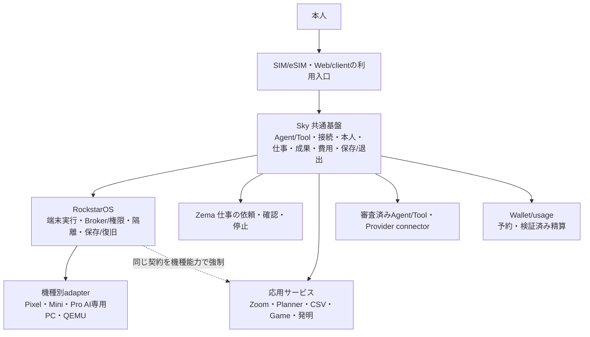
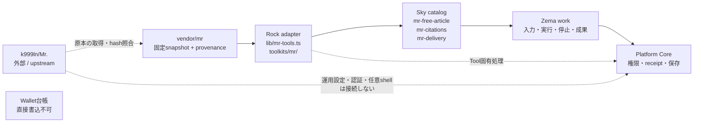
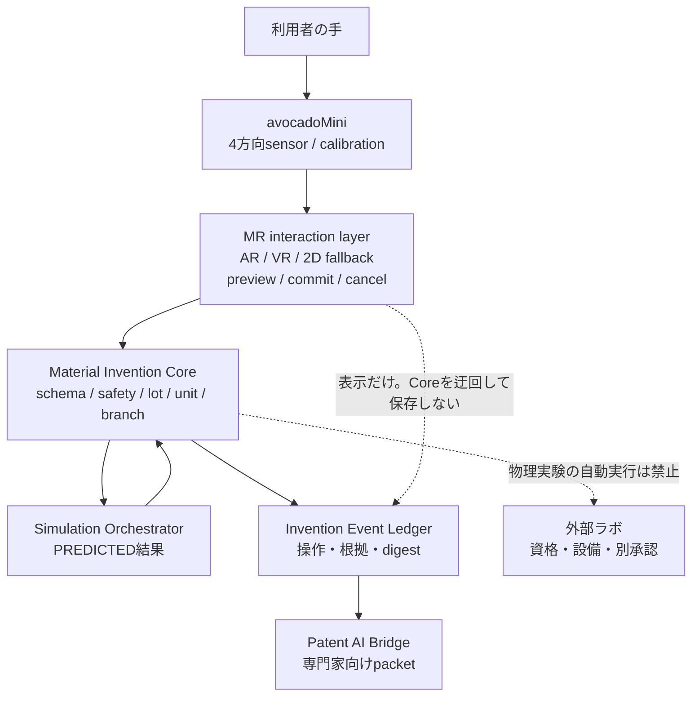
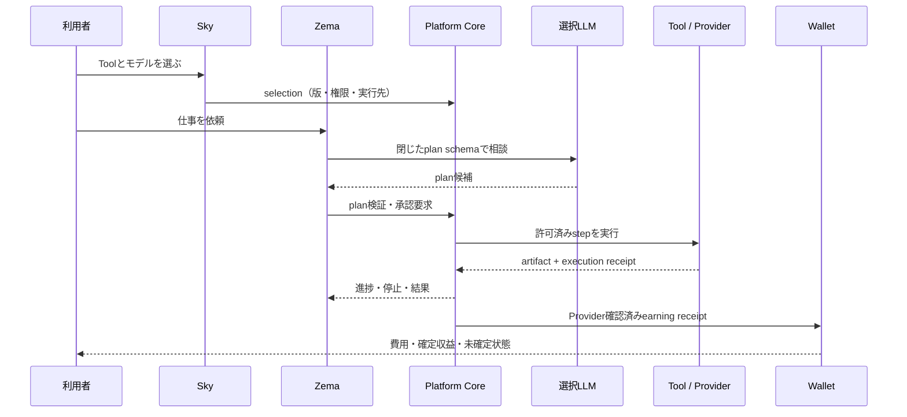

## 現行の大元：RockstarOSの中にSky・Eve・Linux

2026-10-20の本人指示「osが大元」「osの中にskyもeveも」「osの中にlinux」に従い、製品全体の大元は**RockstarOS**とする。OSの中に、能力の登録・追加・接続を担う**Sky**、会話・依頼・計画確認・承認・進捗/停止・成果・利用額のSI窓口である**Eve**、対応するmodel/Agent/Toolを処理する**Linux実行環境**を置く。本人・eSIMサービス利用権・権限・予算・保存/復旧・利用量/請求はOSの共通管理へ結び、Sky/Eve/modelへOS権限を移さない。

利用の流れは、Eveへの依頼→Skyで登録/追加した能力の選択→OSによる本人/利用権/権限/予算の確認→対応Linuxで実行→共通の仕事/成果/使用量→Eveで確認。Skyから機能を選んでEveへ渡す入口も同じOS内にある。TerminalはLinuxを直接扱う任意の操作口で、日常の依頼はEveから行える体験を目指す。クラウドサービスはOS外にある外部実行先で、対応adapterから呼び出す。全クラウドmodel本体を端末内に格納するという意味ではない。

Pixel版はGrapheneOS/Android上の対応Linux guestを使う方針、Mini/Proは機種別のLinux/runtime適合で決め、Pixel用binaryを転用しない。既存のLinux計量・LLM・権限・保存コードを再利用する。これは前の「Skyを全体の大元」とする説明を利用者が訂正した設計階層の修正であり、全OS image・全機種・全Cloud/使用量統合の完成宣言ではない。月額16ドルの枠付き共通契約、Eveへの呼称統合、保存済みデータと既存IDを引き継ぐ。

## 正式名称：Eve（イヴ、旧称Zema）

2026-10-20、利用者の明示指示「zemaじゃなくてeveにしよadamとeveのeve」により、仕事・会話・進捗・承認・停止・成果・使用額を扱う製品の表示名を **Eve** に変更する。名前の由来はAdamとEveのEve。既存のSky、Jennifer、月額16ドルと利用枠、本人承認・保存・復旧の業務契約を引き継ぐ。文中の旧称Zemaは同じ製品の過去名として読む。

既存の`/chat`、`zema`利用権scope、保存キー、`sky-zema-core` package、公開済みの関数/schema/ファイル識別子は互換性のため保持する。名称変更で既存の会話/仕事/成果を消したり、新規サービス契約/追加課金を開始しない。過去の受入証拠・配布物の名称とhashは当時の記録として保持する。Web sourceの表示・名乗りと、Android APK/OS image・公開環境への反映は別に受け入れる。

## 現行の製品階層：RockstarOS → Sky・Eve・Linux実行環境

2026-10-20の本人訂正により、RockstarOSを製品全体の大元とし、Sky・Eve・Linux実行環境をその内側へ配置する。Skyは能力の登録/追加/接続、EveはSIの依頼/仕事/成果/利用額の窓口、Linuxは対応する処理の実行環境。OSの本人/権限/利用権/予算/保存/復旧を共通に使う。2026-10-18にSkyを全体の大元と記した説明は、この現行方針で訂正する。Web/clientによる利用経路と本人の退出/移行は維持する。

既存Platform Core/Brokerと本人承認、利用権/予算、型付き成果、DB/復旧を再利用する。この階層訂正はOS権限をmodelへ委ねる変更でも、全hardwareへの搭載済み宣言でもない。SIM/eSIMの導入/利用権、RQ01〜RQ49、料金、Provider/Pixel/QEMU/Mini/Proの受入は維持する。[共通契約の11項目とZoom/Planner実装](sky-tools-complete-design.md#sky-foundation)。一般公開は保留。

# RockstarOS 製品・サービス・システム関係図

版: 1.1 / 2026-10-02

状態: **正本補助設計**。製品、サービス、内部システム、`Mr.` 由来Tool、MR（Mixed Reality）端末の関係を一つの図で確認するための文書。各コンポーネントのfield単位の契約は表中のリンク先を正本とする。

2026-10-18訂正: avocadoMiniと**AI専用PCのavocadoPro**もPixelと同じRockstarOS SI Core／Sky／ZemaのDevice Profileにする。共通jobの成果を機種別の確認済み出力へ変換する。Mini R5は現行hardware受入待ち、ProはPC本体・OS・model仕様未確認であり、PixelのGrapheneOS image／Linux VMの互換を推定しない。[機種別契約](device-support-architecture.md#shared-si-device-profiles)。

対外的な主商品は、物理SIM/eSIMの購入を入口にRockstarOS、Sky、Zema、cloud LLMとAgentへアクセスするサービスである。SIM購入にはサービス利用権を含める設計だが、OS binary自体はSIM/eUICCへ保存しない。avocadoは建築・インテリア・サウンドを最初に深く適用する産業領域とし、avocadoMiniを生活空間との物理node候補にする。Miniは別のhardware programで、実機試作と販売は未実施であり、サービス利用の必須端末ではない。

入口は、購入チャネルでのSIM/eSIM offer、Rockstar service onboarding、既存OS client/browser、そして対応機種に限るnative OS導入である。通信開通、利用権claim、アカウント認証、端末へのOS/client導入を別々に確認する。

再設計の共通基準は[RockstarOS 1.0 architecture](rockstaros-1.0-architecture.md#rockstaros-再設計一つの仕事を端末間で完了するサービスos)。UIは利用開始からHome、Sky、Zema、Wallet/Usageへ一本の仕事を見せ、runtimeは本人・利用権・承認・job ID/revision・receiptを共有する。画面・Web・Android・native OSは状態の別コピーを作らず、受入済みの共通contractを利用する。設計反映だけでは既存UIや各runtimeの実装済み状態は変わらない。

SI（スーパーインテリジェンス）専用という製品体験では、RockstarOS内のHomeからクラウドLLM、Sky Marketplace、Zemaを直接開き、一つの仕事として選択・承認・実行・停止・成果を扱う。Sky単体のWeb/PWA入口も維持し、SIM/eSIMは利用開始・利用権の経路として区別する。Cloud Providerと実機native OSの受入は別々に判定する。

月末後払いの追加商材候補は契約account単位のSI Managed Service。明示した契約と支払責任者、料金表、月間cap、支払方法を確認して初回の有償利用から起算し、検証済みusageだけを月末に請求する。eSIM、アプリ、端末は利用・配布の経路または別明細の商材であり、月次契約の成立や収納成功そのものではない。[契約と受入](sky-billing.md#rockstaros-siサービス契約と月末請求の商材案2026-10-18)。

| 入口 | 現在のURL・状態 | 内側にあるもの |
| --- | --- | --- |
| SIM/eSIMサービス案内 | `/connect`、`/rockstaros`。offer/activation、利用権、端末別導入経路を説明。販売契約・回線開通は未接続 | channel-neutral entitlement claim、account link、サービス利用開始 |
| Web/client | `/`、Sky `/sky`、Zema `/chat`、仕事 `/work`。本人限定環境で一部を検証中 | 共通アカウント、Agent依頼、job status/result/usage UI |
| Native OS | `/rockstaros/guide`でDeveloper Preview条件を案内。完成スマートフォンOSは未配布 | 署名済みimage、機種適合・boot/復旧gateを満たす端末向け |

eSIM/物理SIMの回線料金、RockstarOS service access、Cloud LLM/Agent usage、端末代は別契約・別明細として扱う。料金表・provider settlement・carrier activationはproduction acceptance待ちである。

この文書を読めば、次の三つを混同しない。

- RockstarOSは、SIM/eSIMを入口にSky、Zema、cloud LLM/Agentへアクセスするサービスと、その本人性・権限・仕事・復旧を支える共通OS/Core。
- SkyはAgent/Tool・本人・仕事/成果・接続・費用の共通基盤、Zemaは仕事の管理、Walletは費用と確認済み収益を扱う。CSVとメルカリはSky登録済みのチーム担当。Material Invention StudioはSkyで組み合わせる発明チームの複合機能で、単体のcatalog Toolではない。
- avocadoMiniは、現行Material Invention Studioを手で扱う専用deviceであり、将来は受入済みDevice Profileに限って建築・インテリア・サウンドの空間projectへ接続する。OSそのものでもサービス開始の前提でもない。

## 1. 会社が提供するもの

矢印は「機能を呼び出す／契約を通して接続する」関係を表す。製品アプリがDB、Wallet台帳、外部Providerへ直接書き込むことは許可しない。すべてPlatform Core／Connectorを通す。

図の実線は通常の契約接続、点線は参照関係または「境界があり直接接続しない」関係を表す。

## 2. 何と何が関係するか

| 起点 | 接続先 | 関係 | 接続を担当する正本 | 現在地 |
| --- | --- | --- | --- | --- |
| RockstarOS | Sky / Zema / Wallet | OSが共通の画面、権限、仕事、保存を提供 | [OS全体詳細設計](rockstaros-complete-design.md) | Web / APKの限定検証 |
| 物理SIM / eSIM | RockstarOS service access | 購入offerがservice entitlementを含む。carrier activation、claim、OS/client導入は別状態 | [SIM/eSIM claim設計](sim-service-entitlement-claims.md) | signed claimとlocal owner bindingは実装済み。carrier、distribution、production billingは未受入 |
| Sky | Tool / MCP | Toolの発見、作者・版・権限・実行先の確認、接続 | [全Tool詳細設計](sky-tools-complete-design.md) | ready Tool 12件、provider接続は段階導入 |
| Sky | CSV業務 / メルカリ収益ループ | `rockstar-csv-cleanup`と`mercari-revenue`をチーム担当として選び、専用画面へ進む | [全Tool詳細設計](sky-tools-complete-design.md) / [Business Pilots](workstreams/09-business-pilots.md) | catalogはready。外部市場の操作とProvider入金照合は別受入 |
| Sky | Material Invention Studio | Core、simulation、Patent AIなどを発明チームとして組み合わせる構想。Studio自体は単体Toolに数えない | [Material Core](material-invention-core.md) / [空間発明設計](rockstaros-avocado-mini-complete-design.md) | Core sandboxのみ実装。操作画面とSky接続は未実装 |
| Zema | Platform Core | 依頼、計画、承認、実行、停止、結果確認を一つのworkにする | [Platform Core](platform-core.md) | 共通契約と一部実装 |
| Wallet | Settlement Worker / Provider | 完了した仕事と確定入金を分離し、Receiptで照合する | [Sky billing](sky-billing.md) | fixture / sandbox、実払出しは未接続 |
| LLM Runtime | Agent Runtime | 選択されたLLMがplanを返し、Agentが許可済み手順だけを実行 | [AI-native OS設計](ai-native-os-architecture.md) / [Decision Fabric](jev-local-qwen-decision-fabric-design.md) | Qwen機内モードと固定runtimeを検証中 |
| Platform Core | Local LLM / Cloud LLM / 自社LLM | モデルは交換可能。権限付与とTool実行はモデルの外に残す | [Local AI契約](../contracts/local-ai-runtime.json) | 既存モデルを先に搭載、自社LLMは追加接続 |
| avocadoMini | Material Invention Studio／空間project | 現行はdigital twinの専用入力・表示機器。将来の建築・interior・sound接続は別Device Profileと実空間pilotで受け入れる | [avocadoMini設計](rockstaros-avocado-mini-complete-design.md) | 方針・設計 / Bench・実空間pilot前 |
| Material Invention Studio | Material Invention Core | 発明チームの将来の操作画面から物質候補、制約、安全状態、simulation結果をCoreへ渡す | [Material Core](material-invention-core.md) | Core sandbox実装、Studio操作画面と物理設備は未接続 |
| Material Invention Core | Patent AI Bridge | 人・AI・文献・予測・実測を分けて発明資料へ整理 | [空間発明設計](rockstaros-avocado-mini-complete-design.md) | 接続設計、特許性・出願の自動判断はしない |

## 3. `Mr.` 由来Toolの位置づけ

`Mr.` はRockstarOSそのものではない。`k999ln/Mr.` の固定snapshotから一部Toolを取り込み、RockstarOSのSky商品として接続している。`Mr.` の運用設定、認証情報、旧Hub全体をOSへ移植していない。

取り込んだToolはRockstarOSの契約、権限、resource制限、成果schema、receiptを通す。`Mr.` の原本とRock adapterはsource、license、hash、入出力が一致しない限り同一実装・同一商品と表示しない。詳細は[Mr.取り込み](mr-integration.md)と[Gitプロジェクト統合方針](git-consolidation.md)を参照する。

## 4. MR（Mixed Reality）とOSの関係

MRはRockstarOSの全体名称ではなく、avocadoMiniの操作方式である。AR、VR、2Dは同じMaterial Invention projectを別の見方で扱う。MR表示が候補を作っても、候補の確定、安全判定、simulation、履歴保存はMaterial Invention Coreだけが行う。

| MRでできること | MRでできないこと |
| --- | --- |
| digital twinを選ぶ、近付ける、接続previewを出す | 実物の材料を混ぜる、加熱する、装置を動かす |
| 候補branchを作る、比率・工程条件を比較する | simulationを実測と表示する |
| 2D fallbackで同じprojectを確認する | gestureだけで特許性、発明者、出願を確定する |

## 5. 利用者の一周とデータの流れ

再設計では一周の各画面を一つのjobへ結ぶ。Homeは継続中の仕事と本人に必要な次の操作、Skyは選択した能力と接続/権限、Zemaは入力から停止・成果までのjob state、Walletは見積/予約/確定usageを受け持つ。端末を替えた時は同じowner・job ID・revisionを再取得する。offline/unknown時は保存済み情報と同期時刻を示し、未送信下書きを実行済みjobとして扱わない。

この一周で、LLMの提案、Toolの実行、成果物、Providerの入金、Walletの精算を別イベントとして保持する。仕事が完了しただけでは売上にしない。

## 6. 正本の読み分け

| 知りたいこと | 正本 |
| --- | --- |
| 会社の製品構成と関係 | 本書（この関係図） |
| OS全体の責任・状態・復旧 | [RockstarOS全体詳細設計](rockstaros-complete-design.md) |
| Sky / Zema / Toolの契約 | [Sky／Zema／全Tool詳細設計](sky-tools-complete-design.md) |
| LLMの交換・判断・権限境界 | [Decision Fabric](jev-local-qwen-decision-fabric-design.md) / [Local AI契約](../contracts/local-ai-runtime.json) |
| `Mr.` からの取り込み範囲 | [Mr.取り込み](mr-integration.md) |
| MR / avocadoMiniの操作・筐体 | [空間発明設計](rockstaros-avocado-mini-complete-design.md) / [Hardware詳細](avocado-mini-hardware-design.md) |
| 発明候補と安全境界 | [Material Invention Core](material-invention-core.md) |
| 費用・収益・払出し | [Sky billing](sky-billing.md) / [Rock Wallet](rock-wallet-production-rail-20260913.md) |

## 7. 設計上の禁止される短絡

- `avocadoMini = RockstarOS` と表示しない。avocadoMiniはOSを搭載する専用デバイス。
- `LLM = Agent = Tool` と表示しない。LLMは提案、Agentは手順、Toolは個別処理を担当する。
- `Mr. = RockstarOS` と表示しない。Mr.は一部Toolの原本・参照元。
- `Tool完了 = 売上` と表示しない。Provider確認済みReceiptが必要。
- `MR表示 = 物理実験` と表示しない。物理設備は別Provider、別資格、別承認。
