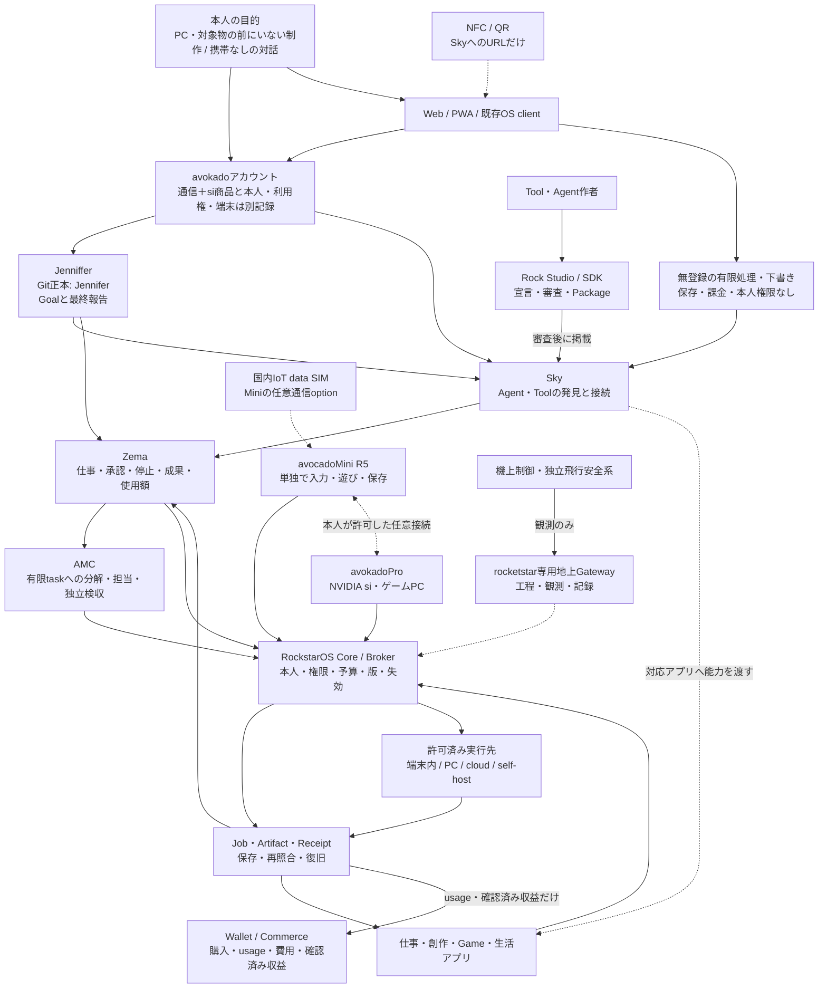
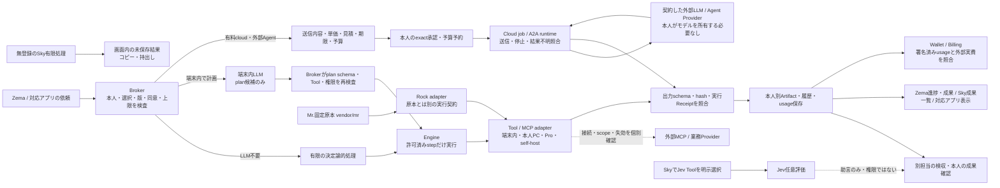
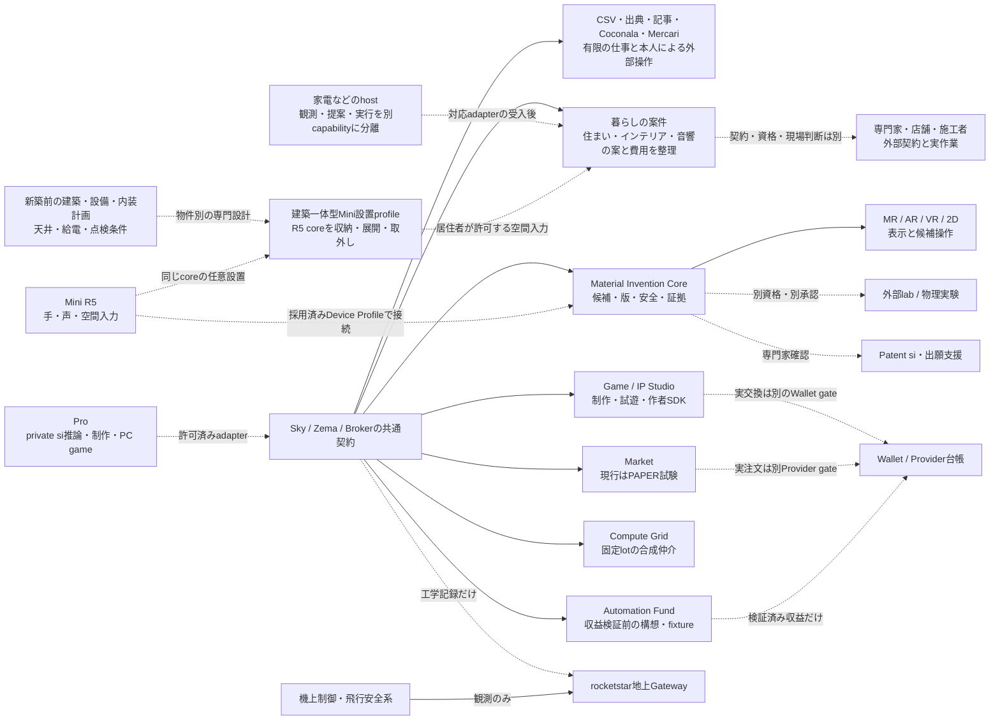

# RockstarOS 製品・サービス・システム関係図

版: 2.2 / 2026-10-15 / 全体接続と実行状態を明示

**商品入口は、eSIMの通信とsi利用権をまとめて提供するサービス。** 2026-10-15の本人選択に基づく。accountは本人・契約・仕事・成果・予算の正本、OS導入は対応機種ごとの別工程。無料試用/client/browser経路を維持する。[6層の基盤とGrapheneOSの改変可能性](native-os-integration.md)から読む。

データの取得・保存・共有・削除、契約相手と費用、異種規格の役割、不足の補完と改修順は[関連・戦略・データ・取引の調査設計](service-design/07-ecosystem-strategy-and-data.md)を参照する。一次資料39件とrepository sourceを区別し、線があることを接続完了にしない。

2026-10-15の[制作と対話の要件](service-design/01-service-experience.md#携帯を持たずpcや対象物の前にもいない制作体験)を全体へ適用する。制作の入口はMini/対応host、計算先は任意のPro/cloud等、現物の製作先は権限を持つ設備/製作者で分ける。案の保存・製作引渡し・現物完成を同じ成功にしない。

## 利用者が出会うもの

Jenniferは利用者が話す全体の統括窓口。Skyは能力を見つけて接続する場所。ZemaはJenniferの裏で依頼・進捗・確認・停止・成果・使用額を管理する仕事system。RockstarOSは本人、有限権限、実行、保存、復旧を守る共通runtimeと、対応機種向けnative OSである。

Miniは身体・手・日本語音声による独立空間端末、ProはNVIDIAのGPU/chipを使う独立高性能si PC（PCゲームも保持）、rocketstarは独立した衛星輸送・回収・再使用の工学program。JennifferのGit表記はJennifer。[JenniferのGit正本](https://github.com/k999ln/rock/blob/3349c2475468443bc7ecd94a4e3782343f514a8f/docs/jennifer-coordination.md)はPR #113からmainへ統合済み（`01d2e418`）。Jevとは別system。

### 1. 製品・サービス・端末の全体図

実線は責任上の接続、点線は任意・限定の接続であり、線の存在を本番接続済みの証拠にしない。Sky直接操作や対応アプリの有限処理にはJennifferとの会話を必須にしない。MiniはProやSIMなしで基本動作を成立させる。rocketstarの機上制御へ一般Agentから命令を送る経路はない。Web、Android、QEMU、native OSが同じDBを共有済みという意味でもない。

## 入口の設計

- 通常URL、Web/PWA、既存OS clientから同じサービスへ入る。Skyの最新公開URLは `https://avoado.si/os/sky`、本人確認は自前passkey、通知はWeb Pushを先に作る確定方針。実装・公開・復旧は個別受入。
- NFC/QRはSkyへのHTTPS URL。mainはColumbia英語の出典整理・AMC・特許アシスタントを先に扱う。NFCから本人性・学生資格・利用権を作らない。5大学共用候補は元作業コピーと比較して受け入れる。
- native OSは正確な機種へ署名済みimage、boot、権限、保存、復旧が合格した時だけ案内する。Pixel試験APK、QEMU、browserをfull OSへ換算しない。
- consumer eSIM発行/販売は保留。Miniの国内LTE/IoT data SIMは任意通信optionで、回線なしMiniも保持する。回線・service entitlement・本人・OS/client導入は独立状態。

Jenniferの会話方式は共通だが、社内portfolioと一般利用者の案件は別の認証/保存領域。Sky直接操作・host appも同じZema仕事へ接続し、会話画面への迂回を必須にしない。記録正本、参照ID、予算階層、停止/精算/削除は[横断整合契約](service-design/06-consistency-contracts.md)へ固定する。

## 実行と成果の流れ

本人の依頼→JenniferのGoal整理→SkyのTool/Agent選択→裏側Zema/AMCまたは対応アプリで条件確認→Coreで本人/版/権限/見積/上限を再検査→adapter実行→結果schema/receipt照合→成果保存→本人検収/取得→項目別usage/決済照合。

### 2. LLM・Agent・Toolがつながる実行経路

ここでいうAgentは、目標を有限の仕事へ分け、許可された実行先へ渡し、停止・再取得・検収まで追う仕事の仕組みである。LLMはその一部で、自然文からの計画や文章生成に必要な経路だけで使う。決定論的ToolはLLMなしで実行できる。無登録のSky有限処理は画面内の未保存出力に止まり、本人別Job保存や有料Agent実行へ自動昇格しない。LLM、Jev、外部Agentの自己申告をTool成功・本人承認・Wallet確定へ変換しない。Cloud ProviderはRock側の契約・設定を使う想定で、利用者が自前のLLMを持つことを開始条件にしない。BYOKは任意の別設定である。

### 3. 応用領域と物理作用の境界

`Mr.`は旧repository由来のTool原本、`MR`はMixed Realityの入力・表示方式であり別物。Gameの点数は実資金、材料simulationは実測、地上でのsi提案は飛行許可にならない。外部納品・公開・課金・実資金・物理作用・飛行は、それぞれ個別の承認と受入を通す。

**暮らしへの接続**は、住まいの間取り・インテリア・音響を一つの案件として、Skyで必要なToolや専門家を探し、Zemaで案・資料・見積・本人の判断・成果を追うこと。新築前からMiniの収納/展開と給電/点検を建築・設備・内装計画に組み込み、居住者が許可した空間入力へつなぐ構想を加えた。これはR5 coreの任意設置profileで、建物/Pro/cloudをMini単体の必須条件にしない。対象天井の適合、施工、安全、保守と居住者のprivacyは別受入である。家電は「観測→提案→本人確認→実行→結果照合」を別capabilityとして設計する。現在の公開Skyには対応冷蔵庫・店舗の本番adapterはなく、発注や機器操作、建築判断・施工を図の矢印だけで実行できるとは扱わない。[Mini建築一体型の設計条件](avocado-mini-r5/README.md#建築一体型miniの設置profile2026-10-14)と[異種hostの契約](sky-mcp-architecture.md#異種hostと複数agentの融合契約)に接続条件を定める。

### 4. 2026-10-14の接続状態

| 経路 | 確認できた範囲 | まだ接続・受入していない範囲 |
| --- | --- | --- |
| Skyの有限処理 | 出典整理等の決まったWeb処理と成果保存のsource。Pixelの17項目テストは8実処理・9模擬 | テスト結果をAgent実行、外部検索、Provider成果へ換算しない |
| Pixelの端末内LLM | 以前の試験署名APKで固定Qwen profileを実証 | 今回の端末読取は`no_model`。現行PixelのZema自然文依頼→モデル→Toolの一周は未受入 |
| Jennifer / Zema / AMC | Goal草案、限定分解、本人承認、仕事・A2Aのsourceとfixture | COLOMBIA原本、本番Provider配備・資格情報、月予算/後払い、native同等UIの受入 |
| Cloud LLM / A2A | 見積、予算、委任、usage Receiptのsourceと局所fixture | 本番model/Agent Provider、実meter・請求・取消・復旧の同一環境受入 |
| 暮らし・建築・異種host | Skyの能力宣言・読取/提案/実行分離、Zemaの仕事管理、Miniの建築一体型設置profileと空間入力を設計 | 天井別の実寸適合、実施工・点検・復旧、住まいの専門家連携、対応家電・店舗adapter、実注文や機器動作の受入 |
| Mini / Pro / rocketstar | R5、Pro P0、rocketstar R1.0の設計と個別のprototype/試験記録 | Mini・Pro製品実機、全OS image、製造・販売、rocketstarの製造・飛行受入 |

この表は設計書・source・2026-10-14のPixel読取を区別した現在地である。`ready`というcatalog表示、図の矢印、過去の別環境試験だけで本番利用可能とは表示しない。[実現順と受入](service-design/04-delivery-and-acceptance.md)と[LLMの現在地](llm-evaluation-architecture.md)で次の合格証拠を確認する。

仕事状態は既存Webの`active/review/completed/cancelled`を使う。承認待ち・通信待ち・外部結果不明は子処理と画面の状態で説明する。保存応答が不明なら同じIDを照合し、自動再送しない。親の取消と外部停止確認は別である。

外部納品・公開・課金・実資金・物理作用・飛行は、生成やファイル取得と別の承認/受入。Game交換、作者SDK、Material digital twin、Wallet/ファンドの既存要求を維持する。非金融Game/創作を金融完成待ちにはしない。

## 料金の関係

アカウント無料、期間パス、従量のしきい値後払い・本人月上限、回線つき機器の基本料という[アカウント入口の確定方針](product-baseline.md)を継承する。残高は持たない。商品代・si原価/上乗せ・外部実費・回線・税等を別に説明する。しきい値1,000円は決済時点で、無条件の実行予算ではない。

Tool売上のSky feeは当面10%。0%の定義と切替条件、作者払出しはbaselineへ従う。旧888 cents成功報酬系はexecutionHoldsを維持する。現行funded Wallet gateと後払いの移行契約、passkey、実meter/請求/返金は未受入。文書でpaid gateを解除しない。

## Mr.由来ToolとMR研究を分ける

`Mr.`は固定原本`vendor/mr`をadapterで接続する既存Tool系列。原本とhashを変更せず、adapter変更時に `python3 scripts/package-mr.py` で配布物を更新する。類似名のWeb/Android/native Toolを同一実体と決めつけない。

MRはMixed Realityの表現・入力profile。Material Invention Studioは同じproject/Asset/候補をAR/VR/2D等で扱う研究系で、catalogの単一商品実体と混同しない。R5の全空間裸眼表示と単独mini要求を、旧四方向台・E3の4本/別Hubへ戻さない。

## 正本と詳しい契約

- サービス全体は[統合設計](service-design/README.md)、要望は[baseline](product-baseline.md)と[JSON](../data/product-baseline.json)。
- OS/componentは[全体詳細](rockstaros-complete-design.md)、Toolは[全Tool詳細](sky-tools-complete-design.md)、LLM/Jevは[LLM正本](llm-evaluation-architecture.md)。
- Miniは[R5](avocado-mini-r5/README.md)と[通信option](avocado-mini-cellular.md)、Proは[P0](avokado-pro-pc-design.md)、rocketstarは[R1.0原本](rocketstar-design/README.md)。
- 実現順と未決事項は[受入計画](service-design/04-delivery-and-acceptance.md)、進捗と担当は[project status](../data/project-status.json)と[Mission Control](mission-control.md)。

設計を共有することと、実装・配備・物理端末・本番Providerを合格させることは別である。
