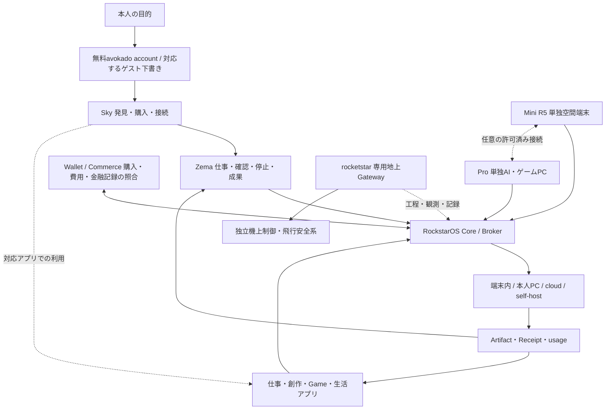

# RockstarOS 製品・サービス・システム関係図

版: 2.0 / 2026-10-13 / サービス設計の再構成

**主商品は、無料avokadoアカウントひとつでSky・Zema・AI Agentを使い、成果を仕事・創作・ゲーム・生活へ持ち帰るサービス。** 最新確定は[2026-10-10のアカウント方針](product-baseline.md)。SIM/eSIM購入を利用開始の必須条件に戻さない。新しい説明の全体は[サービス統合設計](service-design/README.md)を先に読む。

## 利用者が出会うもの

Skyは能力を見つけて接続する場所。Zemaは依頼を仕事にして進捗・確認・停止・成果・使用額を見渡す場所。RockstarOSは本人、有限権限、実行、保存、復旧を守る共通runtimeと、対応機種向けnative OSである。

Miniは身体・手・日本語音声による独立空間端末、ProはNVIDIAを使う独立AI・PCゲームPC、rocketstarは独立した衛星輸送・回収・再使用の工学program。Jennifferは利用者が指定した名称で、役割の正本は確認中。Jevの改名として扱わない。

矢印は到達設計の責任と接続契約。全接続・同じDB・cross-origin認証を完成済みとは扱わない。LLM/Tool/画面は権限を決めず、Brokerが本人とexactな条件を検査する。

## 入口の設計

- 通常URL、Web/PWA、既存OS clientから同じサービスへ入る。Skyの目標URLは `https://avocadomini.si/sky`、本人確認は自前passkey、通知はWeb Pushを先に作る確定方針。実装・公開・復旧は個別受入。
- NFC/QRはSkyへのHTTPS URL。mainはColumbia英語の出典整理・AMC・特許アシスタントを先に扱う。NFCから本人性・学生資格・利用権を作らない。5大学共用候補は元作業コピーと比較して受け入れる。
- native OSは正確な機種へ署名済みimage、boot、権限、保存、復旧が合格した時だけ案内する。Pixel試験APK、QEMU、browserをfull OSへ換算しない。
- consumer eSIM発行/販売は保留。Miniの国内LTE/IoT data SIMは任意通信optionで、回線なしMiniも保持する。回線・service entitlement・本人・OS/client導入は独立状態。

## 実行と成果の流れ

本人の依頼→SkyのTool/Agent選択→Zemaまたは対応アプリで条件確認→Coreで本人/版/権限/見積/上限を再検査→adapter実行→結果schema/receipt照合→成果保存→本人検収/取得→項目別usage/決済照合。

仕事状態は既存Webの`active/review/completed/cancelled`を使う。承認待ち・通信待ち・外部結果不明は子処理と画面の状態で説明する。保存応答が不明なら同じIDを照合し、自動再送しない。親の取消と外部停止確認は別である。

外部納品・公開・課金・実資金・物理作用・飛行は、生成やファイル取得と別の承認/受入。Game交換、作者SDK、Material digital twin、Wallet/ファンドの既存要求を維持する。非金融Game/創作を金融完成待ちにはしない。

## 料金の関係

アカウント無料、期間パス、従量のしきい値後払い・本人月上限、回線つき機器の基本料という[確定設計](account-entry-proposal.md)を継承する。残高は持たない。商品代・AI原価/上乗せ・外部実費・回線・税等を別に説明する。しきい値1,000円は決済時点で、無条件の実行予算ではない。

Tool売上のSky feeは当面10%。0%の定義と切替条件、作者払出しはbaselineへ従う。旧888 cents成功報酬系はexecutionHoldsを維持する。現行funded Wallet gateと後払いの移行契約、passkey、実meter/請求/返金は未受入。文書でpaid gateを解除しない。

## Mr.由来ToolとMR研究を分ける

`Mr.`は固定原本`vendor/mr`をadapterで接続する既存Tool系列。原本とhashを変更せず、adapter変更時に `python3 scripts/package-mr.py` で配布物を更新する。類似名のWeb/Android/native Toolを同一実体と決めつけない。

MRはMixed Realityの表現・入力profile。Material Invention Studioは同じproject/Asset/候補をAR/VR/2D等で扱う研究系で、catalogの単一商品実体と混同しない。R5の全空間裸眼表示と単独mini要求を、旧四方向台・E3の4本/別Hubへ戻さない。

## 正本と詳しい契約

- サービス全体は[統合設計](service-design/README.md)、要望は[baseline](product-baseline.md)と[JSON](../data/product-baseline.json)。
- OS/componentは[全体詳細](rockstaros-complete-design.md)、Toolは[全Tool詳細](sky-tools-complete-design.md)、LLM/Jevは[LLM正本](llm-evaluation-architecture.md)。
- Miniは[R5](avocado-mini-r5/README.md)と[通信option](avocado-mini-cellular.md)、Proは[P0](avokado-pro-pc-design.md)、rocketstarは[R1.0原本](rocketstar-design/README.md)。
- 実現順と未決事項は[受入計画](service-design/04-delivery-and-acceptance.md)、進捗と担当は[project status](../data/project-status.json)と[Mission Control](mission-control.md)。

設計を共有することと、実装・配備・物理端末・本番Providerを合格させることは別である。
