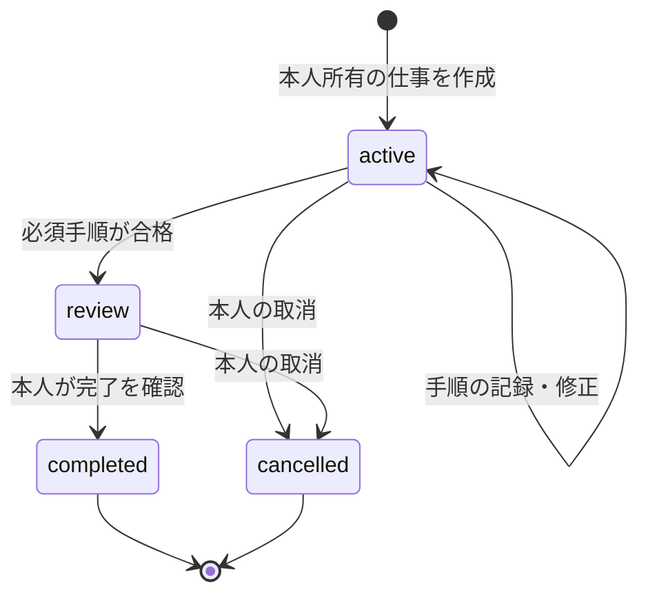

# 共通システムと契約

再構成版 1.0。利用者がどこから操作しても、同じ本人・仕事・権限・成果を説明できる構成を目指す。ここでの統一は契約の統一であり、Web・Android・Linuxの保存先を統合済みと扱わない。

## 1. サービスをつくる責任

**Sky**はcatalog、作者、版、license、価格条件、購入、接続先、対応能力を示す。**Zema**は依頼を有限の仕事へ分解し、現在地、必要確認、停止、成果、費用へ案内する。**Core/Broker**は認証principal、capability、同意、予算、component/入力の版を検査して実行を許可する。**Tool/Provider adapter**は契約で許された個別処理と受信証拠を返す。**Wallet/Commerce**は購入・費用・収益・返金・予約・照合を扱う。

Rockは表示状態の正確さ、本人分離、承認、重複防止、停止と結果不明の処理を持つ。外部Providerはmodel、MCP、決済、通信、hardware等の固有能力を持ち、本人は公開・送信・費用・機器操作の条件を選ぶ。内製Providerにも例外経路を作らない。[責任分界](../workstreams/00-responsibility-boundaries.md)のROCK/EXTERNAL/JOINT/OWNERを全仕事の受入へ残す。

## 2. 実装を再利用する分割

Webは既存Web/API/D1/R2を使うmodule分割を維持する。catalog、connection、job、artifact、commerceを意味のある境界へ分けるが、新しい独立microserviceを名前ごとに増やさない。長時間cloud jobは既存A2A runtimeへ接続する。nativeは[Platform Core](../platform-core.md)と既存Linux/Androidの実装をそれぞれのtransportで使う。

依存方向は **UI → 業務契約 → Broker/権限判定 → adapter → 外部実行先**。LLMがToolを選ぶことと、Toolが許可されることは別である。UI、Tool、Jennifferの将来の役割からDB・台帳・rootへ直通するAPIは用意しない。

再利用先は[workflow](../../lib/workflow.ts)、[本人認証](../../lib/request-auth.ts)、[service access](../../lib/rockstar-service-access.ts)、[catalog](../../lib/catalog.ts)、[A2A委任](../../lib/a2a-delegation-store.ts)、[cloud継続](../sky-cloud-continuity.md)、[SDK](../sky-tool-sdk.md)。adapterの追加で保存・権限・receiptを作り直さない。

## 3. IDと入力の契約

一回の操作を、認証principal由来のowner、project/job ID、表示revision、operation/idempotency ID、Tool/Agentと版、入力digest、実行先、同意scope、見積/予算、期限へ結ぶ。外部APIではそのschemaで定義されたfieldだけを送り、この概念一覧をそのまま新API payloadにはしない。

ownerを本文の自己申告から決めない。同じoperation IDで違う入力を拒否し、revisionが変わった画面からは最新状態を読み直す。model変更・Tool更新・recipe変更で旧承認を再利用しない。secret、原稿、provider tokenをcatalog宣言や診断へ含めない。

成果はartifact ID、job/step、作者/Tool版、入力版、schema、hash、検査結果、retentionを持つ。実行receipt、検収、納品、実入金は異なる証拠。文章の生成成功だけで権利確認・顧客検収・売上確定を行わない。

## 4. 状態を混ぜない

親仕事の現行Web状態は[workflow](../../lib/workflow.ts)の **`active / review / completed / cancelled`**。作成はactive、手順の合格記録を経てreview、本人完了でcompleted、取消でcancelledとなる。step outcomeのfailed/needs_reviewと、親状態を区別する。

下書き、承認待ち、通信待ち、停止確認待ち、照合中は画面表示または子処理の状態として説明する。これらを新しいWorkJob状態として保存する場合はschema・migration・native fixture・復旧を同じ変更で受け入れる。

A2Aは`awaiting_approval`、dispatch系、`working`、`indeterminate`、cancel系、remote終端を別に持つ。[A2A契約](../../lib/a2a-delegation-store.ts)の状態から親画面を投影する。親をcancelledにしたことだけで外部停止や予約解放が成立したとは表示しない。

商品の状態も分解する。`catalogStatus`は掲載分類、`connectionStatus`は接続観測、`executionReadiness`は本人・端末・版・価格・承認条件を満たすか、`acceptanceStage`は検証環境。これらは説明の分類軸で、既存schemaを変更済みとは扱わない。`ready`の一語で全部を代用しない。

## 5. 開始・停止・結果不明

開始前に入力、送信先、外部作用、価格、上限、期限、停止能力を説明する。許可はexactな条件へ固定し、Brokerが開始時に再検査する。cloudの圏外継続は受付確認済みの仕事を、承認済みの上限と期限だけで続ける。

応答喪失は失敗確定にしない。同じoperation/job/delegationをGET照合し、状態が分かるまで自動再送・新しい予約・請求確定を避ける。停止の表示は「停止を要求した」「外部が停止を確認した」「結果不明で照合中」を分ける。取消できないProviderの料金を、即時に0へできると説明しない。

Cloud停止・結果不明の契約は[継続実行](../sky-cloud-continuity.md)、[A2A](../sky-a2a-bridge.md)、nativeは[全体詳細設計](../rockstaros-complete-design.md)を使う。外部通信のない処理だけ、同じ入力・版の有限recipeとして端末内完了を認める。

## 6. 料金とWalletを説明できるようにする

最新確定の設計は[アカウント入口の判断](../account-entry-proposal.md)とbaselineの`accountEntryDecision`である。アカウント無料、期間パスは6か月未満、従量はしきい値1,000円または月末の後払い・初期上乗せ30%、本人が月の上限を指定する。残高を持たず、回線つき機器には別の基本料を設ける。期間パスの自動更新は既定オンを購入画面へ明示し更新前に通知、途中返金は既定なしという既存判断を引き継ぐ。外部確認と実装・本番受入は残る。

利用者に示す金額は、商品代、passの対象、AI/provider原価、上乗せ、外部決済実費、回線基本料、税等の適用条件を別に説明する。30%とSkyのTool売上手数料10%を同じ注文へ無条件に二重適用しない。対象範囲、丸め、税、取消・請求失敗の契約は決めてから同じreceiptへ結ぶ。

実行画面は **事前見積 → 今回の承認上限 → 予約 → 観測usage → 照合済み請求**を並べる。累計しきい値は決済時点であって、実行予算の許可ではない。並列jobと別端末の予約を月上限へ同時に算入し、利用者の上限を勝手に上げない。上限0は新しい有料実行を止めるが、既に発生した債務・停止不能の費用を消す操作にはしない。

現行実装にはfunded Walletを要するpaid dispatch gateがある。**後払い・残高なしへ移るための支払能力判定/予約契約のADRと受入は未完了**。設計書の訂正だけでgateを外さず、postpay adapterと同意・meter・同時予約・請求照合が受け入れられるまで現行の実行保留を維持する。既存native合成Walletは回帰系統として残す。

旧月888 centsの成功報酬系は[料金保留](../product-baseline.md)とMission ControlのexecutionHoldsを維持する。ATMのRock手数料0、ゲーム料金未定、検証済み売上10%、条件達成後のSky取り分0%への切替を混ぜない。金融履歴・収益照合のWalletと、消費者のstored balanceは別概念である。

## 7. 本人と複数端末

到達設計はひとつのavokado accountと自前passkey。現行認証を移行済みとせず、登録、端末追加、紛失、credential失効、復旧、owner A/Bの分離を受け入れる。端末内の顔候補、NFC、SIM、modelの返答だけで本人確認を済ませない。

service access、購入済みPackage、接続済みProvider、実行scope、支出承認は別。現在のpreviewでは利用権強制が設定依存であることを[service access](../../lib/rockstar-service-access.ts)へ照合する。単一authority deviceのAI05を、Gridや複数clientの追加だけで移管済みにしない。

## 8. 保存・削除・復旧

既存owner別D1/SQLite、R2/保護file、revision/CAS、暗号化backupを再利用する。main・公開Site・端末が異なる保存契約を持つ場合は、同じsourceでの移行とreadbackまで別管理する。レシピに原稿・会話・旧成果・旧承認・receiptを移さない。編集成果は原成果を保持し、新しい仕事で再検査する。

保存応答喪失、認証切れ、reload、process終了、disk不足、壊れたbackup、未知schemaに対する復旧を定義する。照合できない状態で「保存完了」を出さず、未知schemaを初期化しない。削除後のsnapshot復元でデータを復活させないためのjournal replayは未完の既知課題を残す。

将来のhost app成果連携は、本人/recipient/scope/期限/失効、artifact schema、hash、truncation、表示revisionを検査する。現在の手元Fitness plugin候補を外部cross-origin SDKの完成にしない。成果の表示許可と外部公開・送信・機器作用の許可を分ける。

## 9. AI、ゲーム、発明、物理作用

端末内LLMは非信頼planner、cloud generatorとJevは明示接続する処理役/評価役。全modelの結果はadvisoryで、本人承認・Tool成功・Wallet確定へ昇格しない。[LLM正本](../llm-evaluation-architecture.md)を維持し、対応端末のlocal能力を全機種必須にしない。

非金融のGame/創作/Material digital twinは同じAsset・provenance・jobへ接続する。GTAは版・server・権限を固定したadapter、交換はRQ13、作者SDKはRQ14、物質の実操作は外部lab、rocketstarは独立制御と安全系のgateを通す。plan、simulation、表示、物理成功を別に記録する。

### Sky Compute Grid（RQ50）

余剰スマホ計算力の仲介はSkyの追加能力で、通常の本人PC/cloud adapterと同一の「実行可能」表示へ混ぜない。`CapacityOffer / ComputeOrder / ComputeLease`を使い、初期供給はAndroid arm64、充電中・idle・unmetered network・thermal none/light。ownerが端末を使い始めたら中断する。公開/合成textを固定runtime/model/tokenizerでembeddingする中断可能lotだけを扱う。

端末自己申告を成功にせず、独立参照計算または別lease quorumで検査する。owner identityと正確な位置を買い手へ公開しない。未指定のcloud fallback、任意code、秘密/個人情報、実資金Wallet記帳・実請求・実払出しは許可しない。現段階のtest credits holdを収益へ換算しない。mainへ未統合のGrid PRも保全比較し、同一artifact/実端末/精算は別受入。[Grid正本](../sky-compute-grid.md)。

## 10. 変更を合格にする証拠

正常な一周に加え、owner A/B、期限切れ、revision競合、更新/失効、同じIDの再送、結果不明、予算超過、停止、再起動、artifact再取得を同じ候補で受け入れる。host、fixture、provider sandbox、仮想OS、物理端末、本番を別欄に記録する。

入力schema・権限・状態・保存を変える実装は[11必須項目](../../data/design-document-index.json)と対応する全体/Tool詳細を更新し、`npm run design:check` と `npm run verify` を通す。新たな未決事項は[実現順](04-delivery-and-acceptance.md)の決定者と合格条件へ結ぶ。
