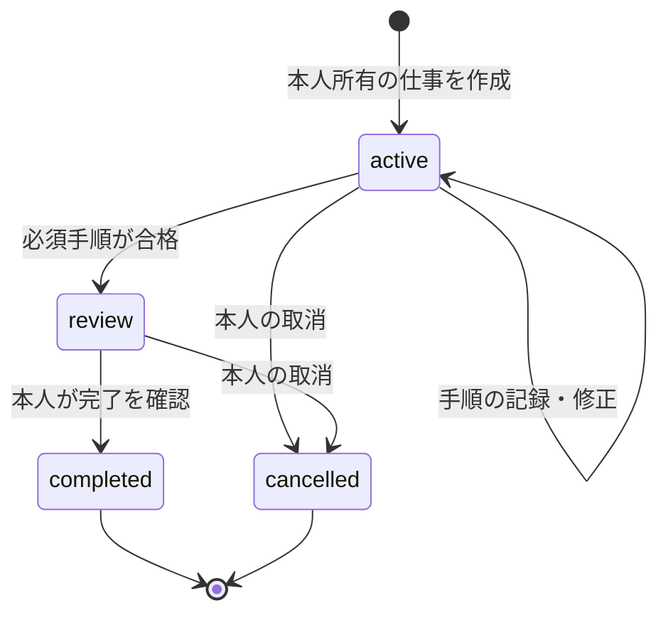

## eSIM/Linux保存時authorityの限定採用

回線profile・本人/利用権・OS/client導入を分け、既存利用権からのLinux commandは[同一commitの現行authority契約](../rockstaros-complete-design.md#esim-runtime-commit-authority)で再照合する。新しい同意/請求/料金を作らず、既存月888c・owner/revision・予約/late CPUを保持。owner-sessionでの保存データread/exportは独立永続ACL/期限判断とは区別し、汎用attachment・本番D1・実課金は別gate。[根拠](../evidence/development-execution/esim-runtime-main-adoption.json)。

2026-10-17本人指示: Skyは、みんなが使いたい能力を持ち寄り、ソフト・機器・家具・建築へ追加・交換するaddプラグインの入口。機能・作者・接続先を固定せず、公式専用枠を設けない。「公式」を必須条件や自動選択の優遇理由にしない。LLM/Agent/Tool/recipe/表示/host adapterは各能力契約で接続する。作者・版・互換・権限・費用・検証実績を共通条件で扱い、Pixel固定catalogは検証範囲として区別する。[目的・体験・責任・保存・状態・復旧・承認・未実行受入](../sky-mcp-architecture.md#使いたいものを追加するaddプラグイン基盤)。

# 共通システムと契約

2026-10-15確定: RockstarOSはJennifer・Sky・Zemaを統合し、各サービスは単体でも利用できる。Sky単体でAgentの選択・接続・実行・usage計測・月次請求・入金確認まで成立させ、Jennifer/Zema/native OS/Mini/SIMを必須にしない。Zemaは同じ明細を参照する。[責任・保存・復旧・独立利用の受入](../sky-billing.md)は設計であり、本番課金受入ではない。

再構成版 1.0。利用者がどこから操作しても、同じ本人・仕事・権限・成果を説明できる構成を目指す。ここでの統一は契約の統一であり、Web・Android・Linuxの保存先を統合済みと扱わない。

2026-10-15の商品入口は[通信＋si利用権bundle](../native-os-integration.md)。無料accountは本人と仕事の正本、eSIMは回線、OS導入は機種別、cloudは予算付き実行として分ける。以下の料金/状態/権限契約を再利用し、購入で無制限実行やOS書込みを許可しない。

## 1. サービスをつくる責任

**Jennifer**は利用者の窓口として目的/Goalと担当si、確認、成果受領を統括する。**Sky**はcatalog、作者、版、license、価格条件、購入、接続先、対応能力を示す。**Zema**はJenniferの裏の仕事systemとして、AMCで確認済みGoalを有限の仕事へ分解し、現在地、必要確認、停止、成果、費用へ案内する。**Core/Broker**は認証principal、capability、同意、予算、component/入力の版を検査して実行を許可する。**Tool/Provider adapter**は契約で許された個別処理と受信証拠を返す。**Wallet/Commerce**は購入・費用・収益・返金・予約・照合を扱う。

Rockは表示状態の正確さ、本人分離、承認、重複防止、停止と結果不明の処理を持つ。外部Providerはmodel、MCP、決済、通信、hardware等の固有能力を持ち、本人は公開・送信・費用・機器操作の条件を選ぶ。内製Providerにも例外経路を作らない。[責任分界](../workstreams/00-responsibility-boundaries.md)のROCK/EXTERNAL/JOINT/OWNERを全仕事の受入へ残す。

## 2. 実装を再利用する分割

Webは既存Web/API/D1/R2を使うmodule分割を維持する。catalog、connection、job、artifact、commerceを意味のある境界へ分けるが、新しい独立microserviceを名前ごとに増やさない。長時間cloud jobは既存A2A runtimeへ接続する。nativeは[Platform Core](../platform-core.md)と既存Linux/Androidの実装をそれぞれのtransportで使う。

依存方向は **UI → 業務契約 → Broker/権限判定 → adapter → 外部実行先**。LLMがToolを選ぶことと、Toolが許可されることは別である。UI、Tool、JenniferからDB・台帳・rootへ直通するAPIは用意しない。

再利用先は[workflow](../../lib/workflow.ts)、[本人認証](../../lib/request-auth.ts)、[service access](../../lib/rockstar-service-access.ts)、[catalog](../../lib/catalog.ts)、[A2A委任](../../lib/a2a-delegation-store.ts)、[cloud継続](../sky-cloud-continuity.md)、[SDK](../sky-tool-sdk.md)。adapterの追加で保存・権限・receiptを作り直さない。

各仕事の記録正本は保存realmとauthorityを一つに固定する。WebはAPI policy/D1/R2、AndroidはUID Broker/SQLite、QEMUはPlatform Core、Miniはlocal runtimeを使い、他surfaceはclient/projectionになる。共通契約は一つのBroker process/DBを共有済みという意味ではない。[参照連鎖、階層予算、停止/精算/削除の投影](06-consistency-contracts.md)を実装時の拘束条件とする。

[Pixel実装設計](../native-os-integration.md#pixel-si専用端末の実装設計)はこれを具体化する。local-onlyはAndroid正本、cloud受付後はD1正本とし、端末cache/未送信commandを別に扱う。混合工程のroot authority、親参照、委任/成果/停止の対応adapterは未受入であり、同じ仕事を二つのDBへ独立に確定しない。既存device transportを再利用し、ShellのHOME未対応、Brokerの既存通信権限、料金/Provider gateの現状を保持する。

### Eve・Smith・miiの同じ仕事

利用者はEveで担当の名前、目的、入力と期待成果、Agent設定を確認して本人別に保存する。Smithは本人が確認した構造化能力をPackageの版・入出力・実行先と照合し、不足や未確認を残す。OSは既存Agent ID/revisionと既存work jobを結び、MCPで確認した正確な引数に一回の操作を発行する。miiソフトadapterは同じowner/job/Agentを読戻し、表示を権限移転と扱わない。

Smithは担当が列挙していないToolの必須入力を不足、schemaを確認できない場合を未確認とする。明示された空object schemaは無入力として扱える。入出力schemaの型と必須項目を表示し、本人が担当の希望と照らして確認した後に仕事の確認画面へ進む。確認は本人・担当版・要件・Packageに結び、取消、変更、期限切れ、読直しで無効化する。非同期照合中の取消と再確認は別の操作であり、古い遷移を復活させない。本人が明示する入出力型・能力ID・許容permission/scope・接続先と実Toolを、PackageとTool双方の版付き宣言と決定的に照合する。省略や宣言欠落は未確認、明示矛盾は不足とし、network・external_account・selected_files・financial_actionの提供者scopeが空なら対象未確認とする。read_user_input・write_results等のscope空は対象範囲を伴わない宣言として扱う。beginとclaimでも対象と版を再確認する。旧clientが既存条件を変更して消す操作は拒否する。旧Agentは新画面で新条件が未設定なら未確認となり、本人による明示設定が必要。旧jobの読取と従来APIの互換は別に維持する。自由文の意味理解は行わない。schema表示の確認を実行権限やToolの安全性にしない。[独立検収・試験](../evidence/development-execution/smith-schema-confirmation.json)／[能力条件の独立検収・試験](../evidence/development-execution/smith-declared-capability-matching.json)。 SDK 0.1.4の配布archiveから展開した2つの作例でも同じ照合と既存仕事・合成mii読戻しを試験する。実接続・一般の第三者Toolの安全性・本番公開を証明しない。[配布作例の証拠](../evidence/development-execution/sdk-declared-example.json)。

合成ブラウザ縦断では、異なる二つの担当に加え、未対応の入力・成果を指定する第三担当を保存して同じ本人として読戻し、不足表示後にjob作成・Tool呼出・claimが増えないことを確認する。同じ仕事の合成成果本文は保存、mii再接続画面、再読込、本人exportでhashを照合する。実機・本番の受入には転用しない。[証拠](../evidence/development-execution/eve-smith-unmatched-hash-browser.json)。

保存と失敗: jobに操作ID・Tool版・入力hash・未確認の応答を残す。60秒の一回限りcapabilityはhashのみjobへ保存し、応答消失を自動再送しない。Connectorは対象引数、現在のschema・実行先、serverの一回claimを確認後にToolを呼ぶ。取消先勝ちならclaimを拒否し、claim先勝ち後の取消は停止要求として残して実行先の停止を未確認とする。claim後の不可逆作用を取消済みと表示しない。表示した成果はclient観測であり署名済みreceiptではない。

今回の実行authorityは既存local-preview ID、明示したscope非強制、loopback、cookieや別credentialなしの開発環境に限定する。verified Package、freeの提供者申告、schema一致は未知Tool全体の安全性や実料金を保証しない。通常account/eSIMの実行authority・実mii入力/物理停止・有料実行/費用照合は別の実装と受入が必要。owner切替・旧版・失効・不明応答・停止競合・再接続、2種の入力出力と未対応能力を同じ候補で試験する。

担当付き新規仕事の現行画面は、Tool・実行先・具体的なJSON入力・提供者の未検証料金申告を表示し、本人確認の後にjobを作る。確認記録は本人scope・Agent版・Package manifest・runtime・入力hashを結ぶclient観測であり、実行権限や検証済み料金ではない。確認は短命で、条件変更・本人切替・期限切れで失効し、APIと保存SQLで版と期限を再検査する。POST結果不明は同じ本人・ID・不変digestをGETで照合し、未存在でも自動再送しない。再書込みは同じ内容の新しい確認が必要。旧形式job／clientの保存互換を維持し、確認記録がないものを確認済みと見せない。実行時には既存の別の一回承認・claimが必要。[証拠](../evidence/development-execution/f3-creation-disclosure.json)。

新しい担当付き仕事で実行時確認を省けないよう、作成時確認を持つjobはbeginとclaimの両方で実行時snapshotを必須にする。本人scope、jobと担当の版、Package/manifest、ConnectorのTool・入力・transport・schema digestと未検証料金申告を同じ操作へ結び、claim時に実Connectorの一回承認と照合する。作成時確認は保持し、入力等が変わった場合の差分を履歴と本人exportに示す。旧jobの旧形式は従来のgateを維持し、未記録を確認済みと見せない。取消・期限・変更・不明応答と一回claimを区別し、snapshotや価格申告を権限・確定料金・署名済み成果にしない。[独立検収・試験](../evidence/development-execution/execution-review-history.json)。

miiソフト画面の委任予算は、同じ本人・job IDを付けた既存A2A読取を明示操作で照合する。APIは本人scopeと対象job IDを返し、adapterは一致、数値、通貨、観測期限、並行読取と対象revisionを検査する。読取不能・本人違い・失効は未確認、記録なしは取得時点の記録なしと表示し、再接続で自動実行しない。上限・予約・利用量記録は取得日時付きの委任予算であり、MCP Tool料金や請求確定額ではない。30秒表示制限はソフト画面のみで、background timer・実機・実請求の受入ではない。[証拠](../evidence/development-execution/mii-budget-readback.json)。

miiソフト試用の表示は読取時の観測世代と期限に結び、期限・追跡喪失・取り外し・boot/scene変更・本人/仕事切替・停止要求で旧表示と入力を失効する。保存成果は消さず、明示的な読直しで再表示する。時計巻戻りや古いtimer/応答、unmount後の遅延読取で旧内容を復活させない。表示期限の検知はJS timerとfocus/visibility eventに依存し、background遅延・短時間の時計巻戻りの完全検知や独立した実機出力leaseは保証しない。[証拠](../evidence/development-execution/mii-output-lease.json)。 hostがread-only接続にhost/executor/outputの宣言を供給する場合、有限版・必要能力・最短期限を照合し、検証済み期限を読戻しと表示に伝える。宣言は観測時のsnapshotで、期限前の変更はhost側の再観測・切断通知が必要。宣言は本人確認・実行権限・機器実在を証明しない。従来のdescriptorなし経路は旧client互換として残す。[試験](../evidence/development-execution/mii-portable-read-descriptors.json)。 合成hostが短い出力期限を渡す場合は実adapter・React画面・同じ保存jobの隔離ブラウザ一体試験で、期限切れ表示と原本保持・明示読直しを確認する。物理表示や実hostの観測ではない。[試験](../evidence/development-execution/mii-short-lease-browser.json)。

同じ合成仕事に既存A2A委任storeとmii読取を接続した試験では、送信結果不明・取消未確認中は予約をheldのまま維持し、送信前失敗への不正な巻戻しを拒否する。miiのローカル取消応答消失はjournalから同じjobを照合し、未確定なら自動再送しない。別の合成terminal caseでは内部receiptの並行再読込を一回の精算に保つ。storeへの合成遷移であり、実transport・署名検証・native Wallet・遠隔/物理停止の成立を示さない。[証拠](../evidence/development-execution/mii-a2a-uncertain-budget.json)。

miiの合成入力は「同じ仕事を確認」→文章入力→「同じ仕事のTool確認へ渡す」→既存MCPの内容確認と一回承認の順に進む。観測は30秒以内のboot/place/scene/sequenceへ結び、停止journal不明・未解決試行・別担当・未対応runtimeでは入力を渡さない。合成観測は権限ではなく、既存runnerが本人・job revision・Agent版・Package/利用権を読み直し、Connectorがprepare済み引数とserver claimを検査する。新しいDBや実行経路は作らない。

追跡喪失、取り外し、再起動、scene変更、期限切れ、時刻逆行、入力/実行先変更は旧入力を失効する。観測開始時刻より後でも、同じ観測内の直前照合時刻から巻き戻れば失効する。再接続や時計の復帰で復活させず、新しい読戻しと明示入力を必要とする。begin送信中の失効は保存されたpendingを残してTool送信を拒否する。既にConnectorへ送った要求やclaim済み処理の取消・物理停止を保証せず、後着の応答は同じ仕事へ未検証で保存しEveとmiiから読む。応答不明・保存不明では自動再送しない。4表示条件（板・膜なし、少ない表示部、上下を含む全範囲、まぶしくしない）と単体利用は維持し、このソフト試用を光学・センサー・実機の成立証拠にしない。

#### Package参照のfixture整合

[Package権限fixtureの詳細](../sky-tools-complete-design.md#work-tool-package-authority-fixture)は、保存した9項目の権限参照と操作Package pinsをSQL自身が同じjob CASへ相関させる。callerが読み直した別契約を同じauthority ID/revisionへ差し替えても旧jobには使わせない。これは整合だけの未信頼fixtureで、本番発行root/本人認証/一回承認/予算を提供しない。既存WorkJob schema・migration・本番dispatch gateは変更せず、古いjobの読取り/取消を維持する。

## 3. IDと入力の契約

一回の操作を、認証principal由来のowner、project/job ID、表示revision、operation/idempotency ID、Tool/Agentと版、入力digest、実行先、同意scope、見積/予算、期限へ結ぶ。外部APIではそのschemaで定義されたfieldだけを送り、この概念一覧をそのまま新API payloadにはしない。

ownerを本文の自己申告から決めない。同じoperation IDで違う入力を拒否し、revisionが変わった画面からは最新状態を読み直す。model変更・Tool更新・recipe変更で旧承認を再利用しない。secret、原稿、provider tokenをcatalog宣言や診断へ含めない。

成果はartifact ID、job/step、作者/Tool版、入力版、schema、hash、検査結果、retentionを持つ。実行receipt、検収、納品、実入金は異なる証拠。文章の生成成功だけで権利確認・顧客検収・売上確定を行わない。

### Tool・Recipe・Runの互換境界

Toolは単一機能、Recipeは固定Tool版と型付き入出力・順序・確認点、AutomationはRecipeにowner・対象resource・予定・許可・予算を結ぶ設定、Run/Attemptは一工程の論理実行と再試行である。これらを名前だけで新schemaへ移さず、既存Work/Run/Attempt、Tool SDKとfixtureへ対応づける。Recipeは循環、未知版、型不一致、無制限分岐/再帰、任意shell式を拒否し、最大工程・試行・費用を開始前に説明する。

第三者Toolの導入では作者鍵、配布digest、license/SBOM、OS/API互換、入出力・資源上限、通信先、保持、取消・サポート終了を審査する。導入成功はPackageInstaller等の実結果で確認し、download成功から推測しない。作者鍵、catalog鍵、OS/OTA鍵は分離し、更新/失効/権限差分を実行直前にも照合する。署名は作者の同一性を示すもので、安全性や利益を保証しない。

## 4. 状態を混ぜない

親仕事の現行Web状態は[workflow](../../lib/workflow.ts)の **`active / review / completed / cancelled`**。作成はactive、手順の合格記録を経てreview、本人完了でcompleted、取消でcancelledとなる。step outcomeのfailed/needs_reviewと、親状態を区別する。

下書き、承認待ち、通信待ち、停止確認待ち、照合中は画面表示または子処理の状態として説明する。これらを新しいWorkJob状態として保存する場合はschema・migration・native fixture・復旧を同じ変更で受け入れる。

JenniferのGoal/AMC taskと最終報告は別の状態機械で、WorkJobの四状態を置き換えない。担当siの提出、独立検収、本人の最終受入は別段階。統合sourceの手動検収を、serverで検証したreviewer証拠へ昇格させない。詳細は[Jennifer profile](03-product-profiles.md#jennifer利用者表記-jenniffer)と[JenniferのGit正本](https://github.com/k999ln/rock/blob/3349c2475468443bc7ecd94a4e3782343f514a8f/docs/jennifer-coordination.md)。

A2Aは`awaiting_approval`、dispatch系、`working`、`indeterminate`、cancel系、remote終端を別に持つ。[A2A契約](../../lib/a2a-delegation-store.ts)の状態から親画面を投影する。親をcancelledにしたことだけで外部停止や予約解放が成立したとは表示しない。

商品の状態も分解する。`catalogStatus`は掲載分類、`connectionStatus`は接続観測、`executionReadiness`は本人・端末・版・価格・承認条件を満たすか、`acceptanceStage`は検証環境。これらは説明の分類軸で、既存schemaを変更済みとは扱わない。`ready`の一語で全部を代用しない。

## 5. 開始・停止・結果不明

開始前に入力、送信先、外部作用、価格、上限、期限、停止能力を説明する。許可はexactな条件へ固定し、Brokerが開始時に再検査する。cloudの圏外継続は受付確認済みの仕事を、承認済みの上限と期限だけで続ける。

応答喪失は失敗確定にしない。同じoperation/job/delegationをGET照合し、状態が分かるまで自動再送・新しい予約・請求確定を避ける。停止の表示は「停止を要求した」「外部が停止を確認した」「結果不明で照合中」を分ける。取消できないProviderの料金を、即時に0へできると説明しない。

Cloud停止・結果不明の契約は[継続実行](../sky-cloud-continuity.md)、[A2A](../sky-a2a-bridge.md)、nativeは[全体詳細設計](../rockstaros-complete-design.md)を使う。外部通信のない処理だけ、同じ入力・版の有限recipeとして端末内完了を認める。

### 条件実行・ローカル接続の引継ぎ

予定、本人指定の入力取込、充電/通信/熱/容量の条件を承認済みAutomationへ結ぶ。変更中の入力はsnapshotを固定してから扱い、電源OFFや初回unlock前の秘密復号を前提にしない。時刻/DST変更、取り逃し、process終了後のlease/outboxを同じ発火/run IDで照合する。新しい通信先・対象・model・費用・外部作用を条件実行の同意へ自動追加しない。

Mr.の固定Toolは[既存adapter](../../lib/mr-tools.ts)と[固定原本](../../vendor/mr/)を維持する。PC接続はinitialize→initialized→tools/listの通信結果と、別のtools/call結果を確認する。ブラウザ単独/PC/MCPの実行先を表示し、失敗時に黙って別経路へ切り替えない。Origin/Host、短命な接続資格、入力上限、パス逸脱拒否、一時領域消去を保持し、原稿・本文をサーバー履歴やログへ混ぜない。端末自身のlocalhostとPCのlocalhostは異なるため、スマホ接続へ旧loopback tokenを流用しない。

## siクラウドのサービス事業者としての料金プラン

2026-10-15の本人指示に基づき、avokadoが提供する料金の中心をsiクラウドのサービス契約へ置く。利用者はSkyでmodel/Agent/Toolと実行先を選び、cloudの利用を契約/使用量/上限/明細として把握する。通信事業者のように使える商品という設計であり、通信網の運営資格やpartner契約が成立したとの意味ではない。eSIM商品の通信＋si利用権と接続し、回線profileを本人・課金authorityにしない。

- 契約: plan ID/版、期間、対象model/Agent/workload、含む利用枠がある場合の単位と量、超過の扱い、単価と改定時の扱いを提示する。本人の追加指示でSky 140の月額は140 USD。2026-10-16に米国向け・含む枠100 USD・差額40 USDを本人が確定。税/州別条件/超過条件の確定は未了。[試算と実装境界](../sky-billing.md#sky-140-の料金案と利用量試算)を参照。既存のaccount無料、30%/1,000円等の数値判断は新しい明示決定まで維持し、新しいplanと二重徴収する条件を作らない。
- meter: modelの入力/出力token等、Agent runnerの計算/時間/工程、Tool/外部実費、回線量を別に照合する。異なるmodelのtokenや通信GBを同じ単価へ黙って換算しない。生の使用量と請求額をplan/rate-card版・見積・同JobのReceiptへ関連付ける。
- 予算: 含む枠の消費と通貨建ての支出予約を区別する。Job横断・複数端末・並列実行のaccount月上限を原子的に照合し、実行中の予約も含める。quotaを出金/移転可能なstored moneyにしない。既存の親Job予算だけでaccount月上限の完成とはしない。
- local: 端末内だけの推論はcloud使用量0として区別する。購入Tool/license、任意support、回線等の別費用がある場合は別に表示する。localという名称だけで、その工程に接続した外部Toolまで無料/無通信と表示しない。
- 継続/失敗: プラン切替・期限切れ・上限到達・解約・支払失敗時の新規実行と受付済み仕事を分ける。勝手な超過実行やProvider切替をせず、停止・照会・最終usageを照合してから未使用予約を解放する。解約操作だけで発生済み費用を消さない。

BIL02/SIM01/SKY21（ROCK、O5）が既存後払い/利用権/Agent workflow契約を再利用してplan仕様と受入を整える。OWNERは月額/枠/超過と契約条件を、partner条件と原価/meterの証拠を見て決める。現時点では料金設計方針のみで、売上・新plan販売・Provider契約・請求成功ではない。Pixelのlocal試作/一仕事/Home受入はこの商用完成待ちにしない。[現状とPixelの順番](../native-os-integration.md#pixelの現在地と実用化の順番)のC1/C2でcloud商用を独立して受け入れる。

## 6. 料金とWalletを説明できるようにする

最新確定の設計は[製品ベースのaccount方針](../product-baseline.md)とbaselineの`accountEntryDecision`である。アカウント無料、期間パスは6か月未満、従量はしきい値1,000円または月末の後払い・初期上乗せ30%、本人が月の上限を指定する。残高を持たず、回線つき機器には別の基本料を設ける。期間パスの自動更新は既定オンを購入画面へ明示し更新前に通知、途中返金は既定なしという既存判断を引き継ぐ。外部確認と実装・本番受入は残る。

利用者に示す金額は、商品代、passの対象、si/provider原価、上乗せ、外部決済実費、回線基本料、税等の適用条件を別に説明する。30%とSkyのTool売上手数料10%を同じ注文へ無条件に二重適用しない。対象範囲、丸め、税、取消・請求失敗の契約は決めてから同じreceiptへ結ぶ。

実行画面は **事前見積 → 今回の承認上限 → 予約 → 観測usage → 照合済み請求**を並べる。累計しきい値は決済時点であって、実行予算の許可ではない。並列jobと別端末の予約を月上限へ同時に算入し、利用者の上限を勝手に上げない。上限0は新しい有料実行を止めるが、既に発生した債務・停止不能の費用を消す操作にはしない。

現行実装にはfunded Walletを要するpaid dispatch gateがある。**後払い・残高なしへ移るための支払能力判定/予約契約のADRと受入は未完了**。設計書の訂正だけでgateを外さず、postpay adapterと同意・meter・同時予約・請求照合が受け入れられるまで現行の実行保留を維持する。既存native合成Walletは回帰系統として残す。

旧月888 centsの成功報酬系は[料金保留](../product-baseline.md)とMission ControlのexecutionHoldsを維持する。ATMのRock手数料0、ゲーム料金未定、検証済み売上10%、条件達成後のSky取り分0%への切替を混ぜない。金融履歴・収益照合のWalletと、消費者のstored balanceは別概念である。

### 旧試算を保存する互換条件

[fund](../../lib/fund.ts)と[個人費用試算](../../lib/settlement.ts)は金融実績や有料実行の予算authorityではない。旧共通収益モデルでは販売先手数料控除後の収益Rから共通運用費Cを最大Rまで回収し、残額へ月最大8.88 USD相当の利用料を一回だけ適用して分配原資Dを求めた。基本枠/boost枠はDと入力率から切り捨て、基本分配は人数で均等、boostは支援予定額比で配分し、未分配額と端数を共同留保へ残す。全分配＋留保=D、支援金をR/Dへ足さない、収益0なら分配0、Tool/端末数で旧利用料を重ねない、個人の電気/通信/API/税/機器費用と混ぜない、という回帰条件を保持する。

現在の実装は旧利用料を`legacyFixture`に限定し、通常試算のfeeは0としている。歴史式を保存しても旧月額の徴収や投資受付を再開しない。旧個人モデルは別の試算として保持し、未回収費用・仮定為替・未実測電力を実収益や請求へ換算しない。

## 7. 本人と複数端末

到達設計はひとつのavokado accountと自前passkey。現行認証を移行済みとせず、登録、端末追加、紛失、credential失効、復旧、owner A/Bの分離を受け入れる。端末内の顔候補、NFC、SIM、modelの返答だけで本人確認を済ませない。

service access、購入済みPackage、接続済みProvider、実行scope、支出承認は別。現在のpreviewでは利用権強制が設定依存であることを[service access](../../lib/rockstar-service-access.ts)へ照合する。単一authority deviceのAI05を、Gridや複数clientの追加だけで移管済みにしない。

## 8. 保存・削除・復旧

既存owner別D1/SQLite、R2/保護file、revision/CAS、暗号化backupを再利用する。main・公開Site・端末が異なる保存契約を持つ場合は、同じsourceでの移行とreadbackまで別管理する。レシピに原稿・会話・旧成果・旧承認・receiptを移さない。編集成果は原成果を保持し、新しい仕事で再検査する。

保存応答喪失、認証切れ、reload、process終了、disk不足、壊れたbackup、未知schemaに対する復旧を定義する。照合できない状態で「保存完了」を出さず、未知schemaを初期化しない。削除後のsnapshot復元でデータを復活させないためのjournal replayは未完の既知課題を残す。

将来のhost app成果連携は、本人/recipient/scope/期限/失効、artifact schema、hash、truncation、表示revisionを検査する。現在の手元Fitness plugin候補を外部cross-origin SDKの完成にしない。成果の表示許可と外部公開・送信・機器作用の許可を分ける。

### Homeの追加機能と本人選択データ

既存Home→`/add`のSky・データ回収・LLM入口を再利用する。Skyは標準機能、追加/解除は機能IDだけを`rockstaros.addons.v1`へ保存し、既存暗号化設定backupにも含める。ブラウザ単位の追加設定はaccount entitlementではなく、LLM追加は既存Zema接続/見積/承認への入口でありmodel binary導入ではない。

`/add/data`は本人が選ぶ最大20ファイル＋メモ、合計2 MiB、メモ64 KiB以内を対象に、AES-256-GCM/PBKDF2-SHA256（310000回）の`.rockdata`へ書き出す。本文とpassphraseはブラウザメモリのみで処理し、再読込/消去で破棄する。自動端末走査、他画面の履歴回収、LLM送信は行わない。容量/形式/名前/重複ID/hash/GCM認証の失敗時は取り出さず、保存失敗や処理中の消去/離脱で遅延結果を成功表示しない。phrase再発行はできず、既存backup v1の互換を維持する。外部自動取得が必要なら対象・owner・同意・保存先を確定して既存adapterへ追加する。

BYOKはProvider資格情報と原価負担の選択であり、account本人性、Tool許可、送信同意、支出上限を免除しない。見積のためにProviderへ依頼文を共有する同意と、有料実行のbudget承認を分け、同意監査にはpolicy版と依頼digestだけを残す。通信経路を切り替えてもowner/job/承認scopeは変えず、受付済みcloud jobの圏外継続と未送信のlocal下書きを別に表示する。

## 9. si、ゲーム、発明、物理作用

端末内LLMは非信頼planner、cloud generatorとJevは明示接続する処理役/評価役。全modelの結果はadvisoryで、本人承認・Tool成功・Wallet確定へ昇格しない。[LLM正本](../llm-evaluation-architecture.md)を維持し、対応端末のlocal能力を全機種必須にしない。

非金融のGame/創作/Material digital twinは同じAsset・provenance・jobへ接続する。GTAは版・server・権限を固定したadapter、交換はRQ13、作者SDKはRQ14、物質の実操作は外部lab、rocketstarは独立制御と安全系のgateを通す。plan、simulation、表示、物理成功を別に記録する。

### Game/ATMと作者SDKの独立条件

RQ13のゲーム交換はATMとは別adapter/同意/試験とし、同じWalletの予約・台帳・照合で二重使用を防ぐ。ゲーム作者が発行できるpoint/bonusと実資金記帳の権限を分離する。ゲーム→Walletは確定消費と承認済み原資を照合する別能力で、方向/通貨/レート/返金が未指定のまま本番へ開かない。ゲーム削除やbackup復元で成立済み交換を消さず、元と復元先を同時に支出可能にしない。ATM障害とgame障害は個別扱いだが、共通Walletが停止中なら双方の新規資金確定を止める。

RQ14はAPI/SDK、合成sandbox、動く最小sample、導入/復旧診断を渡す。2作者・2game・2owner/player（1ownerは2端末）で認証/同意・同時予約・再起動・失効を検査し、同じplayer文字列や冪等キーでも他game/ownerへ漏れないことを確認する。初回導入時間・成功率・原因特定/復旧時間を測り、内部試験を市場優位性や実ゲーム許諾へ換算しない。Game利用だけで未同意のOS月額を始めない。

### Sky Compute Grid（RQ50）

余剰スマホ計算力の仲介はSkyの追加能力で、通常の本人PC/cloud adapterと同一の「実行可能」表示へ混ぜない。`CapacityOffer / ComputeOrder / ComputeLease`を使い、初期供給はAndroid arm64、充電中・idle・unmetered network・thermal none/light。ownerが端末を使い始めたら中断する。公開/合成textを固定runtime/model/tokenizerでembeddingする中断可能lotだけを扱う。

端末自己申告を成功にせず、独立参照計算または別lease quorumで検査する。owner identityと正確な位置を買い手へ公開しない。未指定のcloud fallback、任意code、秘密/個人情報、実資金Wallet記帳・実請求・実払出しは許可しない。現段階のtest credits holdを収益へ換算しない。mainへ未統合のGrid PRも保全比較し、同一artifact/実端末/精算は別受入。[Grid正本](../sky-compute-grid.md)。

外部Agentの署名付きquoteはaccount方針の保留対象。Jennifer統合sourceの署名見積経路は設計/sourceとして保持し、保留解除・対象Provider受入が済むまでpaid実行を有効にしない。運営管理model adapterと外部Agent購入を同じ課金railへ暗黙合流させない。

## 10. 変更を合格にする証拠

正常な一周に加え、owner A/B、期限切れ、revision競合、更新/失効、同じIDの再送、結果不明、予算超過、停止、再起動、artifact再取得を同じ候補で受け入れる。host、fixture、provider sandbox、仮想OS、物理端末、本番を別欄に記録する。

入力schema・権限・状態・保存を変える実装は[11必須項目](../../data/design-document-index.json)と対応する全体/Tool詳細を更新し、`npm run design:check` と `npm run verify` を通す。新たな未決事項は[実現順](04-delivery-and-acceptance.md)の決定者と合格条件へ結ぶ。

## 最新mainのfeed・有限local Agentとの整合

Skyの`sky-usefulness-v2`/`sky-phoenix-v1`は能力の発見・説明だけに使う。おすすめ学習は初期OFF、本人同意でsemantic eventを30日/800件に制限し、入力・会話・成果本文やtoken等を保存しない。正本Tool runのcomplete/failはserver側で照合し、clientの成功自己申告にしない。停止/本人履歴削除、owner切替、保存拒否、401/同期不明時のfallbackは[Skyの現行契約](../sky.md#個人化した1列フィード2026-10-13)を保持する。閲覧・順位・保存は実行権・Job・購入・課金・Agent promptを作らない。

Zema Webのlocal Agentは選択された同じPCのOllama/OpenAI互換loopback endpointだけを使う非信頼planner。閉じたschema、最大3手、`sky_route`/`format_citations`/`coconala_check`の副作用なし処理だけを通す。shell、任意file、外部network、購入/投稿/送信/権限変更、Cloud fallbackを許可しない。通常会話の既存local preview受入とTool選択品質/実成功を分け、公開Workerから本人PCのloopbackに届くとは扱わない。companion/bridgeは未実装で、native Androidの固定Qwen profileやDevice acceptanceへ転用しない。[Agent正本](../agents-and-tools.md)と[LLM境界](../llm-evaluation-architecture.md)へ従う。

## 公開URL・第一者app成果の既存契約

公開Homeは`https://avoado.si/os`、Skyは`https://avoado.si/os/sky`、成果は`/os/sky/outputs`。内部route `/sky`と公開prefixを分け、旧公開`/sky`は新URLへ転送する。トップのMini/Proは各専用domainへ進む。Mini proxyへcookie・本人header・`x-dispatched-app`を渡さず、返ったSet-Cookieを除去し、Sky owner/APIの同一origin境界を保持する。配備前後のreadbackとdomain routerの受入はGit統合と別である。

`SkyAppOutputSlot`は本人の保存済み成果を同一originの第一者appへ表示する。Fitnessは`sky.fitness.plan/1`の型付き表示例。型不一致、omitted、truncated、未保存、別ownerを別状態とし、自由文を運動planへ変換しない。previewは明示sampleで、実Fitness Agent/Provider成果や外部origin SDK、本番本人受入を完成扱いしない。NFCや大学contextに成果の読取権を付与しない。[既存App Output設計](../sky-launch-design.md#sky-app-output-plugins)とowner保存契約を再利用する。
