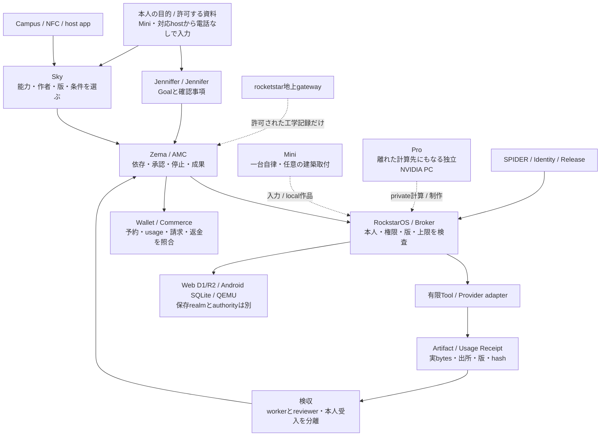
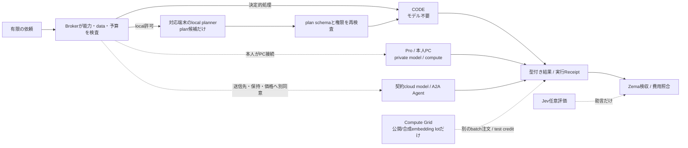
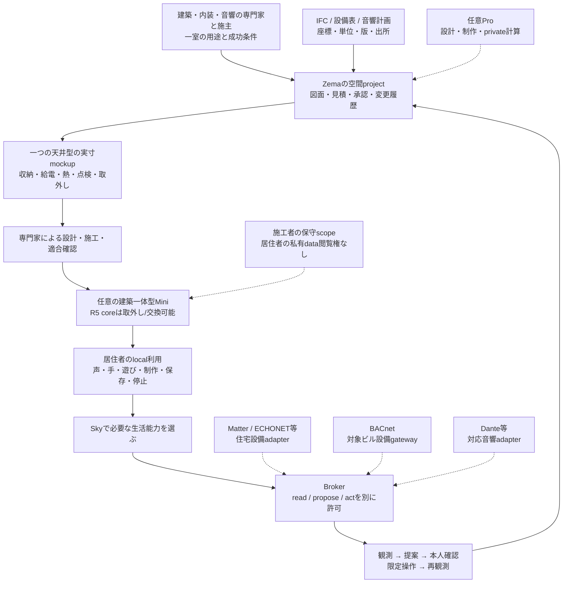
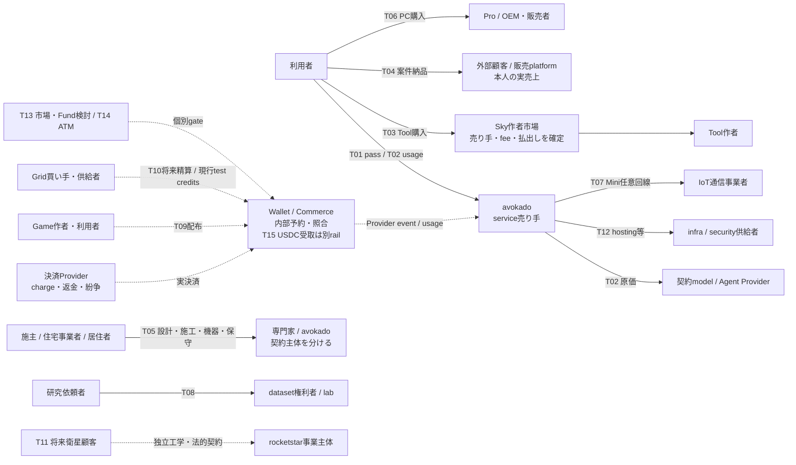
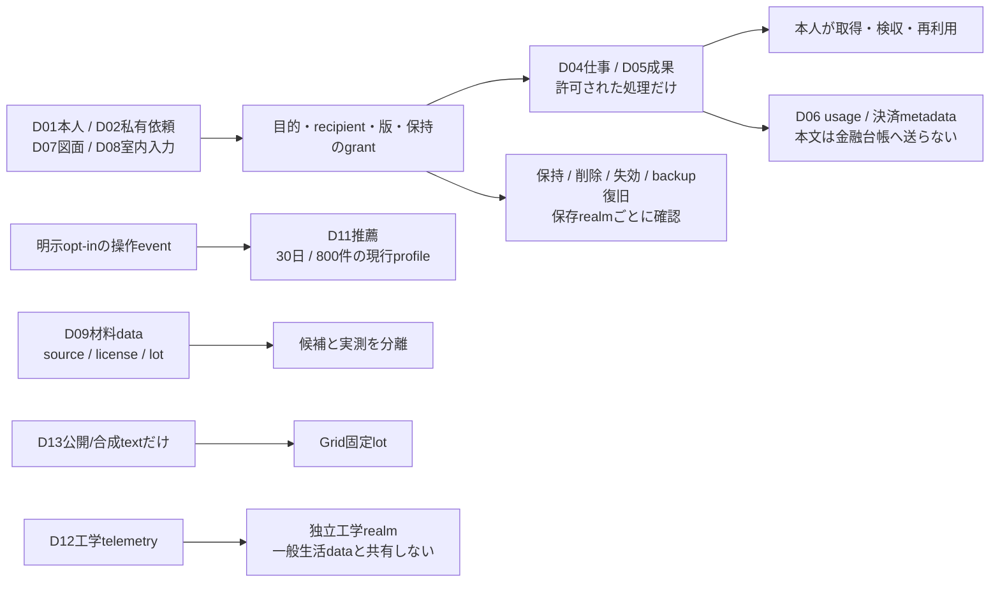

# 07 — 全システムの関連・補完・データ・取引・戦略

版 1.0 / 調査日 2026-10-14 / DOC04・H1・ROCK。基準mainは `c6df4ca93e3b9cee9986755e0bf1f333effe54f6`。新しい明示依頼「全ての関連性、どのsystemがどう動き、何で補い、どんな戦略・データ・取引にするかを調べて作る」に対する統合設計である。

**共通の商品は、本人の目的を有限の仕事へ変え、成果と費用と復旧を本人の手に残すこと。** その共通契約を、Webの仕事、専門家の制作、Miniの生活空間へ広げる。rocketstarは同じ記録・検収思想を地上支援に使う独立工学programとして育てる。共通化するのは本人・権限・仕事・版・証拠・費用で、全製品を一つのprocess、DB、controllerへまとめる設計にはしない。

本章は[現行製品方針](../product-baseline.md)、[共通契約](02-system-contracts.md)、[横断整合契約](06-consistency-contracts.md)、各固定原本を具体的な関係へつなぐ。新しい料金、データ販売、契約、施工、実資金取引の実行許可ではない。機械可読台帳は[ecosystem-research.json](../../data/ecosystem-research.json)。全7製品・19設計領域・38 catalog Tool・RQ01〜RQ50を対応し、19系統・25接続・13データ種・15取引・14外部候補・14 gap・39一次資料を記録した。件数は完成率ではない。

2026-10-15の商品入口の更新とGrapheneOSの再調査は[基盤設計](../native-os-integration.md)を優先する。以下の10-14外部調査とhashは当時のsnapshotで、consumer eSIM保留の記載は当時の方針。新方針でも実発行・有料実行・独自OSは未受入である。

## 調査と判断の読み方

- **repositoryで確認した事実**は上記SHAのsourceと既存証拠に限定する。main同一SHAの取得済みCI6件は全成功。ただしCIは実機・本番Provider・売上の証拠ではない。
- **外部で確認した事実**は末尾S01〜S39の公式仕様・規約・製品資料を根拠とする。提携先として選定/契約済みではない。価格や対応版は採用直前に再確認する。
- **この設計の判断**は、確認済み事実から導いた再利用先・責任分界・試験順である。外部資料がavokadoの設計を保証しているという意味ではない。
- **未統合資料**はmain実績へ加算しない。PR #130 head `3a805132`は建築・内装・音響専門家を先行利用者にする方針、#103/#104/#108はGrid等の候補。元作業コピーのCompanion設計も別候補である。
- 全世界のProvider、法令、特許の調査完了を意味しない。調査範囲、取得失敗、source/hash、未決条件はJSONへ残す。Stripe Directory CLIは認証失効、Meta overviewとJev repositoryのweb読取は取得失敗。これらを最新条件確認済みへ補完しない。

## A. 一つの戦略を、それぞれの製品で実現する

### A1. 共通の勝ち筋

利用者が買う価値は、Agentの数や筐体の所有ではなく、目的を伝えてから成果を受け取り、費用を理解し、止め、次回また続けられること。専門Toolを自社だけで増やすより、Rockは権限・証拠・復旧・互換性を揃え、外部のmodel/機器/専門家の能力を交換可能にする。MCPはTool接続、A2AはAgent間のTask/Artifact交換、WebAuthnは本人認証の仕組みであり、業務承認と費用強制は既存Core/Zemaに残る。[S01 MCP Authorization 2026-07-28](https://modelcontextprotocol.io/specification/2026-07-28/basic/authorization)、[S02 A2A 1.0.0 Specification](https://a2a-protocol.org/v1.0.0/specification/)、[S03 W3C WebAuthn Level 3](https://www.w3.org/TR/webauthn-3/)。

### A2. 二つの利用導線と産業軸

通信＋si利用権bundleの導入前にも試せるWeb/PCの仕事は、既存の出典整理・原稿・CSV等で早く利用/復旧を実証する導線である。建築一体型Miniは、建物が建つ前から専門家の設計・制作に入り、設置と利用と保守を一室のprojectへつなぐ導線である。両者は同じ仕事/権限/成果契約を使い、Mini製造をWeb開始の前提にしない。

現行mainの最初の商用pilotは文章を納品する個人事業主。PR #130には建築家・interior designer・sound/acoustic professional自身の住まい/studio/事務所から始める追加方針が未統合で保存されている。調査からの提案は**建築専門家が使う一室で、設計/制作→設置→暮らし→保守を実証する**ことである。どちらを先に資金/人員投入するかは、最新版baselineへ明示してから固定する。原稿pilotやGame要求を黙って削除しない。

### A2a. PC・対象物・携帯から制作の入口を解放する

2026-10-15の本人指示により、制作場所と計算場所を分ける。本人はMini/対応空間hostから話し、案/版を確認し、PC/Pro/cloudは必要な計算先として使う。現物が目の前にない時は許可済み図面/寸法/計測を参照し、デジタル成果→確定版→製作引渡し→測定/受取を同じJobの工程記録へつなぐ。データは既存D01/D02/D04/D05/D06/D07/D08/D09、商流は既存T02/T04/T05/T08の責任を再利用する。これらは接続契約で、新しい実機/製作Providerの完成ではない。

[6受入ケースと引継ぎ](01-service-experience.md#携帯を持たずpcや対象物の前にもいない制作体験)を基準に、通常の制作/対話は携帯を取り出す回数0・PC前の必須操作0を測る。私有応答の出力先と非電話の本人確認を別途受け入れ、未成立では作用を保留する。前日の調査SHA/45 hash/39資料は当時のsnapshotとして保持し、本追加方針は本人指示を根拠に区別する。

### A3. 共通化と分業

Rockが持つのはidentity/grant、Job/Artifact/Receipt、予算/重複防止、停止/結果不明照合、SDK/Package/互換、local保存/復旧。外部へ求めるのはmodel、正式決済/通信、OEM、建築/電気/音響/材料/航空宇宙の専門能力である。JOINTのadapter受入で両側を結び、OWNERが対象・外部作用・費用・公開を選ぶ。UIは既存の業務契約から状態を表示し、名前ごとの独立microservice/DBを増やさない。

### A4. 製品同士が補う関係

- Skyの品揃えは作者と外部adapterで広げ、品質/権限は審査とBrokerで補う。
- Jenniferの理解/計画は本人確認とAMCの有限分解で補う。Zemaは継続/停止/検収を持ち、LLMの記憶へ仕事の正本を預けない。
- Miniは空間入力とlocal利用、Proはprivateな制作/推論資源を担う。任意接続で能力を増やし、それぞれ単独成立を維持する。
- 建築の配置と設備情報はIFC等、実機操作は対象host adapter、専門的な判断/施工/測定は専門家が補う。
- Gridは公開/合成の中断可能batchだけを別系統で検証する。private原稿や低遅延Agentの不足を無断でGridへ流さない。
- Materialの候補生成は外部data/専門実測で根拠を増やす。rocketstarの製造/飛行安全は独立工学体制で補い、サービス完成へ依存させない。

## B. 制御・計算・暮らし・商流・データの5図

線は到達契約または限定sourceの関係。稼働済みの判定は、JSONの各flow.status、既存証拠、対象環境で行う。点線は任意/別gateを表す。線があっても無条件のデータ共有・取引・設備操作は許可されない。

### 1. 目的・能力・仕事・実行の関係



### 2. 不足を補う計算経路



### 3. 建築前から暮らしへつながる経路



### 4. 誰と何を取引するか



### 5. データの用途と境界



## C. 全システムの動作と補完

### Jenniffer / Jennifer

本人の目的をGoalと確認事項へまとめる会話窓口。入力は本人の依頼、許可した資料、project/Goal revision、出力はGoal Contract草案、担当候補、検収済み成果と未完了の報告。計画は助言。実行/送信/費用の許可は発行しない。

短期会話は既存Zema session、長期Goalはowner確認後の既存D1/AMC。専用重複DBを作らない。 曖昧さは本人確認、分解はAMC、能力はSky、実行はBroker、専門判断は専門家で補う。

現在地: bounded計画、owner別plan/attempt、型付きworker/reviewer報告のsourceがある。 残る条件: COLOMBIA原本、context grant、本番Provider identity、native同等UI。 合格証拠: 同じowner/Goal/版で草案→承認→worker→別reviewer→本人受入を実Providerで照合。

実装/設計参照: [docs/jennifer-coordination.md](../../docs/jennifer-coordination.md)、[app/api/amc/route.ts](../../app/api/amc/route.ts)、[lib/jennifer-execution-reports.ts](../../lib/jennifer-execution-reports.ts)。外部照合資料: [S02 A2A 1.0.0 Specification](https://a2a-protocol.org/v1.0.0/specification/)。

### Sky

能力の発見・比較・掲載・購入・接続を担うplatform。入力は目的/category、Package/manifest、接続先の能力、本人の明示操作、出力は版付きTool選択、接続候補、購入/導入状態。catalog ready、署名、購入のどれもTool実行成功を意味しない。

既存catalog/connection/package、同意時だけfeed履歴。本文を推薦学習へ流さない。 業務状態はZema、権限はCore、外部固有処理はadapter、作者の品質は審査/検収。

現在地: 38 catalog、有限Web処理、feed、大学別入口、SDK/接続管理のsource。 残る条件: 全Tool実行器、外部hostの認証SDK、有料Marketplaceの公開受入。 合格証拠: 同一owner/Tool版で発見→条件→接続/購入→仕事→成果→失効/削除。

実装/設計参照: [lib/catalog.ts](../../lib/catalog.ts)、[docs/sky-launch-design.md](../../docs/sky-launch-design.md)、[docs/sky-tool-sdk.md](../../docs/sky-tool-sdk.md)。外部照合資料: [S01 MCP Authorization 2026-07-28](https://modelcontextprotocol.io/specification/2026-07-28/basic/authorization)、[S34 Product Hunt API](https://api.producthunt.com/v2/docs)。

### Zema / AMC

仕事・依存・承認・停止・成果・費用の実行記録を持つ。入力はGoal/有限依頼、Tool選択、予算/承認、adapter観測、出力はJob/step、Artifact、停止/結果不明状態、型付き報告/Receipt。親WorkJob四状態とA2A/金融/Goal状態は別。remote completedを本人受入へ変換しない。

既存WorkJob/AMC/A2A D1と暗号化artifact。revision/CASで競合判定。 Planner不足は有限recipeと確認、remote応答喪失はGET照合、費用はWalletで補う。

現在地: workflow、A2A送信/照合/取消、parentJob単位予算、Jennifer報告相関のsource。 残る条件: account/月/複数root予算と後払いadapter、公開Provider一周。 合格証拠: 同時予約・停止競合・遅いReceipt・別ownerを含む一周。

実装/設計参照: [lib/workflow.ts](../../lib/workflow.ts)、[lib/a2a-delegation-store.ts](../../lib/a2a-delegation-store.ts)、[docs/service-design/06-consistency-contracts.md](../../docs/service-design/06-consistency-contracts.md)。外部照合資料: [S02 A2A 1.0.0 Specification](https://a2a-protocol.org/v1.0.0/specification/)、[S15 Cloudflare D1 API](https://developers.cloudflare.com/d1/worker-api/d1-database/)。

### RockstarOS / Core / Broker

本人・権限・実行・保存・復旧を強制する共通runtime。入力は認証principal、scope/期限、component/入力版、端末能力、価格/予算、出力は許可/拒否、有限実行要求、保存/復旧診断。LLM/Tool/UIの自己申告から権限を作らない。Web/Android/QEMUのauthorityは別。

Web D1/R2、Android SQLite/Keystore、Linux各正本。同期/移管は別受入。 既存OS保護・署名・認証基盤を再利用し、製品固有driverはDevice Profileで補う。

現在地: Web/Android/Buildrootの分離されたCoreと限定受入。Pixel試験APKはfull imageではない。 残る条件: Pixel全OS build/正式署名/flash/OTA/全損復旧、全profile共通移管。 合格証拠: exact source/image/機種で起動・権限拒否・保存/再起動・復旧を同一artifactで測定。

実装/設計参照: [docs/platform-core.md](../../docs/platform-core.md)、[docs/native-os-validation.md](../../docs/native-os-validation.md)、[docs/phone-preview-20260911.md](../../docs/phone-preview-20260911.md)。外部照合資料: [S03 W3C WebAuthn Level 3](https://www.w3.org/TR/webauthn-3/)、[S24 IPA JC-STAR](https://www.ipa.go.jp/security/jc-star/index.html)。

### avocadoMini R5

一台自律の空間入力・表示・遊び・制作・生活端末。入力は手/身体/日本語音声、校正/設置profile、本人操作、出力はscene/game状態、local作品、有限の接続要求。建築取付と居住者data権限を分離。収納機構/家電作用は個別受入。

local profile/作品、版付き取付・校正情報。cloud同期は本人が選ぶ。 光学/機構は専門設計、重い処理は任意Pro/cloud、家電はhost adapter。

現在地: R5固定設計/算術、任意建築一体型profileの文書。製品実機受入なし。 残る条件: 表示/精密入力、熱・給電・収納・安全・製造。天井別mockupと保守。 合格証拠: 一つのcore/天井/用途で据置単独動作＋取付/展開/停止/停電/取外しとprivacyを測る。

実装/設計参照: [docs/avocado-mini-r5/README.md](../../docs/avocado-mini-r5/README.md)、[docs/avocado-mini-cellular.md](../../docs/avocado-mini-cellular.md)。外部照合資料: [S04 buildingSMART IFC](https://www.buildingsmart.org/standards/bsi-standards/industry-foundation-classes/?lang=en)、[S05 CSA Matter FAQ](https://csa-iot.org/all-solutions/matter/matter-faq/)、[S06 ECHONET Lite規格・認証](https://echonet.jp/about/certification_system/)、[S24 IPA JC-STAR](https://www.ipa.go.jp/security/jc-star/index.html)。

### avokadoPro

NVIDIAを使う独立高性能si・制作・PCゲーム機。入力は本人file/model/game、有限compute job、任意Mini入力、出力はlocal成果、性能/費用/資源診断、game save。private原稿をGrid/cloudへ自動fallbackしない。Mini管理権をPC管理者権と同一視しない。

local SSD/暗号化保存と本人backup。選択した成果だけサービスへ渡す。 OEM/ODM基板とdriverを活用。VRAM不足は対応model縮小/待機/明示cloud選択。

現在地: P0構成・BOM候補・80万円目標。調達/組立/販売は未実施。 残る条件: OEM契約、SKU/QVL、閉箱熱/騒音、si/game同時負荷、販売OS/保証。 合格証拠: 同一SKUでmodel/VRAM/latency/熱/消費電力とgame/保存/復旧を実測。

実装/設計参照: [docs/avokado-pro-pc-design.md](../../docs/avokado-pro-pc-design.md)、[data/avokado-pro-pc.json](../../data/avokado-pro-pc.json)。外部照合資料: [S12 ASUS ROG NUC16仕様](https://rog.asus.com/in/desktops/mini-pc/rog-nuc-16/spec/)、[S13 NVIDIA Laptop 50 series](https://www.nvidia.com/en-us/geforce/laptops/50-series/)。

### rocketstar / A-LINK

衛星輸送・帰還・回収・再使用を目指す独立工学program。入力は要求/設計版、専用地上gatewayの観測、専門家の工学判断、出力は工学artifact、整備/試験記録、地上支援の検収。一般Agentから機上制御/飛行安全系へ指令する経路を設けない。

機番/版/試験/整備の専用台帳。生活者dataと共有しない。 共通Job/版/検収を地上記録に再利用。製造・射場・飛行安全・保険は独立専門系。

現在地: R1.0固定原本、A-LINKのPC模擬prototype。 残る条件: 製造/推進/構造実測、実無線、運用地域・許可・飛行・回収/再使用。 合格証拠: 工学gateと許認可を機番/構成別に独立評価。サービス公開の証拠を転用しない。

実装/設計参照: [docs/rocketstar-design/README.md](../../docs/rocketstar-design/README.md)、[docs/service-design/03-product-profiles.md](../../docs/service-design/03-product-profiles.md)。外部照合資料: [S30 FAA Vehicle Operator Licenses](https://www.faa.gov/space/licenses/operator_licenses_permits)、[S31 内閣府 宇宙活動法申請](https://www8.cao.go.jp/space/application/space_activity/application.html)。

### LLM / Jev / Provider adapters

自然文のplan・生成・限定評価を供給。入力は許可済み最小context、model/ratecard版、上限、出力は非信頼plan/文章/評価、usage観測。model結果をBroker許可、成功、検収へ昇格しない。利用者のLLM所有を開始条件にしない。

本文の新規保存を既定にしない。Provider保持は契約/endpointごとに明示。 有限処理はCODE、privateは対応local、必要なremoteだけ許可後に利用。

現在地: 六文章adapter、local限定planner、Jev任意評価source。 残る条件: operator契約/鍵、実model quality、retention/再販/地域、meter請求照合。 合格証拠: 固定taskで品質・遅延・実費・停止/完了理由を比較し、同じ価格版でReceipt照合。

実装/設計参照: [lib/llm-providers.ts](../../lib/llm-providers.ts)、[docs/llm-evaluation-architecture.md](../../docs/llm-evaluation-architecture.md)、[lib/jev-transport.ts](../../lib/jev-transport.ts)。外部照合資料: [S18 OpenAI API Data controls](https://developers.openai.com/api/docs/guides/your-data)、[S19 Gemini API Terms](https://ai.google.dev/gemini-api/terms.md)、[S37 Transformers.js](https://huggingface.co/docs/transformers.js/index)。

### 建築 / 家電 / 音響 host adapters

異種環境の能力をread/propose/actへ分けて接続。入力は型番/firmware、device capability、観測時刻/不確かさ、scope、出力は型付き観測、変更案、実機応答と照合。接続規格だけで設備操作・構造/消防/資格判断を認めない。

建物/設備assetと居住者profileを分離。sensor原音/映像は最小化する設計。 IFCで空間情報、Matter/ECHONET/BACnetで機器、Danteで対応音響を補う。

現在地: 横断契約の設計。対応家電/店舗の本番adapterはない。 残る条件: 最初の正確なhost、読取専用fixture、認証、低level安全、施工者責任。 合格証拠: 一つの部屋/hostで読取→提案→本人確認→限定操作→再観測。失効/停電/手動操作も検証。

実装/設計参照: [docs/sky-mcp-architecture.md](../../docs/sky-mcp-architecture.md)、[docs/avocado-mini-r5/README.md](../../docs/avocado-mini-r5/README.md)。外部照合資料: [S04 buildingSMART IFC](https://www.buildingsmart.org/standards/bsi-standards/industry-foundation-classes/?lang=en)、[S05 CSA Matter FAQ](https://csa-iot.org/all-solutions/matter/matter-faq/)、[S06 ECHONET Lite規格・認証](https://echonet.jp/about/certification_system/)、[S07 BACnet Standard](https://bacnet.org/about-bacnet-standard/)、[S08 Dante Managed API](https://www.getdante.com/products/network-management/dante-managed-api/)、[S09 国交省 BIM図面審査案内](https://www.mlit.go.jp/report/press/house05_hh_001126.html)。

### Wallet / Commerce / Billing

取引・予約・usage・請求・返金・売上の照合。入力は承認済み見積、Provider Receipt、決済event、確認済み実売上、出力は予約/確定/保留、明細、購入権/照合結果。budgetは残高や請求triggerと別。実金融・success fee holdを文書で解除しない。

既存台帳とProvider event参照。card PAN/秘密鍵を保持しない。 決済・払出し・KYC等は適法なProvider、内部重複防止と照合はRock。

現在地: sandbox/paid gate、Stripe adapter、USDC受取レールsource。 残る条件: 後払い/全account予算、Connect責任/国、実請求・返金・払出しと税。 合格証拠: quote→予約→usage→invoice→payment/refund→台帳をexact金額/通貨/ownerで照合。

実装/設計参照: [docs/sky-billing.md](../../docs/sky-billing.md)、[lib/sky-stripe.ts](../../lib/sky-stripe.ts)、[shared/stripe.mjs](../../shared/stripe.mjs)。外部照合資料: [S20 Stripe Connect charges](https://docs.stripe.com/connect/charges)、[S21 Stripe billing thresholds](https://docs.stripe.com/changelog/basil/2025-07-30/billing-thresholds)、[S23 消費者庁 最終確認画面](https://www.caa.go.jp/notice/assets/consumer_transaction_cms203_240315_02.pdf)、[S39 Circle USDC contracts](https://developers.circle.com/stablecoins/usdc-contract-addresses)。

### 仕事 / 納品 / ブランド運営

素材から本人が検収できる成果・納品・実売上へ進む応用。入力は本人が提供する原稿/CSV/案件、権利/条件、外部取引記録、出力は整理/下書き/納品artifact、実費後収支の照合候補。下書きから外部送信/出品/注文を自動承認しない。

既存owner別Job、CSV専用7日retention、外部取引参照。 Skyの有限Toolと必要なmodel、外部販売platformの正式導線を組み合わせる。

現在地: 出典/記事/CSV/案件/納品/ブランドconnector等の限定source。 残る条件: 公開本人保存/再訪/持出し、個別platform契約とreal注文/売上。 合格証拠: 本人A/B分離、原本hash、顧客検収・実入金の別証拠、失敗時の二重納品防止。

実装/設計参照: [docs/csv-business-v1.ja.md](../../docs/csv-business-v1.ja.md)、[lib/catalog.ts](../../lib/catalog.ts)、[lib/workflow.ts](../../lib/workflow.ts)。外部照合資料: [S32 Mercari Shops API](https://api.mercari-shops.com/docs/index.html)、[S33 ココナラ ルール](https://coconala.com/pages/guide_rule)、[S34 Product Hunt API](https://api.producthunt.com/v2/docs)。

### Game / IP Studio / 作者SDK

遊び・創作・配布を非金融で先に成立させる。入力は本人作品/音声、game SDK event、権利と公開範囲、出力はscene/game/asset、作者導入診断、版付き成果。game point発行と実資金Walletを分離。配布platformの許諾を別確認。

作者/owner別asset、save、license/provenance。 既存SDK/sandbox、対応game engine/配布基盤。実交換は別金融adapter。

現在地: 非金融sandbox/SDK/交換fixture。IP Studio catalogはcandidate。 残る条件: 実ゲームの同一版/端末受入、録音/通話、配布契約。実交換は未許可条件。 合格証拠: sample導入時間/成功率/復旧時間を測定。Steam等の条件に適合する配布profileを選ぶ。

実装/設計参照: [docs/service-design/05-requirement-coverage.md](../../docs/service-design/05-requirement-coverage.md)、[docs/mini-game-client.md](../../docs/mini-game-client.md)。外部照合資料: [S29 Steam Direct](https://partner.steamgames.com/steamdirect)。

### Material Invention / Patent / Lab

候補→根拠比較→安全評価→専門実験の証拠を版で結ぶ。入力はmaterial/lot/配合/工程、由来/不確かさ、許可dataset、出力は候補graph、simulation候補、実験依頼草案、測定/特許の参照。計算予測を実測/安全/特許成立へ変換しない。外部実験は別承認。

material record/候補/measurementを出所・版・license・公開条件で分離。 データは許諾済み公開/有償dataset、実測は専門lab、法務/出願は専門家。

現在地: 2D候補比較とowner保存。実simulation/lab/Mini表示の受入は別。 残る条件: dataset契約、model妥当性、lab/秘密/公開条件、装置接続。 合格証拠: 原料lot/校正/試験法/測定Receiptを候補へ結び、予測誤差を事前基準で評価。

実装/設計参照: [docs/material-invention-core.md](../../docs/material-invention-core.md)、[docs/rockstaros-avocado-mini-complete-design.md](../../docs/rockstaros-avocado-mini-complete-design.md)。外部照合資料: [S25 NIMS 設備・データ利用](https://www.nims.go.jp/business/equipment/)、[S26 DICEデータセット利用](https://dice.nims.go.jp/using/case_study.html)。

### Sky Compute Grid

公開/合成textの固定embedding lotとAndroid余力のmatching。入力は公開/合成入力lot、予算/SKU、ownerの容量offer、出力はlease、検証済みlot/Receipt、test credit精算候補。private原稿を配布しない。Pro/cloudの無断fallbackに使わない。

host fixtureと未統合永続branchを区別。input/lease/accountingを分離する設計。 中断可能なbatchだけで余力を活用。低遅延/常時APIは契約cloudへ明示分岐。

現在地: mainのmatching/合成fixture。永続worker等はopen PR #103/#104を別扱い。 残る条件: 永続配布/実端末/検証者の攻撃耐性、原価、実課金/払出し。 合格証拠: 同一lot/hash/leaseで制約停止・再配置・重複拒否・精算再実行を測定。

実装/設計参照: [docs/sky-compute-grid.md](../../docs/sky-compute-grid.md)、[data/product-baseline.json](../../data/product-baseline.json)。外部照合資料: [S28 Android WorkManager constraints](https://developer.android.com/develop/background-work/background-tasks/persistent/getting-started/define-work)。

### Market / Automation Fund / ATM境界

PAPER分析と検証可能な収支を扱う独立金融応用。入力は公開市場data/fixture、確認済み取引/収益の参照、将来Provider契約、出力はPAPER仮説/実績再計算、費用/リスク/保留理由。予測/合成利益から実注文・資金運用・ゲーム交換を許可しない。ATMは別adapter。

PAPER/fixture台帳と金融Provider台帳を分離。 実取引/custody/KYC/取引執行は適切な外部Provider契約へ。OSは権限・照合・停止を維持。

現在地: 汎用PAPER市場、ファンドの実績再計算/fixture、ATM境界設計。 残る条件: 市場/資産/地域/Provider/リスク/法務/実funding/実取引の個別gate。 合格証拠: PAPER再現と実取引の適法/契約/資金/停止/照合を別々に評価。旧利益試算を収益実績にしない。

実装/設計参照: [docs/service-design/05-requirement-coverage.md](../../docs/service-design/05-requirement-coverage.md)、[data/product-baseline.json](../../data/product-baseline.json)。

### Campus / NFC / host app成果

利用contextと紹介入口を共通Skyへ届ける。入力はURL tag、本人同意profile、検証済みdomain/型付き成果、出力は大学context、おすすめ入口、許可された成果projection。NFC/大学名/email domainは本人性・在籍・購入・成果閲覧権を作らない。

最小tag集計とCampus公開profileを本人Jobから分離。 URL/PWAの配布性を使い、仕事/費用/成果の正本はSky/Zemaへ集約。

現在地: 5大学入口、同一origin成果表示、NFC route source。 残る条件: 実カード/iPhone再読取、所属運用/6枠、cross-origin認証と失効。 合格証拠: 入口→本人認証→同じ成果再取得、A/B分離、tag停止、realm/recipient拒否。

実装/設計参照: [docs/campus-layer.md](../../docs/campus-layer.md)、[docs/sky-nfc-columbia.md](../../docs/sky-nfc-columbia.md)、[docs/sky-launch-design.md](../../docs/sky-launch-design.md)。外部照合資料: [S03 W3C WebAuthn Level 3](https://www.w3.org/TR/webauthn-3/)。

### SPIDER / Identity / Operator / Release

最小権限、供給chain、限定運用、正確な状態と復旧を支える。入力はPackage署名/digest/SBOM、認証event、本人指定検査入力、限定診断、出力は許可/拒否/失効、脆弱性対応、監査/更新/復旧証拠。署名を安全保証にせず、operator保守で私有原稿や全root権を取得しない。

秘密を除く監査metadata。鍵/私有本文/診断の送信scopeを分離。 OS保護と認証、外部security評価、再現可能build/rollbackを組み合わせる。

現在地: 静的SPIDER Tool、限定native監視、CI/CodeQL等。 残る条件: 24h運用や全通信保護、第三者監査、製品型式ごとのIoT適合。 合格証拠: 脅威別拒否・復旧・失効をexact artifactで確認。CI件数で実機完成率を出さない。

実装/設計参照: [docs/workstreams/04-security-identity-compliance.md](../../docs/workstreams/04-security-identity-compliance.md)、[docs/platform-core.md](../../docs/platform-core.md)。外部照合資料: [S01 MCP Authorization 2026-07-28](https://modelcontextprotocol.io/specification/2026-07-28/basic/authorization)、[S03 W3C WebAuthn Level 3](https://www.w3.org/TR/webauthn-3/)、[S24 IPA JC-STAR](https://www.ipa.go.jp/security/jc-star/index.html)。

### Web / DB / Storage / QEMU / Distribution

実行環境・保存realm・配布artifactの土台。入力は認証済みAPI、DB migration、署名済みrelease、backup/鍵版、出力は保存結果、稼働/復旧状態、source/build/site/image対応。別Siteの同pathとWeb/Android/QEMUを同じDB・同じ受入と呼ばない。

D1 metadata、非公開R2 bytes、端末local DB/鍵。各authorityを明示。 既存managed基盤を再利用し、appの認証/CAS/暗号/削除照合はRockで実装。

現在地: Web/API/D1/R2とQEMU/Android独立配布source。 残る条件: DB+object+keyの一貫restore、authority移管、全OSと一般配布受入。 合格証拠: 同一source/artifactでfresh導入→更新→保存→rollback/restore→削除。

実装/設計参照: [docs/system-composition.md](../../docs/system-composition.md)、[docs/native-os-validation.md](../../docs/native-os-validation.md)、[docs/service-design/06-consistency-contracts.md](../../docs/service-design/06-consistency-contracts.md)。外部照合資料: [S15 Cloudflare D1 API](https://developers.cloudflare.com/d1/worker-api/d1-database/)、[S16 Cloudflare D1 Time Travel](https://developers.cloudflare.com/d1/reference/time-travel/)、[S17 Cloudflare R2 presigned URL](https://developers.cloudflare.com/r2/api/s3/presigned-urls/)。

### avocado Companion（local未統合候補）

子供の手持ち/ランドセル向け小型相棒と独立alarmの検討。入力は明示的な会話/SOS操作、保護者同意、学校mode、出力は限定会話/伝言草案、独立local alarm候補。小型alarmをR5縮小版や実Cloud Agent稼働済みとしない。

local候補設計。子供の実data収集/送信は未受入。 物理alarmはmodel不在でも独立。会話は許可済み保護者bridge/cloud候補。

現在地: 元作業コピーの設計とPixel browserのルール型preview報告。main未統合。 残る条件: 物理機、電池/alarm回路、guardian identity、Provider、録音/位置/通知/法務。 合格証拠: 実子供dataなしの合成fixture、独立警報と通信断、同意/削除を別評価。

実装/設計参照: [docs/service-design/07-ecosystem-strategy-and-data.md](../../docs/service-design/07-ecosystem-strategy-and-data.md)。外部照合資料: [S27 FTC COPPA FAQ](https://www.ftc.gov/business-guidance/resources/complying-coppa-frequently-asked-questions)。

## D. 接続を成立させる共通契約

各接続はJSONのF01〜F25へ対応する。payload名は説明の分類であり、そのまま新しいAPI/SQL schemaを追加する指示ではない。既存schemaへ版付きで対応づける。

1. **選択**: Tool/Agent/hostの作者、版、schema、実行場所、scope、送信先、停止能力、価格/保持を比較する。宣言と実接続の観測を分ける。
2. **準備**: 認証owner/realm、Job/operation、入力digest、資料grant、exactな実行先、見積版、期限を保存する。
3. **承認と予約**: 本人確認と予算予約を行い、送信直前に失効/版/残予算を再検査する。NFC、model判断、署名、購入は代わりにならない。
4. **実行**: 有限adapterが一回送信し、受付Task/operationを保存する。応答喪失は同じIDへGET照合し、自動新規送信を避ける。
5. **検収**: 実bytesからartifact hashを計算し、schema、producer、入力版、切詰め、usageを照合する。worker/reviewer/本人受入/顧客納品は別証拠。
6. **終了と復旧**: Job終端、remote取消、金融閉鎖、本文削除は別状態。停止不明なら残余最大費用を保留し、次回も既存IDから復旧する。

**現在の具体的な差分**: MCP公式latestは2026-07-28、repositoryの受入allowlistは2025-11-25/2025-06-18。最新protocol対応を自動宣言せず、明示版交渉と認可差分試験を行う。A2A sourceは1.0契約を持つが、Agent Cardや仕様への適合だけでProviderの本人性・課金・品質を保証しない。[S01 MCP Authorization 2026-07-28](https://modelcontextprotocol.io/specification/2026-07-28/basic/authorization)、[S02 A2A 1.0.0 Specification](https://a2a-protocol.org/v1.0.0/specification/)。

## E. どのデータを、どこから、何に使うか

以下はdata contractであり、新規収集を始めた記録ではない。既存のretention値は対応profileだけに適用する。全データを一つのdata lakeや学習corpusへ集める設計にしない。外国Providerへの送信は目的/recipient/保持/移転条件を法務・契約で照合する。[S22 個人情報保護委員会 外国提供](https://www.ppc.go.jp/personalinfo/legal/guidelines_offshore/)。

### D01 本人・認証・利用権

取得元/記録主体: RockstarOS / Core / Broker。受け手: Sky、Zema / AMC、Wallet / Commerce / Billing、Campus / NFC / host app成果。目的: 本人分離とscope判定。保存: realmごとの既存認証/DB。

保持: credential/session失効と契約記録の保持を分離。期間は既存policyを使い全域統一は未受入。 共有: 必要なprincipal/scopeだけ。NFC/顔候補を認証根拠にしない。 削除/復旧: 再登録/復旧で旧session失効を確認。私有本文は含めない。

### D02 Goal・依頼・私有原稿

取得元/記録主体: Jenniffer / Jennifer。受け手: Zema / AMC、LLM / Jev / Provider adapters、仕事 / 納品 / ブランド運営。目的: 本人の目的に必要な処理。保存: 既存Zema/owner Job、許可されたProvider。

保持: 短期会話8session/24message/10分TTLのprofileと長期Goalは別。全system同値ではない。 共有: default context grantなし。送信内容/目的/recipient/保持を本人が選ぶ。 削除/復旧: 本文削除と会計Receipt保持を分離し、backup再復活を試験。

### D03 能力・Package・版・license

取得元/記録主体: Sky。受け手: RockstarOS / Core / Broker、Zema / AMC、建築 / 家電 / 音響 host adapters、SPIDER / Identity / Operator / Release。目的: 互換と有限権限の照合。保存: catalog/registry/manifest。

保持: 版付き。作者失効/更新/終了を追跡。 共有: 公開宣言へsecret/顧客原稿を入れない。 削除/復旧: 旧仕事の版を保持し、失効は新実行を拒否。

### D04 仕事・operation・実行状態

取得元/記録主体: Zema / AMC。受け手: Jenniffer / Jennifer、RockstarOS / Core / Broker、Wallet / Commerce / Billing。目的: 再取得・停止・二重実行防止。保存: WorkJob/AMC/A2A台帳。

保持: 終了/削除/未解決holdを別状態で保持。 共有: ownerと対応recipientだけ。運用portfolioと顧客Jobを分離。 削除/復旧: 同じIDでGET照合。response喪失時の再dispatchを防ぐ。

### D05 成果・hash・schema・由来

取得元/記録主体: Zema / AMC。受け手: Jenniffer / Jennifer、仕事 / 納品 / ブランド運営、Game / IP Studio / 作者SDK、Material Invention / Patent / Lab、Campus / NFC / host app成果。目的: 検収・再利用・納品。保存: 暗号化artifact/owner成果。

保持: Toolごとのretention。CSV専用は受付7日または本人削除。 共有: grantは固定版/用途/recipient/期限。外部URLの自動取得は別adapter。 削除/復旧: bytes/hashを再照合し、DB/R2/鍵をそろえて復旧。

### D06 見積・予約・usage・決済event

取得元/記録主体: Wallet / Commerce / Billing。受け手: Zema / AMC、RockstarOS / Core / Broker、Jenniffer / Jennifer。目的: 上限強制・請求/返金/実費照合。保存: Wallet/Commerce/Provider参照。

保持: 未解決holdは月境界で消さない。法定/契約保持は国と契約で決める。 共有: 最小metadataだけ。原稿本文/カード番号/秘密鍵は金融台帳へ渡さない。 削除/復旧: event/operation一意で再送を重複計上しない。

### D07 空間/BIM・天井・設備asset

取得元/記録主体: 建築 / 家電 / 音響 host adapters。受け手: avocadoMini R5、avokadoPro、Zema / AMC。目的: 配置/干渉/施工/点検の版管理。保存: 到達設計のowner/建物asset領域。

保持: 物件契約で保持/引渡/退去を決める。未実装。 共有: 建物owner、設計者、居住者の用途ごとにgrant。生活履歴は別。 削除/復旧: IFC版/座標/単位/取付版を保持。撤去/交換後の対応表を更新。

### D08 室内観測・pose・音声・音響

取得元/記録主体: avocadoMini R5。受け手: 建築 / 家電 / 音響 host adapters、RockstarOS / Core / Broker、LLM / Jev / Provider adapters。目的: 明示入力と快適性/音響の有限評価。保存: local優先の候補profile。

保持: 生音声/映像の常時蓄積を既定にしない。具体秒数/保持はprofileごとに未決。 共有: 時刻/単位/校正/不確かさを付ける。cloud/第三者への送信は別同意。 削除/復旧: 入力欠落/過熱/停電は停止とlocal保存。生体推定を強認証にしない。

### D09 材料・simulation・実測

取得元/記録主体: Material Invention / Patent / Lab。受け手: avokadoPro、Zema / AMC、仕事 / 納品 / ブランド運営。目的: 候補比較と予測妥当性。保存: 既存Core＋到達dataset/実験台帳。

保持: dataset license/秘密/公開条件を別に保持。 共有: source/DOI/license/lot/試験法/校正を付ける。任意学習・再販は別許諾。 削除/復旧: 予測と測定を別artifact、誤差と版を残す。

### D10 game/作品・score・save

取得元/記録主体: Game / IP Studio / 作者SDK。受け手: avocadoMini R5、avokadoPro、Zema / AMC。目的: 制作・遊び・作者導入。保存: owner/作者別Assetとgame save。

保持: 作品license/削除と購入証拠を分離。 共有: 公開は作品/版/権利を本人確認。scoreをreal moneyに変換しない。 削除/復旧: game終了でもJob/OS復旧を止めない。

### D11 推薦・導入・運用の最小指標

取得元/記録主体: Sky。受け手: SPIDER / Identity / Operator / Release、Zema / AMC。目的: 本人の推薦と障害/導入改善。保存: 同意時feed履歴/最小監査。

保持: 現行feedは30日/800件。建築pilot等の新計測は未導入。 共有: 推薦に原稿/会話/成果本文を使わない。営業/学習/data販売へ自動転用しない。 削除/復旧: 停止/全削除と履歴なしfallback。集計でも再識別性を評価。

### D12 工学・telemetry・整備

取得元/記録主体: rocketstar / A-LINK。受け手: Zema / AMC、SPIDER / Identity / Operator / Release。目的: 地上支援と機番別検証。保存: 専用gateway/工学台帳。

保持: 工学契約と許可条件で保持。生活系とは別realm。 共有: 一般Agentは許可済み観測だけ。飛行安全へのwrite経路なし。 削除/復旧: 工学版/機番/時刻を照合。欠測を正常として補完しない。

### D13 Grid公開lot・容量・検証Receipt

取得元/記録主体: Sky Compute Grid。受け手: Wallet / Commerce / Billing、Zema / AMC。目的: 分散batch検証とtest精算。保存: main fixture / 永続候補は未統合。

保持: 公開/合成だけ。永続artifactと会計のretentionは未受入。 共有: private・個人/子供dataは受け付けない。粗い地域と匿名offerを使う設計。 削除/復旧: lease/hash/期限/lot検証、拒否/再配置/重複精算防止。

### データから改善するもの

改善の入力は、本人の許可した操作、実行所要時間、失敗/復旧理由、検収の差分、許諾済み測定である。仕事本文を広告/推薦/汎用model学習へ流すことや、住宅の映像/会話/生活習慣を売ることは確定要望に含まれず、この設計でも開始しない。BIMや測定datasetの商用利用は元の権利者・居住者・専門家との契約が必要で、匿名化という名称だけで再識別性や再配布権の問題を解消しない。

OpenAIはAPIの学習利用とabuse log/application stateを区別し、ZDRは承認/条件付きである。Geminiは有償/無償でdata条件を区別する。したがって「API接続済み」「store:false」「有料model」だけで全Providerの非保持を約束しない。採用endpoint/機能/契約ごとに記録する。[S18 OpenAI API Data controls](https://developers.openai.com/api/docs/guides/your-data)、[S19 Gemini API Terms](https://ai.google.dev/gemini-api/terms.md)。

D1の復旧機能だけでR2成果bytesや暗号鍵は戻らない。期限URLはbearer権なので、失効/recipient/本文削除の経路を別に設計する。[S16 Cloudflare D1 Time Travel](https://developers.cloudflare.com/d1/reference/time-travel/)、[S17 Cloudflare R2 presigned URL](https://developers.cloudflare.com/r2/api/s3/presigned-urls/)。

## F. 誰が、誰へ、何を対価に取引するか

T01〜T15は別の商流。決済Providerへ払うこと、作者へ配分すること、本人の外部売上を確認すること、予算を予約することを一つのWallet残高で代用しない。今回、注文・支払い・外部連絡は一件も実施していない。

### T01 期間パス/対象利用権

支払側: サービス利用者。受取側: avokado。単位: 期間・対象quota。経路: 既存Commerce＋決済Provider候補。

価格/状態: 有効6か月未満・自動更新等の現行方針。価格/範囲/国/税はpaid開始前に確定。 開始gate: 公開の購入/再訪/解約・失敗復旧を受入。 返金/失敗: 返金既定と強行法規/Provider条件をOWNER/法務が照合。 使うdata: D01、D03、D06。

### T02 si従量実行

支払側: サービス利用者。受取側: avokado（外部原価はavokado→model/Agent Provider）。単位: token/秒/Tool単位等をratecard固定。経路: Zema予算→Provider Receipt→請求。

価格/状態: 初期上乗せ30%、請求trigger1,000円、本人月上限。実装のfunded gateは維持。 開始gate: account/Goal全域予約、再販/原価/請求/取消/後払い受入。 返金/失敗: 上流費用と顧客請求、取消不明/未払い/返金を別台帳。 使うdata: D04、D05、D06。

### T03 版付きTool/Package利用権

支払側: Tool購入者。受取側: 購入画面で確定した売り手（現行service売り手はavokado。作者への配分は別契約）。単位: license/購入単位。経路: Sky Marketplace＋Connect方式を要決定。

価格/状態: 当面Sky fee10%、0%への既定条件を維持。決済実費は別。 開始gate: 売り手の法的主体、fee payer、返金/紛争、作者審査、実払出しを確定。 返金/失敗: transferとrefundの連動、作者終了/失効時の利用権を明記。 使うdata: D01、D03、D06。

### T04 原稿・制作・納品成果

支払側: 案件顧客。受取側: 利用者本人／外部販売platform。単位: 案件/納品/検収。経路: Coconala/Mercari等の正式な外部導線。

価格/状態: 外部受取は利用者の売上。旧success fee/CSV販売者料金は保留。 開始gate: 送信/掲載/納品/顧客検収/実入金を分ける。 返金/失敗: 外部規約の取消/返金とRockの仕事停止を混同しない。 使うdata: D02、D05、D06。

### T05 Mini本体・設置設計・施工・保守

支払側: 施主/住宅事業者/居住者（契約で決める）。受取側: avokado＋建築/設備/施工/音響の専門事業者。単位: 機器/設計図版/物件/作業。経路: 独立見積・建築契約/購入契約。

価格/状態: 価格・販路・販売主体・施工保証未決。機器と工事とcloud/回線を別明細。 開始gate: 一物件の設置責任、資格、事故/保証、privacy、引渡/退去/保守を合意。 返金/失敗: 未施工/不適合/撤去/機器交換と継続service解約を別定義。 使うdata: D01、D06、D07、D08。

### T06 NVIDIA si PCとsupport

支払側: Pro購入者。受取側: avokado／OEM/販売者（販売構造未決）。単位: exact SKU一台/保証期間。経路: OEM/ODM調達→販売契約。

価格/状態: 80万円は目標。税/送料/保証/仕入/販売OS未確定。 開始gate: OEM供給/ブランド/改装条件、BOM/QVL、同一閉箱試験。 返金/失敗: 返品/故障/SSD私有data/driver更新と部品終息を規定。 使うdata: D03、D05、D06。

### T07 Mini任意LTE data回線

支払側: avokado（回線付き機器事業者）。受取側: IoT通信事業者。単位: SIM/profile/通信量/月。経路: carrier契約→機器service明細。

価格/状態: consumer eSIM販売保留。国内LTE・カード試作/chip量産・SGP.32を同時照合。 開始gate: 第三者利用、module適合、管理API、解約/上限、再販/本人確認条件。 返金/失敗: 回線解除でlocal利用/作品を失わない。通信不明時の二重profile購入を防ぐ。 使うdata: D01、D06、D11。

### T08 許諾dataset・測定/試験報告

支払側: 研究依頼者/avokado（契約で分ける）。受取側: データ権利者/専門lab。単位: dataset版/試料lot/試験法。経路: DICE等利用申請/見積、lab個別契約。

価格/状態: 閲覧可能とbulk学習/再配布許諾は別。有償条件/秘密/公開を確定。 開始gate: データlicense、試験範囲、安全、試料/成果権、校正/測定Receipt。 返金/失敗: 試験不成立/試料損失/再測定と代金、秘密保持/発表条件。 使うdata: D05、D06、D09。

### T09 game/作品利用権・配布

支払側: game利用者／作者。受取側: 作者／配布platform。単位: 作品版/配布契約。経路: Sky/正式game store候補。

価格/状態: game販売条件未決。Game交換・ATM・暗号資産を別契約。 開始gate: 実game、license、配布先規約、必要な審査。 返金/失敗: save/購入権/返金と実交換停止を分離。 使うdata: D05、D06、D10。

### T10 検証済み固定embedding lot

支払側: 計算買い手。受取側: 計算供給者（将来）。単位: verified lot/lease。経路: 現行sky_test_credits、将来決済は別。

価格/状態: real請求・払出し未開始。価格/SKU/地域と電力/通信/検証原価は未受入。 開始gate: 永続台帳、改ざん/不正供給、実端末、採算と規制。 返金/失敗: 期限切れ/不正/中断は未精算。再配置と二重支払いを防ぐ。 使うdata: D06、D13。

### T11 将来の輸送/試験/地上support

支払側: 衛星顧客／研究主体。受取側: rocketstarの将来事業主体・製造/射場/保険等。単位: mission/機番/検収milestone。経路: 独立した航空宇宙契約。

価格/状態: 売上/受注/製造/飛行未成立。生活serviceの課金に混ぜない。 開始gate: 運用地域、機体/施設/周波数/保険/損害責任、独立工学gate。 返金/失敗: 飛行取消/遅延/試験失敗の条件を独立契約。 使うdata: D05、D06、D12。

### T12 infra運用と独立評価

支払側: avokado。受取側: hosting/保存/監査等の供給者。単位: request/CPU/storage/月/審査範囲。経路: 既存infra契約＋個別見積。

価格/状態: 既存契約の費用/地域/保存条件を要確認。無料枠を無限原価0にしない。 開始gate: DPA/region、backup/障害対応、鍵、SLAと出口。 返金/失敗: 終了時export/削除、復旧/移行と残usageの照合。 使うdata: D03、D06、D11。

### T13 検討中の市場/運用service

支払側: 将来の投資/市場利用者。受取側: 適法な実取引/ファンドProvider（未選定）。単位: 取引/運用契約ごと。経路: 現行PAPER/fixture。実執行は別Provider。

価格/状態: 価格/資産/市場/利益定義/実fundingは未確定。success fee系executionHolds維持。 開始gate: 地域/取引条件/権限/資金/リスク/法務/実照合を別に確定。 返金/失敗: 損失/取消不能/結果不明を契約別に扱い、利益を保証しない。 使うdata: D06。

### T14 ATM専用の資金/現金サービス

支払側: ATM利用者。受取側: 対象ATM/現金取扱Provider（未選定）。単位: ATM操作ごと。経路: Game/市場/カードと別adapter。

価格/状態: Rockが徴収するATM手数料0、外部実費は別。実連携未受入。 開始gate: 対象Provider/法務/本人確認/取引条件/照合を確定。 返金/失敗: 現金結果不明を自動再送/成功確定しない。 使うdata: D06。

### T15 既存Base USDC受取の限定rail

支払側: 本人が操作する外部Wallet送信者。受取側: 本人確認済み受取address。単位: chain/asset/txごと。経路: 本人Wallet署名/chain観測→受取照合。

価格/状態: 額/宛先/実費を本人が指定。秘密鍵非保管。 開始gate: owner署名と最初の実transfer、exact/finalized照合、資産/chain/運用条件。 返金/失敗: 取消不能・誤送金等はcard refundと異なる。別資産/偽tokenを拒否。 使うdata: D01、D06。

### 費用と採算を同じ単位で見る

現行の30%は対象si usageへの上乗せ、10%は作者売上のSky取り分、1,000円は請求triggerで、同じ明細へ機械的に重ねない。実行可否は原子的な `照合済usage C + 未解決残余予約 R + 新規最大額 N ≤ 本人上限 L` をaccount期間/Goalへ適用する到達設計で判断する。現行parentJob poolをその完成と呼ばない。

測る採算は、**実受取売上 − model/Tool原価 − 決済/返金/不払い − hosting/保存 − support/施工/保証引当の該当分**。Mini/ProはBOMだけでなく組立・不良・物流・保証・設置/撤去を含め、Gridは電力/通信/検証/再計算を含める。rocketstar研究費を生活serviceのusageへ黙って転嫁せず、事業別に予算と受注条件を持つ。原価/需要データがないため、利益率/黒字時期/需要規模は算定しない。

Stripe Connectはcharge方式でfee/返金/紛争の負担が変わる。billing thresholdは請求時点の機能で、Rockの実行前上限を外部へ丸投げしない。購入画面は提供/更新/解約条件まで明示し、法務と対象国で受け入れる。[S20 Stripe Connect charges](https://docs.stripe.com/connect/charges)、[S21 Stripe billing thresholds](https://docs.stripe.com/changelog/basil/2025-07-30/billing-thresholds)、[S23 消費者庁 最終確認画面](https://www.caa.go.jp/notice/assets/consumer_transaction_cms203_240315_02.pdf)。

## G. 外部候補をどこに使い、どこまで確認したか

候補は既存契約へ差し込むadapter/調達/専門支援の確認先であり、提携発表ではない。社名を選ぶ前に、用途・必要能力・data条件・同じ環境での受入可能性を比較する。外部候補の契約状態は全件「この調査では未確認」である。

### P01 OpenAI API

役割: cloud生成/検索の既存adapter候補。補完理由: modelを利用者が所有する必要なし。渡す/受ける情報: 明示許可された最小contextとusage。取引/相談経路: 既存server API契約、DPA/再販/regionとratecardを確認。残条件: Rock側予算・資格情報・実Receipt/請求は未受入。[S18 OpenAI API Data controls](https://developers.openai.com/api/docs/guides/your-data)。

### P02 Gemini API

役割: 交換可能な文章Provider候補。補完理由: 既存google adapterを再利用。渡す/受ける情報: 許可contextとusage/完了理由。取引/相談経路: 有償/無償tier・契約・データ条件を分けて比較。残条件: 無料tierへ私有原稿を黙って送らず品質/請求を評価。[S19 Gemini API Terms](https://ai.google.dev/gemini-api/terms.md)。

### P03 Stripe Connect / Billing

役割: 購入/後払い/作者払出し候補。補完理由: 既存Stripe adapterを再利用。渡す/受ける情報: 顧客/商品参照・金額/税・決済event。取引/相談経路: 法的売り手・charge方式・国/capabilityを選びsandboxから。残条件: 権限・会計・課金状態は内部台帳、KYC/紛争/返金責任を確定。[S20 Stripe Connect charges](https://docs.stripe.com/connect/charges)、[S21 Stripe billing thresholds](https://docs.stripe.com/changelog/basil/2025-07-30/billing-thresholds)。

### P04 SORACOM

役割: Mini任意IoT LTE/SGP.32の確認先。補完理由: 遠隔profile切替を自作しない方向と整合。渡す/受ける情報: SIM/profile・通信量・障害状態。取引/相談経路: 事業窓口で国内LTE/chip/第三者利用/SGP.32の同一契約見積。残条件: 公表機能だけで要求全部を満たすplan採用としない。[S14 SORACOM Connectivity Hypervisor](https://soracom.jp/services/air/connectivity-hypervisor/)。

### P05 ASUS / NVIDIA対応OEM・ODM

役割: Proの参照機/統合供給候補。補完理由: CPU/GPU基板と冷却を再利用できる可能性。渡す/受ける情報: SKU/BOM/QVL/熱/firmware/保証。取引/相談経路: メーカー/正規供給窓口で評価機とOEM条件を照合。残条件: retail販売は裸基板/独自brand供給の証拠ではない。[S12 ASUS ROG NUC16仕様](https://rog.asus.com/in/desktops/mini-pc/rog-nuc-16/spec/)、[S13 NVIDIA Laptop 50 series](https://www.nvidia.com/en-us/geforce/laptops/50-series/)。

### P06 LIXIL Life Assist系・住宅事業者

役割: 建築導入/設備連携の比較候補。補完理由: 建物設計時に入る導線の実例研究。渡す/受ける情報: 物件/設備型番・対応機能。居住者原稿は渡さない。取引/相談経路: 公式製品/設計施工/事業窓口への技術適合確認を準備。残条件: 公開API/avokado提携/全設備互換は未確認。[S10 LIXIL Life Assist2構成](https://www.lixil.co.jp/lineup/smarthome/lifeassist2/system/)。

### P07 Panasonic HEMS/AiSEG系

役割: 住宅設備read/controlの比較候補。補完理由: 既存設備controllerを使う任意adapter候補。渡す/受ける情報: exact設備型番/機能/観測。取引/相談経路: 公式対応型番表と認証、メーカー/設計者の組合せ確認。残条件: Miniの基本動作へHEMS Hubを必須化しない。[S11 Panasonic HEMS対応](https://panasonic.jp/aircon/hems.html)、[S06 ECHONET Lite規格・認証](https://echonet.jp/about/certification_system/)。

### P08 Audinate / Dante

役割: sound設備監視/制御・OEM候補。補完理由: 専門音響を独自network規格で作り直さない。渡す/受ける情報: 対応audio subscription/status/preset。生音声は別許可。取引/相談経路: Dante対象管理製品/API条件、OEMは公式窓口で評価。残条件: API接続は残響/騒音改善や音響設計の合格ではない。[S08 Dante Managed API](https://www.getdante.com/products/network-management/dante-managed-api/)。

### P09 NIMS NOF / ARIM / DICE

役割: 材料data/専門設備の候補。補完理由: 現物証拠を外部専門設備で補える。渡す/受ける情報: 許諾dataset/試料/測定metadata。取引/相談経路: サービスごとの申請/有償契約/秘密と公開条件を選ぶ。残条件: NOF/ARIM/DICEを同一公開契約とみなさない。[S25 NIMS 設備・データ利用](https://www.nims.go.jp/business/equipment/)、[S26 DICEデータセット利用](https://dice.nims.go.jp/using/case_study.html)。

### P10 Cloudflare D1/R2

役割: 既存Web保存・運用基盤。補完理由: 現在の構成を維持し重複DBを減らす。渡す/受ける情報: 暗号化bytesとmetadata、最小ログ。取引/相談経路: 既存binding/契約を確認、backup/出口を受入。残条件: Time TravelはR2/暗号鍵/localの一括復旧ではない。[S15 Cloudflare D1 API](https://developers.cloudflare.com/d1/worker-api/d1-database/)、[S16 Cloudflare D1 Time Travel](https://developers.cloudflare.com/d1/reference/time-travel/)、[S17 Cloudflare R2 presigned URL](https://developers.cloudflare.com/r2/api/s3/presigned-urls/)。

### P11 Mercari Shops

役割: 販売/在庫/注文の条件付きadapter。補完理由: 既存connector条件を再利用。渡す/受ける情報: 承認された商品/注文/取引metadata。取引/相談経路: Shops契約、専用国内固定IP、sandbox/token。残条件: 個人メルカリの自動出品権には拡張しない。[S32 Mercari Shops API](https://api.mercari-shops.com/docs/index.html)。

### P12 Coconala

役割: 本人の案件/納品の外部販売先。補完理由: 有限の提案/確認/納品管理を先行。渡す/受ける情報: 本人が持ち込んだ案件/納品記録。取引/相談経路: 本人の正式取引導線、外部利用/automation条件を確認。残条件: 公開一般API/自動応募/外部決済誘導の許諾は未確認。[S33 ココナラ ルール](https://coconala.com/pages/guide_rule)。

### P13 Steam / game配布先

役割: Game作者の配布候補。補完理由: 非金融game導入体験を独立に検証。渡す/受ける情報: 作品build/権利/販売/検収。取引/相談経路: 作者による正式登録・審査・配布契約。残条件: crypto/NFT交換等の制約を守り実交換対応を既定にしない。[S29 Steam Direct](https://partner.steamgames.com/steamdirect)。

### P14 Product Hunt

役割: 外部Tool発見の条件付き候補。補完理由: 独自data収集を必要最小限にする候補。渡す/受ける情報: 公開Tool metadata/出典。取引/相談経路: 商用利用は公式問い合わせ経路で許諾を確認。残条件: 今回問い合わせは未実施、商用feed採用は未承認。[S34 Product Hunt API](https://api.producthunt.com/v2/docs)。

### 建築・sound・材料・Gameで特に混同しないこと

IFCは空間/設備情報の交換、Matter/ECHONETは対応住宅機器、BACnetは対象ビル設備、Danteは対応audio networkの能力を扱う。IFC fileを受け取れたことを建築確認/施工可へ変換せず、音響APIの接続を残響/騒音改善の実測へ換算しない。対象機器/版/測定法を選ぶ。[S04 buildingSMART IFC](https://www.buildingsmart.org/standards/bsi-standards/industry-foundation-classes/?lang=en)、[S05 CSA Matter FAQ](https://csa-iot.org/all-solutions/matter/matter-faq/)、[S06 ECHONET Lite規格・認証](https://echonet.jp/about/certification_system/)、[S07 BACnet Standard](https://bacnet.org/about-bacnet-standard/)、[S08 Dante Managed API](https://www.getdante.com/products/network-management/dante-managed-api/)、[S09 国交省 BIM図面審査案内](https://www.mlit.go.jp/report/press/house05_hh_001126.html)。

Materialsの公開閲覧、dataset提供、設備利用は別契約である。NIMSでは成果非公開の施設利用と利用報告公開の方式が分かれ、有償dataset提供もある。秘密発明を公開型設備契約へ自動送信しない。[S25 NIMS 設備・データ利用](https://www.nims.go.jp/business/equipment/)、[S26 DICEデータセット利用](https://dice.nims.go.jp/using/case_study.html)。

Steam等の配布には固有条件があり、Steam Directはcrypto/NFT発行交換型アプリ等に制約を示す。Game SDKの実資金交換を全配布先の既定能力にしない。rocketstarは日本/米国等の運用地域ごとに打上げ/再突入/施設/保険等を専門判断し、両国制度の記載を個別許可へ転用しない。[S29 Steam Direct](https://partner.steamgames.com/steamdirect)、[S30 FAA Vehicle Operator Licenses](https://www.faa.gov/space/licenses/operator_licenses_permits)、[S31 内閣府 宇宙活動法申請](https://www8.cao.go.jp/space/application/space_activity/application.html)。

## H. 四つの一周で設計を評価する

### J01 LLMを持たず文章の仕事を始める

1. ゲストで出典整理/下書きの有限処理
2. 本人保存で認証とJob作成
3. 必要な生成だけProvider/送信内容/見積/上限を選ぶ
4. Broker許可後に一回実行
5. 原稿を本人検収して外部へ納品
6. 顧客検収・実入金と原価を別照合

失敗/復旧: Provider未設定なら有限処理/保存を維持して有料実行は待機。自動cloud送信や売上計上をしない。

### J02 建築前からMiniを空間へ組み込む

1. 専門家/施主と一室の課題・権利・対象天井を決める
2. IFC/図面版・空間座標・設備/点検条件を許可資料として登録
3. Proで案/制作を任意処理しZemaで版と費用を比較
4. 実寸mockupで収納/熱/声/安全/取外しを測る
5. 建築/電気/音響専門家が取付/施工を各契約で確認
6. 居住者がlocal profile/停止/privacyを受け入れる
7. read-only家電一機種から本人許可の生活支援を増やす

失敗/復旧: 図面/機器/構造が変われば旧案/承認を無効化し再評価。cloud停止や退去でもlocal作品の取得/消去と機器撤去ができる。

### J03 材料候補を根拠ある試験へ進める

1. 公開または許諾datasetの出所/版/用途を記録
2. Coreで候補/危険情報の不足を比較
3. 許可したPro/計算adapterで予測
4. 専門家が試験法/試料lot/秘密と公開/価格を確認
5. 本人が外部lab依頼を承認
6. 測定Receipt/校正/誤差を候補版へ戻す
7. 出願/公開は別専門判断

失敗/復旧: データ利用や危険性が不明なら外部実験へ送らず、候補と不足根拠を保存。simulationを測定へ換算しない。

### J04 余剰計算と工学研究を主商品から独立して育てる

1. Gridは公開/合成lotをtest creditで検証
2. 供給端末の使用復帰/熱/通信制約で停止
3. verify済みReceiptだけ精算候補へ
4. rocketstarは別realmの工学artifact/観測を地上記録へ
5. 独立工学/金融/許認可gateが成立した範囲だけ段階を上げる

失敗/復旧: Gridの失敗が主商品やMini基本動作を止めず、ロケット観測の欠落は不明として保持。両者とも売上や一般通信を先に宣言しない。

## I. 不足を何で補い、どの順で直すか

P0は安全な共通仕事/費用/復旧、P1は選んだ一室/一機種の製品実証、P2と独立trackは別投資判断。IDは優先順の提案で、既存task ownerを上書きしない。

### G01 P0 — 月/Goal/複数端末の上限

原因/現在との差: parentJob単位poolを全accountの月上限とは呼べない。 修正: 既存予算台帳をaccount期間→Goal→leafへ束ね、直接LLM/worker/reviewerを含める。 合格証拠: 同時に上限直前の二Jobを開始して片方だけ予約、月境界/遅延Receipt/上限0も検証。 関連task: SKY21、BIL02。現在状態: open。

### G02 P0 — 後払いとfunded gate

原因/現在との差: 料金方針は残高なし、現行paid gateはfunded Walletを要求。 修正: PaymentAuthorizationとProvider資金を分けるADR、税/丸め/FX/期間と返金責任を確定。 合格証拠: sandboxで見積→予約→meter→請求→不払い/返金→復旧をexact照合するまで既存gate維持。 関連task: BIL02、WLT06。現在状態: open。

### G03 P0 — 外部Provider一周

原因/現在との差: 六adapterと見積/Receipt sourceがあっても契約/鍵/実請求の受入ではない。 修正: task別品質/遅延/原価/保持条件から一Providerを選び最小contextで接続。 合格証拠: 固定taskと上限で一回送信、完了理由/usage/請求/取消/timeoutを同じ環境で確認。 関連task: SKY21。現在状態: open。

### G04 P0 — 検収記述のsource不一致

原因/現在との差: 旧03/06はAMC server相関処理を未実装と記述、現main codeは実装を持つ。 修正: 文書を現コードへ訂正して報告生成を再利用。distinct principal文字列と運用独立性は分ける。 合格証拠: 型付きreport/criteria/digestの拒否試験と、実Providerのidentity/別reviewer/本人最終受入。 関連task: DOC04。現在状態: documentation_corrected_runtime_acceptance_pending。

### G05 P0 — realm/外部アプリ認証

原因/現在との差: Web/Android/QEMU/別Siteは契約が似ていてもDB/authority共有済みではない。 修正: 正本realm/recipient/grant/epochを固定し、同originを先行。 合格証拠: A/B/A、cross-origin recipient違い、失効、引渡/端末移管、古いUIの競合を拒否。 関連task: SKY21、WEB06。現在状態: open。

### G06 P0 — data lifecycle

原因/現在との差: 共通Job、CSV7日、feed30日、local作品、Provider保持は別policy。 修正: data classごとのpurpose/owner/recipient/retention/削除/backup台帳を具体化。 合格証拠: DB/R2/鍵/backupへ削除tombstoneを反映し、復旧後に本文が復活しないことを測る。 関連task: DOC04。現在状態: open。

### G07 P1 — Mini天井型と単独成立

原因/現在との差: 収納の方向は確定、表示/入力/熱/安全/構造適合/実機は未成立。 修正: 一つの天井型/用途とcoreを選び、取付・取外し・点検の実寸mockupを先行。 合格証拠: 展開/収納/停止/停電/手動退避/落下防止/熱/声/作品復旧を専門担当と同一機で確認。 関連task: MAT15。現在状態: open。

### G08 P1 — Pro調達と実測

原因/現在との差: 参照機公表仕様は地域/SKU差を持ちOEM供給と同一でない。 修正: OEM/QVL/firmware/保証を先に固定、stock筐体で基準測定後に独自筐体へ。 合格証拠: private推論/PC game同時負荷、VRAM/熱/騒音/消費電力/保存/復旧を実測。 関連task: MAT16。現在状態: open。

### G09 P1 — 建築/家電/音響の実host

原因/現在との差: IFC/Matter/ECHONET/BACnet/Danteの意味と権限が異なる。 修正: 図面assetと実機bindingを別にし、read-only一機種からadapterを受入。 合格証拠: 観測→提案→本人確認→限定操作→再観測、失効/停電/手動操作/可動範囲を確認。 関連task: MAT15、SKY21。現在状態: open。

### G10 P2 — Grid永続性と採算

原因/現在との差: 合成lot/test creditsとopen branchを実精算済みにしない。 修正: #103/#104/#108をSHA別比較し永続/中断/悪意worker/費用を評価。 合格証拠: 同leaseの二重Receipt/異hash/熱/owner復帰/再配置と電力通信検証原価を実測。 関連task: GRID01。現在状態: open。

### G11 独立 — rocketstarの専門gate

原因/現在との差: 一般serviceの成功は製造/飛行/衛星通信の根拠にならない。 修正: 専用工学体制・地域・機番/構成を固定し、地上記録とのread-only契約を受入。 合格証拠: 機体/射場/無線/保険/許可/試験/再使用を各専門gateで審査。 関連task: DOC04。現在状態: open。

### G12 P1 — 外部data/販売/専門家取引

原因/現在との差: 公開閲覧・OSS license・接続APIは商用再販/個人data再利用の許可ではない。 修正: counterparty/データlicense/目的/成果/責任/価格単位/返金をTransaction単位で確定。 合格証拠: Product Hunt商用条件、Shops専用IP、dataset公開/秘密、配布規約を出典付きで照合。 関連task: SKY21。現在状態: open。

### G13 決定待ち — 市場入口の版差

原因/現在との差: mainの文章個人事業主pilotとPR #130の建築/内装/音響専門家先行方針は別版。 修正: accountを共通入口に保ち、建築専門家の自宅/studio/事務所pilotを戦略案として提示。正式優先順位はownerの新しい直接指示か#130統合で固定。 合格証拠: customer/room/problem/partner/地域/価格/測定指標の一枚briefが同じbaselineへ反映。 関連task: DOC04、G04。現在状態: open。

### G14 別候補 — Companionのmain未統合

原因/現在との差: local browser previewを物理alarmやLLM実行/保護者通知の合格にしない。 修正: 元資料のhashと未統合状態を保存し、R5/主商品とは別Device Profileで検討。 合格証拠: 独立alarm、guardian consent、電池/通信断、位置/録音/削除を実dataなしで受入。 関連task: DOC04。現在状態: open。

### 次の実行順

1. **基準を揃える**: #130の市場方針と現行mainの関係をowner判断/保全統合で固定。source訂正と全coverage/CIを通す。未統合機能を一般公開実績へ足さない。
2. **一つの仕事を持ち帰る**: 公開有限Toolで本人保存/再訪/取得/401/応答喪失を受入。外部Provider一仕事は契約/予算/Receipt/請求を別に通す。
3. **一つの空間を成立させる**: 専門家自身の一室をpilot案として、課題/図面/天井/保守/privacyを固定。実寸mockup→単体core→専門施工→居住者受入へ進む。
4. **任意能力を追加**: Pro、read-only家電一機種、sound一能力、許諾data/lab一系統を個別に検証。各追加で同じJob/予算/失効/復旧の契約を使う。
5. **独立trackを拡張**: Game非金融/作者SDKは金融完成を待たず、Grid/Market/Fund/ATM/rocketstarはそれぞれの実資金・工学gateを通す。

pilotで測る値は、成果までの時間（秒/分）、検収差分（件と内容）、保存/復旧時間（秒/分）、実費（通貨/仕事）、事前最大額との誤差、設置/交換時間（分）、温度/騒音/入力誤差（校正と単位付き）、再利用した人/対象人数と観測期間。現時点の値は未取得で、仮のグラフや完成率を作らない。

## J. 前の設計から改善した根拠

- **I01** 既存3図で製品・実行経路を説明。接続ごとの台帳は未集約 → **25接続をpayload/transport/状態/guard/failureまで対応**。確認方法: 全接続にguardとfailureがある。限界: 文書整合のみ、接続稼働は別。

- **I02** 天井収納と施工・居住者の境界は既存profileにある → **IFC/機器/音響を分け、図面assetと実host binding・保守へ接続**。確認方法: Mini単体/施工者/居住者を分離。限界: 物件/実寸試験は未実施。

- **I03** LLM不要/端末内/cloudの経路は既存図にある → **経路別の送信data・費用・保持・不足時の待機と補完先を対応**。確認方法: 利用者LLM非所有でも無料有限処理の経路がある。限界: 一般自然文Agentの本番供給は未受入。

- **I04** 既存受入表はあるが全catalogを横断する一覧は分散 → **38 Toolをsource/fixture/実機/本番/未統合の境界へ対応**。確認方法: 38 Toolの掲載分類と実行条件を別記録。限界: Tool数で完成率を出さない。

- **I05** 独立検収が未実装という古い説明 → **現AMC APIのreport相関を再利用し文書訂正**。確認方法: worker/reviewer digest/Receipt/sourceを照合。限界: Providerの運用独立性を自動保証しない。

- **I06** CSVやfeed等の保存policyが個別資料に分散 → **13 data classの用途/保存/共有/削除を横断して記録**。確認方法: private内容と推薦/売上/工学dataの混入を禁止。限界: 新計測/データ販売/学習を開始しない。

- **I07** 料金率と金融gateは既存。商流全体の責任一覧は未集約 → **15取引のpayer/payee/成果/単位/責任/返金gate**。確認方法: 30%/10%/1,000円と外部実費を別に追う。限界: paid受入まで請求保留を維持。

- **I08** 担当と実現順は既存。横断調査による差分は未集約 → **sourceと39一次資料から14 gapを再利用先と受入順へ接続**。確認方法: source証拠と39一次資料、50RQ/19領域/37Tool coverage。限界: 優先市場/物件/国/予算はowner決定。

良くなったと判定するのは、同じ依頼を複数入口から開始しても、同じowner/仕事/予算/成果を照合でき、外部送信/費用/設備作用が必要な所だけ確認でき、失敗後も既存状態から戻れる時である。今回の文書合格と、次のruntime/実機合格は分ける。

## K. 全要望・領域・Toolのcoverage

RQ01〜RQ50は[既存の要望対応](05-requirement-coverage.md)を維持し、JSONのrequirementCoverageで全件を具体systemへ対応する。全19設計領域もdomainCoverageへ対応し、本文の新しい見出しで元の正本を置き換えない。

以下の38 Toolは現行catalogを全件読んだ在庫。readyは掲載分類、candidate-localは接続済み実行器ではない。data/取引の対応はJSON/対話資料で比較できる。OSS license labelは既存catalog値で、重み/外部API/商用取引の新しい許諾審査ではない。

- **会話図解 · Visual Scribe** (`visual-scribe`) — catalog ready。系統: Sky。data D02/D05。ブラウザ内の発言分割で、意味推論・事実確認・外部送信・保存は行わない。

- **Material Invention · 物質候補の比較** (`rockstar-material-invention`) — catalog ready。系統: Material Invention / Patent / Lab。data D09/D05。本人scope/版/recipient/費用/権利と実行先の個別受入。
- **SPIDER · セキュリティ検査** (`rockstar-spider`) — catalog ready。系統: SPIDER / Identity / Operator / Release。data D03/D11。本人scope/版/recipient/費用/権利と実行先の個別受入。
- **AMC · Goalと部隊の進捗** (`rockstar-amc`) — catalog ready。系統: Zema / AMC / Jenniffer / Jennifer。data D02/D04/D05。本人scope/版/recipient/費用/権利と実行先の個別受入。
- **CSV整形・検査・納品** (`rockstar-csv-cleanup`) — catalog ready。系統: 仕事 / 納品 / ブランド運営。data D02/D05。本人scope/版/recipient/費用/権利と実行先の個別受入。
- **avocadoOS Market Scanner** (`rockstar-markets-analysis`) — catalog ready。系統: Market / Automation Fund / ATM境界。data D06。本人scope/版/recipient/費用/権利と実行先の個別受入。
- **メルカリ収益スターター** (`mercari-revenue`) — catalog ready。系統: 仕事 / 納品 / ブランド運営。data D02/D05。個人版支援とShops正式APIを分離。
- **Instagram運用・受注型ブランド管理** (`fashion-brand-ops`) — catalog ready。系統: 仕事 / 納品 / ブランド運営。data D02/D05。本人scope/版/recipient/費用/権利と実行先の個別受入。
- **IP Studio — SNS・ゲーム・音声** (`rockstar-ip-studio`) — catalog candidate。系統: Game / IP Studio / 作者SDK。data D05/D08/D10。本人scope/版/recipient/費用/権利と実行先の個別受入。
- **ココナラ** (`coconala`) — catalog ready。系統: 仕事 / 納品 / ブランド運営。data D02/D05。本人scope/版/recipient/費用/権利と実行先の個別受入。
- **記事の無料版メーカー** (`mr-free-article`) — catalog ready。系統: 仕事 / 納品 / ブランド運営。data D02/D05。本人scope/版/recipient/費用/権利と実行先の個別受入。
- **出典整理ツール** (`mr-citations`) — catalog ready。系統: 仕事 / 納品 / ブランド運営。data D02/D05。本人scope/版/recipient/費用/権利と実行先の個別受入。
- **納品記録の照合** (`mr-delivery`) — catalog ready。系統: 仕事 / 納品 / ブランド運営。data D02/D05。本人scope/版/recipient/費用/権利と実行先の個別受入。
- **サブスク顧問** (`rockstar-ledger`) — catalog ready。系統: Wallet / Commerce / Billing。data D06。本人scope/版/recipient/費用/権利と実行先の個別受入。
- **Jev品質評価** (`jev-evaluation`) — catalog ready。系統: LLM / Jev / Provider adapters / 建築 / 家電 / 音響 host adapters。data D02/D03/D05。本人scope/版/recipient/費用/権利と実行先の個別受入。
- **法務受付** (`rockstar-legal-intake`) — catalog ready。系統: 仕事 / 納品 / ブランド運営。data D02/D05。本人scope/版/recipient/費用/権利と実行先の個別受入。
- **特許アシスタント** (`rockstar-patent-assistant`) — catalog ready。系統: 仕事 / 納品 / ブランド運営。data D02/D05。本人scope/版/recipient/費用/権利と実行先の個別受入。
- **faster-whisper** (`faster-whisper`) — catalog candidate。系統: LLM / Jev / Provider adapters。data D02/D08/D05。本人scope/版/recipient/費用/権利と実行先の個別受入。
- **Transformers.js** (`transformers-js`) — catalog candidate。系統: LLM / Jev / Provider adapters。data D02/D08/D05。本人scope/版/recipient/費用/権利と実行先の個別受入。
- **Playwright** (`playwright`) — catalog candidate。系統: LLM / Jev / Provider adapters / 建築 / 家電 / 音響 host adapters。data D02/D03/D05。本人scope/版/recipient/費用/権利と実行先の個別受入。
- **Jev Ultrafast** (`jev-ultrafast`) — catalog candidate。系統: LLM / Jev / Provider adapters / 建築 / 家電 / 音響 host adapters。data D02/D03/D05。本人scope/版/recipient/費用/権利と実行先の個別受入。
- **Jev Trader** (`jev-trader`) — catalog candidate。系統: Market / Automation Fund / ATM境界。data D06。PAPER/replayのみ。
- **TypeSafe Computer Use** (`typesafe-computer-use`) — catalog candidate。系統: LLM / Jev / Provider adapters / 建築 / 家電 / 音響 host adapters。data D02/D03/D05。本人scope/版/recipient/費用/権利と実行先の個別受入。
- **Jev Review** (`jev-review`) — catalog candidate。系統: LLM / Jev / Provider adapters / 建築 / 家電 / 音響 host adapters。data D02/D03/D05。本人scope/版/recipient/費用/権利と実行先の個別受入。
- **Jev Router** (`jev-router`) — catalog candidate。系統: LLM / Jev / Provider adapters / 建築 / 家電 / 音響 host adapters。data D02/D03/D05。本人scope/版/recipient/費用/権利と実行先の個別受入。
- **Jev Browser** (`jev-browser`) — catalog candidate。系統: LLM / Jev / Provider adapters / 建築 / 家電 / 音響 host adapters。data D02/D03/D05。本人scope/版/recipient/費用/権利と実行先の個別受入。
- **Mobile Jev** (`mobile-jev`) — catalog candidate。系統: LLM / Jev / Provider adapters / 建築 / 家電 / 音響 host adapters。data D02/D03/D05。本人scope/版/recipient/費用/権利と実行先の個別受入。
- **ココナラ提案文の下書き** (`coconala-proposal-draft`) — catalog candidate。系統: 仕事 / 納品 / ブランド運営。data D02/D05。本人scope/版/recipient/費用/権利と実行先の個別受入。
- **受託案件ワークフロー** (`gig-workflow`) — catalog candidate。系統: 仕事 / 納品 / ブランド運営。data D02/D05。本人scope/版/recipient/費用/権利と実行先の個別受入。
- **ココナラの依頼・添付整理** (`coconala-inbox`) — catalog candidate。系統: 仕事 / 納品 / ブランド運営。data D02/D05。本人scope/版/recipient/費用/権利と実行先の個別受入。
- **YouTube台本** (`youtube-script-writer`) — catalog candidate。系統: 仕事 / 納品 / ブランド運営。data D02/D05。本人scope/版/recipient/費用/権利と実行先の個別受入。
- **SEO・記事構成** (`seo-blueprint`) — catalog candidate。系統: 仕事 / 納品 / ブランド運営。data D02/D05。本人scope/版/recipient/費用/権利と実行先の個別受入。
- **LP・販売ページ制作** (`landing-page-sprint`) — catalog candidate。系統: 仕事 / 納品 / ブランド運営。data D02/D05。本人scope/版/recipient/費用/権利と実行先の個別受入。
- **商談返信・見積り支援** (`sales-objection-reply-builder`) — catalog candidate。系統: 仕事 / 納品 / ブランド運営。data D02/D05。本人scope/版/recipient/費用/権利と実行先の個別受入。
- **顧客インタビュー分析** (`user-interview-synthesizer`) — catalog candidate。系統: 仕事 / 納品 / ブランド運営。data D02/D05。本人scope/版/recipient/費用/権利と実行先の個別受入。
- **予定・カレンダー連携** (`calendar-coordination`) — catalog candidate。系統: 建築 / 家電 / 音響 host adapters。data D01/D02/D04。本人scope/版/recipient/費用/権利と実行先の個別受入。
- **Telegram通知・承認** (`telegram-notifications`) — catalog candidate。系統: 建築 / 家電 / 音響 host adapters。data D01/D02/D04。本人scope/版/recipient/費用/権利と実行先の個別受入。
- **外部ツール候補の発見** (`producthunt-discovery`) — catalog candidate。系統: Sky。data D03/D11。商用許諾未確認。

## L. 調査資料と更新方法

以下は2026-10-14に参照した一次資料。各社の説明は供給能力の根拠で、avokadoとの契約・製品性能・個別法令適合を証明しない。資料の改訂時は、source date、影響するflow/data/transaction/gap、採用版と再受入条件を同じ変更で更新する。

- **S01** [MCP Authorization 2026-07-28](https://modelcontextprotocol.io/specification/2026-07-28/basic/authorization) — MCPのHTTP認可とtoken audienceを確認。Rockの受入済みprotocol版とは別に移行判定する。
- **S02** [A2A 1.0.0 Specification](https://a2a-protocol.org/v1.0.0/specification/) — Agent Card、Task、Artifact、GetTask/CancelTaskを確認。業務承認や料金照合はRock側に残る。
- **S03** [W3C WebAuthn Level 3](https://www.w3.org/TR/webauthn-3/) — RP IDとoriginの検証、user verificationの境界を確認。本人の仕事承認は別契約。
- **S04** [buildingSMART IFC](https://www.buildingsmart.org/standards/bsi-standards/industry-foundation-classes/?lang=en) — BIM情報交換は版とviewに依存。IFC対応だけで施工可能性を証明しない。
- **S05** [CSA Matter FAQ](https://csa-iot.org/all-solutions/matter/matter-faq/) — Matterはlocal connectivity。遠隔利用にはcontroller等の別条件がある。
- **S06** [ECHONET Lite規格・認証](https://echonet.jp/about/certification_system/) — 規格/AIF適合と個別機器の相互接続を分ける。
- **S07** [BACnet Standard](https://bacnet.org/about-bacnet-standard/) — ビル設備の通信規格。製品・設備ごとの能力と安全責任は別。
- **S08** [Dante Managed API](https://www.getdante.com/products/network-management/dante-managed-api/) — Dante対応機器のsubscription制御/監視APIと必要製品条件を確認。
- **S09** [国交省 BIM図面審査案内](https://www.mlit.go.jp/report/press/house05_hh_001126.html) — BIM活用と図面審査の制度案内。avokadoの法規判定や申請適合の証拠にはしない。
- **S10** [LIXIL Life Assist2構成](https://www.lixil.co.jp/lineup/smarthome/lifeassist2/system/) — 専用home deviceと対応機器一覧がある。avokado向け公開API/提携は確認できていない。
- **S11** [Panasonic HEMS対応](https://panasonic.jp/aircon/hems.html) — エアコン等は正確な型番とHEMSの組合せ確認が必要。
- **S12** [ASUS ROG NUC16仕様](https://rog.asus.com/in/desktops/mini-pc/rog-nuc-16/spec/) — RTX5080 Laptop等の参照機仕様。地域/SKU差とOEM基板供給を別確認する。
- **S13** [NVIDIA Laptop 50 series](https://www.nvidia.com/en-us/geforce/laptops/50-series/) — Laptop GPUとdesktop GPUを区別。Proへの搭載・熱・性能は実測が必要。
- **S14** [SORACOM Connectivity Hypervisor](https://soracom.jp/services/air/connectivity-hypervisor/) — SGP.32のprofile管理サービス。国内LTE・chip・再販条件の同時適合は別確認。
- **S15** [Cloudflare D1 API](https://developers.cloudflare.com/d1/worker-api/d1-database/) — batchやDB処理の供給能力。アプリのowner/CASとobject storageの整合はRock側。
- **S16** [Cloudflare D1 Time Travel](https://developers.cloudflare.com/d1/reference/time-travel/) — DB復旧機能を確認。R2本文・鍵・端末localの全損復旧とは別。
- **S17** [Cloudflare R2 presigned URL](https://developers.cloudflare.com/r2/api/s3/presigned-urls/) — URLは期限付きbearer権。owner認証や即時失効の代替にはしない。
- **S18** [OpenAI API Data controls](https://developers.openai.com/api/docs/guides/your-data) — 学習利用、abuse log、application state、ZDRの条件を分離。store:falseだけでZDRにならない。
- **S19** [Gemini API Terms](https://ai.google.dev/gemini-api/terms.md) — 有償/無償のデータ条件を区別。採用時に契約とmodel/ratecard版を固定する。
- **S20** [Stripe Connect charges](https://docs.stripe.com/connect/charges) — charge方式でfee/返金/紛争負担が変わる。作者振込までWallet内部で完結しない。
- **S21** [Stripe billing thresholds](https://docs.stripe.com/changelog/basil/2025-07-30/billing-thresholds) — billing threshold対応の公式変更。Rockの実行前予算上限は独自に強制する。
- **S22** [個人情報保護委員会 外国提供](https://www.ppc.go.jp/personalinfo/legal/guidelines_offshore/) — 目的・提供先・移転条件を確認する法務入口。個別適法性は未判定。
- **S23** [消費者庁 最終確認画面](https://www.caa.go.jp/notice/assets/consumer_transaction_cms203_240315_02.pdf) — 数量/価格/支払/提供/解約等の表示確認の入口。現行画面の合格とはしない。
- **S24** [IPA JC-STAR](https://www.ipa.go.jp/security/jc-star/index.html) — IoT製品security適合評価。ラベルは無事故保証ではなく未取得。
- **S25** [NIMS 設備・データ利用](https://www.nims.go.jp/business/equipment/) — NOFの成果非公開とARIMの利用報告公開等、施設利用条件を分離する。
- **S26** [DICEデータセット利用](https://dice.nims.go.jp/using/case_study.html) — データセット提供には有償契約が必要と明示。閲覧条件をbulk再販許諾へ転用しない。
- **S27** [FTC COPPA FAQ](https://www.ftc.gov/business-guidance/resources/complying-coppa-frequently-asked-questions) — 米国の子供向けオンライン機能の検討入口。Companionはlocal未統合候補で運用未受入。
- **S28** [Android WorkManager constraints](https://developer.android.com/develop/background-work/background-tasks/persistent/getting-started/define-work) — 充電・unmetered等の制約と制約喪失時の停止。Gridの配信/精算合格は別。
- **S29** [Steam Direct](https://partner.steamgames.com/steamdirect) — 配布には登録・審査等が必要。crypto/NFT発行交換アプリの制約をGame交換設計と照合する。
- **S30** [FAA Vehicle Operator Licenses](https://www.faa.gov/space/licenses/operator_licenses_permits) — 米国の打上げ/再突入licenseの入口。運用地域未定で個別適用は未判定。
- **S31** [内閣府 宇宙活動法申請](https://www8.cao.go.jp/space/application/space_activity/application.html) — 日本の打上げ・衛星管理・型式/施設等の制度入口。許可取得済みではない。
- **S32** [Mercari Shops API](https://api.mercari-shops.com/docs/index.html) — Shopsのcontract/token/国内専用固定IPとsandbox。本体個人メルカリの自動出品権にしない。
- **S33** [ココナラ ルール](https://coconala.com/pages/guide_rule) — 取引外利用や外部取引誘導等の制約。本人入力から下書き/納品管理する範囲を先行。
- **S34** [Product Hunt API](https://api.producthunt.com/v2/docs) — 商用利用には問い合わせが必要。無料APIを商用Sky feedへ無条件採用しない。
- **S35** [Telegram Bot API](https://core.telegram.org/bots/api) — HTTP Bot APIによる通知候補。chat IDやcallbackだけを強い仕事承認にしない。
- **S36** [faster-whisper upstream](https://github.com/SYSTRAN/faster-whisper) — 音声認識のPC実行候補。録音同意・重みlicense・Mini実機性能は別。
- **S37** [Transformers.js](https://huggingface.co/docs/transformers.js/index) — WASM/WebGPU等のブラウザ推論候補。端末/モデル互換と重み取得は別受入。
- **S38** [Playwright](https://playwright.dev/docs/intro) — browser自動化runtime候補。相手サイトの利用権や外部作用承認を付与しない。
- **S39** [Circle USDC contracts](https://developers.circle.com/stablecoins/usdc-contract-addresses) — mainnet/testnetとchainごとの公式USDC contractを分離。受取本人/実transfer/確定照合はRockの別gate。

repository根拠のpath/hash、未統合branch SHA、取得失敗は[調査台帳](../../data/ecosystem-research.json)に保存する。private原稿、API key、実アカウント情報、全web本文は保存しない。

再検証:

```sh
npm run research:check
npm run research:check -- --source-hashes
npm run baseline:check
npm run design:check
npm run project:check
npm run mission:check
npm run verify
```

research:checkは全RQ/全catalog/全設計領域の対応、ID参照、資料URLと証拠形式を検査する。履歴を保持する環境では`--source-hashes`で基準SHAの45 source hashを別途照合する。shallow CIのcoverage合格を履歴hash照合済みとは呼ばない。Mermaid構文と対話資料の表示/typecheckは別に確認する。完了は設計と参照の整合で、Provider/実機/施工/取引の合格は本章へ創作しない。

検証結果: Node22.23.3の`npm run verify`は合格（通常2235件:2234 pass・既存skip1・fail0、仕事API1381、CSV385、asset208参照/欠落0）。source hash45件、Mermaid新章5/既存図3、Canvas SDK型検査は合格。Canvasのrendered UI受入は未実施。既存PC adapter cleanup試験の途中1失敗と、未変更の単独/最終全体再合格はJSONへ記録し、runtime修正と呼ばない。

GitHubの[PR #135](https://github.com/k999ln/rock/pull/135)はhead `d63e074be2a32a5c00e9f8adf3b4cf17df3a7508`の8 CI全成功後、UTC `2026-10-15T00:31:34Z`にmain `b0ecbd2cdc9c95334abf6adb746c772395479f32`へ統合済み。merge treeは検証headと一致。Site配備、実Provider、施工/実機/商用取引の受入は別で、今回実施していない。
