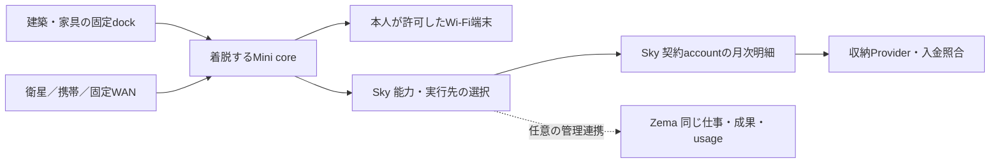

# Miniの埋込・着脱・衛星Wi-FiとAgent月次請求

2026-10-15。利用者がこのチャットで確定した要求を、サービス設計チャット「サービス設計を組み直す」と同じ正本へ統合する。主担当MAT15/M1、請求はBIL02/O5。設計のみ、実機・回線・実請求は未受入。

## 一つの利用体験

建築・インテリアのdockにMiniを取り付け、Skyで必要なAgent/LLM/Toolを選ぶ。Jenniferで目的を伝え、Zemaで同じ仕事・成果・費用を確認する。Miniを取り外すと、本人の仕事と接続を携帯し、許可されたWANを近くの端末へWi-Fi共有することを目標とする。施設の機器権限は持ち出す本人の仕事から分離する。

Sky単体で利用から月次請求まで完結し、Mini・Jennifer・Zema・RockstarOS導入は必須ではない。Zemaは同じusageを参照する任意の仕事管理入口。

線は設計契約であり、回線や本番Provider接続の証拠ではない。

## ハードと通信

2026-10-25の継続指示に基づく準備（要件変更なし）: 内蔵衛星modem・antenna・保護付き電池pack/セル・回線契約の[候補比較と実機試験準備](../avocado-mini-r5/satellite-hardware-trial-plan.md)を追加。9770の一般IP、9704のIMT、NB-NTNのUDP主体通信を区別し、共有許諾・網側hard cap・同一閉箱の収納/電源/熱を採用前条件とする。地域/用途と数値目標は未確定、購入/契約/無線送信/実機合格は未実施。単体携帯、端末/通信量/料金上限と表示4条件を維持。

Mini単体の衛星→Wi-Fi共有について、端末許可/失効、送受信量と費用の事前予約、ドック離脱、停止/期限、SQLite保存と再起動復旧のhost制御prototypeを追加。架空回線の試験であり、実modem/AP/kernel強制・本人UI・Provider課金・同一閉箱は未接続。板/膜なし、少ない表示部、上下全範囲、低眩しさを保持する。

[通信制御の詳細](../../systems/rock-star-os/targets/avocado-mini/tethering/README.md)へ、利用体験、責任、API、最大料金の予約、停止/復旧とDP02/03/05への受入順を追加した。実料金表は未確定で、試験の単価は架空。

[Linux下位制御](../../systems/rock-star-os/targets/avocado-mini/tethering/LINUX.md): Linux packet gate候補では、同一grantのIPv4/IPv6・送受信を共有quotaで強制し、停止・離脱・再起動時に旧許可を閉じる。隔離Linuxの実packet20件とcompiler4件に合格し、独立静的/host検収mustFix0。counterは最終確定とせず予約を保持する。実衛星/AP/Broker認証・Provider請求・電池の受入は別途必要。 namespace所有claimの破棄/再利用は自動解除せず、旧processと未確定予約の管理照合が必要。

[AP認証・網側上限](../../systems/rock-star-os/targets/avocado-mini/tethering/ACCESS.md)の共通adapterを追加。端末固有鍵、管理下hostapdの世代/認証、網側HMAC/TLS予約をLinux転送前に確認する。事業者・modemは本人回答どおり未定。実無線/衛星/請求は未受入、単体携行と表示4条件を維持。

[着脱・衛星・携帯Wi-Fiの詳細](../avocado-mini-r5/embedded-portable-connectivity.md)をR5の現行追補とする。固定dockは保持・給電・任意の有線通信、可搬coreはOS・本人性・保存・携帯電源・Wi-Fiを担当する。1本自律・使用時200mm以内・別演算Hub不要は維持。原本の外部給電のみの前提を、設置中給電＋取り外し後の携帯電源へ更新する。battery部品は未選定。

直接衛星通信は目標であり、屋内での受信や高速internetを保証しない。アンテナ、上り/下り、回線契約、IP/共有可否、熱/電池/収納を同一試作機で確認する。外部衛星terminalで通信できても、Mini単独衛星対応とは呼ばない。物理停止、ゲーム、local処理はcloud課金の完成待ちにしない。

## 請求と責任

[月次後払いと未払い対応](../sky-billing.md)を料金の正本とする。通信事業者のように契約accountへAgentの使用量・単価・上限・明細をまとめ、毎月請求する。通信費・端末代・既存OS料金・Agent費・第三者実費は別項目。携帯carrierの請求書への合算は別の接続契約であり、まだ未受入。

後払いでも見積・上限・同意を維持。未払い時は通知、猶予/異議対応、新規有料Agent利用の制限、入金照合と復旧、必要時に人が審査する適法な回収へ進む。OSが銀行口座を直接凍結したり、安全機能を止めたりする設計にはしない。旧ToC収益料金の保留と今回のAgent利用料金方針を混同せず、executionHoldsと本番gateを維持する。

## 合格条件と次の作業

ハードはDP01〜05（着脱/電源/衛星IP共有/熱と稼働時間/本人・guest分離）を実機で受入。請求は同一account複数Miniの集計、月境界、重複usage/決済通知、結果不明、異議/訂正、制限と復旧をProvider sandboxで受入する。国、契約/収納主体、単価、締日/支払日、与信枠、battery、modem/antenna/Provider、施工profileは未確定。

GitHubへの設計保存、main統合、サイト公開、runtime実装、実機/Provider受入を別々に記録する。今回の変更には手元のFivePlay/FiveM実装、Pixel実装、課金有効化を含めない。
