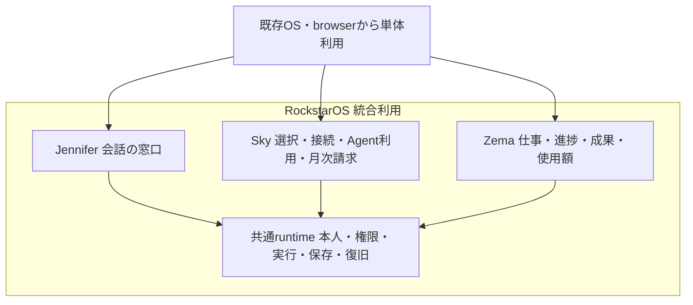
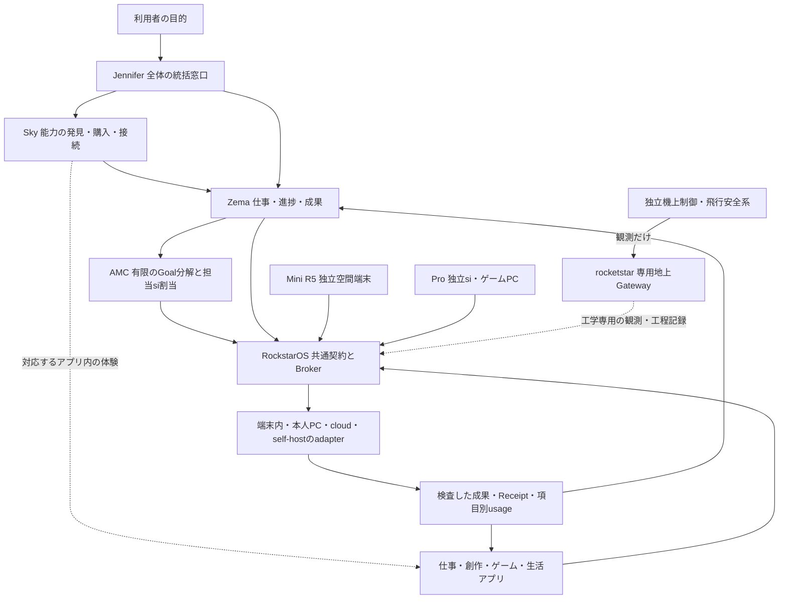

# avocado サービス統合設計

## RockstarOSへの統合と各サービスの単体利用

2026-10-15の本人指示により、**RockstarOSにはJennifer・Sky・Zemaを統合する。同時に3つはそれぞれ単体でも利用できる設計とする。** Jenniferは話しかける窓口、SkyはAgent/LLM/Toolの選択・接続・利用と月次請求、Zemaは仕事・進捗・承認・停止・成果・使用額の管理を担う。

**SkyだけでAgent利用から月次請求まで完結する。** JenniferやZema、native OS、Mini、SIMの導入を必須にしない。Zemaの使用額表示はSkyの同じ明細を参照し、請求の成立条件にならない。共通の本人・権限・Job/Run・成果・usage契約をadapter経由で利用し、全サービスの同一DB化や全経路の実装完了を意味しない。[請求責任・状態・保存・復旧・合格条件](../sky-billing.md)を正本とする。

図は論理的な統合と利用入口を示す。単体利用時は必要な共通backend/adapterへ接続し、native RockstarOSのインストールは要求しない。独立配布・認証・実Provider連携の受入は各経路で別に行う。

再構成版 1.0 / 2026-10-13 / 設計案と既存契約の整理。製品版は RockstarOS 1.0 Developer Preview を維持する。

利用者の明示指示により、第一者の製品表示はすべて小文字の **si** を使う。[表記契約](../../data/product-terminology.json)に従い、API/schema・package名・task ID・外部固有名と保存原本は互換性と証拠のため保持する。表記変更で能力・実行権限・受入状態は変えない。

**自分のやりたいことを、自分のsiチームと進め、成果を仕事・創作・ゲーム・生活へ持ち帰れるサービスを作る。** Jenniferへ目的を話し、Skyで能力を選び、裏側のZemaで仕事を進め、RockstarOSが本人・権限・費用・保存・復旧を支える。MiniとProはその体験を広げる独立した機器。rocketstarは同じ記録・承認思想を使う独立した宇宙工学programである。

利用者の「やりたいことは変わっていない。最初から設計書を組み直して素敵なサービスにしたい」という指示に基づき、機能を追加した順の説明から、体験・責任・契約・実現順に読める構成へ組み直した。既存実装を全面作り直す指示、料金変更、実機操作、公開・課金の開始ではない。

2026-10-15の中心体験は、**PCや対象の実物の前に拘束されず制作し、携帯を持たず対話・確認・指示を続けること**。[体験と受入条件](01-service-experience.md#携帯を持たずpcや対象物の前にもいない制作体験)を各製品へ通す。Miniは空間の入口、Pro/cloudは任意の計算先、Sky/Zema/Coreは同じ作品・仕事・本人・費用を引き継ぐ。

## 読む順番

1. [利用体験](01-service-experience.md) — 誰が何を始め、どこで成果を受け取り、また使いたくなるか。
2. [共通システムと契約](02-system-contracts.md) — Sky・Zema・OS・si・Walletの責任、状態、保存、費用、復旧。
3. [各製品の役割](03-product-profiles.md) — Jennifer、Mini、Pro、rocketstarを同じ構想へ接続する境界。
4. [実現順と受入](04-delivery-and-acceptance.md) — 再利用する実装、不足、担当、合格証拠、次の作業。
5. [要望の引継ぎ](05-requirement-coverage.md) — RQ01〜RQ49と最新mainで追加されたRQ50の対応先。
6. [横断整合契約](06-consistency-contracts.md) — 同じ本人・仕事・予算・成果を追う不変条件と12受入シナリオ。
7. [関連・戦略・データ・取引の調査設計](07-ecosystem-strategy-and-data.md) — 19系統の入出力と不足の補完、25接続、13データ種、15取引、一次資料と改善証拠。

技術の細部は[全体詳細設計](../rockstaros-complete-design.md)、[全Tool詳細](../sky-tools-complete-design.md)、[全設計ポータル](../rockstaros-design-portal.md)から開く。ここはサービス全体を理解し実装判断へ渡す統合基本設計で、原本PDF、各Device Profile、Tool schemaの代用品にはしない。

全製品の接続、LLMを使う／使わない実行経路、Mr.由来ToolとMR、現在の受入状態は[全体Mermaid関係図](../rockstaros-product-system-map.md)にまとめた。図の線は設計上の契約であり、実Providerや実機の接続完了を意味しない。

## 七つの名前をどう理解するか

- **Sky** — 自分に必要なAgentとToolを見つけ、条件を確かめ、購入・接続し、使う場所へ届けるplatform。
- **Zema** — 依頼を仕事にし、計画・進捗・確認・停止・成果・使用額を見渡す管理役。
- **RockstarOS** — UIやsiの主張から独立して、本人・有限権限・実行・保存・復旧を強制する共通runtime。対応する機種ではnative OSとしても提供する。
- **Jennifer** — 利用者が話す全体のプロジェクト統括窓口。第一者表示はJenniferへ統一し、過去資料のJennifferは旧表記としてだけ保持する。目的をGoalへ整理し、担当siと成果受領をまとめる。Zemaはその裏の仕事system。[JenniferのGit正本](https://github.com/k999ln/rock/blob/3349c2475468443bc7ecd94a4e3782343f514a8f/docs/jennifer-coordination.md)はPR #113でmain統合済み。本番受入は別。
- **avocadoMini** — 身体・手・日本語音声で遊び、作り、暮らしへ広げる独立した空間端末。現行はR5。
- **avokadoPro** — NVIDIAのGPU/chipを使う高性能si PC。PCゲームも維持する独立据置PCで、Miniへの接続は任意。
- **rocketstar** — 衛星輸送・帰還・回収・再使用を目指す独立工学program。一般のAgentから機体管制を行わない。

Jenniferは会話による統括の窓口。Sky直接操作・host app・ゲストの有限処理では会話を必須にせず、同じ業務契約へ接続する。8件のJennifer projectは社内開発/運営portfolioで、一般利用者の案件と権限を分ける。

図は到達設計の関係を示す。全接続が実装済み・同じDBへ同期済みという意味ではない。Mini・Pro・rocketstarの完成は、Sky単体の利用開始条件にしない。

## 今回固定する判断

1. 2026-10-15の本人選択により、eSIMの通信とsi利用権をまとめる商品を入口にする。accountは本人・契約・仕事・費用の正本で、試用とclient/browser経路は維持する。料金率・実発行・本番gateはこの方針変更だけで変えない。[6層の基盤とGrapheneOS調査](../native-os-integration.md)を土台にする。
2. 利用者はJenniferと話し、Zemaは仕事・承認・停止・成果・費用の裏側systemとして動く。Skyは独立Web/PWAでも品質を成立させる。OSの中、アプリの中、NFC入口からも同じ仕事・権限・成果契約へ接続する。画面を共用できることと、履歴・認証が共有済みであることは区別する。
3. 全体を一つの体験にしても、Skyは発見・接続、Zemaは仕事管理、Brokerは実行権、Walletは金融記録の照合を持つ。新しい巨大管理systemを作らない。
4. まず既存Toolで成果を保存・持ち帰り・再利用できる一周を完成させる。自然な会話・cloud Agent・複数端末・空間操作は同じ契約を使って伸ばす。
5. ゲーム・発明・Rocketstarの志向を削らない。非金融Gameと創作は金融の完成待ちにせず進め、交換・物理作用・飛行は既存の個別gateを守る。

## 設計の根拠と状態

要求は[製品ベース](../product-baseline.md)と[data/product-baseline.json](../../data/product-baseline.json)を優先する。最新の明示判断が過去の説明を更新し、原本のバイト列・履歴・受入記録はそのまま保持する。今回の構成案とUX上の選択を、利用者が既に確定した新要望として記録しない。

最初の設計入力のGitHub mainは `4273ef02da9dbb28ede8ba8862b874615fa8a0d7`。同一SHAの6 check成功を読取確認した。mainのcomposition・復旧改善は存在する一方、手元の旧作業コピーにある5大学共用Sky・Fitnessの型付き成果plugin・要求署名版eSIMは別の未保存候補である。未マージをmainへ、CI成功を本番Providerや物理OSへ読み替えない。[再構成の証拠](../evidence/service-design-rebuild.json)に入力・検証・残条件を記録する。

Jenniferのcontext・真正検収証拠、課金方式と現行Wallet gateの整合、passkeyの実装・復旧、各端末の実機受入は、[未決定事項と決め方](04-delivery-and-acceptance.md#未決定事項と決め方)に担当と判定条件を置く。

最新再確認: PR #113のJennifer sourceはhead `3349c247`の8check成功後、2026-10-13 18:21:19 UTCにmain `01d2e418`へ統合済み。merge SHAの7checkも成功。本設計branchへmainを保全mergeした。原本/context/真正review/native/Providerの未受入条件は引き続き個別に残す。

利用者の「mainへあげて」によりPR #114を2026-10-13 21:37:37 UTCにmain `59412c04`へ通常mergeした。最新mainの#112/#115/#116/#117/#118を保全した受入head `7b27ae7d`は全体verifyと同一SHA9 CI成功、merge treeも一致。Git統合をSite再配備/Provider/実機受入へ換算しない。

8. [Miniの着脱・衛星Wi-FiとAgent月次請求](08-mini-connectivity-and-billing.md) — 建築から携帯へつながる体験、通信・仕事・料金、受入境界。
