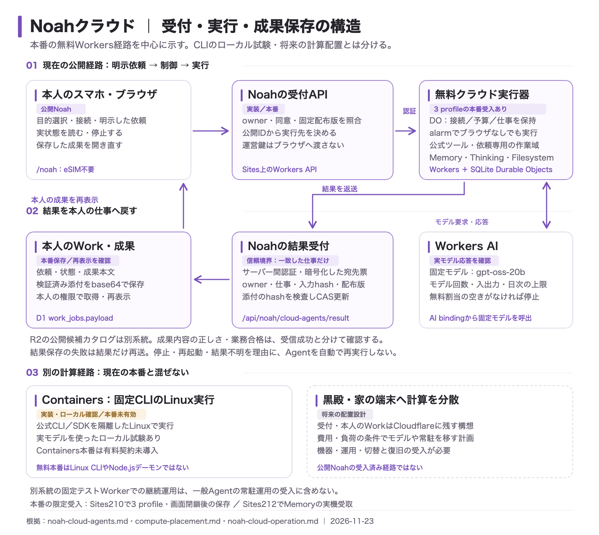
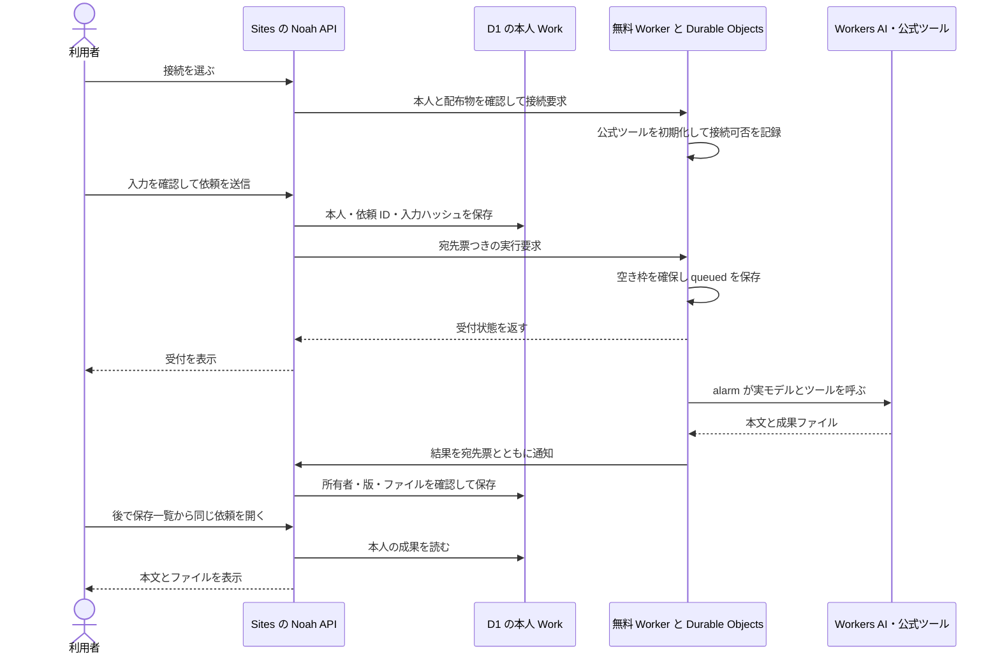

# Noah — CLIの管理クラウドと提供元への直接接続

- 本人が言う一言: 「CLI型もユーザーの設定なしでNoah内から使う。指定元のクラウドへも直接つなぐ」
- Goal: Macを起動せず、公式CLI/SDKの接続・依頼・停止・結果の再表示をNoahで完結する。
- Noaがつなぐもの: 公開ディレクトリのproject ID、固定版の実行profile、確認済み提供元の接続先、既存の本人scopeとWork。
- AMCの工程: 掲載/版/本人確認→実行先の準備→probe→明示した依頼を受付→隔離実行→結果の保存と確認→停止/破棄。
- Jevの合格条件: 実クラウドで公式Agentの入力→応答/ファイルを1件以上観測する。画面閉鎖後の結果再取得、同一ID再送の実行1回、別owner/Origin拒否、同時数/期限拒否、停止後の実行0、運営鍵のguest/ブラウザ露出0を試験する。提供元接続は検証したendpointへ実際に要求する。
- 出力先: NoahのAgent詳細と既存Work。提供元・版・実行状態・本文と成果物・失敗理由を表示する。
- Wallet: 利用者への新課金は追加しない。運営の既存Cloudflare環境に明示した有限のCPU/時間/モデル/日次枠を設定する。外部購入・送金・有償サービス登録のゲートは開かない。
- hardware profile依存: Cloudflare Durable Objects / Containers / Workers AI。Noah WebはSites。本人のMacとスマホは操作画面のみ。
- 失敗時: 起動失敗を接続成功にしない。途中の実行は自動再送しない。停止・期限切れでcontainerを破棄し、停止確認不能/再起動で結果不明を保存する。
- 記録: 本人scope、profile/配布版、接続ID、依頼ID/入力hash、期限、状態、モデル呼出回数、生成物hash。既存WorkのCASで保存し、業務合格や本人承認へ昇格しない。

## 本番で依頼を動かす仕組み（2026-11-23）

利用者は `avoado.si/noah` で仕事を選び、入力と送信先を確認して依頼する。無料の管理クラウドで受け付けるのは公式の Memory、Filesystem、Sequential Thinking。スマホや Mac は受付と閲覧を担当し、送信後にブラウザを終了しても実行器が結果を保存する。[公開画面](../../components/noah-cloud-agent.tsx)・[対応する配布物と上限](../../lib/noah-cloud-contract.ts)

### 配置とデータの持ち主

| 場所 | 入出力と保存範囲 |
| --- | --- |
| Sites の Noah Web/API | 画面と同じホストで本人を解決する。D1 の公開掲載系列と R2 の `noah/collection/v1/{source}.json` を読み、配布元と固定した実行方式を照合する。掲載は公開、依頼・履歴・成果は本人単位で扱う。[ディレクトリ](../../lib/noah-agent-directory-server.ts)・[収集データの読取](../../lib/noah-agent-directory.ts)・[本人の解決](../../lib/request-auth.ts) |
| 専用 Worker `noah-free-cloud-agents` | Node.js と esbuild で公式 npm 3種を束ね、Cloudflare Workers の `nodejs_compat` で動かす。依頼ごとの仮想ディレクトリ `/tmp/workspace` を公式ツールが使い、モデル呼出は Worker の `AI` binding が担当する。利用者の端末や常駐 Node.js サーバーの起動は不要。[ビルド](../../services/noah-cloud-agents/build-free.mjs)・[配置](../../services/noah-cloud-agents/wrangler.free.jsonc)・[公式ツール](../../services/noah-cloud-agents/free-official.mjs) |
| SQLite Durable Objects | `CONNECTIONS` は本人のハッシュ・project・profile ごとに接続状態と直近の依頼 ID を保持。全体で一つの `BUDGET` は UTC 日次の利用数と同時枠、`JOBS` は本人のハッシュ・依頼 ID ごとの入力、版、期限、進行、結果送達状態を保持する。依頼を動かすのは `JOBS` の永続 alarm。[受付と状態遷移](../../services/noah-cloud-agents/worker.mjs)・[無料実行](../../services/noah-cloud-agents/free-worker.mjs) |
| Sites の D1 `work_jobs` | `user_id` と依頼 ID で本人の Work を取得し、`revision` が一致する場合だけ更新する。本文は `payload.noahRemote.result`、ファイルは `payload.noahRemote.cloud.files` に名前・バイト数・SHA-256・base64 本体を保存する。Web は本人のファイルを Blob に戻してダウンロードする。この経路の R2 は公開の収集目録に使う。[結果の受取](../../lib/noah-cloud-api.ts)・[Work の保存](../../lib/work-store.ts)・[ダウンロード](../../components/noah-managed-files.tsx) |

### 接続から再表示まで

- **接続を選ぶ。** `GET /api/noah/discover/project?id=…` で配布元・実行環境・対応 profile を確認し、`GET /api/noah/cloud-agents?projectId=…` で接続状態と本人の履歴を読む。接続・依頼・停止・切断は同じ API への JSON の POST。書込には同一 Origin と現在の `X-Rock-Owner-Scope` が必要で、接続・依頼時には本人の許可設定も確認する。Sites から専用 Worker への `POST /rpc` はサーバー間の Bearer 認証を使う。[詳細 API](../../app/api/noah/discover/project/route.ts)・[クラウド API](../../app/api/noah/cloud-agents/route.ts)・[検査と転送](../../lib/noah-cloud-api.ts)
- **依頼を受け付ける。** 接続の試験が成功し、有効な接続 ID が一致すると、同じ接続で前の依頼が終わっていることを調べる。無料枠は全体で同時2件、UTC日ごとに実行10件、本人3件。接続試験は全体で別に100件/日、同時枠は実行と共用する。満枠は429。1件240秒、依頼本文12,000バイト、モデル最大4回、モデル入力32,768バイト/回、出力1,024トークン/回。固定モデルは `@cf/openai/gpt-oss-20b` で、共有の無料割当に達すると利用を停止する。[枠の定義](../../lib/noah-cloud-contract.ts)・[受付判定](../../services/noah-cloud-agents/worker.mjs)・[モデルの呼出](../../services/noah-cloud-agents/free-worker.mjs)
- **結果を受け取る。** 公式ツールの成功を少なくとも1件確認し、本文とファイルを返す。成果ファイルは実行記録 `noah-execution.json` を含め12件まで、各32 KiB・合計64 KiB。`POST /api/noah/cloud-agents/result` は Origin のないサーバー間 Bearer 認証と暗号化宛先票（AES-GCM）を検証する。本人・project・依頼 ID・入力ハッシュに加え、配布版・ハッシュ・終了状態・各ファイルの実体を照合する。受取後は `/noah/saved?tab=results` から `/noah/tasks/{id}` を開ける。共通の `GET /api/noah/ask/{id}` はこのクラウド成果を D1 から読む。[宛先票](../../lib/noah-cloud-receipt.ts)・[コールバック](../../app/api/noah/cloud-agents/result/route.ts)・[共通の成果読取](../../lib/noah-ask.ts)
- **通信や処理が途中で止まったとき。** 同じ依頼 ID・入力の再送は既存状態を返し、内容が違えば409。依頼中の端末切断は実行を継続する。本人の停止は終端状態にし、遅れて届く結果で上書きしない。開始済みの提供元モデル計算の中断時刻は観測できない。実行中の実行器再起動、または停止確認失敗は `unknown` とし、自動で再実行しない。完了通知の保存に失敗したら10分ごと、完了から最長30日間、**結果だけ**を送り直す。送達済みの実行器内データは完了から1日を過ぎた alarm で削除し、本人の D1 の Work は保持する。[実行器の復旧](../../services/noah-cloud-agents/worker.mjs)・[受付・結果照合](../../lib/noah-cloud-api.ts)

### 他の実行先と運用目標

公開 MCP や Gradio Space は提供元が処理する。`GET /api/noah/provider?project=…` が正規の送信先・操作・入力定義を返し、利用者が確認した `POST /api/noah/provider` を受けてから再照合して送る。公開サイト診断では管理許可と外部診断への同意を求める。成果を同じ本人の Work に保存するが、提供元での処理中は結果画面を開くよう案内する。[提供元の受付](../../lib/noah-provider-api.ts)・[定義の再照合](../../lib/noah-provider-runtime.ts)・[サイト診断](noah-site-diagnostics.md)

固定した Linux CLI を動かす有料 Containers、本人ごとの専用 Sandbox、常駐処理を黒殿へ移す構成は拡張対象。公式6配布物の ARM64 Linux 隔離試験ではホストから実モデルへ中継した。Hermes・boss・Time の本番起動と新ログインへの管理移行は未完了。運用の設計目標は受付 API の月99.5%、最初の成果が95%で30秒以内、預かったデータの消失0。D1 の日次 R2 バックアップと復元訓練は別の運用作業で、本番定期実行・100人同時利用・月間 SLO 達成の実測は残る。[計算配置 §0.5・§4](../compute-placement.md)・[Sandbox 案 task75](../../codex/tasks/75-noah-own-device-cloud.md)・[運用 task105](../../codex/tasks/105-cloud-operations.md)・[隔離試験 task125](../../codex/tasks/125-noah-cloud-agents.md)

### 本番で確認した範囲

| 公開版と端末 | 観測した操作と結果 |
| --- | --- |
| Sites210、Chrome 157・390×844px タッチ | 3種類を各1件送信し、Chrome 全終了後15秒は HTTP を送らず、共通 Work の読取で D1 保存を確認。Memory は実モデル2回・成功した公式操作1回、Filesystem は2回・1回、Sequential Thinking は4回・3回。再起動後の表示・ダウンロード・ファイルハッシュ、別件で停止・同じ依頼の再送・別所有者の404も確認。[task125 の受領票](../../codex/tasks/125-noah-cloud-agents.md#2026-11-23-本番の画面閉鎖後受取停止) |
| Sites211、Chrome | 添付表示の修正後、Memory 1件を再測。Chrome 終了から約3.6秒後に D1 保存。再起動後に `memory.jsonl` 145バイトをダウンロードしてハッシュを照合し、保存済み添付の表示も確認。[PR #21 の公開後受入](https://github.com/iceiceice999/rock/pull/21) |
| Sites212、Pixel 10・Android 17・Vanadium、411px | 「接続できる」から Memory を検索・接続・依頼し、保存一覧から成果を開いて再読み込み。実モデル2回、公式 `create_entities` 成功1回、`memory.jsonl` 136バイトと実行記録の実体・ハッシュを照合。Pixel のダウンロード操作はこの試験の対象外。[PR #23 の実機受入](https://github.com/iceiceice999/rock/pull/23) |

## 境界

2026-11-22 追加指示: 全掲載を接続対応の対象とする。既存の確認済み系列とSpaceに加え、GitHubの公式server.json、npmの公開パッケージと公式MCP台帳、Docker MCPの公式配布記録から実行先を照合する。紹介一覧のURLや説明文のコマンドを実行先として採用しない。公開MCPには入力定義を確認して直接要求し、既存Workで同一依頼ID・本人分離・停止と保存を保持する。CLIは固定配布物のMCP標準入出力にも対応を拡張する。APIがない・認証必須・停止中の場合はその理由をNoah内へ返す。全掲載件数と実行合格件数は分ける。追加契約は未承認のまま。

公開紹介文をshellコマンドとして実行しない。有料 Containers 向け設計では、運営が検証したprofileの固定配布物をコンテナイメージに入れ、依頼は文字列として渡す。guestへの外部network・運営鍵・ホスト共有を与えない。モデル要求は運営側の固定モデル/上限を経由する。依頼ごとに独立したcontainerを破棄し、他人の環境を再利用しない。

提供元の接続先は公式API/台帳で同じ配布物との対応を確認し、HTTPSの公開hostだけを使う。任意URLやredirectによる私有network到達を拒否する。提供元が本人のログインを必須にする操作は認証を省略せず、Noah内でその必要性を表示する。

本番D1 migrationは不要。新しい独立WorkerのDurable Object保存を使い、既存の本番テーブル定義は変更しない。Cloudflare Containersの配備権限は本人の再認証で取得する。

## 実装と受入範囲

固定profileはHermes Agent 0.19.0（公式SDKのterminal/file操作）、boss-agent-cli 3.4.151（公式CLIの求人票からの面接準備）、Time 2026.11.18、Sequential Thinking 2.2.0、Memory 2.2.1、Filesystem 2.4.0。後者4つは公式MCP標準入出力の初期化・道具一覧・実際の道具呼出を固定実行コマンドで扱う。Dockerの配布ページは公式上流実装との対応を確認した別名で、Docker Hubのイメージ自体を使うという意味ではない。任意GitHub CLIへの対応完了は含まない。bossの求人検索・応募や提供元ログインも未対応。公開MCPの接続先は実行直前にも配布元の定義と道具hashを確認し、宛先変更・本人停止・権限変更時は送信しない。応答不明は再実行せずWorkへ記録する。提供元クラウドが公開されていないAgentに接続先を推測して付けない。

有料 Containers 向け実装の実行枠は全体同時2件、1日50件、本人1日10件、1件240秒/モデル8回/1応答2048tokens。モデルはWorkers AIの `@cf/openai/gpt-oss-20b` に固定する。ファイルは1件32KiB、合計64KiB、12件まで。依頼ごとのguestは外部通信不可・非root・共有ディレクトリなし。公式Agentの操作を使い、モデル呼出だけを運営側で中継する。

結果は暗号化した宛先票とサーバー間認証でNoahへ返し、既存Workへ保存する。ブラウザは完了通知の実行主体ではない。保存に失敗した場合は10分ごと、最大30日間結果だけを再送し、Agentは再実行しない。保存済みの実行器側結果は1日後に削除する。NoahのWorkでは内容を未検証のまま保存し、料金・本人承認・業務合格へ昇格しない。

2026-11-22のローカル受入: 公式2配布物をLinux/amd64の外部通信なしコンテナで起動し、HermesのToolによる `total.txt=2000`、bossの5問の面接準備を確認。モデルは固定応答を使った試験であり、実クラウドのモデル受入ではない。実Chromeの320/390/1280pxではAPI fixtureを使ってタップ・接続・停止・結果再表示・ファイル保存を確認。Cloudflare `containers:write` の認証は完了したが、新旧両環境でWorkers Paid requiredを実確認。実クラウド受入が完了するまで本番CLI機能は有効化しない。

2026-11-22 追加CLIの受入: Node 24の固定イメージで公式Memory/Filesystemの初期化とツールを実行。Memoryは依頼内の情報整理とmemory.jsonl出力、次の独立guestが空の記憶で開始することを確認。Filesystemは専用/workspace内の作成/読込と成果のhash照合、領域外の直接パスとsymlinkの拒否を確認。モデルはfixtureであり、実クラウド受入は継続して未完了。新ログイン用OAuthは既存認証と別保存にし、配備先は旧account IDへ固定する。

## 無料枠の公式JavaScript実行

2026-11-23の最新指示により、追加料金を発生させずに進める。Memory 2.2.1 / Filesystem 2.4.0 / Sequential Thinking 2.2.0の公式npm本体をfactoryから呼ぶ。shellプロセス・コンテナではなく、公式ツール実装をWorkersへ組み込む方式。bundlerで解決できないversion.jsの動的package.json読込だけを固定manifestの値に置換し、ツール実装やパス検査は書き換えない。

Workers FreeとSQLite Durable Objects、Workers AIの無料割当を使い、有料モデル・Gateway・契約変更を使わない。無料枠超過はCloudflare側のエラーで停止する。運営側でも全体10件/UTC日、本人3件/UTC日、同時2件、モデル4回、出力1024tokens/回、入力32768bytes/回を上限にする。別機能と共有の無料割当を使うため、上限未満でも空きがない日は実行できない。

受付後は永続alarmが実行を開始し、ブラウザGETなしで既存の宛先票からWorkへ結果を送る。実行中の再起動は再送せず結果不明。停止は永続状態で以後のモデル/Tool送信と結果採用を閉じる。すでに提供元で始まったモデル計算自体の中断を保証するものではない。公式ツールは依頼専用の/tmp/workspaceのみを使い、外部fetchや利用者端末にはつながない。出力ファイルは既存上限とhashを検証する。

追加受入: 実workerdで公式Tool呼出、VFSの依頼間分離、直接パス/リンクによる領域外拒否を確認する。本番で実モデル/Tool呼出と成果hash、Chrome全終了後のWork保存、同一ID非再実行、別owner拒否、停止後の追加操作なしを確認してから各profileをUIで有効にする。2026-11-23、Sites210で3profileの実モデル/公式Tool処理とChrome全終了後のD1保存・再表示・download/hashを確認し、別依頼の停止/再送非実行/別owner拒否も確認した。端末条件と配備版、成果の証拠は [task125](../../codex/tasks/125-noah-cloud-agents.md#2026-11-23-本番の画面閉鎖後受取停止) に記録する。

## 無料枠の公式Python実行

2026-11-23の追加指示。公式Hermes Agent 0.19.0の会話ループとTodo/Memory、boss-agent-cli 3.4.151のinterview-prepコマンド、Time 2026.11.18のMCP factoryをPython Workersへ組み込む。配布物のSHA-256を検証して展開し、公式ソースは変更しない。OSシェル、Hermesの汎用ファイル操作・追加Tool・長期記憶、bossの求人検索・応募は提供しない。Hermesの計画と依頼内の記憶、bossの面接準備、Timeの変換結果を成果ファイルとして保存する。

PythonのVFSはisolateで共有されるため、依頼ごとにUUIDの一時領域を作り、公式Hermesのcontext-local homeとインスタンス別Storeを使う。Python実行をisolate内で直列化し、終了時に領域とContextを必ず破棄する。モデル輸送は運営鍵を渡さないRPC capabilityで固定モデルへ中継し、既存の日次10件・本人3件・同時2件・240秒・モデル4回の同一予約で数える。JS coordinatorは長いPython呼出を開始gateの外で待ち、停止・期限後のモデル/Tool受付と結果採用を閉じる。Pythonの外部公開URL・任意URL入力・OSプロセス起動は設けない。

互換層は非対話コールバック、無効化したバックグラウンドログ、固定RPCモデル輸送、公式設定への一時保存に限定する。モデルの出力やfixture成功を公式Tool成功と扱わず、成功した操作名・入力/応答hashと固定配布版を実行記録へ残す。結果は既存Work callbackで送達し、保存済みの再表示は実行を起こさない。本番D1 migration・有料プラン変更は不要。

合格条件: 3profileで公式処理成功・実モデル1回以上・成果hash一致、画面閉鎖後に閲覧なしでWork保存、再表示/ダウンロード、異なる依頼の記憶非共有、同一IDの非再実行、停止/期限後の結果不採用。既存3profileと全体verifyの合格を保つ。本番受入前のprofileは完成扱いにしない。
