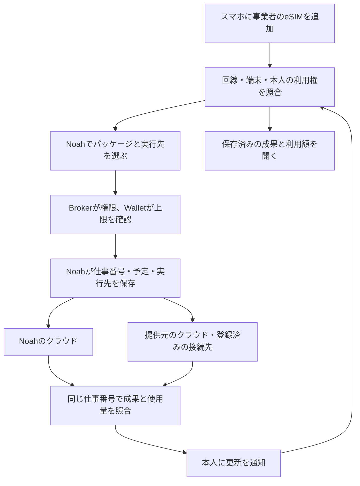

# Noah — 専用の端末（雲・家・手元）

Noahで仕事を頼む時に「どこで動くか」を決める。自分のMacを使う仕事はMacが起きている間に動く。Noahのクラウドを選んだ仕事は、スマホもMacも閉じたまま、依頼時または予約した時刻に動く設計。miiは主商品、その最小構成がNoah。クラウドで実行を確認済みなのは[固定テストAgent](noah-cloud-operation.md)で、一般Agent向けの実行・従量請求は設計段階にある。

## クラウドで依頼して受け取るまで

スマホ向けRockstarOSでは、本人の専用eSIMを経由する要求だけが、このサービスのクラウドへの依頼・操作・成果取得に進める。独立版Noahと仕事の実行基盤を共有する場合も、対象の仕事には同じ接続条件を適用する。すでに許可された予約のサーバー側実行は、利用権・権限・予算を確かめて続ける。[専用回線での利用条件](../structure/03-esim.md#専用回線での利用条件)

以下はスマホから始める仕事の設計。ローカル試験では、同じ仕事番号を使って実行先を照会し、タブを閉じた後に結果を取得できた。実eSIMおよび外部提供元での動作は未検証。[模擬回線の検証](https://github.com/k999ln/rock/pull/387)

- 開始時にAgentの版・入力・実行先・費用上限を確定する。外部Agentでは対応する提供元を優先できる。次の仕事から実行先を切り替え、受付済みの仕事は元の接続先・仕事番号で照会する。
- 予約の各回は予定IDと予定時刻で識別する。開始前に利用権・停止状態・残予算を再確認する。外部に受付済みの仕事は、提供元の中断確認が届くまで停止確認待ちとする。
- 結果は本人の仕事に保存し、予約額と確定使用料を照合する。端末通知は更新の有無を伝え、本文は本人が専用回線で開く。再送で実行・精算・配給を増やさない。
- 配給では本人が配送先を登録し、運営がDockで入荷済みの品物・数量・受取人を指定する。本人が受領を記録する。配送先は運営と本人が扱い、外部Agentには渡さない。

### 実装・公開前に確かめること

スマホからの通し試験は、専用eSIMでパッケージを1件開始し、画面を閉じ、次の予約時刻を過ぎてから同じ本人のNoahで結果を受け取るまで。本人の成果1件とその回の利用記録1件、他人の成果取得0件を照合する。同じ開始要求・完了報告の再送、通知を拒否した端末、専用回線を外れた端末、データ元が応答しない場合も試す。[eSIMの実機受入](../../codex/tasks/11-esim-first-live.md)

1. 固定版のAgentを1種選び、2人のアカウントで許可した入力・成果・停止が混ざらないことを確認する。
2. Macとブラウザを閉じて予約時刻を3回通し、各回にWorkと成果が1件ずつ残ることを確認する。予定停止後の新規起動は0件。実行中の停止は環境の終了まで確認する。[予定の受入](../../codex/tasks/92-noah-standing-work.md)
3. 同じ依頼・終了通知の再送と結果不明を試し、二重実行・二重計上が0件になることを確認する。同時に届いた依頼の予約合計が本人・運営の上限に収まることを確かめる。[利用記録の受入](../../codex/tasks/94-noah-usage-three-views.md)
4. 原価と明細を照合し、事業者、モデル、予算、無料枠、失敗時の請求条件を決めてから有料提供へ進む。[実装タスク75](../../codex/tasks/75-noah-own-device-cloud.md)

## 既存の実行契約

- 本人が言う一言: 「みんながこの noah を使って agent を当たり前に自分の専用の端末に繋げて利用できるようにしたい」「pc の前じゃダメ」（11-20）「携帯は『リモコン感覚』。メインの動きは違うハードウェアで済ます」（10-10）
- 2026-11-25本人確定: eSIMから本人専用の非公開クラウドを利用する接続・隔離と、安全確認・公的機関への適法な協力は[03 §8〜10](../structure/03-esim.md#8-esimで開く本人専用クラウド2026-11-25本人確定)を正本とする。本書は実行先の契約であり、回線接続を無制限の常駐・実行承認に置き換えない。本人用eSIM不要経路は保持。provider・クラウド契約・提携・実データでの安全確認と情報提供は未受入。
- Goal（Eveが作る）: 目的＝Agent を、本人専用の、画面の無い端末で動かす。本人の手元は頼む所と受け取る所にする / 入力＝固定版（hash）、依頼文、承認済みの上限 / 期待成果＝既存 Work の成果と使用量 / 予算上限＝無料枠、または本人の月の上限 / 要る権限＝その版が宣言した権限
- Noaがつなぐもの: `noah-terminal/1`、`noah-isolation/1`、`/api/noah/runner`（取りに来る・lease・heartbeat・finish）、`noah_runner_devices`、`noah_runner_commands`、モデルの中継、既存 Work、Wallet の予約、接続計画（[noah-one-click-connect.md](noah-one-click-connect.md)）
- AMCの工程:
  1. 受付（担当: Broker）— 合格条件: 利用権・上限・版の固定を確かめた。
  2. 端末の用意（担当: Work）— 合格条件: クラウドは本人ごとに論理端末を1件登録し、仕事を受けた時に計算資源を割り当てる。家と手元は本人が承認した端末。
  3. 隔離環境の用意（担当: Work）— 合格条件: 仕事ごと・Agent ごとに別。画面・入力装置・本人のファイルが無い。
  4. 配置（担当: Work）— 合格条件: 配布物と依存の層の hash が固定版と一致。
  5. 実行（担当: Work）— 合格条件: 上限の内側で終わる、または理由付きで止まる。
  6. 回収（担当: Work）— 合格条件: 成果と使用量が Work に残り、隔離環境が消えている。状態を持つ Agent は、その Agent の分だけ保存した。
  7. 精算（担当: Wallet）— 合格条件: 無料枠の消費、または従量の明細に 1 回だけ載る。
- Jevの合格条件: 別 owner との隔離環境の共有 0 件。同じ owner の別の Agent のファイルの読取 0 件。宣言外の host への通信 0 件。隔離環境の中の鍵 0 件。上限を超えた継続 0 件。停止後に残る隔離環境 0 件。同じ要求 ID の実行 1 回以下。結果不明の自動再実行 0 件。hash が合わない配布物の実行 0 件。置き場所の無断変更 0 件。PC が要る手順 0（雲）。[noah-screenless.md](noah-screenless.md) の検査の違反 0 件。
- 出力先: Noah の端末の一覧（雲・家・手元を同じ並びで）、「頼む」と仕事の一覧。phone でも可。
- Wallet: クラウドの無料枠は候補段階（1人1日10回）。超えた分は上記の従量設計を使う。家と手元はクラウドの実行料0円。電力と端末の実費は未計測と表示する。
- hardware profile 依存: 雲は全部。家は mii（Hub）・Pro・Mac。手元は pixel-native。**契約に機種の名前を書かない。** 置き場所の値は `cloud`・`home`・`pocket`。機種の差は profile と、端末の行の platform に置く。
- 失敗時: 準備の失敗・時間切れ・上限到達・通信の拒否を分けて見せる。lease を越えた仕事は結果不明にし、再配送しない。家の端末が応答しない時は待つ。本人が端末ごとに選んだ時だけ雲へ回す。
- 記録: owner、端末、版 hash、隔離環境の種類、開始と終了、CPU 秒、メモリ、モデルの入出力トークン、通信した host、停止の理由。依頼と成果の本文は既存 Work にだけ置く。

## 置き場所

| 値 | 何か | 本人の準備 | 向く Agent |
| --- | --- | --- | --- |
| `home` | 家で動き続ける端末。今は Mac の runner（最初の完成条件）。次に mii の Hub、Pro | 端末を 1 回つなぐ | ターミナルで動く Agent、載せたコード、常駐、本人の契約で動く Agent、手元のデータ、画面を操作する Agent |
| `cloud` | 利用者のMacが閉じていても、Noahが仕事ごとに起動する画面の無いLinux（設計） | 対応Agentと上限を確認 | クラウド隔離の受入を通った単発・予約の仕事 |
| `pocket` | Pixel の中 | 無し | スマホ内版（[noah-mobile-variant.md](noah-mobile-variant.md)） |

- つないだ Agent（Passport）は account が正本。端末は cache。端末を足した時・替えた時は、置き場所の変更（`change_place`）をまとめて 1 回の確認で行う。
- 提供者のサーバーで動く Agent は、この契約の外（[noah-agent-intake.md](noah-agent-intake.md)）。

## クラウドの実装候補（Cloudflare Sandbox）

2026-11-21: 雲は Cloudflare の従量で始め、引き金（従量の請求が月 約 $190 を 2 か月続けて超える）の後に黒殿の 1 ノードへ移す。置き場所の値は `cloud` のまま。詳細は [compute-placement.md](../compute-placement.md)。

- 専用 Worker から Cloudflare Sandbox を起動する（[noah-cloud-operation.md](noah-cloud-operation.md) の専用 Worker と同じ置き方）。Web の本体とは別の配備にし、runner と同じ認証付き API だけで話す。Sandbox は 1 つが 1 つの VM。認証と回数制限は用意されないので、こちらで持つ。
- 本人ごとの端末は `noah_runner_devices` に platform=`cloud` の行として持ち、端末の一覧に出す。初めて必要になった接続の時に作る。
- `noah_runner_commands` は「端末 1 台につき実行中 1 件」の一意制約（`noah_runner_one_claim`）を持つ。雲の端末は同時 3 件（候補）まで動かすので、同じ形の受け渡しを別の表で持つか、制約を platform 別にするかを実装で決める。既存の行の意味は変えない。
- 共通の image は 1 つ（Node・Python）。Agent ごとの image は作らない（保存の上限が account 全体で 50GB）。依存を入れ終えた層は、Sandbox の backup（R2 の読み取り専用の層）として 1 回作り、同じ版の実行で使い回す。Agent の状態も、owner と Agent の組ごとに同じ仕組みで保存する。
- 外向きの通信は全閉から始め、接続要件の `egress` だけ許可する。モデル提供元の host は中継へ向ける。鍵は中継が付ける。
- 上限の初期値は今の `LIMITS`（240 秒、モデル呼び出し 8 回、出力 2,048 トークン、入力 12,000 bytes、ファイル 12 個）。常駐は雲では受けない（1 体あたり月 約 $8。設計書 6 章）。

## 家の作り

- 今の Mac の runner（`scripts/noah-mac-runner.mjs`、常駐は `scripts/noah-mac-service.mjs`）が最初の実装。足すのは、スマホの QR での承認、導入を 1 つにまとめること、[noah-screenless.md](noah-screenless.md) の重さの上限。
- mii の Hub と Pro は、同じ runner を Linux で動かす。先に、Mac 固有の処理を 1 か所に寄せ、Linux の host で同じ受入を通す（task 95）。機種ごとの受入は別の task にする（この契約は変えない）。
- mii では、Agent に表示層・カメラ・マイク・センサーを直接渡さない。Agent が返すのは成果と表示の依頼で、描くのは RockstarOS（[noah-screenless.md](noah-screenless.md)）。
- 本人の月額契約で動く Agent（Codex 等）は、`home` でだけ動かす。本人のログインを雲へ運ばない。

## 費用の式（雲）

月の運営原価 ＝ 受付・予約の基盤費 ＋ 全実行の計算・モデル・外部サービスの利用料 ＋ 保存・通信・ログ ＋ 決済・請求手数料。無料枠内の仕事も運営の原価には含める。料金比較では「登録人数」に加えて、実際に使う人数、1人あたりの回数、1回の実行時間とモデル利用量を記す。

1,000人全員が毎日1回、30日使うと月3万回になる。比較用のCloud Run東京の例では、1回5分・1 vCPU・メモリ1 GiBで0.90円、Gemini 3.1 Flash-Liteの入力1万・出力2,000トークンで0.825円。受付月750円を足すと月52,500円（1ドル150円換算、無料枠控除前、保存・通信の追加分、決済手数料、税、人件費等は別）。**5分は事業者間の比較条件で、現行の実行上限は240秒。** 本番予算には、候補環境で測った実行時間とモデル利用量を使う。試算上の「1回10円」は販売価格に採用していない。[Cloud Run](https://cloud.google.com/run/pricing?hl=ja)・[モデル](https://ai.google.dev/gemini-api/docs/pricing#gemini-3.1-flash-lite)・[受付基盤](https://developers.cloudflare.com/workers/platform/pricing/)

## 最初に測るもの

固定 adapter 13 件のうち、モデル無しか中継で動く物を使う。準備の秒数、最初の成果までの秒数、1 回の費用、同時 10 件での失敗数、依存の層を戻す秒数。結果をこの文書へ足す。
