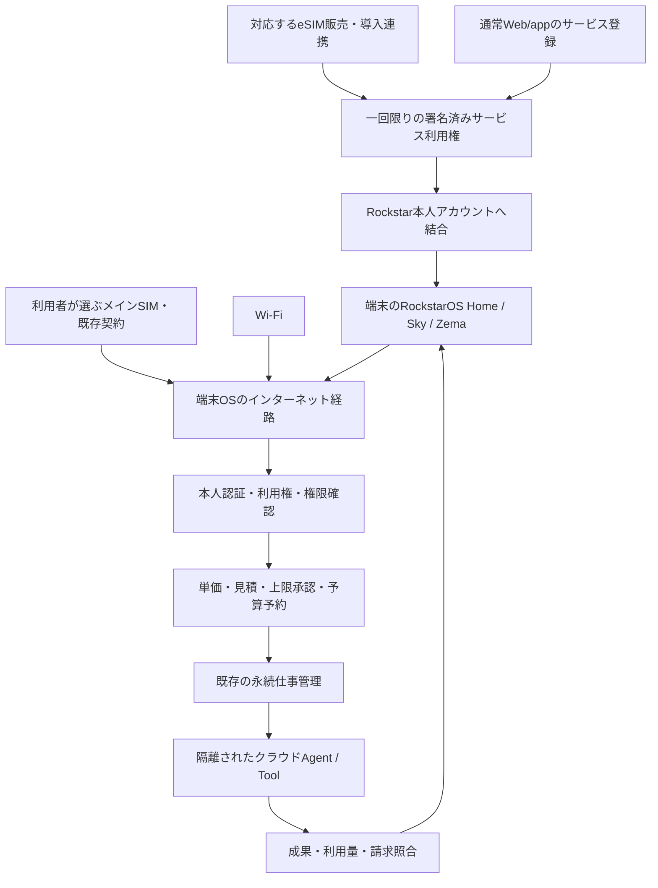
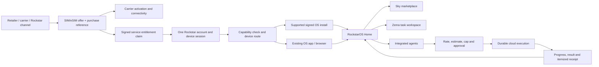

# Optional SIM/eSIM-led RockstarOS service architecture

## Sky共通入口仕様 — NFC・通常Web・任意eSIM・iOS

更新: 2026-10-12。利用者が指定したチャット「大学別NFCでSkyに接続」（`01a13164-efb3-7253-a986-5517c3db5a71`）の最新明示方針「OSでも出すがSky単体でも高品質に使える」と、このチャットのeSIMからiOSへSkyを追加したい要望を同期する。RQ01〜RQ49を保持し、既存WEB06 / SKY21 / SIM01の詳細化とする。主担当はWeb / PWA / Sites、ROCK。以下は共通入口の仕様であり、今回の保存を新しいruntime実装・公開・実機受入と数えない。

### 目的・提供範囲

SkyはAgent・Tool・MCPを発見し、作者・機能・価格・権限・実行先を確認して購入・接続・利用する単独サービス。最新の追加指示により、Sky単体の成果は各対応アプリ内へプラグインして表示し、Skyの成果一覧からも確認できる。OS版ではZemaが依頼・進捗・承認・停止・成果・使用額を統合管理する。RockstarOSは共通runtimeと対応端末への統合を担う。SkyのWeb/PWA利用開始はOS完成やeSIM購入を待たない。

通常URL、大学NFC/QR、任意eSIMのサービス案内は同じSkyへ収束させる。大学専用の別アプリや新しい顧客・購入・仕事台帳は作らない。大学名・おすすめ・用途例を変えても、既存SkyのAgentフィード、役割選択、Market、購入履歴、接続管理、保存済み成果を共用する。Zemaへの導線はOS版の仕事管理として維持する。フォーム中心の旧大学Hub案は後続の明示修正により主画面として退役し、briefは補助Toolとして保持する。

### 利用体験とiOSの到達範囲

1. 通常URLは`/sky`。登録済みNFC/QRは`/t/{tagId}`から`/sky/campus/{id}/hub`へ進み、同じ`SkyWorkspace`を大学文脈で表示する。対象はNYU / FIT / Columbia / Fordham / John Jay。未知・停止タグは既存解決規則に従い、特典や利用権を付けない。
2. 説明と用途を閲覧し、使いたいAgentを選ぶ。保存・購入・個人の接続には既存の本人sessionを使う。購入が必要なPackageは条件確認→既存Checkout→支払照合→購入履歴へ進む。購入済みであっても未接続・失効・返金・利用不可を区別する。
3. 接続先・送信データ・権限・実行可能範囲を確認する。OS版ではZemaで依頼を作り、Sky単体を組み込むアプリでは受入済みのアプリ契約から依頼する。有料Cloud実行では単価・見積・上限・予約を承認してから実行する。依頼欄への下書き引継ぎは送信や課金ではない。
4. 実行中・承認待ち・停止要求・失敗・結果不明を表示し、成果とusageを保存する。受入済みCloud jobは許可済み範囲で継続でき、再接続時に同じjobを読み戻す。保存済み成果はSky一覧と対応アプリで読み、OS版はZemaでも管理する。接続/購入の成功表示をAgentの成果へ置き換えない。
5. iPhoneはSafariで使い始め、本人が希望すればホーム画面へWebアプリとして追加する。NFC読取りにはOS通知を開く操作、PWA追加には本人操作が必要。eSIM追加だけでSkyを自動導入・常駐・他アプリ操作できる仕様にはしない。
6. eSIM提供形態では対応する販売/導入案内から既存claim・導入証明・利用権へつなぎ、同じSkyへ戻す。通常のWeb利用者にeSIM購入を要求しない。通信は本人が選んだメインSIM/Wi-Fiを使い、eSIM存在だけで本人認証しない。

iOS native clientのApp Intents/Siri/ショートカット/ウィジェット連携、App Clipによる初回体験は後続候補。今回の初期ローンチ条件に加えず、実装済みとも扱わない。採用時は公開API、対象iOS、配布方法、必要権限、停止/復旧、実機操作を個別受入する。常駐の価値はまず「Cloudで継続した仕事を通知・Zemaで受け取れること」で満たし、PWAアイコンを端末内の無制限な常時実行と説明しない。

根拠: [AppleのeSIM provisioning](https://developer.apple.com/documentation/coretelephony/ctcellularplanprovisioning/)、[NFC背景読取り](https://developer.apple.com/documentation/corenfc/adding-support-for-background-tag-reading)、[iPhoneのWebアプリ追加](https://support.apple.com/ja-jp/guide/iphone/iphea86e5236/ios)、[App Intents](https://developer.apple.com/documentation/appintents)、[App Clip](https://developer.apple.com/documentation/appclip/configuring-the-launch-experience-of-your-app-clip)。

### 入出力・状態・保存

- 入力: 許可済み大学ID、登録タグID/経路、本人session、Package/版、接続先、依頼、費用承認。任意eSIMでは既存注文・claim・署名済み導入証拠・登録gateway鍵を追加する。タグ/URLに原稿・秘密・購入権tokenを置かない。
- 出力: 同じSkyの大学別表示、条件/価格、購入・接続の状態、Skyの保存済み成果、対応アプリ内の型付き表示、OS版Zema job、暫定/確定usageと明細。
- 状態は直交させる: 入口/大学表示、本人、大学特典、購入/サービス利用権、接続先、job、予算/usage、client追加、SIM導入。`campus=columbia`、PWA追加、eSIM導入を認証済み・学生確認済み・支払済み・実行済みへ昇格させない。
- 保存は既存owner別Campus profile、commerce、service entitlement、MCP枠、`lib/workflow.ts`の仕事/revisionと成果物を使う。大学別manifestは表示/起動情報のみ。下書きは既存のtab内・10分・一回限りの引継ぎ。eSIM API署名は既存scope・期限・失効を再利用する。
- 複数入口でも同じ本人の購入・仕事を再利用する。ただし別originのSites間でcookie、IdP session、D1、購入権が自動共有されるとは扱わず、配備先と認証callbackを同一候補で検証する。

### 承認・料金・責任

一般MCP無料枠5、対象5大学の大学メールdomain確認済みstudent profileは6を保持する。在学そのものの証明は未受入で、student属性は自己申告。7枠目等の拡張価格・期間・条件は未確定のため販売無効。接続枠、Agent/Tool購入、Cloud usage、外部SaaS実費、通信料を分ける。既存Tool売上10%や保留中の月額条件をこの仕様で変更しない。現在のPC Connector由来の枠identityをそのままスマホCloudの本番quota受入に数えない。

ROCKは共通UI・状態表示・既存認証/利用権・quota・予算・復旧を担当。EXTERNALはApple/Android、IdP、Stripe、carrier、Agent/MCP Providerの対応範囲を担当。JOINTは同じ公開artifactで本人A/B・iPhone/Android・購入/実行/停止/再接続を検収。OWNERは配布先、学生確認水準、販売条件と費用上限、必要な端末操作を決める。既存承認を保持し、LLM出力や公開フラグから新しい権限・課金を推定しない。

### 失敗・復旧

NFC非対応/読取り失敗は同じ管理URLのQRまたは直接URLへ戻す。PWA追加を拒否してもbrowser利用を続ける。ログイン失効は既存return先へ復帰し、購入やjobを新規作成し直さない。Checkout戻りだけで支払を確定せず、結果不明は既存注文を照合する。Provider未接続・料金未確定・超過・失効は理由と次の操作を示し、実行を停止する。通信断後は同じjob/receiptを読み戻し、再送や二重購入を避ける。MCP枠の削除と実行中jobの停止は別操作として扱う。

### 進捗との対応（2026-10-12の観測）

| 対象 | 確認できた範囲 | 残る条件 |
| --- | --- | --- |
| GitHub main `8c5891f` | Columbia向け`[campusId]`公開入口が存在。同一SHAのcheck-run 8/8 success | 5大学のlocal差分・DB履歴・引継ぎとの統合。main CIをdirty作業木へ転用しない |
| local `37c06cec` + 未commit差分 | 5大学のHubが共通`SkyWorkspace`を参照。Sky内Zema、manifest、MCP一般5/学生6のsourceと先行local試験がある | 共通Skyへ戻した最新差分のUI再検証、同一artifact公開、実機/本人A/B受入 |
| 指定公開`rockstaros-kaiya.../sky` | 今回browserでAgentフィード、役割、Market、サービス/MCP接続、コードtimelineを読取り確認 | source/version・DBとの同一性、5大学差分の配備、本人/購入/Provider実行は未確認。画面表示を成功実行へ換算しない |
| 別公開`sky-marketplace...` | 既存大学監査のv39/source `8cd0a4d7`はこの別Siteの履歴 | 指定公開Siteとversion/DB/受入を混同しない。今回この別Siteは再受入していない |
| Cloud Agent/MCP | executor等のsourceはあるが`remoteAiPricingGateAccepted()`はfalse。スマホ単独MCP/本番費用の縦断受入は未完了 | Provider・信頼単価・本人上限・予約・usage照合・取消/再接続を同じ実行経路で受入 |
| eSIM/iOS | 任意claim/署名アクセスのlocal契約は既存。iOSはbrowser/PWAから入る設計 | 実eSIM/carrier/端末引渡し、iPhone実機。native iOS/App Clip/App Intentsは後続候補 |

先行大学試験の証拠は[大学NFC記録](evidence/campus-sky-entry.json)。その旧専用HubのUI試験を共通Skyへの変更後のUI合格に流用しない。今回の仕様同期・source hash・検証は`data/project-status.json`の`skyEntrySpecificationSync`へ記録する。Pixel APK、QEMU、full OSのgateも独立して維持する。

### 修正順・合格条件・未決定事項

1. **差分と入口を同期**: mainと先行dirty変更を保全し、`[campusId]`/`[campus]`の競合、0059〜0063 migration/journal、最新引継ぎを整合。同じsource SHA/build/配備先/DBを特定できること。
2. **単独Skyを受入**: 通常URLと5大学タグから同じAgentフィードへ入り、大学名/おすすめ/役割、Market、本人の購入・接続、Zemaへ進める。大学を替えても別ownerデータを表示しない。guestの閲覧/briefと保存・購入・実行の本人条件を分ける。
3. **代表Agent一件を縦断受入**: 機能/価格/権限/実行先→必要な購入照合→接続→見積/上限承認→Provider実行→成果/usage保存→Zema読戻し。無権限・失効・超過・停止・通信断・再試行も同じ候補で確認。false gateを外すだけで合格にしない。
4. **対象を限定して公開検収**: 指定Siteで同一artifact、本人A/B、一般5/対象学生6/超過/競合、iPhone/Androidの実NFC・QR・PWA、購入失敗/復旧を記録。Apple Payは適格環境の実Checkoutで別検収。未受入Providerや未確定有料枠を販売可能と表示しない。
5. **任意eSIMとiOS拡張**: 上記と同じSkyを再利用してclaim/失効/再接続を受入。App Clip/native連携が必要になった場合は別scopeで実装・実機検証する。Sky単独公開をeSIM/OS完成待ちに戻さない。

検証入口: `npm run project:update`、`npm run baseline:check`、`npm run design:check`、`npm run verify`。UI変更時は共通Sky・大学別Sky・Zemaの実操作を追加する。代表Agent/Provider、追加枠料金、学生確認水準、配布大学の運営条件、実eSIM発行元、iOS native採用は未確定。既存無料/決定的Toolから試せるが、その成功で有料Cloudを合格にしない。

Status: product direction and implementation contract, 2026-10-02. This document supersedes plans that position eSIM checkout inside RockstarOS as the primary product, or imply that the OS binary is stored on a SIM.

## メインSIMを通信に使う共通クラウドサービス設計

更新: 2026-10-07。利用者の「雛形は同じものを使い」「mainsimから基本は通信を享受しクラウドで動くシステムを設計したい」という明示指示による具体化。主担当はSky / MCPのROCK、既存taskはSKY19、BIZ01、BIL02。この提供形態では新しい通信回線の購入を共通必須条件にせず、既存メインSIMまたはWi-Fiのインターネット接続を使う。以下の旧SIM販売・開通フローは通信同梱offerに適用する。通常Web/app、native/local、既存の通信同梱経路も保持する。今回の成果は設計であり、実eSIM連携・本番課金の実装完了ではない。

### 1. 目的と実現範囲

商品は「eSIMを入口に利用開始できるRockstarOSクラウドサービス」。Skyを含む画面はスマホのclient/browser、仕事の実行はクラウドへ置く。端末OSの置換は不要で、eUICC内にRockstarOS、Sky UI、LLMを格納・実行する設計にはしない。eUICC自身の専用OSや限定的なアプレットと、RockstarOSの汎用runtimeは区別する。

メインSIMの通信でこのサービスへHTTPS接続する構成は可能。一方、独自の「通信契約なし・認証専用eSIM」が任意の市販端末へ標準手順だけで入ること、eSIM追加だけでSkyが起動すること、任意のeSIM内鍵をbrowserから使えることは未確認。実profileを配布するなら、発行元・SM-DP+・LPA・端末/OSの権限と対応条件を受け入れる。carrier/OEM協力なしの汎用eSIM製品を販売可能とは表示しない。

これはeSIM同士が直接通信を融通する方式ではない。スマホのclientが、OSの選んだ既存の通信経路でクラウドに接続する。回線料金は既存メインSIM契約に従い、RockのAgent料金とは分離する。

### 2. 利用体験と構成

1. 対応offerの導入案内またはサービス登録から、同じHomeへ進む。実eSIMの追加とサービス登録のQR/URLを明確に区別する。サービス用コードをeSIM activation codeと表示しない。
2. 一度だけ本人登録し、署名済みclaimをredeemする。eSIM経由なら受入済みの発行/導入adapterから引き渡す。profileの存在、EID/ICCID、IPアドレスだけで本人認証しない。
3. モバイルデータは本人が設定したメインSIMを基本とし、Wi-Fiも利用する。追加eSIMへのデータ切替、APN変更、ローミング有効化、VPN導入をサービス開始時に自動実行しない。browserはSIM指定/経路保証ができないため「現在の端末接続を使用」と表示する。メインSIM固定を商品条件にする場合はnative側の経路確認・切断時停止を別受入する。
4. SkyでAgentを選び、Zemaに依頼する。送信情報・権限・単価・見積範囲・最大額・圏外中の継続可否を確認して開始する。
5. 実行中は進捗と予約額/暫定利用額、完了後は成果と項目別利用明細を表示する。通信復帰時は同じjobを取得する。

### 3. 共通の雛形と変更点

共通化する対象は既存のHome/Sky/Zema UI、本人/端末session、署名claim、Package registry、`lib/workflow.ts`の業務状態、A2A/直接LLMの実行、予算予約、receipt、支払い照合。eSIMごとにOSやクラウド基盤を複製しない。共通サービス上でownerごとにデータ・権限・予算を隔離する。必要なAgentだけjob単位の隔離環境へ送る。

offer設定は既存の`issuerId + offerId`とPackage key/manifest hashを再利用する。追加候補の設定は`entryMode`（既存サービスclaim／提携eSIM連携）、`connectivityPolicy`（端末の既定経路）、`proofPolicy`（account claim／検証済みprofile連携）、`tariffVersion`、対応端末/地域。これらは設計上の候補で、現schemaや環境変数に実装済みという意味ではない。料金・提供期間・scope・鍵はversionと失効規則を持つ。

共有してはいけないものは利用者session、秘密鍵、claim code、実eSIMのprofile認証情報、予算と台帳。テンプレートが同じでも、これらの識別子・秘密・所有権は固有にする。自作テンプレートの複製は実eSIM発行手順の代替にならない。

### 4. 既存コードとの差と修正順

- `lib/rockstar-entitlement-claim.ts`は既に`physical_sim | esim | service_only`を受け入れる。まず`service_only`と既存本人sessionを使い、通信プラン購入なしのクラウド体験を検証する。これは実eSIM導入を検証したことにはしない。
- 現在の`lib/esim-cloud-grant.ts`と`lib/esim-cloud-access.ts`は、有料eSIM注文、profile binding、署名install receipt、trusted gateway、審査済みStarter Packを必須にする。通信同梱型として保持し、単にJOINや署名検査を外して新方式へ流用しない。汎用サービス利用権経路と、実eSIMを根拠にする追加認証adapterを分離する。
- `lib/rockstar-service-access.ts`の既存claim経路を再利用し、本番は利用権検査を有効にする。previewの検査省略を製品の認証設計にしない。eSIMアクセスcookieを支払い承認に用いない。
- `lib/sky-usage-payment.ts`の直接LLM回収はtest専用で、A2Aは既存Wallet精算である。今回の設計を全Agentの本番従量課金完成とは扱わない。

最初に最新main・作業branch・この引継ぎ優先順位を同期し、未commitの既存作業を保全する。その後、サービスclaimのみのfixture → cloud job/予算/usage → 提携eSIM adapter → 実端末 → Provider sandbox/請求照合の順で受け入れる。クラウド体験とeSIM連携を別々に検証してから同じartifactで一周させる。

### 5. 入出力・状態・保存

入力はowner、サービス利用権ID、端末session、Agent/Package版、入力digest、scope、価格版/通貨、見積、予算上限、同意、冪等キー。実eSIM連携時だけ発行元と検証済みprofile/導入証拠の参照を付ける。出力は利用可能scope、同じjob ID、進捗、成果参照、利用明細、請求/入金状態。

状態は独立した軸で保存する。既存の仕事状態名を新設しない。

- 通信: 接続／切断／不明。browserのonline表示だけでSIM種別を確定しない。サービスに第二回線は必須でない。
- profile: 対象外／未発行／発行済み／導入確認／無効・削除。メインSIMの通信成功をRock profileの導入確認へ転用しない。
- サービス利用権: 未結合／有効／期限切れ／失効。停止しても保存済み成果・明細の本人回収経路は残す。
- client: browser／受入済みapp／受入済みnative OS。eSIM対応をnative OS受入と混同しない。
- jobと費用: 保存された業務状態、予約額、暫定usage、確定usage、invoice照合、入金を別レコードで結ぶ。

既存D1/永続Workflow・暗号化成果物保存・Wallet台帳を使い、owner/revisionの競合判定を維持する。Provider鍵はサーバー側、端末sessionは既存安全保存、eSIM activation secretは既存専用配送に限定する。原稿、SIM秘密、実アカウント情報をGitへ保存しない。

### 6. 従量課金と収益

顧客料金の基本式は「検証した利用量 × 事前提示した販売単価」の合計。Agentに応じて入出力token、計算時間、保存量/期間、外部Tool/API実費などから必要な項目だけ定義する。すべてを必ず課金する要件ではない。Provider原価への上乗せ方式または原価とservice feeを分ける方式を選び、同じ費用を両方へ二重計上しない。既存Tool販売10%も別の取引として照合する。

Rockの貢献利益は顧客売上からProvider/計算原価、作者配分、決済費、返金等を引いた残額であり、純利益や利益保証ではない。単価・通貨・最低額・請求周期・税・返金はBIZ01で確定する。通信料金は既存キャリアの別請求とし、キャリア合算請求は別契約が成立するまで実装前提にしない。AWS案件の自己負担0条件と既存料金保留を変更しない。

上限は事後集計だけで守れない。子job/並行jobが共通予算へ原子的に予約し、次の処理単位・最大出力・停止反映待ちの原価を予約内に収められるときだけdispatchする。実行時間・出力・価格の最大値を制限できないProviderは、この上限保証モードでは有料実行を許可しない。予算予約と実資金確保は別gate。増額時は再見積・本人承認を要求する。

### 7. 失敗・停止・復旧と承認

回線切替/圏外でも、クラウド受付済みの仕事は事前の継続同意と上限内で進める。未送信の依頼を受付済みにしない。通信復帰後は同じowner/job/keyで照合し、応答不明を自動再実行しない。利用量通知はprovider event/sequenceで重複排除し、遅延・欠損は未照合として扱う。

eSIM削除をサーバーが即時検出できるとは限らない。サービス失効は認証済みpartner event/本人操作/有効期限で処理し、事前に定めたjob停止規則を適用する。切断と失効は別である。紛失端末sessionは失効し、本人再認証後に別端末で同じ成果を回収する。claim/回線購入/モデル出力からTool権限や支払同意を推論しない。送信情報、外部作用、費用上限を既存承認境界で確認する。

### 8. 責任と合格条件

ROCKは共通UI、利用権、owner分離、権限、仕事/予算/明細、adapter契約とfixtureを担当。EXTERNALは実eSIM発行/LPA/OEM能力、クラウド実行・usageと請求、決済を提供。JOINTは同じprofile/端末/job/価格版での一周の検証を担当。OWNERは端末通信設定、接続・外部作用・上限を承認し、事業者として販売料金/契約条件を確定する。

受入は次の順で記録し、どこまでを検証したかを分ける。

1. **共通サービスfixture**: 通信プランなしの正当な`service_only` claim→本人→Sky→見積→承認→job→usage。同時処理・改ざん・別owner・期限切れ・上限超過を拒否する。
2. **接続変更**: メインSIMからWi-Fi/圏外/復帰へ切替えて同じjobと費用を回収。勝手なデータSIM変更・二重実行・二重請求がない。browserでは「メインSIM固定を強制した」と記録しない。
3. **実eSIM入口**: 契約済み発行元とexact端末/OSで発行・導入・サービス引渡し・失効/削除・端末交換。追加profileがデータ回線でなくてもサービスへ到達することを実測。Pixel 10 GL066/frankelは最初の試験候補で、過去APK23/23はこの証拠に転用しない。iPhoneは別受入。
4. **クラウド/課金**: 実Provider sandboxで正常・失敗・取消・停止遅延・応答消失・meter重複を試し、同じjobのusage/価格/請求/入金を照合する。商用条件と資金確保を受け入れてから限定本番へ進む。

未決定は、実eSIMを提供できる提携先と端末範囲、profileを無効化した後の利用権規則、提供期間、料金/回収方式、Provider上限保証。提携先の回答と同一候補の実測で決める。実eSIM経路が成立しない場合はサービス専用版を提供可能かを別に評価し、「eSIM導入済み」とは表示しない。

### 9. 調査根拠と現時点の証拠

2026-10-07確認の一次資料: [Android eSIM architecture](https://source.android.com/docs/core/connect/esim-overview)はcarrier profile、LPA/SM-DP+と権限境界を説明する。[GSMA仕様一覧](https://www.gsma.com/solutions-and-impact/technologies/esim/esim-specification/)はprofile provisioningの仕様体系の入口。[Apple Dual SIM](https://support.apple.com/en-us/109317)はデータ回線選択と切替条件を、[Pixel Dual SIM](https://support.google.com/pixelphone/answer/9449293?hl=en)は既定のデータSIM選択を説明する。これらから既存データ接続上にクラウドclientを構成する設計判断を導いた。サービス専用eSIMの汎用配布が保証されるとの記載ではない。

GitHub mainは`0fbf688b4585b829f9e34d37799d446cb5a66b32`を観測し、同SHAのcheck-runs 6件（verifyとSPIDER 5件）はcompleted/success。local HEADは`37c06cecc0dad6ebd59aa64a2900413df0ba2d68`、branchは`codex/esim-cloud-access`で対応remote refなし。多数の既存未commit差分を保持したままの設計保存で、mainのCI結果はこの作業木の合格証拠ではない。GitHub保存・main統合・公開は未実施。

## 2026-10-05 Cloud OS business direction

Authority: explicit user instruction and same-day clarification on 2026-10-05, recorded in `data/product-baseline.json.cloudOsUsageBusinessIntent`. The user explicitly limited this direction to the eSIM pattern and said not everything needs to use it. This entire document describes one optional service offering, not a replacement for the whole RockstarOS product. Preserve native/local LLM/offline agents, ordinary app/Web entry without eSIM, and capability/consent-based hybrid operation. Offer the eSIM path only for accepted compatible devices/channels; do not require an eSIM from every user. This clarification takes precedence over telecom-first wording below and earlier sales-positioning text. This optional offering is an eSIM-accessible RockstarOS cloud OS service. Sky agents execute in the cloud; this offering earns a disclosed margin from metered agent usage. Carrier connectivity supports access and is not this offering's product category or primary revenue model. Physical-SIM channels remain optional prior design, not a new requirement for this clarification.

The eSIM is an onboarding/access entry, not a runtime for an OS binary or model and not independent permission to use a person's apps or funds. Entry integration (carrier/distributor handoff, client link or entitlement delivery) is a design dependency requiring a real accepted route. The runtime uses authenticated Rockstar identity and service entitlement; possession of a profile or connectivity alone does not authenticate the user. Browser/app access may use other available networks after that identity is established.

**Experience and responsibilities.** One account opens Home, chooses a Sky agent, supplies input, reviews the quote and maximum spend, approves, follows cloud progress and retrieves the result and itemized usage. ROCK owns entitlement binding, job/consent identity, shared budget reservation, metering deduplication, stop/recovery, UI and ledger. EXTERNAL supplies provider execution, signed/verified usage or authoritative usage lookup, invoices and payment settlement; entry partners supply the accepted eSIM-to-service handoff. JOINT acceptance spans the same job/order across those systems. OWNER chooses input, permissions and the spend limit, and supplies the business's pricing and commercial terms.

**Inputs, outputs and storage.** Bind owner, entitlement, agent/package version, provider/model, immutable input digest, quote/rate version, currency, metering unit, cap, consent and idempotency key before dispatch. Persist jobs, reservations, usage events and receipts in the existing owner-scoped durable cloud store; keep provider API keys server-side and eSIM activation secrets out of prompts, logs and this repository. Return durable job state, results/artifact references and itemized provisional/confirmed amounts. Entitlement, carrier state, job success, metered usage, invoice reconciliation and customer settlement stay distinct.

**Failure and recovery.** Duplicate events charge once; response loss reconciles the same operation and never triggers blind redispatch. Reconnection retrieves the same job. Unsent work is not cloud-accepted work. Consent fixes whether accepted work may continue while the client is offline. Cap exhaustion stops dispatch or requests fresh approval; revoked entitlement blocks new work without deleting durable receipts. Cancellation records any provider work already consumed; uncertain provider costs remain unresolved instead of being fabricated or silently charged. Save/restore and owner isolation apply to results and receipts separately.

**Revenue contract.** Customer usage charge minus provider/model/compute costs, any author share, payment costs and refunds yields the contribution margin; operating costs and tax are additional before net profit. No numerical margin or guaranteed profit is approved. Candidate meters such as tokens, compute time, or a bounded agent operation must be selected per agent/provider from measurable cost data. A completed task alone is not proof of usage or settlement. Define failure/retry/cancel billing and avoid charging twice for the existing Sky Market 10% sale commission and cloud usage service fee. Preserve the held USD 8.88 policy and free discovery/connection rules; running paid cloud work is separately quoted.

**Acceptance and undecided choices.** BIZ01 specifies units, rates, currency, minimums, margin/cost allocation, caps and refund terms from a contracted sandbox's measured usage; SKY19 integrates the one-account Sky/Zema experience; BIL02 accepts dispatch → usage → provider invoice → customer charge reconciliation. Require normal completion, failure, cancellation, duplicate/delayed events, lost response, offline reconnection, cap exhaustion, revocation and cross-owner denial on one candidate. Real seller/carrier entry, provider costs and actual invoices remain unaccepted. Pixel/QEMU native installation remains a separate supported-device gate and is not a prerequisite for validating the browser cloud service. This document change does not enable live billing, carrier contracts, public release or device flashing.

Implementation started from main `9f64aee3`, merged into work branch `codex/esim-cloud-access` at `37c06cec`. GitHub main observed later as `80a662cc`; this worktree is not that remote revision. Earlier audit snapshots describe their recorded revisions, not the current main.

## eSIMに結び付く端末鍵でのCloud APIアクセス（2026-10-07）

**目的と責任。** 利用者の即時実装指示に基づき、Security / Identity / Complianceを主担当（ROCK、既存SIM01）とし、eSIMに登録済みのgateway鍵をCloud APIへのアクセスキーとして使う経路を追加する。既存の購入・profile binding・署名導入receipt・gateway trust・Starter Pack・期限・scope・取消を再利用する。これはeUICC内秘密鍵や現在のSIM挿入/有効状態を毎回直接検証する機能ではない。署名者は既存のeSIM gateway鍵であり、実eSIMの鍵保管・carrier privilege・端末adapterはEXTERNAL/JOINTで別受入する。暗号鍵による個人データの秘匿やサーバー非保存も別の要件である。

**利用体験と承認。** 初回は本人accountでeSIMの購入・導入・利用権を確認し、購入画面の「クラウドアクセスを開始」で既存のキーを有効化する。対応clientはそこで得た公開`key.id`を使い、端末の登録済み秘密鍵で要求へ署名する。秘密鍵とブラウザBearerの送信は署名経路には不要。Home/Sky/Zemaの既存APIへ同じownerで接続する。Toolの外部作用、見積共有、課金の承認は既存の別gateを通す。従来のcookie経路は維持し、署名の不成立時にcookieや別owner sessionへ自動fallbackしない。

**入力と出力。** `Authorization: RockEsimProof <base64url JSON>`、schema `rock-esim-cloud-request/1`。署名対象はschema、accessKeyId、requestId、signatureAlgorithm、HTTP method、origin/path/queryを含む完全なURL、bodySha256、issuedAt、expiresAt。`rock-esim-cloud-request-signature/1`とNULのdomain prefixを含む固定順JSONへ署名する。ES256はP-256/SHA-256の64-byte P1363、Ed25519は64-byte署名。HTTPS必須（local loopback HTTPだけ試験例外）、有効期間最大60秒、未来時刻許容5秒、本文最大1MiB。API固有の小さい入力制限も維持する。private key、原文、eSIM activation情報をproofに含めない。出力は既存APIのowner-scoped結果で、署名自体は支払いやTool成功の証明ではない。

**状態と保存。** migration `0061_esim_cloud_proof_uses.sql`を既存0059/0060の後へ適用する。リプレイ拒否表はaccess_key_id、request_id、expires_atのみ。要求本文・署名・秘密鍵は保存しない。scope・元注文・導入証明・gateway公開鍵と現在の指紋を再照合し、署名検証後にD1のunique制約で一回だけ使用済みにする。同時に同じproofが来ても一件だけ通る。同一HTTP Request内の複数scope確認は内部メモリで共用するが、別のHTTP要求へは共用しない。期限切れ行は認証時に最大256件ずつ削除する。既存job/利用明細/任意成果の保存仕様は変わらない。

**失敗・復旧。** 署名・owner/注文の鍵結合・URL/本文・有効期限・scope・現trustが不一致なら401。migration/DB障害は安全に停止する。既存のrotate/revoke、返金、期限切れ、gateway失効で署名アクセスも停止する。通信結果不明時は同じ署名を再送せず、新しいrequestIdと署名で既存job ID/idempotency keyを照合する。署名を新しくしても業務操作の二重実行を認めない。紛失時は通常accountで失効し、鍵の再登録と利用権の確認を経て復旧する。HTTP redirectは署名clientで拒否する。

**client導入。** `lib/esim-cloud-proof.ts`の`signEsimCloudRequest(request, keyId, algorithm, signer)`を使う。signerは署名対象bytesを受け取り、端末の安全な鍵保管領域で署名したbytesを返すadapter。秘密鍵を引数として渡さず、ブラウザで新しい鍵を生成して登録済みeSIM鍵の代わりにしない。通常accountでのキー発行・管理と、端末署名によるCloud API利用は別経路。実Android/iOS/eUICC signerのUI接続は未受入で、関数だけで端末対応を表示しない。

**合格条件・未決定の決め方。** `node --experimental-strip-types --test tests/esim-cloud-proof.test.mjs tests/esim-cloud-access.test.mjs`で両署名方式、改変、TLS、期限、本文上限を確認する。`npm run build`後の`TMPDIR=/private/tmp node scripts/check-work-api.mjs`で署名アクセス、本文の業務保存、要求再利用/並行再利用拒否、scope、key rotation、返金、誤鍵、管理API拒否を同じWorker/D1 fixtureで検証する。全体は`TMPDIR=/private/tmp npm run verify`。端末adapter方式・eUICC保管可否・実profile削除の即時検出可否は契約先仕様とexact端末で決める。合成署名の合格を実eSIM・実端末・公開済みに置き換えない。

ローカル検証結果: focused 12/12、Worker/D1 API 1178 assertions、CSV113、`npm run verify` exit0。実eSIM・端末・公開未受入。[同一sourceの証拠](evidence/esim-signed-access-local.json)。

## Optional eSIM cloud access implementation

**Purpose and experience.** An eligible owner opens `/sky/purchases`, checks the eSIM order, completes supported device installation, then selects **クラウドアクセスを開始** after signed install and authenticated gateway/Starter Pack confirmation. `/connect` explains this optional route alongside ordinary Web/app access. The owner can inspect the expiry, rotate the browser key or revoke it on the same purchase. Installation itself does not open a browser or create a cloud login automatically; the carrier-to-client handoff still needs partner/device acceptance.

**Responsibility and input.** ROCK owns `GET/POST /api/esim/orders/{orderId}/cloud-access`, owner separation, authorization and storage. EXTERNAL supplies carrier installation proof; the accepted device gateway supplies the existing signed receipt. OWNER/JOINT configure contracted service terms and production trust. The server accepts only an existing live paid, unrefunded order, its profile binding and exact installed/enabled receipt, the corresponding trusted device key and reviewed Starter Pack hash. A boolean from a browser never substitutes for those proofs.

**Configuration.** Apply migration `0059_esim_cloud_access_keys.sql`. `ESIM_CLOUD_ACCESS_POLICIES_JSON` is a server-only JSON array of `{packageKey, manifestSha256, accessDurationDays, scopes}`. Each unique purchased package/hash must have an explicit duration of 1–366 days and unique scopes from `rockstaros_access`, `sky`, `zema`, `agents`, including `rockstaros_access`. Missing/invalid policy disables grants. Reuse `ESIMGO_PLAN_CATALOG_JSON`, the immutable order pricing snapshot, `ESIM_INSTALL_RECEIPT_KEYS`, and existing configured/attested device gateway keys. Do not put signing keys or real activation material in this document. Duration/scopes must be agreed for each real offer; test fixture values are not product pricing.

**Output and state.** GET returns eligibility, scopes, service expiry and public key metadata; states are `not_issued`, `active`, `suspended`, `expired`, `revoked`. POST accepts `issue`, or `rotate`/`revoke` with the current `expectedKeyId`; a stale identifier returns 409. Issue/rotate returns only metadata and an HttpOnly, SameSite=Strict `/api` cookie (Secure outside loopback HTTP). Raw secrets never appear in response JSON, page markup, Web storage or logs. One active key per order is enforced in D1. Browser possession is a bearer credential, not hardware proof of possession; it remains linked to the originally attested order/device and is revalidated against that evidence.

**Storage and authorization.** The separate cloud-key table stores SHA-256 token hashes, owner/order/device/receipt references, granted scopes, timestamps and rotation links. It preserves audit rows. Normal authenticated Rockstar identity manages keys; a cloud key cannot issue/rotate itself, administer accounts, or call payment endpoints. Only explicitly allowlisted cloud work APIs accept it. Service scopes are intersected with the key's own scopes even in preview mode; broader owner entitlements cannot widen a cloud credential. Existing trusted gateway authentication is retained. Valid eSIM Starter Pack references appear in the existing entitlement response for display/package handoff; that display is not Tool approval.

**Failure and recovery.** Every use rechecks current paid/refund status, profile/install receipt, gateway trust, Starter Pack review/hash and policy. Expiry or changed evidence stops access. Credentials last at most 30 days and never outlive the service term, measured from the original gateway activation; rotation does not renew the service. Concurrent rotations yield one winner; old keys stop working. Concurrent revocation is compared with the original revocation state. If eligibility changes during replacement, keep a revoked, discoverable predecessor for explicit retry. When an issue response is lost, refresh state and rotate the saved key; never recover a plaintext secret from storage. Configuration/database failures fail closed without exposing internal errors. Stopping this key preserves existing jobs/receipts and does not cancel separately held service claims.

**Fees and acceptance.** The key resolves to the same owner used by existing quote, budget, usage and receipt stores. It does not create a charge, approve a Tool invocation, override the remote AI pricing gate, or implement carrier billing. Account management, provider connections and payments still require normal account/session authentication. Cloud-key access covers the Workbench/cloud APIs; full `/chat` provider administration remains an account flow. Local synthetic tests cover proof prerequisites, foreign owner, Origin, credential secrecy, concurrent rotation, scope isolation, expiry/refund/key revocation and restoration. Real carrier activation, device acceptance, external provider execution, commercial duration/prices and monthly/carrier collection remain distinct open gates. Evidence: [eSIM cloud access](evidence/esim-cloud-access-local.json).

## Product definition

This optional offering is a physical SIM or eSIM offer, sold through Rockstar and partner channels, that includes access to RockstarOS services. The SIM identifies/activates a carrier subscription where applicable; a separate signed purchase entitlement links the purchase to a Rockstar account. The OS binary is delivered through a supported device installation/update channel, or services run in the existing OS app/browser client. A SIM purchase alone neither activates a carrier profile nor installs an OS image.

Users choose the offer for three reasons, in order: fast access to cloud LLMs and agents; transparent usage pricing; integrated access to Sky and Zema with little setup. Cloud LLMs and agents execute remotely and are metered by use. Their charges are itemized separately from carrier connectivity charges.

## System boundaries

Carrier activation, purchase entitlement, Rockstar identity, device installation, cloud execution, and cloud billing are separate records and acceptance gates. Preserve channel-neutral signed claims, owner-scoped device authorization, device capability/attestation, durable A2A/Workflow jobs, recovery, quote and metering infrastructure, and shared budget reservations.

## Onboarding contract

1. At purchase or first launch, show the offer, included RockstarOS service scopes, supported regions/devices, carrier eligibility, and separate connectivity and AI pricing. Support physical SIM and eSIM purchases from more than one channel.
2. Activate eSIM only through an explicit supported carrier flow; for physical SIM, guide insertion and show carrier state when it can be read. Do not infer activation from a service claim.
3. Sign in once to a Rockstar account. Redeem the channel-neutral, one-time signed purchase entitlement and show which services it includes. Do not require separate registration for Sky, Zema, and integrated agents.
4. Read or request a device capability snapshot. Route eligible exact models to a signed, recoverable RockstarOS installation flow only after that model's install path is accepted. Route other devices to the supported existing-OS app/browser. SIM/eSIM support does not imply OS-install support.
5. Land on one Home with direct Sky, Zema, and Agent entry points. Present included/recommended agents as optional ready-to-use services; install or invoke them only under their own reviewed package, permission, and provider constraints. Additional agents remain discoverable through Sky.
6. For paid cloud work, show provider, model/agent, visible rates, estimate, currency, usage meters, user-set maximum spend, and any prompt-sharing disclosure before dispatch. Require explicit authorization. Hold execution at the cap and ask again before any higher spend.
7. Persist the accepted job and consent before dispatch. Cloud execution continues within that accepted scope while the device is offline. On reconnect, retrieve the same job's progress, result and itemized provider usage; never duplicate a task because a response was missed.

## Execution and cost contract

The device UI is a client and approval surface. Cloud workers and contracted providers perform cloud LLM/agent work. Each job binds the authenticated owner, task ID, provider/agent and version, request digest, quote/rate version, budget cap, consent, expiry, and offline-continuation choice. The cloud job ledger is authoritative for progress and recovery. Results and meter events sync to the device by the same job ID.

Before work, display rates and a bounded estimate. During work, display provider-reported usage and current reserved/estimated spend with its provisional status. After work, show itemized metered usage and receipt, and distinguish provider-reported usage from invoice-reconciled or settled amounts. A local fixture or usage row is not a bill. Enforce user caps in the shared reservation and dispatch layer; exceeding a cap requires a new quote and explicit approval.

The device can queue a new local task offline only when it is clearly labeled local. It cannot reach a cloud provider while the device has no route. Previously accepted cloud work can continue because the cloud already has the durable job, input and authorization.

## Device and service interface

- Shared Rockstar identity/session across the installed client and RockstarOS services; Sky, Zema and agents do not each create accounts.
- Home provides direct routes to Sky discovery, Zema work, agent task submission, active jobs, results and spending.
- Capability-based routing describes model, memory, storage, OS/bootloader, network and trust features. It recommends an install or client path based on exact accepted compatibility records; it never exploits or overrides a device.
- eSIM/SIM modules handle supported provisioning/activation integrations only. They do not contain the RockstarOS image or authorize arbitrary device control.
- Offline continuity UI distinguishes cloud jobs already accepted, unsent drafts, local-only work, and actions waiting for approval.

## Audit and backlog

| Priority | Work | Existing assets | Acceptance still needed |
|---|---|---|---|
| P0 | Finish one-time purchase claim and short onboarding across purchase channels | signed channel-neutral entitlement claim, issuer SDK, encrypted/idempotent seller-to-Rockstar delivery API, `/connect`, common identity/device session, Home routes | connect seller checkout to claim issuance and the seller's buyer-delivery channel; validate expiry/resend/refund/reissue in a contracted sandbox; carrier activation readback and end-to-end customer acceptance |
| P0 | Make cloud execution and pricing user-trustworthy | durable A2A jobs/recovery, signed quotes, budget holds, meter/receipt verifiers, itemized UI, explicit consent, [operator stop/recovery procedure](sky-cloud-operations-runbook.md), Android Shell source path for quote review → separate device-credential Wallet approval → exact quote-bound hold → Broker proof → explicit Cloud approval → same-ID recovery | compile and run Android Core/AIDL/APK/instrumentation on an equipped CI/device host; accept real Provider contract and sandbox, live rates/meters, invoice reconciliation, funded settlement |
| P0 | Route across device families | capability snapshot/attestation, Android client/core source, browser app | exact-SKU compatibility matrix; Android build/APK/Binder/device tests; supported iOS/PC clients; signed OS install and recovery acceptance per exact model |
| P1 | Integrate Sky, Zema and packaged agents | shared identity, direct Home entry, Package review/handoff, signed runtime binding, Provider-declared Package invocation extension, controlled local executor/result/receipt fixture, sequential Node-to-Python A2A handoff fixture, Zema UI to prepare a completed/retrieved result as an untrusted-data draft for a second separately quoted sibling Agent task, persisted owner/parent-scoped predecessor→successor edge after result capture, one successor per reviewed result, maximum redelegation depth 1 enforced in the store/API and D1, Cloudflare Worker/D1 fixture executing two separately approved sibling delegations on distinct Agent origins under one shared parent budget with encrypted handoff and restart/no-replay checks, read-only parent controller snapshot, cloud-agent Zema plan step records bound by delegation ID and server-checked against the saved signed quote or terminal captured result plus usage receipt, one-minute scheduled deadline sweep that expires pre-send work/releases its hold and requests cancellation of overdue remote tasks, versioned persisted Zema plan v1 with pre-work objective editing and immutable server-derived quote/Wallet/Cloud-approval/result-receipt gates | Extensible multi-step authoring and operator recovery runbooks; production Provider deadline/cancel semantics and interoperability; production output-schema/receipt semantics; reviewed default offer profiles |
| P1 | Add distribution and activation adapters | eSIM provider fixtures, channel-neutral signed-claim SDK and encrypted/idempotent seller delivery API, entitlement APIs | partner contracts and production keys, physical SIM fulfillment, carrier/eSIM activation, returns/refunds, operational support |

The eSIM bootstrap toolkit remains an eSIM integration fixture, not the product distribution restriction. Local tests verify only the behavior named in their evidence. They do not prove production billing, actual carrier activation, physical SIM fulfillment, successful OS installation, or supported-device acceptance.

2026-10-02 implementation audit follow-up: the native quote-to-Wallet-to-Cloud approval source path is now connected through Shell API v18 and the stable delegation ID. The earlier correction artifact listed that handoff as missing before the follow-up integration; current source-contract and shared Node/Cloud canonical-vector tests pass. Android Core Java/JUnit, AIDL generation, APK build, device-credential/reconnect instrumentation have not run on this host, so the native flow is implemented in source and locally contract-checked but not Android-runtime accepted. Real Provider execution, prices/invoices, funded settlement, SIM fulfillment/activation, and exact-SKU installation remain separate gates. See [follow-up evidence](evidence/sim-led-product-correction-followup-20261002.json).

## Evidence categories

- Implemented in source: the reusable infrastructure named above and Web/Android source paths as recorded in the workstream.
- Locally verified: automated tests with synthetic claims, keys, quotes, meters, D1 rows, and Worker jobs. These are local behavior evidence only.
- Production/device acceptance required: seller and carrier connections, real Provider contracts and invoices, production D1 deployment/readback, funded billing, Android/APK/device behavior, and exact-model OS installation and recovery.

### Agent利用料の月次後払い（2026-10-15）

利用者指示により、Agent利用を契約accountごとに毎月まとめて請求する方向へ更新。[請求・未払い対応設計](sky-billing.md)で単価/見積/上限、usage照合、支払方法、通知/猶予/有料実行制限/入金復旧/適法な回収を定義。通信・端末・OS・Agentの明細は分ける。銀行口座をOSが直接凍結する権限は持たせない。後払い与信・Provider sandbox・実請求は未受入。
