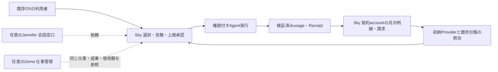

# Sky Market決済と旧収益精算

## Sky単体の月次請求ローカル実装（2026-10-15）

`/sky/billing` と `/api/sky/monthly-sandbox` を追加した。`npm run sky:monthly:sandbox` で `http://127.0.0.1:5220/sky/billing` を開く。NodeのSQLiteを使うローカル専用サーバーは合成accountで動き、同じReact画面・HTTP handler・D1互換storeを利用する。通常WebのAPIは既存本人確認とrate limitを通し、`SKY_MONTHLY_SANDBOX_MODE=local-fixture` かつHTTP loopbackのときだけ有効。外部公開originでは404。これは実Provider sandboxや本番課金ではない。

既存の出典整理Agent `lib/sky-citation-agent.ts` → `lib/workflow.ts` → `work_jobs`を再利用する。新しいAgent/LLM能力や通貨残高は作らない。見積IDに本文hash・テスト単価版・金額・5分期限を固定し、明示承認後に規則処理を実行する。原稿1,000文字（JS UTF-16単位）ごと10円、月上限1,000円はfixture専用値で、商用価格ではない。成果とusageは一つのDB batchで保存し、DB triggerで月上限・締め状態を確認する。同じIDの再送は成果を再取得し、再計上しない。

migration `0016_sky_monthly_sandbox.sql` はsandbox専用の見積・usage・請求を追加する。月はUTC、通常の締め処理は過去月のみ。画面の「月末を模擬」はlocal fixtureでのみ当月を締める。締め後に同月の新規実行はできない。入金照合は`fixture:` ID・本人・請求ID・金額・通貨・sandbox区分を照合し、不一致/応答不明ではissuedを保つ。実Provider呼出し、カード、銀行、旧収益精算、funded Wallet残高は変更しない。

保存は `work/sky-monthly-sandbox/state.sqlite`（Git対象外）。再起動後も明細を再取得できる。ローカルfixture accountは実本人確認の証拠ではない。通常Web経路の既存認証とローカル合成accountを区別する。停止は起動terminalのCtrl-C。復旧は同じDBで再起動し同じ見積/請求IDを照合する。締め後に新しい試験を始める場合は既存DBを保全し、`SKY_MONTHLY_TEST_DB=work/sky-monthly-sandbox/new-test.sqlite SKY_MONTHLY_TEST_PORT=5221 npm run sky:monthly:sandbox` で別DB/portの試験を始める。

検証: `node --experimental-strip-types --test tests/sky-monthly-sandbox.test.mjs` で一周、二重送信、上限、本人分離、期限/月境界、Provider結果不明/不一致、DB再起動、HTTP gateを確認。画面から見積10円→Agent成果→再送追加なし→月締め→模擬入金照合を操作確認した。

未完了: 実外部Agent/LLMの署名usageからの月次計上、実Provider sandbox/支払手段/通知、税/請求書/訂正/返金、未払い制限・復旧、複数契約/商用料金、定期月締め運用。既存A2A/remote LLMの予算予約・署名usageを次にadapterで接続する。本実装の成功を実決済・商用Agent月次請求の受入にしない。

## Sky単体のAgent利用・月次請求（2026-10-15確定設計）

本人の明示指示により、**Sky単体でAgent/LLM/Toolの選択、接続、利用、使用量計測、明細確認、月次請求、支払い状態の確認まで成立させる**。RockstarOSの導入、Jenniferとの会話、Zemaの利用、Miniの購入、SIM契約は必須条件にしない。既存OSのbrowser/clientから利用できるサービスを目指す。本節は設計の責任分担であり、既存の買い切りCheckout実装を月次従量請求の実装済み証拠にしない。

Skyは利用者向け料金表示・契約・usage集計・請求の責任を持つ。実行の権限と予算は共通Broker契約で強制し、収納は決済Provider、台帳・予約・照合は既存Wallet/Billing契約を再利用する。Sky単体とは独立した利用入口と業務完結性を指し、重複する決済基盤や無制限の実行権限を作る意味ではない。



### 入出力・保存・失敗と復旧

入力は本人/契約account、選択した能力と版、実行先、単価版、見積、許可上限、対象期間。出力はJob/Runに相関するusage・Receipt、項目別明細、請求/支払い/訂正状態。同じaccount・実行ID・usageイベントIDを使い、JenniferやZemaから閲覧しても再計上しない。既存の本人別保存、revision競合、予約・台帳・監査を共有し、UIごとの請求DBを新設しない。Agent利用料、通信回線料、OS料金、商品代、外部実費を区別する。

利用状態と請求状態を分離する。見積→上限承認→予算予約→実行→usage確定→月締め→請求→入金照合を別記録にし、異議/訂正・未払い・結果不明も保持する。成功した仕事を請求失敗で未実行へ戻さない。再接続時は既存実行と決済を照合し、二重実行・二重請求を防ぐ。通信断やProvider応答不明を支払い成功としない。単価/予算の変更は新しい同意が必要で、無断で上限を超えない。未払い対応は下記の通知・制限・照合・復旧方針に従う。

### 独立利用の合格条件

RockstarOS未導入、Jennifer/Zema未利用、Mini/SIMなしのテストaccountで、Skyのみから選択→上限承認→Agent実行→usage確認→月締め→Provider sandbox請求→入金照合→明細再取得まで一周する。本人A/Bの分離、月境界、重複usage/Webhook、同一account複数入口、実行停止、上限超過拒否、通信断/応答不明、訂正、未払い制限と復旧を確認する。Zema接続後も同じ金額/実行を参照し、請求件数が増えないことを検証する。これらの月次一周試験は未実行。

契約/収納主体、国、単価、税、締日/支払日、与信・保存期間・ProviderはBIL02/O5で既存契約との適合を決め、sandbox証拠と本番gateを分ける。製品関係の同期はDOC04/H1。新しい本番課金を有効にする変更ではない。


**2026-10-01 設計更新:** 既存実装に対する[決済・Wallet統合詳細設計](sky-commerce-design.md)と[Wallet詳細](wallet-commerce-design.md)を追加した。型/DDLは実装前の参照契約。今回の利用者指示で旧月額8.88 USD案は対象外とし、下記の過去実装記録とは区別する。

**2026-09-27 現行判断:** 利用者の「決済もできるようにして」という明示指示により、Sky Marketの商品購入をStripe Checkout / Connectへ接続する実装を追加した。Sky手数料10%、登録・接続・公開・基本利用料0円を維持する。外部決済、API、siモデル、cloud等の第三者実費は別項目である。実資格情報の設定、Stripe sandbox受入、実課金、本番配備は未実施。8.88 USDのToC収益料金案は引き続き保留し、旧精算Workerは新しいToC Earning Receiptを409 `SKY_FEE_POLICY_ON_HOLD`で拒否する。

## Sky Market決済（2026-09-27実装）

### 利用経路と対象

提供者は `/sky/sell` からStripeのExpressアカウント登録へ進み、Stripe上で本人情報・銀行口座を入力する。Skyはカード番号・銀行口座情報を保存しない。アカウントの `charges_enabled`、`payouts_enabled`、`details_submitted`、`transfers=active` を照会してから、本人所有の審査済みPackageに販売価格・販売条件URL・返金条件を保存する。

購入者は `/sky/marketplace` のPackageを選び、金額と条件を確認してStripe Checkoutへ進む。戻り先 `/sky/purchases` で支払いを再照合する。署名Webhookでも照合し、Stripeから再取得したSession、PaymentIntent、Chargeの注文ID、金額、JPY、test/live、受取先、10%手数料、支払い成功が一致した場合にだけ購入済みとする。戻りURLやブラウザの申告だけでは購入済みにしない。

現在の対象は `pricing.model=external_contract`、現行manifest hashに結び付く有効な `verified` review、提供者の販売設定を持つPackageの円建て買い切り販売である。価格は50〜99,999,999円の整数。LLMのPackageも同じ条件で販売できるが、カタログのLLM候補や既存Toolに価格を自動付与しない。月額、従量課金、他通貨、税・請求書・割引の自動計算は今回の対象外。

Skyは注文額の `floor(amountMinor × 1000 / 10000)` をStripeの `application_fee_amount` に設定し、提供者の接続アカウントへdestination chargeを作る。10,000円ならSky手数料1,000円、提供者への分配9,000円。Stripe等の処理費用、税、返金・紛争の負担は別であり、1,000円をSkyの純利益とは表示しない。アカウント作成では処理費用と決済損失のpayerをplatformに設定している。銀行への払出し完了はこの注文記録から推測せず、Stripe側で確認する。

### 保存とAPI

実装は `lib/sky-commerce.ts`、`lib/sky-commerce-store.ts`、`lib/sky-stripe.ts`。Web D1の `drizzle-legacy/post-site-bridge/0018_sky_commerce.sql` が `sky_commerce_sellers`、`sky_commerce_offers`、`sky_commerce_orders`、`sky_commerce_events` を追加する。旧Billing WorkerのDBとは独立している。

| API | 動作 |
| --- | --- |
| `GET /api/sky/commerce/offers` | 公開販売価格・条件・revisionを取得。現行reviewが失効した商品を除外 |
| `GET /api/sky/commerce/seller` | 本人の受取先状態、Package、販売設定、売上を取得 |
| `POST /api/sky/commerce/seller` | `{ "action": "onboard" }` で本人の受取先登録URLを作成 |
| `POST /api/sky/commerce/offers` | 本人の `packageKey`、`expectedRevision`、`amountMinor`、`currency: "jpy"`、`active`、`termsUrl`、`refundPolicy` を保存 |
| `POST /api/sky/commerce/checkout` | `packageKey` と閲覧済みの `offerRevision` から注文・Checkout URLを作成 |
| `GET /api/sky/commerce/purchases` | 本人の注文、返金額、購入アクセス状態を取得 |
| `POST /api/sky/commerce/reconcile` | 本人の `orderId` をStripeへ再照合 |
| `POST /api/sky/commerce/refund` | 提供者本人の `orderId` の未返金残額を返金 |
| `POST /api/sky/commerce/webhook` | Stripeのraw body署名を検証し、最新の決済情報を照合 |

販売条件の保存は `expectedRevision` 必須。新規は0（未登録）、更新は編集開始時に取得した正整数を送る。欠落・不正値（負数・小数・文字列・MAX_SAFE_INTEGER以上）は400、既存版との競合は409で書き込まない。旧クライアントは再読込・更新が必要で、自動的な最新版への置換はしない。DBは作成をcreate-if-absent、更新をowner/package/mode/revisionの単一SQL CASで実行し、RETURNINGでその操作の保存値を返す。schema migrationは不要。

画面は入力と基準revisionを保持し、背景再取得で基準だけを進めない。409後は入力を保ったまま最新の価格・状態・販売条件・返金条件を取得・表示し、「確認した」の後に別の再保存操作を行う。再保存までに別更新があれば再び409となる。保存・最新版取得中は入力を無効化する。

価格、手数料、受取先、購入者IDを購入リクエストから採用しない。注文は販売条件とmanifest hashを固定し、後の価格変更で書き換えない。同じ購入者・Package・環境の進行中注文は一つに制限し、Stripeのidempotency keyも注文IDへ固定する。イベントと注文状態はD1 batchで保存する。

`sky_commerce_orders` の支払い済み状態がSkyの購入アクセス記録を兼ねる。Packageの停止、review期限切れ、manifest変更、返金・紛争では接続先を表示しない。ただしRegistryのendpointは公開情報になり得るため、この表示制御だけでは第三者MCP serverへのアクセスを防げない。有料提供者は自身の認証・利用権・失効処理を実装する必要がある。今回の購入記録をMCPへの認証済み接続やTool実行成功に読み替えない。

### サーバー設定と導入

| 設定 | 条件 |
| --- | --- |
| `SKY_PAYMENTS_MODE` | `test` または `live`。未設定・不正値では決済不可 |
| `SKY_STRIPE_SECRET_KEY` | modeに一致する `sk_test_…` / `sk_live_…` または対応するrestricted key。Stripe呼出しはサーバー内のみ |
| `SKY_STRIPE_WEBHOOK_SECRET` | その環境の送信先に対応する `whsec_…` |
| `SKY_PAYMENT_ORIGIN` | 正確なOrigin。パス、query、fragment、認証情報を含めない。HTTPはtestのlocalhost / 127.0.0.1だけ |

鍵はWebサーバーのsecret bindingまたはGit対象外のローカル環境へ設定する。`NEXT_PUBLIC_` / `VITE_` 等で公開せず、ブラウザ、LLM、商品MCP、ログへ渡さない。test/liveの注文・販売設定・受取先は分離される。未設定時の一覧APIは接続待ちを返し、書込みは503で止まる。旧 `BILLING_SERVICE_URL` 等だけでは新しい購入機能を設定できない。

1. Web D1へ既存migrationと `0018_sky_commerce.sql` を順に適用する。ローカルは `npx wrangler d1 migrations apply DB --local --config wrangler.local.jsonc`。配備先はそのWebアプリのDBへ適用し、旧Billing DBへ誤適用しない。
2. Stripeのtest環境とConnectを用意し、四つの設定をWebサーバーへ登録する。`npm run dev` で `/sky/sell`、`/sky/marketplace`、`/sky/purchases` を確認する。
3. Stripeの通知送信先を `<SKY_PAYMENT_ORIGIN>/api/sky/commerce/webhook` に設定する。対象は `checkout.session.completed`、`checkout.session.async_payment_succeeded`、`checkout.session.async_payment_failed`、`checkout.session.expired`、`charge.refunded`、`charge.dispute.*`。raw bodyと `Stripe-Signature` が変更されず到達することを確認する。
4. 本人サインインで受取先登録、審査済み `external_contract` Packageの販売条件設定、testカード購入、戻り先照合、Webhookを実際のStripe sandboxで受け入れる。
5. 受取先、販売条件、返金・紛争対応とsandbox結果を確認した後、本番資格情報・本番Webhook・HTTPS Originを設定する。本番配備と実資金の結果は別に記録する。

liveの本人APIは現在、HTTPSの `.chatgpt.site`、設定Origin、`x-dispatched-app: site---…` と既存Sites本人ヘッダーを使う。公開経路が本人ヘッダーを除去・検証・再設定すること、およびそれを迂回できる直接Worker Originが公開されないことが必須。host/dispatch文字列だけでは署名認証にならない。testモードの合成ヘッダー試験を実サインイン検証としない。

Webhook経路はStripeがサインインなしで到達でき、raw署名で認証される必要がある。Sitesのアクセス設定がこの例外経路を実際に提供できるかは未確認。配備前に匿名POSTの到達を確認し、ログイン画面への転送や認証要求で止まる場合は、署名とraw bodyを保持する専用の受信経路を用意してから接続する。本人用APIの認証を外して解決しない。

### 返金、結果不明、受入

提供者は売上画面で注文と未返金額を確認して返金する。Stripeへ `reverse_transfer=true` と `refund_application_fee=true` を指定する。画面から任意額の部分返金はできないが、Stripe側で行った部分返金はWebhookで金額とともに記録する。部分返金・返金確認中・紛争中はアクセスと再購入を止め、全額返金が確認できた場合に新規購入を認める。返金・紛争より遅く到着した支払い完了でアクセスを復活させない。

受取先作成の結果不明、Sessionを保存できなかった注文の再作成、結果不明の返金は、最初の要求から20時間を超えると自動再送を止めてStripeでの確認を求める。再照合で返金の初回要求時刻を延長しない。返金失敗や紛争解決後の利用再開、紛争の証拠提出、銀行払出しの追跡は運用確認が必要で、画面からの手動状態書換えや自動再開は実装していない。

ローカル検証:

```sh
node --experimental-strip-types --test tests/sky-stripe.test.mjs tests/sky-commerce.test.mjs
npm run schema:check
npm run typecheck
npm run lint:product
```

commerceの37件は、全Web migrationを適用したSQLiteとStripe HTTP mockで、購入縦断、10%固定、本人分離、同時購入、通知署名、金額・宛先不一致、review失効、返金・紛争の順序逆転、再送期限を確認した。これはProvider sandboxでの受入ではない。

Provider sandboxでは、実際のConnect本人登録、買い切り支払い・認証失敗・取消、10%分配と処理費用の明細、Webhook再送・順序逆転・不達後の再照合、全額/部分返金・紛争、受取先無効化、別本人からの拒否、有料MCP側の認証と返金後失効、銀行払出し状態の区別を確認する。現時点で実Stripe資格情報、provider sandbox実行、live money、配備の証拠はない。

## 旧収益精算Workerの範囲

以下の888 cents計算式、Earning Receipt、払出し台帳は旧収益モデルの設計・回帰検証の記録。上記の商品購入とは別経路であり、今回の変更で再有効化していない。

公開Workerでは状態確認に`BILLING_SHARED_SECRET`と`SETTLEMENT_INGEST_SECRET`を必要とする。`PAYOUT_ADAPTER_SECRET`は払出しadapter接続時だけ必要で、未登録なら払出しclaim/resultを503で拒否する。料金保留中の状態確認やToC拒否まで503にしない。[公開環境の確認記録](evidence/launch/sky-billing-fee-hold-20260924.json)。

## 旧料金案・実装履歴

2026-09-19方針更新: 無料配布を理念とし、OSの利用料を従量課金とする意向が示された。以下のSky収益連動精算は現行runtimeの契約であり、OSの利用量を計測する新料金ではない。対象範囲、計量単位、単価・上限が決まるまで料金計算を変更しない。

2026-09-17追加設計・最新訂正: SkyをToolチームの主入口へ統合し、**Sky経由の検証可能な利益に対する成功報酬の一部を開発者還元原資とする提案**へ更新した。成功報酬率、利益の定義、既存888 cents月上限の扱い、回収方法、開発者配分率/weight/留保は未確定で、最新要望を確認中。以下は既存runtimeの経済契約であり、新方針への移行は未完了。料金計算や実請求を無断変更しない。[Skyの貢献・還元契約](sky-network-economy.md)。

## 収益モデル

Skyは利用開始時にカードへ8.88 USDを請求しない。Skyの自動化が生み、外部の販売・決済Providerで入金まで確認できた収益だけを対象に、利用者ごと・UTC月ごとに次の順で精算する。

1. 検証済み自動化売上を計上する。
2. その売上に直接対応する外部Provider、API、モデル等の実費を回収する。
3. ToC分は実費後の残額からSky利用料を最大888 USD centsまで回収する。
4. 残額を利用者の払出し指図へ入れる。

式はToCの旧保留案については `sky_fee = min(gross - operating_cost, 888 - fee_already_collected_this_month)`。売上0なら利用料0、実費後の残額が888 cents未満ならその範囲だけ、未達分の債務化・翌月繰越・カード請求はしない。ToBの現行表示ポリシーは、検証済みTool売上の10%をSky手数料、残り90%を提供者側として扱うが、実際のReceipt計上・請求・払出しは受入完了まで無効である。

## 信頼境界

ブラウザや利用者が売上額を自己申告するAPIではない。販売・決済Providerを照合する内部adapterだけが、次の証拠を持つEarning ReceiptをSkyの`POST /api/earnings/receipts`へ送る。

- SkyのExecution Receipt ID
- Provider名と重複しない入金参照
- 利用者、ToC/ToB区分、払出し先参照
- USD cents整数の確定売上と直接実費
- 入金証拠のSHA-256
- 32 bytes以上の`EARNING_PROVIDER_SECRET`による、時刻付きraw body HMAC署名（`Avocado-Provider-Signature`）

Sky bridgeは署名を先に検証し、`sourceProvider`が設定済み`EARNING_PROVIDER_ID`と一致すること、Execution Receipt IDが本人所有の完了済み・非サンプルjobであること、利用者・Tool・発生時刻が一致することを確認する。合格した同じraw bodyだけを`SETTLEMENT_INGEST_SECRET`で再署名して精算Workerへ送る。ブラウザ、LLM、Tool自身にはどちらの秘密も渡さない。

単なるツール実行成功、成果物作成、手入力売上、未確定PaymentIntentは受け入れない。同じReceipt ID、Execution Receipt ID、Provider入金参照の再送は同一内容なら冪等に返し、異なる内容なら409で止める。Providerからbridgeへの再送後も、精算Workerの一意制約によってWalletへは一度だけ反映する。

## 実装経路

Skyの`POST /api/earnings/receipts`がProvider署名とWeb D1のjobを照合し、独立Cloudflare Workerの`POST /v1/earnings`だけがbridge署名済みReceiptを受ける。D1 migration `0002_earnings_settlement.sql`は以下を保存する。

- `earning_receipts`: 実行・Provider入金・証拠hash・金額の対応
- `monthly_earning_settlements`: 利用者/月ごとの売上、実費、Sky回収、分配額
- `earning_ledger_entries`: `AUTOMATION_REVENUE`、`OPERATING_COST`、`SKY_SERVICE_FEE`、`BENEFICIARY_PAYABLE`の追記型台帳
- `payout_instructions`: Provider adapterが残額を送るための一意な指図、5分lease、idempotency key、送金結果

Receiptの割当、月集計、台帳、払出し指図、適用済み印は一つのD1 batchで更新する。途中失敗で未適用Receiptが残った場合、同じ署名済みReceiptの再送で再開できる。`POST /v1/payouts/claim`はProvider adapterへ未処理の指図を5分leaseし、`POST /v1/payouts/result`は同じleaseで`paid`、`failed`、結果不明を記録する。adapterは再試行時も指図の同じidempotency keyを使う。`GET /v1/status`はSkyの短命ユーザーtokenとOriginを検証し、本人の当月集計だけを返す。

以前の`POST /v1/checkout`、`POST /v1/portal`、`POST /v1/webhooks/stripe`は410 `UPFRONT_BILLING_RETIRED`を返す。旧`0001_billing.sql`は移行履歴を壊さないため保持するが、新しい契約・請求を作らない。

## Provider adapterの接続条件

### 開発者還元への接続境界

既存`earning_receipts.sky_fee_minor`は旧契約のSky利用料割当額、`applied_at`は収益台帳への適用であり、現金/USDCの回収完了ではない。旧契約の回収正本は`rock_fee_collection_instructions`の`collected`状態と、既存reconcileが確認したtransaction・金額・宛先・finality・確認時刻である。これを新契約の成功報酬へ自動変換しない。新契約でも利益発生、請求、実回収を分け、利用者やToolが申告した「回収済み」を証拠にしない。

追加する貢献・配分準備側は、既存の署名検証済み収益を再利用し、新契約の利益照合と成功報酬回収証拠へ結ぶ設計とする。新契約への移行または回収readbackが未完了なら金額未確定のままにする。pending明細はBillingの4勘定や利用者向け`payout_instructions`への新たな記帳ではなく、確定した支払債務でもない。今回の設計で既存払出しworkerへ開発者宛の送金を追加しない。

原資は実回収済み成功報酬だけとする提案であり、先の`collected_sky_fee`固定案を訂正する。draft policyの成功報酬率/月上限/回収方法/開発者配分率/weight/留保条件は未設定値を保持する。設定が揃うまで開発者配分金額は未確定、実払出しは無効。未合意の利用者残額控除、ToB商品売上、PAPER収益、未回収成功報酬から原資を補わない。将来policy有効化時は、版/hash、対象期間、原資の一意性、合計が利用可能原資を超えないこと、最小単位の丸め、取消・返金・既配分との照合が必要である。

Walletは、利益の根拠と成功報酬の請求内容を表示し、本人の支払い・領収・照合を円滑にする決済窓口である。外部サービスが本人の銀行口座へ入金した事実は、Skyへの支払完了でも銀行自動引落しの委任でもない。口座登録や入金確認から回収権限を推測せず、新しい支払手段・同意・結果照合を契約と実装で確定する。

作者帰属は認証登録者と実行時の検証済みTool版/hashを結ぶ。manifestの`developerRecipientId`は宣言値なので、そのまま実払出先にしない。現行のExecution/Earning Receiptだけでは作者版のsnapshotを持たない過去実行もあるため、証拠のない過去分を現在のpackage登録者へ遡及配分しない。

収益・回収・貢献は別保存境界のため、全体を単一transactionで確定したとは扱わない。安定したsource IDとhashで冪等再照合し、途中失敗は既存Billingの適用結果を確認してから再開する。返金やchargebackは元Receiptを上書きせず参照付きの保留/相殺を必要とし、Provider返金連携未受入を「返金なし」とみなさない。再実行やpolicy更新による二重配分を防ぐ受入後にのみ、将来の支払機能へ進める。

このWorkerは収益の検証・配分台帳であり、仕事を受注したり銀行送金を単独で行うものではない。実収益化には、各自動化商品について次のadapterを接続する。

1. 需要側から有償注文を受ける販売adapter
2. Execution Covenantに従って仕事を実行し、Skyの一意なjob IDへ納品・承認を記録するadapter
3. 決済Providerの署名Webhookまたは公式照会で入金確定を確認するadapter
4. Execution Receiptと入金を一対一で照合し、`EARNING_PROVIDER_SECRET`でEarning Receiptへ署名するadapter
5. `payout_instructions`を同じidempotency keyで実送金し、成功・失敗を照合するadapter

販売主体、資金保管、本人確認、提供地域、税、返金、chargeback、最低払出額はProviderごとに確定する。Provider sandboxで入金、Webhook再送、順序逆転、返金、払出し失敗、再照合が合格し、所有者が本番資格情報と口座を確認するまで実入金・実払出しは有効化しない。

## 設定と検証

`services/sky-billing/wrangler.jsonc`へSkyの公開OriginとD1 IDを設定し、Git外のsecretとして次を登録する。

```sh
npx wrangler secret put BILLING_SHARED_SECRET --config services/sky-billing/wrangler.jsonc
npx wrangler secret put SETTLEMENT_INGEST_SECRET --config services/sky-billing/wrangler.jsonc
npx wrangler secret put PAYOUT_ADAPTER_SECRET --config services/sky-billing/wrangler.jsonc
```

Sky側には同じ`BILLING_SHARED_SECRET`と`BILLING_SERVICE_URL`を設定する。現在は一つの収益Provider adapterをfail-closedで固定するため、Sky側へ`EARNING_PROVIDER_ID`、`EARNING_PROVIDER_SECRET`、`SETTLEMENT_INGEST_SECRET`もsecretとして設定する。収益Provider adapterへ渡すのは`EARNING_PROVIDER_SECRET`だけであり、精算Workerの`SETTLEMENT_INGEST_SECRET`はSky bridge以外へ渡さない。払出しadapterには別の`PAYOUT_ADAPTER_SECRET`だけを渡す。これらをブラウザ、LLM、商品MCP、ログ、Gitへ出さない。複数Providerの本番接続前に、Providerごとのsecret保管・rotation・失効を追加する。

ローカルでは `node --experimental-strip-types --test tests/earning-bridge.test.mjs tests/billing.test.mjs tests/billing-worker.test.mjs tests/settlement.test.mjs` で、完了job照合、サンプル・未完了・本人／Tool不一致の拒否、二重計上拒否、署名、改ざん、低収益、月上限、ToB無料、Receipt再送、競合、本人別status、先払いAPI停止を確認する。Worker bundleは`npm run billing:check`、全体回帰は`npm run verify`で確認する。

2026-09-12のローカル受入では`npm run verify`を完走し、Web本体118 tests、Fashion Brand Ops 14 tests、仕事API 143 assertions、D1移行互換、Worker dry-run bundle、本番buildが成功した。実販売Provider、実決済、実口座、実払出しは未接続であり、この結果を収益・回収・送金実績とは扱わない。

2026-09-15のROCK_READY受入では、Web D1上の完了jobからProvider署名、bridge再署名、Billing D1のReceipt・4勘定・払出し指図までを一つのfixtureで縦断した。同一Receiptの再送は1件のまま、同じ実行への別Receiptは409、未署名、別Provider、未完了、サンプル、本人／Tool不一致、収益鍵と払出し鍵の相互流用は拒否した。2026-09-16には同じ合成実行IDと証拠hashをPixelのTool／端末Wallet区間とこの署名精算区間へ渡し、物理6/6・host 7/7で相関を確認した。二つの試験区間であり、実Provider sandbox、配備済み端末からの一本通し、実収益は引き続き未接続である。

## Rock受取Wallet / Base USDC

RQ36により、`0004_rock_settlement_wallet.sql`でRock受取operator、5分challenge、receipt単位の回収指図を追加した。`GET /v1/rock-wallet`、`POST /v1/rock-wallet/challenge`、`POST /v1/rock-wallet/verify`、`DELETE /v1/rock-wallet`、`POST /v1/rock-wallet/reconcile`を短期Billing tokenで認証する。

受取先は外部EIP-1193 Walletの所有署名で確認する。署名はSite origin、Base chain id、nonce、発行・失効時刻へ束縛し、秘密鍵、seed phrase、token approval、送金権限を要求しない。回収指図はEarning Receiptへ既に配分された `SKY_SERVICE_FEE` だけから作り、受取先未登録、着金待ち、finalized待ち、着金済み、結果不明を分ける。

着金済みへの遷移には、Base Mainnet `8453`、Circle公式Base USDC contract、exactなrecipient、`amount_minor * 10,000` units、成功receipt、finalized blockの一致をすべて要求する。receipt、idempotency key、transaction hashはuniqueである。RPC timeout・不明状態・未finalizedでは自動送金または別transferを作らず、同じ指図を明示的に再照合する。初期の `BASE_RPC_URL` は公開Base RPCで、運用負荷に応じて認証済みRPCへ差し替える。[設計と本番gate](rock-wallet-production-rail-20260913.md)。


## 2026-10-01 CSVの50円決済試験

[CSV試験の接続と受入](sky-csv-trial-payment.md)。通常受付と別の指定サンプルにJPY50のHosted Checkoutを追加。Apple Pay表示と実課金は本番接続・本人決済の受入待ち。


## Agent利用料の月次後払いと未払い対応（2026-10-15）

利用者は「携帯料金と同じシステムでAgent利用を毎月請求し、強い支払義務にする」と明示した。主担当Billing/BIL02、ROCKは契約・計測・請求状態とサービス権限、EXTERNALは決済/収納・適法な債権回収、JOINTは請求/入金/復旧の受入、OWNERは契約主体・対象国・料金・支払条件を確定する。本項は料金方式の設計変更であり実請求・引落し・回収の実施ではない。

### 契約と請求

- Agent利用料は契約account単位で毎月まとめて後払い請求する方向とする。携帯キャリアの実請求への合算は別契約/接続が必要で、今回成立したとは扱わない。
- Agent/Provider、使用単位、単価の版、実行job、利用期間、税/値引/返金を明細化。通信料、SIM/eSIM、端末代、既存OS料金、Agent料金、第三者実費を分ける。定額/無料枠/超過単価は未定で、既存Sky基本無料・商品販売10%手数料・旧8.88案保留を一括上書きしない。
- 締日、支払日、通貨、回収方法（口座振替/カード等）、収納主体、支払同意、税、返金、解約時の最終請求、契約変更通知を契約版へ固定する。銀行/カード情報は選定決済Providerへ預ける。
- 後払いでも単価提示、実行見積、月額利用上限、実行中予約を必須にする。上限内の包括利用同意と個々の高額/権限変更承認を区別。後払い与信枠は未設計/未受入で、既存の実行gateを無条件に解除しない。
- 月次集計は検証済みusageを一度だけ計上。通信切断/遅延receipt/重複webhookで二重請求せず、不明usageを推測確定しない。未確定項目は保留・翌月調整等を契約に定義する。請求書発行、引落し要求、引落し成功、入金照合を別状態にする。

### 支払いを確実にする設計

`accruing → invoice_open → payment_pending → paid` を基本状態にし、`payment_failed / overdue / disputed / restricted / recovery_review` を支払状態と権限状態の組合せで管理する。

1. 開始時に支払方法の確認と契約同意、本人/法人の支払責任者を記録する。
2. 締め前に利用額と上限、請求確定時に明細と支払期限を提示する。
3. 決済失敗は残高不足・認証待ち・Provider障害・結果不明を区別。結果不明は照合し、無制限再引落ししない。
4. 未払いは通知、契約で定めた猶予と再試行、異議申立て/訂正窓口を通す。争いのある明細は確定した支払義務と分離する。
5. 期限超過時は新規の有料Agent実行と追加与信を停止する。安全停止、保存済み成果の確認/適切なexport、請求確認/支払い/異議申立ての入口は残す。家の施錠・警報・電池安全を回収手段として止めない。通信回線停止はその通信契約と事業者の責任に従い、OSが任意に切断しない。
6. 入金確認・請求訂正後に権限を復旧する。支払済みと誤認して与信を増やさず、二重回収/二重返金を拒否する。
7. 長期未払いは契約/利用/請求/通知/異議/入金の証拠を保全し、人の審査と対象国で認められる回収手続きを経る。自動的に訴訟/差押えを実行しない。

「口座が止まるほど」は強い回収可能性を求める意図として記録する。RockstarOSに銀行口座凍結権を与える設計にはしない。日本では、銀行預金等の差押えは判決や仮執行宣言付支払督促等の債務名義に基づく裁判所の債権執行手続であり、利用規約への同意だけで口座全体を自由に停止できるという意味ではない。日本以外は対象国の専門家による別確認が必要。[裁判所の債権執行案内](https://www.courts.go.jp/saiban/syurui/syurui_minzi/minzi_25_08/index.html)（2026-10-15確認）。信用情報への登録や他口座への横断的制限も自動権限としない。

### 保存・受入・次の決定

既存のusage、予算予約、Wallet/請求storeとProvider参照を再利用する。契約version、支払同意reference、billing period/timezone、usage ID、invoice ID、明細revision、入金reference、通知履歴、異議、restriction reasonを本人別に保存。確定請求を直接上書きせず訂正記録で追跡する。

合格条件は、同一account複数Mini/ゲーム/Agentの集約、上限を超える同時実行拒否、月境界/遅延usage、重複/順序逆転通知、引落し失敗/結果不明、異議/訂正、制限後の入金復旧、解約後最終請求のsandbox往復。すべて追加の本番受入は未実施。対象国、B2C/B2B、請求/収納主体、料金単位、締日/支払日、猶予/再試行、与信/上限、収納Provider、回収委託先は未確定。既存買い切り決済やfixtureを月次後払いの完成へ換算しない。

## Cloud使用量とStripe test接続

BIL02/O5が既存RemoteAiTextStoreのcompleted/priced/settled記録と、既存A2A storeで署名検証・精算済みのusage receiptを月次明細へ取り込む。Jennifer/Zemaは不要。本人別の既存work_jobs/予算承認/上限/実行精算を維持し、請求取込時にWalletを再精算しない。入力は種類と実行IDのみで、金額はserver側の保存済み記録から取得する。実行Providerは既存接続設定、決済Providerは別のStripe sandbox設定を使用する。

保存は0017のinvoices/items/events。source IDとprovider referenceを一意にし、月はUTCの確定時刻、USD/JPY、価格版とusage snapshot/hashを保存。請求合計はDB triggerで加算し、明細の編集/削除を拒否。1請求は同一owner・月・通貨・Stripe accountに限定し、draft→submitting→open→paid、異常はattention。締め後追加は拒否し、遅延usage/訂正/返金の翌月調整は未実装。自動月締め・税・与信・未払い制限も未実装で、今回の受入を本番後払い完成としない。

画面は利用記録の取込→表示額確認→テスト請求作成→照合。Stripeへ送るのは合計・内部請求ID・月で、原稿や個別usageは送らない。顧客/請求/明細/確定それぞれに固定idempotency keyを使用。timeoutは同じ請求で23時間以内に再開し、それ以降は自動再送せず人がProvider側を照合する。確定後も本体・通貨・金額・顧客・metadata・sandbox一致を取得APIで確認し、paidは支払額全額一致と残額0のみ。Webhookはraw bodyの署名と時刻を検証、イベント重複を拒否、通知内容だけでpaidにせず再取得する。

`/sky/billing/provider-test`と`/api/sky/cloud-monthly-test/{account,webhook}`はstripe-test設定かつHTTP loopbackだけ。有効な既存本人認証を使い、POSTは同一Originを要求する。専用Mac起動はsynthetic accountを使う。test鍵以外、別account、livemode objectを拒否する。未claimの権限制限やaccount API 403を理由に照合を解除しない。契約・本番鍵・実カード・銀行口座を使わない。

起動用のGit管理外0600 JSONに `SKY_CLOUD_MONTHLY_MODE=stripe-test`、`SKY_MONTHLY_STRIPE_KEY`、`SKY_MONTHLY_STRIPE_ACCOUNT`、`SKY_MONTHLY_STRIPE_WEBHOOK_SECRET`を設定し、次を実行する。Stripe CLIは対象sandbox profileでlistenし、通知を下記portのwebhookへ転送する。設定やclaim URLはログ/Gitへ出さない。

```sh
SKY_MONTHLY_PROVIDER_TEST=1 SKY_CLOUD_MONTHLY_CONFIG_FILE=/absolute/private/config.json npm run sky:monthly:sandbox
node --experimental-strip-types --test tests/sky-cloud-monthly.test.mjs
```

テスト専用顧客は `sky-monthly-test@example.com` を設定する。send_invoiceがemailを要求するためで、本人の連絡先ではなく予約ドメインのfixtureである。請求書メールの送信APIは呼ばず、auto_advance=falseを維持する。旧email欠落で失敗した請求はDBごと保持し、idempotency key変更や金額改変で再発行せず、fresh合成DBで修正版を検証した。

Mac画面は `http://127.0.0.1:5222/sky/billing`。`SKY_MONTHLY_TEST_PORT=5223`で今回の受入画面へ変更でき、CLIの転送portも合わせる。DBは `work/sky-cloud-monthly-test/state.sqlite`（Git管理外）、`SKY_MONTHLY_TEST_DB`で指定可。fixture seed関数は明示的な合成データ専用であり、通常起動時には投入しない。再起動は同一DB・同一sandboxを維持する。料金未確定の実Cloud実行は新規に送らず、接続先/予算を利用者が確定してから既存実行経路で取得する。

合格条件: 保存済み確定usageの取込、本人分離/改ざん/再送/上限/締め後追加拒否、署名通知/金額不一致/本番拒否、実Stripe sandboxで請求・テスト決済・署名通知・再取得の往復、実Cloud実行のusageとの同一ID照合。2026-10-16に合成usage 1 USDの実Stripe sandbox往復を受入済み。実Cloud実行との同一ID照合は未完了。[最新証拠](evidence/sky-cloud-monthly-test.json)を正本とし、unit mockと外部受入を区別する。

### Sky 140 の料金案と利用量試算

本人が2026-10-15に月額140 USDを指定。`sky-140-draft-v1`として記録し、`lib/sky-plan-estimate.ts`とProviderテスト画面で比較する。料金の指定は実Cloud消費予算の承認や本番契約ではない。2026-10-16に本人が米国向け・利用枠100 USD相当（Provider原価ベース）を了承し、140 USDとの差額40 USDを運営分とする。枠は返金/送金できる預金ではなく月内サービス使用上限。超過自動請求なし・枠到達停止・繰越なしを案とする。税、適格Agent、契約更新/解約、未使用枠、返金、異議、決済料金/採算、原価単価を利用者向けにどう表示するかは本番前に決定する。通信/SIM/端末料金は別。40 USDは利益ではなく決済・保存・サーバー・サポート・損失等の控除前残額。

[OpenAI公式料金](https://developers.openai.com/api/docs/pricing)、[Anthropic公式料金](https://platform.claude.com/docs/en/about-claude/pricing)を2026-10-15確認。標準、cache割引なし、各呼出しは短いcontext枠と仮定。入力/出力100万token当たりUSDは、GPT-6 Luna 0.10/0.50、GPT-6.1 Sol 2/10、GPT-6 Astra 10/50、Claude Sonnet 5.5 2/10、Claude Opus 5.5 4/20。これは試算であり、既存の署名付き実行rate cardやProvider対応表を置換しない。

計算式は `floor(利用原価枠 ÷ ((全呼出し入力token × 入力単価 + 全呼出し課金出力token × 出力単価)/1,000,000 + 外部Tool等の原価))`。出力には推論tokenを含む。標準1仕事を全呼出し合計入力50,000/出力10,000tokenとすると、100 USD枠ではLuna 10,000件、Sol/Sonnet 500件、Opus 250件、Astra 100件。140 USD全額を原価に使う比較ではそれぞれ14,000/700/350/140件。各モデルを単独利用した場合で、全件数を同時に提供する意味ではない。

Solで軽い仕事入力10,000/出力2,000を1,000件（40 USD）、標準200件（40 USD）、長い仕事入力500,000/出力100,000を10件（20 USD）の組合せは計1,210件/100 USD。長い仕事は複数の短context呼出しの合計と仮定する。検索・ツール・runner・長context割増・再試行が加われば減る。OpenAI Web検索は1,000回10 USDと検索内容token分が別に必要。品質/完遂率・実トークン消費の測定前なので保証回数ではない。

定額契約と既存従量test invoiceの合算/控除は未実装。140 USD＋含むusageの二重請求を避ける必要があり、承認されたplan版を既存商品/契約schemaに接続し、月次quota予約→実使用→請求相殺の受入後に有効化する。今回の画面は試算、外部Stripe商品/Subscriptionは未作成。

## 米国向けの契約に基づく月次請求

2026-10-16、本人は「SIMカードみたいに固い請求」を求め、対象を米国と確定。Sky 140の月額140 USD・Agent利用枠100 USDを承認した。BIL02/O5が主担当、DOC04/H1が同期。これは料金設計の承認であり実契約・Cloud支出・実課金の承認ではない。ROCKは本人/同意/契約/計測/請求照合/有料利用権、EXTERNALはStripeの収納・カード/ACH・法律専門家、JOINTは失敗/未払い/復旧、OWNERは契約法人・販売州・税・支払期日/猶予・後払い与信を決定する。

### 利用体験と確定させる契約

契約開始前に、契約者/支払責任者、plan版、140 USD/月、含む原価枠100 USD、課税、利用期間/締め日/支払日、更新、解約の効力日、未使用枠、返金/異議、未払い時に止まる範囲を提示し、本人の明示同意を版/hash/時刻と共に保存し控えを提供する。同意は事業者側の製品方針承認と顧客本人の支払承認を分ける。自動更新・支払方法の保存/継続課金の同意を初期チェック済みにしない。法人の場合は支払担当者の契約権限を確認する。B2C/B2Bと販売州の確認前に全米対応とは表示しない。

従来の月次後払い方針を維持する。継続支払方法の登録/認証成功は回収保証でも後払い与信承認でもない。最初の後払い期間を開始するには顧客ごとの有限与信/最大損失/最初の支払期日を別途決定する。Stripe Subscriptionの初期課金をそのまま有効にして前払いへ変えず、period/anchorと初回請求時点のsandbox試験を先に行う。前払いへ変える場合は新たな製品判断として明示する。

月額140 USDに100 USD枠を含める。枠内usageを追加請求せず、140+実usageの二重請求を禁止。モデル/Tool/runner実費を枠にどこまで含めるかをplan版で固定し、対象外の実費は実行前に別承認する。既存予算予約と並列実行上限を再利用し、未知原価/未承認Toolは実行しない。自動超過は無効。未使用分を預金・換金可能残高にしない。運営差額40 USDは税/決済/保存/サポート等控除前で、利益保証ではない。

### 回収とサービス権限の対応

| 状態 | 収納側の処理 | Skyの新規有料実行 |
| --- | --- | --- |
| consent/payment_method/credit_pending | 契約・支払方法・後払い上限を確認 | 開始不可 |
| active | 承認済み後払い期間、同一契約へ集約 | 利用枠・既存Broker承認内のみ |
| payment_pending / unknown | 同じ請求IDを照合、追加請求を作らない | 新しい与信/次期枠を増やさない |
| past_due | 失敗理由/金額/期日/次の処理を通知、Providerの許す再試行のみ | 契約で定めた時点で新規有料利用を停止。猶予中も既存有限上限を維持 |
| restricted | 回収/異議の確認を継続 | 新規有料利用不可 |
| paid_and_reconciled | 金額/通貨/契約/請求期間/過去未払と最新状態を照合 | 契約が有効で全停止理由が解消したときだけ復旧 |
| disputed / canceled | 異議対応または更新停止、精算額を別確認 | 決済成功通知だけで自動再契約・復旧しない |

支払/異議/解約、保存済み成果の確認/export、安全停止はrestrictedでも残す。銀行口座やOS全体/家の安全設備を止める設計にはしない。別アカウントや全端末への制限拡大は契約ID/本人の一致なしに行わない。未払いを理由に解約受付を隠さず、更新停止と既発生分の請求確認を分ける。

支払方法登録はProvider側のSetupIntent/Hosted UI等を使い、Rockへカード番号/銀行credentialを保存しない。請求はSubscription/Invoiceの `charge_automatically` を候補とし、SetupIntentだけで支払済みへしない。Smart Retriesの回数/期間は未決で、hard decline・認証必要時の無限再送をしない。Stripeの再試行スケジュールとSkyの停止期日を別に管理する。[Stripe再試行](https://docs.stripe.com/billing/revenue-recovery/smart-retries)、[Subscription lifecycle](https://docs.stripe.com/billing/subscriptions/overview)（2026-10-16確認）。

`invoice.paid`だけでなく支払失敗、要認証、subscription更新/解約、refund/disputeも最新オブジェクトで照合する。過去請求の遅延paidで新しい未払い停止を解除しない。監査保存は既存owner/job/usage/請求IDを再利用し、追加する契約/同意版/決済reference/通知履歴/restriction理由/復旧記録を別の財布残高にしない。通信料のキャリア請求への合算は未接続で、携帯料金そのものになるわけではない。

### 米国向けの要件と残る確認

オンライン継続課金では、重要条件の事前開示、明示同意、継続課金を停止する簡単な方法を設ける。[FTCのROSCA説明](https://www.ftc.gov/business-guidance/blog/2018/07/time-rosca-recap-ftc-says-risk-free-trial-was-risky-not-free)。消費者の口座からの継続振替には書面または同等の電子認可と控えが必要で、変動額の通知などにも条件がある。[CFPB Regulation E §1005.10](https://www.consumerfinance.gov/rules-policy/regulations/1005/10/)（2026-10-16確認）。カードの継続課金とACH mandateを同じ認可として扱わない。消費者の異議/支払停止の権利を消す設計、取消不能な引落し、回収保証は提供しない。

販売州ごとの自動更新・通知・税、事業者法人/B2C/B2B、後払いの適用条件、回収委託の条件を専門家と確認する。回収不能分を自動で罰金化したり信用情報へ登録したりせず、契約/使用/請求/通知の証拠を保全して別途審査する。既存の日本向け記述は歴史/地域例であり米国向けの法的根拠に転用しない。

### 実装状況と受入

現コードは確定usage取込・従量test invoice・署名通知の再照合と料金試算まで。定額契約、SetupIntent、月次Subscription、未払い制限をAgent実行の権限として強制する接続、通知、返金/異議復旧は未実装/未受入。今回の画面の手順表示をruntime成功とはしない。

2026-10-16、本人承認で既存sandboxを引き取り、同じaccountのtest鍵へ更新しaccount APIの403を解消。合成usage 1 USDを請求し、テストカード決済・署名付きinvoice.paid・Stripe再照合・Sky paid表示まで確認した。鍵やclaim URLをチャット/Gitへ貼らない。Cloud Providerのcredentialと実試験の小額予算も別に必要で、月額売価140 USDを試験支出上限に転用しない。

合格条件は同意なし拒否、初回後払い期間の有限上限、月境界と予約、140 USDの1回請求と枠内usageの追加請求0、テストカード成功/失敗/要認証、重複通知、逆順通知、異議中/解約済み復旧拒否、過去未払いの残存、未払い停止中の成果export、入金後の正しい復旧、再起動後の同一状態。実Stripe testで同じcontract/invoice/usage IDを記録し、本番カード/引落し/回収/銀行制限は実施しない。


### Sky 140の固定請求・失敗復旧Sandbox

BIL02/O5（JOINT）、2026-10-16。`lib/sky-140-collection-test.ts`と`scripts/sky-140-collection-sandbox.mjs`は、既存Sky 140の価格定義とStripe test設定・署名検証を使う受入harnessである。実利用の月次サービスではない。既存Wallet/RemoteAiTextStore/A2A予算台帳を複製せず、合成の確定原価100 cents・予約0を判定入力にして、後のserver統合で要求する契約を検証する。純粋判定関数へ渡す残高/予約/契約/請求集合はserver正本が必要で、browser申告やLLM出力を本番権限として使わない。

- 目的・体験: 過去の2026-08/09を合成サービス期間として月末操作を明示実行し、各140 USDを請求。初月成功→翌月失敗→同じ翌月請求の復旧を、Macの5224画面で確認する。実際に2か月待った証拠やschedulerの証拠ではない。
- 条件: fixture専用の同意版と与信140 USDを使う。顧客の契約同意、本人確認、後払い与信承認を取得したとは扱わない。100 USD枠の残額は預金ではない。月末前・未確定予約・原価枠超過は請求確定を拒否し、枠内usageの追加請求は0。
- 入出力・状態: account一致→全請求をStripeから再取得→ID/customer/metadata/版/期間/USD/140 USD/test modeを照合。全請求が全額paidかつ残額0の場合だけSandbox利用判定を許す。前月paidで翌月未払いを隠さず、契約取消/異議・同意不足・枠超過・結果不明では拒否。成果exportと支払入口の許可は保持する。これは実Agent送信gateの強制ではない。
- 保存: Git外0600 JSONへrun ID、操作ごとの冪等keyに対応するProvider ID、チェック済み段階、署名通知を保存。秘密鍵は別の0600設定だけ。原稿・カード番号は保存しない。完了後再起動は保存済み報告の復元のみで、新規課金しない。
- 失敗・復旧: 23時間を超える未完操作は再送せず照合へ止める。既存invoice IDを維持し、失敗カードから成功カードへ明示的に試験を進める。キー/設定が変わる場合もaccount一致必須。署名通知は重複を記録せず、現在の全請求を再取得して判定する。新しい試験には別の`SKY140_TEST_STATE`を明示し、旧記録を消して再実行しない。
- 承認・実費: 利用者の「次」と既存Sandbox試験許可の範囲。`SKY140_SANDBOX_ACCEPTANCE=1`とtest鍵が必要。`charge_automatically`の請求を作るがauto_advance=falseで、harnessがテストカードのpay APIを呼ぶ。自動月次回収・Subscriptionの実装/受入ではない。実Cloud、本番鍵/カード/銀行引落しは使わない。
- 合格: 6ローカル試験、外部Sandbox10項目、署名通知5件、UIのpassedを確認。[同じsource hashの証拠](evidence/sky-140-collection-sandbox.json)。実Agentの事前予約/送信箇所へ利用判定を原子的に組み込むこと、契約同意保存、月次scheduler、要認証カード、返金/chargeback、税、州別条件は未受入。与信/期日/猶予の製品条件はOWNERが確定し、今回のfixture値を自動採用しない。

```sh
# 同じSandboxのCLI listenを127.0.0.1:5224/webhookへ向け、署名secretをprivate configに設定
SKY140_SANDBOX_ACCEPTANCE=1 SKY_CLOUD_MONTHLY_CONFIG_FILE=/absolute/private/config.json node --experimental-strip-types scripts/sky-140-collection-sandbox.mjs
node --experimental-strip-types --test tests/sky-140-collection.test.mjs
```


## Sky 140の月次自動請求とAgent停止復旧Sandbox

2026-10-17 BIL02/O5（JOINT）、設計同期DOC04/H1。本人の追加指示により、旧5224の純粋判定harnessを拡張し、`lib/sky-recurring-sandbox.ts`と`0018_sky_recurring_sandbox.sql`を実装する。目的はSky単体で月締め後の140 USD自動回収と未払い時の既存Agent利用制限を一周させること。Jennifer/Zema/物理SIMは必須ではない。本番課金を有効にせず、明示登録したSandbox契約ownerだけを対象とする。

- 体験・料金: UTC暦月の終了後、固定140 USDを保存済みテスト支払方法に自動請求。100 USD相当のAgent利用枠を含み、従量明細をもう一度加算しない。未使用枠繰越/超過自動請求なし。入会時の前払いなし、未払いは次月の新規有料予約と外部送信を停止。既存成果の閲覧・保存と送信済み処理の精算は保持する。実行済みの外部処理を遡って取消すものではない。
- 責任: ROCKが契約projection、scheduler、照合、既存AgentのDB gateを担当。Stripeがテスト決済結果を担当。OWNERはSandbox検証を承認済み。本番提供の契約同意UX、更新日/期日/猶予、税・与信・返金条件は未受入で、fixtureのUTC暦月や即時停止を商用条件と扱わない。銀行口座や他サービスを凍結する機能はない。
- 入出力・保存: server専用登録でowner/account/customer/PaymentMethod/テスト同意版を保存。`sky_recurring_contracts`は契約期間・状態・確認有効期限・排他lease、`sky_recurring_charges`は期間一意のStripe請求ID・明細ID・再送revisionを保存する。これは回収projectionであり、WalletやAgent精算台帳を作り直さない。既存未確定実行があるownerの新規登録は照合完了まで拒否。
- 予約/送信: RemoteAiTextStoreの予約・dispatch・最終send claim、A2Aの予約INSERT・dispatch・remote send直前をSQL triggerで原子的に検査する。既存の本人/承認digest/親予算/取消/重複防止は維持。USDの既存確定額と未確定予約を両系統で合算し10000 centsを超える予約を拒否。旧期間の未確定予約も保守的に加算する。無料local処理や未登録ownerへ新規請求は発生しない。
- 状態: active → collecting → active/past_due。請求処理中、未払い、Provider照合失敗、確認期限切れは送信を許可しない。照合結果は最大5分で失効しtimerが更新。cancelled/disputedは自動復旧しない。返金/dispute通知は署名検証とProvider再取得後に停止する。過去の未払いが残れば新しい月だけ払っても復旧しない。
- 自動回収: loopback5225のserverが30秒毎に期限到来を確認する。Stripe Subscriptionの前払いを使わず、独自の永続月次schedulerから`charge_automatically`/`auto_advance:false`の請求を作成してpayする。期間unique制約、120秒lease、アカウント別idempotency key、保存済みIDで再起動と重複を防ぐ。支払失敗後は自動で無限に再試行せず、明示的なテスト支払方法更新を新revisionとして同じ請求に再試行する。
- 失敗/復旧: 不明な作成・支払結果は同じkeyで23時間以内のみ再送、期限超過は照合待ちで停止し人が保存IDを確認。raw webhook署名、test mode、account、customer、通貨、固定総額、期間metadata、paid/残額を再取得して照合後だけ復旧する。HTTPはreadonlyレポートと署名webhookのみで、登録や支払方法変更の公開APIは設けない。
- 検証: 合成LLM/A2A仕事を既存storeへ通すローカル8件と、Stripe実Sandboxでのタイマー月締め・失敗停止・同一請求の支払復旧・翌月請求・署名通知・再起動を区別して記録する。[同一sourceの証拠](evidence/sky-recurring-sandbox.json)。実Cloud APIの実行/消費、顧客の本番契約、公開scheduler運用・監視、SCA対応UX、長期運用の受入は別gate。

Node22での起動と受入:

```sh
node --experimental-strip-types --test tests/sky-recurring-sandbox.test.mjs
# private configはsk_test/account/CLI listenerの署名secretのみ。Gitへ保存しない。
SKY_RECURRING_SANDBOX=1 SKY_CLOUD_MONTHLY_CONFIG_FILE=/absolute/private/config.json node --experimental-strip-types scripts/check-sky-recurring-provider.mjs
# 受入driverは検証時計を進める。実際の月待ちを省略し、既存予約・送信gateのみ動かす。
# 通常の時計を使うcollector（DBは事前にテスト登録済みのもの）
SKY_RECURRING_SANDBOX=1 SKY_RECURRING_DB=/absolute/private/state.sqlite SKY_CLOUD_MONTHLY_CONFIG_FILE=/absolute/private/config.json node --experimental-strip-types scripts/sky-recurring-sandbox-server.mjs
```

受入driverの作業ディレクトリは`work/sky-recurring-sandbox`（Git外）、5225は読み取りレポート。Stripe CLIで`invoice.paid,invoice.payment_failed,invoice.payment_succeeded,charge.refunded,charge.dispute.created`を5225へforwardする。検証完了状態からの再起動は新しい請求を作らない。途中失敗時は保存済みDB/請求IDを照合し、未払い状態を消してやり直さない。本番移行時の未決条件はBIL02/OWNERが確定するまでgateを閉じる。

### Cloud usageから100 USD枠への接続

2026-10-17 BIL02/O5。本人の追加指示で実CloudのusageをSky 140へつなぐ。検証費用は「無料枠のみ」と指定されたため、有料API実行は許可しない。projectの環境変数、`.env`、`.dev.vars`でCloud資格情報を確認できず、無料Providerの本人account/残高/対象modelも未確定。実Cloud受入は未完了で、既存Stripe Sandbox合格を転用しない。

`lib/sky-recurring-usage.ts`のserver専用入口は、同一owner・Sandbox accountの契約と承認済み入力digestを検査し、既存のquote→予約→暗号化入力保存→`executeReservedRemoteAiText`→Provider最終usage→`cloudMonthlySource`の照合へ接続する。別owner、別account、live決済設定は拒否する。既存の公開paid gateを開かず、現段階は受入用の明示呼出しだけ。入力は完了時に既存削除処理で破棄する。

- 確定料金は既存の署名済み単価版と最終token usageから計算する。表示中の文字数やbrowser申告料金を精算に使わない。usage/response ID/単価版/所有者を保持し、再送は同じ記録を読む。Sky月額140 USDへ同じusageを加算しない。
- 読取projectionはRemote LLM/A2Aの既存確定額と未確定予約を合算して`settledMinor`、`reservedMinor`、`remainingMinor`、停止理由を返す。新たな金融台帳は作らない。予約可否の権限正本は0018の同DB triggerであり、画面に表示した残額は実行許可ではない。
- 100 USDちょうどで次の有料予約は拒否。到達直前でも最大見積が残額を超える仕事は送信前に拒否する。並列予約を含み、既に送信済みの処理は許可済み上限内の結果を照合する。timeoutや最終usage不明は予約を保持して、無料/0円扱いで枠を戻さない。
- `tests/sky-recurring-usage.test.mjs`は合成単価と合成HTTP応答を使用する。99 USD＋1 USD→次のfetch 0件、最後の1 USDの並列競合、usage欠落のhold保持、重複/owner/account/live拒否、送信前取消、A2A/LLM共通枠の計6件を確認する。実際に100 USD消費したという証拠ではない。
- Macの5225レポートは保存済み台帳から確定・予約・残りを表示する。既存データは合成であり、実Cloudの利用明細とは表示しない。

公式の[usage/token契約](https://developers.openai.com/api/docs/guides/token-counting)と[料金表](https://developers.openai.com/api/docs/pricing)を2026-10-17に確認。最終usageのoutputには見えない生成tokenも含まれるため、出力文の文字数から確定料金を作らない。今回は新たなmodelの選定・実単価の固定・無料枠の承認をしていない。

再開条件は、本人の無料利用権を確認できるProvider/account、接続鍵、対象modelと受入済み単価、無料枠を超えて請求されない条件。揃えば少量の実応答を同じ経路へ通し、response IDとtoken明細・精算額・枠の差分を記録する。100 USD境界は独立した合成試験として表示し続ける。追加課金・自動購入・上限解除は行わない。

## 月額プランと無料Cloudの統合Sandbox（2026-10-17）

本人指示により、BIL02/O5（JOINT）で月額140 USD・利用枠100 USDの既存月次契約へ無料Cloud自動選択を結ぶ。1時間の合成契約を月次購入として扱わない。ROCKは契約/usage/送信gate/保存、EXTERNALはStripe Sandboxの決済とPollinations匿名無料API、OWNERは本番契約条件を担当する。

利用体験は「月次契約・残枠表示 → 外部送信への同意 → 自動選択 → 無料Cloud実応答 → トークンと0 USD表示」。`skyRecurringUsage`が本人の契約、期間内の確定usage、期間をまたぐ未確定予約を合算する。無料応答は0 USDであり100 USDを架空に減らさない。枠切れでは無料Cloudも新規選択/送信を停止する。未払い/照合期限切れも停止し、Stripeの署名イベントを受けたinvoice再取得・140 USD一致・入金確認で復旧する。

入金と枠の更新は別条件。消費済み枠は同じ月内の照合/入金では戻さず、過去の請求が入金済みで次の期間へ進んだ時だけ新しい100 USD枠になる。未確定予約は翌月にも残す。停止中でも保存済み結果は再送せず参照できる。Provider失敗/usage不明は結果未確認として保存し自動再送しない。429/402で有料fallbackや追加購入をしない。

独立SQLiteと既存Stripe Sandboxで検証し、既存の公開D1/実アカウント/1時間契約を上書きしない。公開アカウントの月次契約移行・常設schedulerは別の配備受入。画面は月次契約と補助の1時間合成契約を区別する。clockはserver内のテスト依存注入だけに限定し、HTTP bodyから指定させない。

合格条件は月次契約での実応答、合成100 USD上限のネットワークゼロ停止、140 USDの実Sandbox支払失敗、署名通知と同一請求入金再取得、次月更新後の実応答、過去usage保持、再押下で外部POST追加ゼロ。証拠は[統合受入](evidence/sky-monthly-free-cloud.json)。本番税/与信/契約条件は未決で、この試験は決定しない。

再現はNode 22で `node --experimental-strip-types --test tests/sky-free-cloud.test.mjs tests/sky-recurring-sandbox.test.mjs tests/sky-recurring-usage.test.mjs`。実Provider試験は `SKY_MONTHLY_FREE_CLOUD=1 SKY_MONTHLY_FREE_DIR=/absolute/private/run SKY_CLOUD_MONTHLY_CONFIG_FILE=/absolute/private/test-config.json node --experimental-strip-types scripts/check-sky-monthly-free-cloud.mjs`。Stripe CLIでinvoice.paid/payment_failed/payment_succeededを`http://127.0.0.1:5228/webhook`へ転送し、その署名秘密を同configへ設定する。test鍵/account一致のみ許可する。終了/再開は同runのDB/acceptance.jsonを保持し、曖昧な送信・23時間を超えた未完了決済を自動再実行しない。新しい試験は別ディレクトリを指定する。検証画面は`http://127.0.0.1:5228/`。

## 公開実アカウントの月次Sandbox移行（2026-10-17）

本人の追加指示で、公開avoado.siの既存1時間合成契約を月額140 USD・利用枠100 USDのStripe Sandboxへ移行する。BIL02/O5（JOINT）、ROCKは移行履歴/本人限定UI/停止判定、Stripeはテスト請求/入金通知を担当する。本番課金・有料Cloudは有効化しない。

`sky_hosted_monthly_tests`に旧契約JSONと検証期間、合成利用額、Stripeテスト参照、処理leaseを保存する。旧契約のid/created_at、成果物と明細を残し、本人限定・明示同意・旧fixture口座/同意版一致・更新時刻CASを満たす場合だけ契約の接続先を変更する。既存の請求や未確定予約がある契約は移行拒否。外部処理は永続id由来のidempotency keyと23時間の再送期限で保護する。移行が中断された時は履歴から再開し、契約を新規作成し直さない。

画面は `月次契約を確認 → 同意して移行 → 無料Cloud実応答 → 合成100ドルで上限停止 → テスト月締め/支払失敗 → テスト入金/復旧`。合成usageは専用表に明示し、実usageへ捏造挿入しない。無料Cloudの共通projectionだけがこの本人・契約・口座・旧検証期間に結びつく合成額を集計する。新しい実有料Agent経路の受入ではない。合成額を消去せず次期間へ更新することで新しい枠に進み、未確定の実予約は既存集計で持ち越す。

初期phaseは前月末の検証時計、未払いphaseは月初境界、復旧後は現在時刻を使う。時計・金額・owner・Stripe接続先はHTTP入力で指定できない。課金には既存Stripe Sandbox collectorを使い、test鍵、account一致、livemode=false、14000 centsのinvoice照合を強制する。署名通知は専用endpointで検証・再取得し、event idを保存する。本人の画面確認/実行時にも照合を更新する。常設の無人月次schedulerの運用受入は含めず、照合が途切れた際は5分lease満了で停止する。

合格条件は旧契約・既存データ保持、実アカウントの月次移行、画面からの自動選択/実応答、枠切れ/未払い時の送信拒否、同一invoice入金照合と次月更新後の復旧、署名通知と再読込み保持。証拠は[evidence](evidence/sky-hosted-monthly.json)。元の公開50表148行はGit外へ保全し、追加DDL配備直後に同じ148行の一致を確認した。これは閲覧APIが列挙した表の行保全で、全D1のatomic物理snapshotではない。

安全な停止はSKY_HOSTED_MONTHLY_SANDBOXとSKY_FREE_CLOUD_ENABLEDを無効化して再配備する。過去契約/試験明細を削除・上書きして戻さず、請求はStripe test objectを再照合する。旧source version 61へ戻す場合も追加表を残す。必要なキーはSKY_CLOUD_MONTHLY_MODE=stripe-test、SKY_MONTHLY_STRIPE_KEY/ACCOUNT/WEBHOOK_SECRET、既存の本人限定SKY_FREE_CLOUD_OWNER_ID。旧stripe販売設定と公開範囲を変更しない。本番契約・税・与信・無人運用は未受入。

公開version62で移行・自動選択・合成上限停止・未払い停止・同一140 USDテスト請求の入金/契約復旧を確認した。旧契約snapshotも一致。生成は移行直後と復旧後の2回とも無料Provider HTTP 402で停止し、実応答の合格条件は未達。本番課金や有料fallbackは行わない。全体verifyは2288 pass/既存skip1、全stage成功。main統合は実応答の残条件を確認してから行う。
