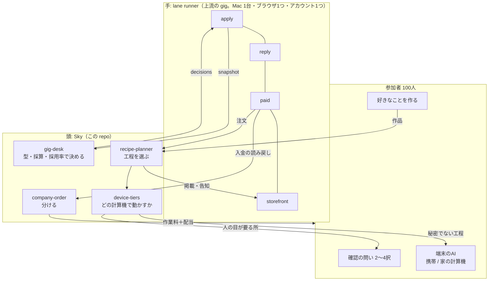

# Sky の収益ループ — 先行例との差分と、一つにまとめた形（2026-11-18）

出典: Daisuke134/anicca（旧名 life-manager。同じリポジトリで、旧 URL は転送される。MIT、2026-11-18 の main）、k999ln/Mr.（main、2026-11-18）、この repo の PR #318、2026-11-18 の本人指示。
本人の PC の `Mr/skills/anicca-life-manager` は読めていない（フォルダの許可が下りなかった）。GitHub の Mr. では同じスキルが `skills/anicca-rockstar_ibot` に改名されている（`docs/manifests/oss-merge-1-sources.json`）ので、GitHub 上の Mr. と上流で比べた。

## 1. 先行例（life-manager の「Coconala loop」）は何か

1台の Mac・ログイン済みブラウザ1つ・アカウント1つで、出品者アカウントを人の承認なしで回す。公開ベータとして1コマンドで入る。

| lane | 間隔 | やること |
| --- | --- | --- |
| apply | 300秒 | 募集一覧を読み、納品できる募集に提案を送る（1回最大7件） |
| storefront | 1800秒 | 自分の出品の閲覧・問い合わせ数を読み、見られているのに連絡が来ない出品を直す。出品0なら最初の出品を作る |
| reply（negotiate） | 300秒 | 購入前のトークルームの質問・見積り依頼に答える |
| paid | 900秒 | 入金済みの注文を読み、作り、別の検査役に見せて直し、1回だけ納品する |
| browser / daily-report / evidence-gc | — | ブラウザの維持、日次報告、証拠の掃除 |

止まらないための仕組み: 案件ごとに独立した担当と作業場所、送信の二重防止（effect の照合と fence）、送信後の公式画面での読み戻し、ブラウザの貸し借り、operator brake、価格の A/B 実験、入金は公式の受領記録だけを数える。

公開されている成績（2026-11-15）: ココナラ入金 ¥263,634（7/25〜10/12）、直近30日は注文3件 ¥39,500、応募19件で返信0、出品20件の公開販売数は全て0。

会社全体の公開数字（同リポの open/metrics.json、2026-11-15）: 直近30日の売上 $47.66、今月 $31.81、MRR $20。把握できている今月の支出は $293.70（一部のみ）。README も「事業の自律運営と確認済みの利益は目標であり、まだ実証されていません」と書いている。**先行例と同じ性能に並んでも、100人で分ける原資は月に数千円〜数万円の規模。足りないのは自動化ではなく買い手。**

## 2. 無いものの一覧

### 2.1 Mr. に無いもの（上流は 2026-07-29 の版から 3.5 か月進んでいる）

| 領域 | 上流にあって Mr. に無い | 意味 |
| --- | --- | --- |
| ココナラ（gig の scripts） | 24 本が無く、共通する 197 本のうち 69 本が古い。paid_direct は 5,214 行 → 7,569 行 | 途中で止まる原因の修正がここに入っている |
| 二重送信の防止 | `coconala_application_effect_reconcile`、`coconala_reply_effect_reconcile`、`application_occurrence_reconcile`、`storefront_*_reconcile`、移行3本 | 送ったか不明の時に再送しない |
| 止まった時の復旧 | `browser_lease_yield`、`operator_brake`、`client_artifact_restore`、`coconala_request_closed_readback`、`coconala_cancel_browser` | 1 lane がブラウザを握ったまま止まる、を解く |
| lane の入口 | `coconala-reply-owner`、`paid-direct-owner`、`coconala_paid_adapter`、`coconala_reply_adapter`、`coconala_product_adapter`、`storefront_kernel`、`market_product_contract` | 返信・納品・出品を共通の型で扱う |
| お金の読み戻し | `coconala_cfo_financial_readback` | 入金を公式画面から読む |
| loop（registry） | 163 → 195。`hf-gig-apply-reconcile`、`hf-gig-apply-evidence-gc`、`gig-experiment-evaluate`、CrowdWorks 5本、Lancers 2本、Mercor 3本、ほか | 定期実行の定義 |
| 他の販売先 | `crowdworks`、`mercor`、`promptbase`、`line-sticker`、`ebook-articles`、`upwork_readiness`、`freelancer_readiness` | ココナラ以外 |
| 運用のスキル | `loop-engineering`、`harness-engineering`、`observability-engineering`、`eval-engineering`、`platform-deadline-guard`、`google-login` ほか計 19 | 止まらない運用の手順 |

### 2.1b 既に Mr. にあるのに、この repo で作り直してしまったもの

| 機能 | Mr. / 上流にあるもの | この repo で作ったもの | 扱い |
| --- | --- | --- | --- |
| 利益の分配 | `skills/ubi`: 黒字の回だけ、純利益の一定率（初期値 10%）を受取人で等分。運営者の取り分は別枠。二重払い防止、GMO あおぞらの一括振込、USDC | lib/sky-company-order.ts の配当 | 配当の計算と支払いは ubi を使う。Sky 側は作業料（寄与）の計算だけ残す |
| 収支の集計 | `skills/cfo`（上流 80 ファイル、Mr. は 2） | なし | Mr. の同期（task 36）に cfo を含める |
| 文章・電子書籍・スタンプ・プロンプトを売る | `writer-agent`、`earn/ebook-articles`、`earn/line-sticker`、`earn/promptbase`（後ろ3つは Mr. に無い） | lib/sky-gig-offers.ts の CREATOR_LANES（工程の定義だけ） | 売り場の手は上流のものを使い、CREATOR_LANES は「本人に何を残すか」の定義として使う |
| 告知・SNS | `earn/marketing-engine`（上流 261、Mr. 196）、`social`、`x-tweeter` | なし | 同上 |

### 2.2 上流にも Mr. にも無く、Sky が足すもの

| 無いもの | Sky の実装 | 状態 |
| --- | --- | --- |
| 型ごとの採算と採用率で「出す・出さない」を決める | lib/sky-gig-desk.ts `triageGig` / `selectProposals` | 実装済み |
| 工程の組合せを実績で選び直す | lib/sky-recipe-planner.ts | 実装済み・未接続 |
| 参加者（100人）へ確認の仕事を配り、作業料にする | `planJudgmentTasks` / `assignJudgmentTasks` / `resolveJudgments` | 実装済み・画面なし |
| 参加者の端末のAIを使い、一致した結果だけ払う | lib/sky-device-tiers.ts | 実装済み・端末未接続 |
| 入金を作業料・配当・会社へ分ける | lib/sky-company-order.ts | 実装済み・保存なし |
| 好きなことだけやる人の型（絵・文章・情報収集・解析） | lib/sky-gig-offers.ts `CREATOR_LANES` | 工程の定義まで。売り場の接続は未実装 |

### 2.3 rock にまだ無いもの（上流にはある）

ブラウザを動かす手そのもの（4 lane）、二重送信の防止、公式画面での読み戻し、日次報告、出品の作成・改善。**これは作り直さず、上流のものを使う。**

## 3. 一つにまとめた形



受け渡しは上流の schema に合わせてある: apply lane の `application_snapshot` を `decideLanePass` に渡すと、`application_decisions` と同じ形（request_id / business_class / proposal_text / price_jpy / deliver_date …）を返す。

```
node --experimental-strip-types scripts/sky-gig-desk.mjs desk.json --lane snapshot.json
```

送信は初期値で自動（`policy.submission: 'auto'`）。本人が送る形に戻す時は `'owner'`。

## 4. 売る型（最初から入れた 16 個）と、好きなこと型（4 個）

受注型は lib/sky-gig-offers.ts の `SKY_GIG_OFFERS`。先行例が実際に出品・応募している領域と、rock の道具から作った。

| 群 | 型 | 最低額 |
| --- | --- | --- |
| 自動化 | 表計算の自動化 / 連絡・通知・定型業務の自動化 / 問い合わせAIチャットボット | ¥5,000 / ¥30,000 / ¥30,000 |
| 作る | 小さなWebアプリ・LP | ¥50,000 |
| データ | 公開データ・PDFを表にする / CSVの整形・検査 / アンケート・インタビューの分析 / 業界・競合の調査レポート | ¥8,000 / ¥3,000 / ¥8,000 / ¥8,000 |
| 文章 | コラム・SEO記事 / 商品説明・掲載文の更新 / 手順書・マニュアル / 画面・短文の翻訳 / 文字起こし・議事録・図解 | ¥3,000〜¥5,000 |
| 見せる | 研修・営業スライド / 動画の台本・構成 / SNS投稿の月次企画・制作 | ¥5,000 / ¥5,000 / ¥29,800 |

好きなこと型（`CREATOR_LANES`）は、本人の工程が「作る」の1つだけになるよう planner が組む（テストで確認）。売り場は既にある市場。

| 型 | 本人が作る | 売り物 | 売り場 | 連れてくる場所 |
| --- | --- | --- | --- | --- |
| お絵描き | 絵 | アイコン・挿絵の受注、素材・グッズ | ココナラ、SKIMA、BOOTH、SUZURI、LINEスタンプ | Instagram、X、pixiv |
| エッセイ・文章 | 原稿 | 有料記事・マガジン、電子書籍 | note、Kindle、Substack | X、Threads、Instagram |
| 業界の情報収集 | 見つけたこと | 週次ダイジェスト（月額）、調査レポート | note メンバーシップ、Substack、ココナラ | X、LinkedIn |
| 解析・分析 | 分析 | 分析レポートの受注、記事・テンプレート | ココナラ、ランサーズ、note、BOOTH | X、Qiita、Zenn |

売り場ごとの「掲載する」「投稿する」は、接続が入るまで planner が「足りない」と返す。上流には line-sticker、ebook-articles、promptbase、Instagram / TikTok / X の投稿 loop があり、Mr. の同期（task 36）で使えるようになる。

## 5. 端末のAIの使い方

| 置き場所 | 動くモデルの目安 | 任せる工程 | 検証 |
| --- | --- | --- | --- |
| 参加者の携帯 | 0.6B〜1.5B（Pixel 10 で実測済み） | 分類、抜き出し、条件との照合、人の確認の下準備 | 別の持ち主の端末 2 台以上の一致 |
| 参加者の家の計算機（PC / Mac / mii） | 30B 級の公開モデル（例: Meta Muse Glimmer、4bit で 20GB 弱、Apache-2.0） | 上に加えて、文章・コード・画像の読み取り | 同上 |
| 会社の家の計算機 | 同上 | 依頼者の秘密を含む工程 | 人か Jev |
| 会社のクラウド | 制限なし | 端末でこなせない工程 | 人か Jev |

- 依頼者の秘密は参加者の端末へ出さない。持ち主自身の資料（自分の絵・原稿）は持ち主の端末を先に使う。
- 払う根拠は、一致して採用された単位の数。稼働時間・台数は見ない。
- Meta の Muse Glimmer は携帯では動かない（20GB 前後のメモリと GPU が要る）。「Muse のように使える」を携帯で実現するなら、携帯は小さいモデル＋家の計算機（mii）へ投げる形になる。10-10 の「ミニ＝計算資源、携帯はリモコン」と同じ向き。

## 6. 100 人の集め方

加入した人が今日やれることは「確認の問いに答える」「端末を貸す」「好きなものを作って渡す」の3つ。入口は Mr. に既にある Telegram の bot が最短。

| 段 | 人数 | 集め方 | 見せるもの |
| --- | --- | --- | --- |
| 1 | 10 | 自分たちと近い友人。対面で一緒に入れる | 最初の入金と、最初の振込の画面 |
| 2 | 30 | 1 の人の紹介（紹介に作業料。settle の `referral`）。学校・研究室で 30 分の導入会 | 1 人あたりの実際の受取額の一覧（名前なし） |
| 3 | 100 | 収支を毎日公開する（先行例の公開ダッシュボードと同じやり方）。絵・文章を作る人へは「作るだけ」の実例を X / Instagram / pixiv / note で見せる | 公開の収支、作った人の売上の実例 |

- 「稼げるなら友達に見せる」が効くのは、見せられる画面があってから。最初に作るのは受取額が見える画面。
- 人数は仕事の量に合わせて増やす。問いが来ない日が続くと人は離れる。
- 未成年は保護者の同意が要る。報酬の支払いと税の扱いは税理士に確認する。

## 6b. 100 人に何をしてもらうか（買い手が足りない、を前提に）

作る側（AI）は余っていて、買い手が足りない。だから 100 人の主な役割は、計算でも確認でもなく、**買い手を連れてくること**と**売れるものを作ること**に置く。

| 役割 | 何をする | お金の出どころ |
| --- | --- | --- |
| 紹介 | 知っている店・会社・人を1つ指す。提案と見本と運用は Sky が用意する | その取引の作業料（`referral`）。販売サイトの手数料がかからない直接の取引 |
| 作る | 絵・文章・調べたこと・分析を渡す。掲載・告知・問い合わせ・納品は Sky | その商品の売上 |
| 確認・端末 | 問いに答える、端末を貸す | 受注があった分だけ |

ココナラの窓口は入口の1つとして回すが、原資の中心には置かない。

## 7. 作る順番

1. Mr. の gig を上流の最新へ同期する（[task 36](../codex/tasks/36-mr-gig-upstream-sync.md)）。止まる問題の修正がここで入る。
2. apply lane の判断を `decideLanePass` につなぐ（[task 37](../codex/tasks/37-lane-runner-bridge.md)）。型ごとに出品を1件ずつ作る（storefront lane）。
3. 受取額が見える参加者の画面と、確認の問い（[task 35](../codex/tasks/35-gig-desk-screen.md)）。
4. 端末のAIを工程に入れる（携帯は分類・照合から）。
5. 好きなこと型の売り場を1つずつ接続する。
