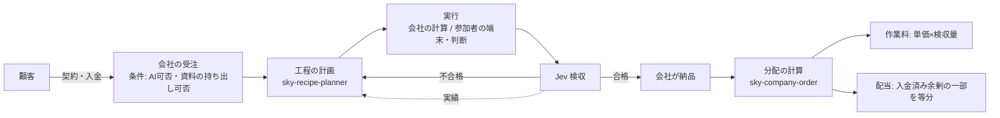
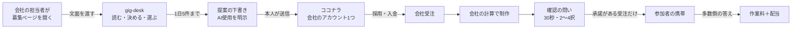

# Sky の仕事の一周 — 会社が受け、Sky が工程を決め、外から入ったお金だけを分ける

2026-11-15。出典は議事録（08-23〜10-31）、11-15 の本人メモ、かいやとの会話。決定は [07](structure/07-decisions-from-minutes.md)、役割は [04](structure/04-eve-noa-amc-sky.md)。提案の部分は本人確認待ち。

## 1. 誰のために作るか

最初の利用者像はかいや（11-15 本人メモ）。受入条件は一つ:

**「めんどくさい」と言った後、Noelle が裏でツールを選び、指示を訳し、進捗を追わなくても成果が出る。**

そのために Sky が持つ原則:

| 原則 | 意味 |
| --- | --- |
| 望みは審査しない | 「こうしたい」を要件定義の面接にしない。Eve はそのまま Goal にして形にする |
| 手段は裏で検証する | どの工程で作るか・いくらかかるか・通るかは Sky が測る。本人には聞かない |
| 本人に残すのは本人が選んだ所だけ | 「ここは自分でやりたい」と言った工程は自動化しない。それ以外は全部引き受ける |
| 新しい方法は自動で入れ替える | 同じ仕事で良くなると実績で分かった時だけ切り替える。「最新だから」では替えない |

## 2. 現状（2026-11-15 の main）

| 部分 | あるもの | 無いもの |
| --- | --- | --- |
| 依頼の振り分け | 正規表現で 13 Tool の 1 つへ（lib/sky-routing.ts） | 工程全体の計画。当てはまらない依頼は null |
| 合成実行 | 3 Tool（出典整理・記事編集・CSV）を手で並べる。予算 0 のみ（lib/work-composition.ts） | Sky が並べ方を決めること。有料の工程 |
| 計算の分散 | 公開テキストの埋め込み 1 種、試験用 credit、host fixture（lib/sky-compute-grid.ts） | 実端末、実際の仕事、現金 |
| ココナラ | 応募前の確認と、人へ再委託する案件の手入力台帳（lib/coconala-team.ts） | 受注、入金確認、会社としての分配 |

lib/sky-*.ts は 116 本あるが、**外の人が払ったお金が入り、成果が出て、誰かに支払われた一周は 0 回**。足りないのは機能の数ではなく、この一周。

## 3. 一周



### 3.1 工程の決め方（lib/sky-recipe-planner.ts）

選ぶ単位は Tool ではなく、手元の素材から成果までの工程。比べる値は 1 つ:

```
検収に通る成果 1 つあたりの期待総額
  = (実費 + 本人の手間[分] × 本人の 1 分の値段) ÷ 工程全体の合格率
    + 初回準備 ÷ この仕事が起きる回数
```

- 合格率は Receipt の実績から出す。未観測は 0.5 から始め、回数が増えるほど実績に寄る。
- 「自動化を作るか、今回だけ手でやるか」は最後の項で決まる。1 回きりの仕事に大きな自動化は選ばれない。
- 5 回連続で通った工程は固定し、毎回考え直さない。直近が不合格、または別の工程が 2 割以上良い時だけ外す。
- 5 回に 1 回は実績の少ない工程を試す。新しい Tool はここから入る。
- 届かない時は「この型の素材を作れる能力が無い」を返す。Noa が Sky で探す・作る入力になる。
- 順位を出すだけで、実行・課金・外部送信は許可しない（Broker / Wallet / Jev の gate はそのまま）。

### 3.2 お金の分け方（lib/sky-company-order.ts）

| 層 | 決まり方 | 原資 |
| --- | --- | --- |
| 作業料 | 割当時の単価 × 検収に通った量。稼働時間・台数では払わない | 会社の債務。顧客の入金を待たない |
| 配当 | 入金 − 返金 − 販売手数料 − 実費 − 予備 − 作業料 の一部を参加者で等分 | 実際に入った現金だけ |

- 見積り時に、全量が通っても作業料を払い切れるかを確認する。払い切れない見積りは出さない。
- 寄与は 3 種: 計算（検証済み）、判断（人にしかできない確認）、紹介（顧客を連れてきた）。
- 「毎月いくら配る」と約束できるのは、過去で最も少なかった月の配当原資 ÷ 人数まで。

### 3.3 どこで実行してよいか

| 案件の条件 | 実行先 |
| --- | --- |
| AI 使用が不可、または未確認 | 受けない |
| 個人情報・秘密を含む、または資料を社外へ出す承諾が無い | 会社の管理下だけ |
| AI 可、公開・合成の資料、持ち出しの承諾あり | 参加者の端末・人も使える |

「分散していても自社の計算」という呼び方では、他人の端末に顧客の資料が載ることは変わらない。販売先ごとの規約確認の記録は受注に残す。

## 4. 数字で見た前提（提案者の見積り。本人確認待ち）

- RTX 4090 の時間貸しは 1 時間 $0.33（Vast.ai、2026-11-14 時点、computeprices.com）。スマホの推論能力をその 1/30〜1/100 と置くと、1 台 1 時間 $0.003〜0.011。夜 8 時間 × 30 日で月 $0.8〜2.6。**スマホの計算だけで 1 人に配れるのは月数百円の規模**（1/30〜1/100 は未測定の仮定）。
- 10-10 の「現金 8 万円」を 3 万人へ配るには、配当原資が月 24 億円要る。計算の対価では 2 桁以上足りない。
- 受託の値段を決めているのは計算ではなく、顧客を見つけること・検収に通すこと・納品の責任。だから配る原資は「会社が仕事を取って残した余剰」で、計算量は分け方の一部に過ぎない。
- 「GPU を積むほど稼げる」をハードの売り文句にすると、収益を約束して機器を売る形になる。UI・広告には書かない（03-esim §7 と同じ扱いを提案）。

## 5. 仕事が無い人が最初に使うもの

売れるものの知識が無い人が持っているのは、目・好み・その場にいること・知り合い。Sky はそこだけを頼む。

| 入口 | 本人がやること | Sky がやること | お金の出どころ |
| --- | --- | --- | --- |
| 判断 | 2 案のどちらが良いか選ぶ、読んで変な所を押す | 会社の受注の検収前確認に組み込む | 作業料（判断） |
| 紹介 | 知っている店・会社を 1 つ指す | 公開情報から直せる所を見つけ、見本を作り、提案と継続運用まで用意する | 作業料（紹介）＋継続分 |
| 計算 | 充電中・未使用の端末を貸す | 公開・合成の資料の計算だけ配り、検証する | 作業料（計算） |
| 配当 | 参加している | — | 入金済み余剰の等分 |

既存の募集へ応募する仕事は、同じ AI を使う全員との値下げ競争になる。会社として取る仕事は、**これまで高すぎて誰も頼まなかった小さい継続業務**（店の掲載情報・予約案内・商品説明の更新など）を先にする。

## 6. 作る順番

1. 会社の受注 1 件を、会社の計算だけで、受注→計画→検収→納品→入金→分配の計算まで通す（[task 34](../codex/tasks/34-company-order-first-loop.md)）。参加者の端末は使わない。
2. Eve の依頼を planner へつなぎ、正規表現の振り分けを置き換える（[task 33](../codex/tasks/33-sky-recipe-planner-wiring.md)）。
3. 判断の寄与（2 択・誤り指摘）を 1 つの受注に入れる。
4. 計算の寄与は、3 までの入金実績が出てから。公開・合成の資料に限る現行 Grid の条件を保つ。

測る値: 本人がやりたくない作業に使った分数、検収に通った割合、実費後の入金額、配当原資の最少月。Bot の数・稼働時間は測らない。

## 7. ココナラで最初にやる形（2026-11-18）

### 7.1 先に同じことをやった人の公開記録

Daisuke134/anicca-products に自動化のコードは無い（公開ダッシュボードの数字と、別リポへの案内だけ）。本体は後継の Daisuke134/life-manager（MIT）の `skills/earn/gig/scripts/coconala_*`。個人アカウント1つにログインしたブラウザを動かし、応募・返信・見積り・納品・出品の改題をする作り。

本人たちが公開している数字（`apps/landing/public/open/client-work.json`、2026-11-15 更新）:

| 販売先 | 応募 | 応募への返信 | 入金 | 起きたこと |
| --- | --- | --- | --- | --- |
| ココナラ | 通算 19 | 0 | ¥263,634（7/25〜10/12、納品 12 件以上） | 出品 20 件。改題を繰り返して全件 7 日ロック |
| ランサーズ | 通算 85 | 7 日で 4 | 確定 ¥0（仮払い ¥33,000） | — |
| クラウドワークス | 通算 4 | — | 確定 ¥0 | ログイン待ちで停止 |

読み取れること: 募集への応募は 19 件で返信 0 なので、入金は応募以外（出品への注文、既存のやり取り）から来ている。ココナラ公式も、募集への応募を「実績を積めてきたら」の番外編に置いている（同リポの調査メモ `docs/platform-best-practices-2026-11-07.md` が引用する「ココナラ通信 7 月号」）。**「募集を一括で全部取る」は、取りに行く数を増やしても採用が増えない。**

### 7.2 規約で決まること（ココナラ利用規約、最終改定 2026-11-13。条番号は取得時点）

| 条 | 内容 | Sky への意味 |
| --- | --- | --- |
| 6 条 2 項、74 条 2 項 | 利用は会員自身が行う。ユーザ名・パスワードを第三者に使わせない | 参加者の個人アカウントを Sky が動かす形は不可 |
| 13 条 2 項 19 号、26 条 2 項 | 複数の会員登録の禁止 | アカウントを増やして応募を増やす形は不可 |
| 加盟店規約 9 条 1 項 34 号 | 出品代行させる・する行為の禁止 | 参加者の名前で会社が出品する形は不可 |
| 13 条 2 項 22 号 | 当社が認める場合を除き、自動的に応答する等の機能を持つソフトウェア等の利用の禁止 | 自動返信・自動応募は避ける（適用範囲の解釈は運営へ確認が要る） |
| 45〜49 条 | 法人機能。メンバーを招待し、メンバーの行為は法人が責任を負う | 会社のアカウント 1 つ＋メンバー、が正規の形 |

スクレイピングを名指しで禁じる条文は見当たらなかったが、13 条 2 項 29 号（運営の妨害）がある。巡回はしない。

### 7.3 だから、こう作る



- 参加者の携帯が出すのは計算ではなく、**人の目**（どちらが読みやすいか、変な所はどこか）。これは AI に置き換えにくく、依頼者に説明でき、作業料の根拠になる。
- 加入した人がやることは「問いに答える」だけ。ココナラのアカウントは要らない。
- 提案は数で押さない。型ごとの採用率を記録し、得にならない型は自動で止まる（`triageGig` の score ≤ 0）。
- 募集への応募と並行して、会社の出品（型 1 つにつき 1 件）を先に整える。先行例の入金は応募以外から来ている（7.1）。出品の作成・変更は本人が行う。
