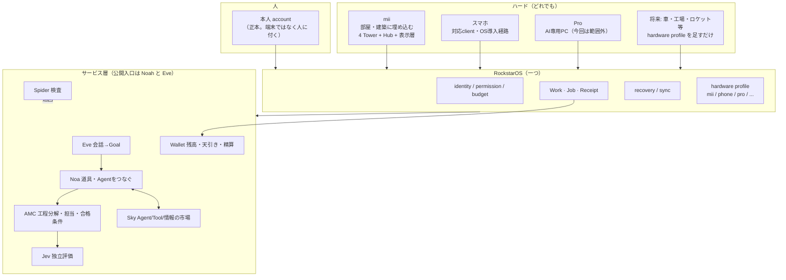

# 00 全体像 — 世界観 → 製品 → システム（2026-11-02）

このフォルダ `docs/structure/` が**設計の正本**。他の docs/ は歴史と詳細。矛盾したらここが勝つ。

## 0. 目的（なぜ作るか。2026-11-20 本人の言葉）

| | |
| --- | --- |
| 大きな目的 | **みんなが Agent を使って、生活がより豊かになる。** |
| 最初の目的 | **教育と、身の回りの生活が、少しでも便利に、効率よくなる。** 「豊かになる」は意味が広く、訴求しにくい。だから、まずここに絞って進める |
| 残る物の基準 | わかりやすく便利になる物が残っていく |
| 行き着く所 | Noah が無いと生きていけない、と言われる所まで持っていく |

Agent を使う時・運営する時に、一番重く見る 3 つ（迷った時は、これを先にする）:

1. **どんな Agent にも、1 クリックでスムーズにつながる。**
2. **登録が要る場合でも、どこかでそれを解決して、利用者を離れさせない。**
3. **Agent が動く時に、画面をジャックしない。** ターミナルで動かす形でもよい。画面を取らない方法を探して、作る。

この章は「なぜ」と「何を先にするか」。下の 1 章からは「何を作るか」と「どう作るか」。Noah の設計がこの 3 つにどう答えているか、足りない所、今の品揃えと並びの現状は [Noah の設計書](../noah-design.md) の 12 章。出典は [07](07-decisions-from-minutes.md) の 2026-11-20（21:51・21:54・21:57）の行。

まだ決まっていない事（本人確認待ち）: 「教育」は誰の何を便利にするか。「身の回りの生活」で最初に狙う場面。最初の相手の国と言葉。

## 1. 一言で

**主商品はmii、最小構成の出発点はNoah。** まず本人Macで対応Agentを選び、接続・実行・成果受領・停止まで完成させ、その後miiで声と空間表示を使う体験へつなぐ。Eveは依頼窓口、RockstarOSは共通基盤、SIM/eSIMはOS導入の仕組み。[最新方針](../product-baseline.md)。

> **一つの account、一つの OS（RockstarOS）、どのハードでも続きから動く。**
> 話す相手は **Eve**。Eve が目的を決め、**Noa** が道具とAgentをつないで形にし、それを **mii** で見て触る。

目指す構造は、一つのaccountと共通契約を複数の対応ハードで使うこと。対応はhardware profileごとに検証する。mii（建築・部屋に埋め込む端末）、持っているスマホ（適合するclient・導入経路）、Pro（AI専用PC）、将来はロケット・車・工場設備まで、共通のRockstarOS契約を使い、OSは一つ、accountは一つ。全機種での導入や同期の完成を意味しない。

## 2. 層の絵

## 3. 製品は6つしかない（外から見える名前）

| 名前 | 何か | 今回の整理で扱うか |
| --- | --- | --- |
| avokado | 会社・ブランド | 名前だけ |
| **mii** | 部屋・建築に埋め込む物理端末。RockstarOS 搭載 | **扱う**（01-mii.md） |
| **RockstarOS** | 一つの実行基盤。全ハード共通 | **扱う**（02-rockstaros.md） |
| **Eve** | 話しかける相手。依頼→仕事→成果の窓口 | **扱う**（04-eve-noa-amc-sky.md） |
| **Noah** | Agentを集める・つなげる・載せる最小構成 | **扱う**（04） |
| Pro | AI専用PC | 範囲外（既存docsのまま） |

SIM/eSIMは **OS導入の仕組み**（03-esim.md）。最初のNoahは本人Macで受け入れ、miiやSIMの導入を前提にしない。

## 4. 読み順

| 知りたいこと | ファイル |
| --- | --- |
| mii のハード構造・表示方式・4 Tower の役割 | [01-mii.md](01-mii.md) |
| RockstarOS が「一つ」であるとはコード上どういうことか、hardware profile、account の続き | [02-rockstaros.md](02-rockstaros.md) |
| eSIM で OS が入るとは何か、何を売り何を売らないか | [03-esim.md](03-esim.md) |
| Eve → Noa → AMC → Jev の流れ、Sky、サービス挙動の書き方 | [04-eve-noa-amc-sky.md](04-eve-noa-amc-sky.md) |
| 収益・料金・1ヶ月/1年計画 | [05-business.md](05-business.md) |
| 名前の正本（外側・内側・旧名） | [06-naming.md](06-naming.md) |
| 議事録から抽出した日付付き決定 | [07-decisions-from-minutes.md](07-decisions-from-minutes.md) |
| Kaiya の PDF（Issue01）への指摘 | [08-pdf-review.md](08-pdf-review.md) |
| リポのどこを直せばよいか（Codex向け） | [09-repo-layout.md](09-repo-layout.md) |

## 5. 現在の説明と履歴の置き場所

- 現在の製品の使い方・画像・コードは[README](../../README.md)、進捗は[project](../../project.md)。
- 方針の変更理由は[07 決定](07-decisions-from-minutes.md)、過去の変更記録は[CHANGELOG](../../CHANGELOG.md)。旧説明を現在の入口へ複製しない。
- 構成や受入の詳細は上の対応表へリンクし、同じ契約を複数文書で独立して定義しない。
