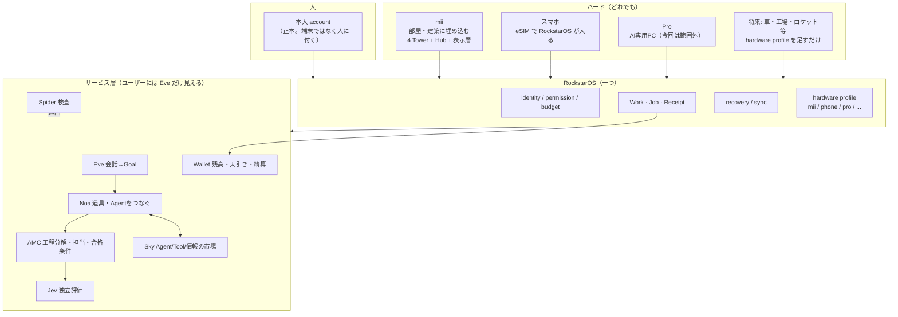

# 00 全体像 — 世界観 → 製品 → システム（2026-11-02）

このフォルダ `docs/structure/` が**設計の正本**。他の docs/ は歴史と詳細。矛盾したらここが勝つ。

## 1. 一言で

> **一つの account、一つの OS（RockstarOS）、どのハードでも続きから動く。**
> 話す相手は **Eve**。Eve が目的を決め、**Noa** が道具とAgentをつないで形にし、それを **mii** で見て触る。

Apple が iOS / macOS / watchOS を「同じ Apple ID、同じ体験」で束ねているのと同じ構造。違いは、avokado は**ハードを選ばない**こと。mii（建築・部屋に埋め込む端末）、持っているスマホ（eSIMで入る）、Pro（AI専用PC）、将来はロケット・車・工場設備まで、RockstarOS がハードごとに最適化されて載るが、OS は一つ、account は一つ。

## 2. 層の絵

## 3. 製品は6つしかない（外から見える名前）

| 名前 | 何か | 今回の整理で扱うか |
| --- | --- | --- |
| avokado | 会社・ブランド | 名前だけ |
| **mii** | 部屋・建築に埋め込む物理端末。RockstarOS 搭載 | **扱う**（01-mii.md） |
| **RockstarOS** | 一つの実行基盤。全ハード共通 | **扱う**（02-rockstaros.md） |
| **Eve** | 話しかける相手。依頼→仕事→成果の窓口 | **扱う**（04-eve-noa-amc-sky.md） |
| **Sky** | Agent・Tool・情報を見つけてつなぐ場所 | **扱う**（04） |
| Pro | AI専用PC | 範囲外（既存docsのまま） |

配布できるものは **eSIM**（03-esim.md）。mii を持っていない人は eSIM で RockstarOS に入る。

## 4. 読み順

| 知りたいこと | ファイル |
| --- | --- |
| mii のハード構造・表示方式・4 Tower の役割 | [01-mii.md](01-mii.md) |
| RockstarOS が「一つ」であるとはコード上どういうことか、hardware profile、account の続き | [02-rockstaros.md](02-rockstaros.md) |
| eSIM で OS が入るとは何か、何を売り何を売らないか | [03-esim.md](03-esim.md) |
| Eve → Noa → AMC → Jev の流れ、Sky、サービス挙動の書き方 | [04-eve-noa-amc-sky.md](04-eve-noa-amc-sky.md) |
| 収益・料金・1ヶ月/1年計画 | [05-business.md](05-business.md) |
| 名前の正本（外側・内側・旧名） | [06-naming.md](06-naming.md) |
| 議事録から抽出した日付付き決定 | [07-decisions-from-minutes.md](07-decisions-from-minutes.md) |
| Kaiya の PDF（Issue01）への指摘 | [08-pdf-review.md](08-pdf-review.md) |
| リポのどこを直せばよいか（Codex向け） | [09-repo-layout.md](09-repo-layout.md) |

## 5. この整理で変えたこと（2026-11-02）

- README を「PRの受領票」から「中の人向けの構造図」に書き換えた。日付付きの更新履歴は CHANGELOG.md に全文移した（削除していない）。
- 旧 README / AGENTS / project.md / PROJECTS.md は `archive/root-snapshot-20261029/` に原本のまま保存。branch `archive/pre-restructure-20261102-main-1daf5c3` に整理前の main 全体がある。
- Smith → Noa、Jennifer → AMC へ統合、avocadoMini → mii、Zema → Eve/Work（06-naming.md）。
- eSIM の定義を「データ付きbundle」から「RockstarOS の鍵付き回線」へ（03-esim.md）。
- Codex への指示書は `codex/tasks/` に1件1ファイル（`codex/tasks/00-index.md`）。
