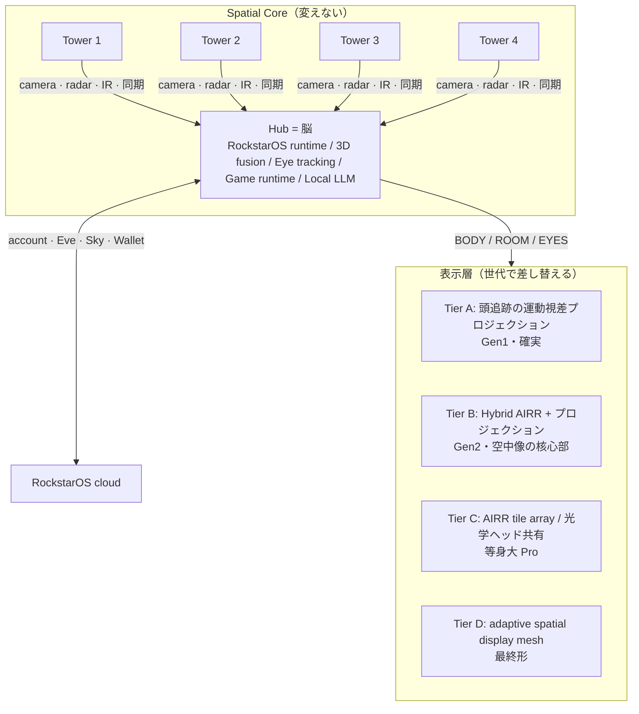

# 01 mii — 建築に埋め込む RockstarOS 端末の構造（2026-11-02）

出典: 議事録（2026-08〜10）、「3Dプロジェクション技術説明」チャット全文（2026-10）、AVOKADO Issue01 PDF（Kaiya、2026-10）。
この文書は**構造**を決める。寸法・性能・校正・受入条件の設計書は [docs/mii/design/](../mii/design/00-README.md)（V1、2026-11-02）。原価・工場・ロット単価は後（Codex task 20 が調べる）。

## 1. 世界観（変えない前提）

- 眼鏡・ヘッドセット・画面を**使わない**。部屋そのものが3D世界になる。壁・床・家具・人の体に像が出る。
- 用途は全部入り: 遊び（家具を足場にするアクション、狭い部屋でのオープンワールド、軸切替、人間テトリス、チェス、床ライト、遠隔ツイスター・剣道）、体（ヨガ・ダンス・バレエ・ゴルフの正しい姿勢を体に投影して矯正、介護・見守り）、学び（分子・物理の波・三角関数・立体図形の切断、医学部の人体）、仕事（工場の保守手順を現物に重ねる、研修）。
- **avocadoOS（=RockstarOS）の機能は全部入る**。mii は「空間用の別OS」ではなく、RockstarOS の目・耳・空間I/O。Eve / Noa / AMC / Jev / Sky / Wallet / Work / Memory / 権限 は Hub 側で全部動く。
- 一人用の完成度を優先し、複数人は「部屋ごとに一人」の遠隔同時プレイで実現する（頭追跡の運動視差は一人に対して完璧、複数人同室は後の世代）。
- 建築に埋め込む（PDF Issue01）: 置き型ではなく、天井・壁・柱・プールサイドに**最初から**入る。「部屋が si を持っている」状態。

## 2. 構造の原則: Spatial Core と表示層を分ける

| 層 | 役割 | 何が入るか | 変えるか |
| --- | --- | --- | --- |
| **Tower ×4** | 感覚器官。部屋の形・体の3D・目の位置を取る | global-shutter/NIR camera、IR照明、mmWave候補、ハード同期、小さなMCU、secure identity、温度/電源監視、**光学ヘッド**（表示層の出口） | 筐体は建築に合わせて変える（下記）。中身は共通 |
| **Hub** | 脳。RockstarOS が動く唯一の場所 | RockstarOS runtime、Jev、local LLM、Vision/Spatial AI、3D fusion、Game runtime、Memory、Tools/MCP、Wallet、権限 | 共通。Pro と同じ基板系列を使える |
| **表示層** | 視覚世界を現実に返す器官 | Tier A〜D（下記） | **世代で差し替える**。Core は変えない |

**Tower に OS を4コピー入れない。** Tower は安く、Hub に集める。これが「4つで3万円」の表示目標を壊さない唯一の構造。

## 3. 表示層の段階

| Tier | 方式 | 何ができる | 目標BOM（工場直・RFQ前。販売価格は 16万/41万 のどちらかが未決: 07） | いつ |
| --- | --- | --- | --- | --- |
| A | **頭追跡 運動視差プロジェクション**（1 光学エンジン＋壁/床＋頭追跡） | 壁・床・家具・体に、視点に合わせて動く3D。本当の空中像ではないが確実。ヨガ矯正・教育・床ゲーム・工場ガイドは全部これで成立 | 3〜8万円 | **Gen1・今** |
| B | Hybrid AIRR + プロジェクション | 中心に 30〜50cm の本物の空中像（チェス駒・分子・相手の顔）、周囲は A | 7〜25万円 | Gen2 |
| C | AIRR tile array ／ **光学ヘッド4つ＋共有 Light Engine** | 等身大の遠隔相手。4 Tower の光学ヘッドで1つの空間ディスプレイを構成（視線位置から必要なヘッドだけ使う） | 10〜30万円（4ヘッド3万円は10k台量産の目標） | Pro版 |
| D | adaptive spatial display mesh | 部屋全体が表示素子 | 未定 | 最終形 |

Gen1 の試作は「1 プロジェクター＋1 壁＋頭追跡」で始める（Codex task 21）。眼鏡は fallback としても採用しない（議事録: なしにしたい）。

## 4. 筐体の3形態（PDF Issue01 を正とする）

PDF には3つの形が出てくる。全部 **同じ Tower の中身** を別の筐体に入れたものとして定義する。

| 形 | 置き場所 | 中身 | 注意 |
| --- | --- | --- | --- |
| **Column**（高さ 1,000mm の黒い柱、先端に径150×高200mm の Head、薄い重量ベース φ260） | 床。賃貸でも置ける | Tower 1本分。4本で Core 完成。Head（200mm 包絡）は R5 筐体の継承 | 設計書 03 章。1本だけでも Eve 端末として動く（空間機能は限定、設計書 09 章） |
| **Puck**（天井埋込の円盤） | 新築・改装の天井 | Tower。上から部屋全体を見る。表示層の光学ヘッドは天井向きが有利 | 施工の電源・冷却・メンテ口が要る |
| **Slot**（壁埋込の縦スロット、単眼） | 玄関・廊下・プールサイドの壁 | Tower（カメラ主体）。外向きの単眼は**来訪者の認識・見守り** | 屋外・水回りは IP 等級が要る。外向きレンズはプライバシー表示（録画中サイン）が法的に必要になり得る |

Hub は見えない場所（分電盤脇・天井裏・家具内）に1台、**別体**（本人指示 2026-11-02。Column が Hub を兼ねる案は取り下げ）。Node は 1 本でも動くが基本 4 本、最低 2 本。本数を増やすと空間の品質が上がる設計を前提にする（設計書 09 章）。

## 4.5 本人認識

顔カメラの生体認証で本人を認識し、各自の account（cloud）へつなぐ（議事録 10-30）。Tower のカメラがそのまま identity の入口。ウェイクワードは「ヘイ、エヴァ」（10-27）。

## 5. ソフト側の接点（RockstarOS から見た mii）

| 機能 | 置き場所 | 現行コード |
| --- | --- | --- |
| hardware profile `mii` | systems/rock-star-os/targets/mii（旧 avocado-mini） | targets/avocado-mini |
| 空間入力（BODY/ROOM/EYES）→ Goal の入力 | lib/mii-*.ts（空間入力を Eve の入力型へ）| lib/mii-*.ts 3本 |
| Game runtime / creator SDK | lib/game-*.ts, sites/avocado-mini/creator-kit | 既存 |
| 遠隔同時プレイ（部屋ごと一人） | lib/remote-*.ts | 既存 remote 14本 |
| Wallet（レッスン料・大会参加費・教材ライセンス） | lib/wallet*.ts | 既存 |
| 導入・初期化・回復 | docs/structure/02-rockstaros.md の account 継続 | rockstar-entitlement-* |

**サービスは mii のためだけに作らない。** ヨガ矯正は「Spatial AI → Jev → Yoga Agent → 表示層」の普通の Work として書く（04 の書式）。mii は入力と出力が増えただけ。

## 6. 既存設計書との関係（捨てない）

| 既存 | 位置づけ |
| --- | --- |
| docs/avocado-mini-spatial-invention.md、avocado-mini-hardware-design.md（Full-scale 発明台、4方向 Sensor Ring） | **Core の原型**。Sensor Ring = 4 Tower。発明台の用途は「用途の一つ」に降格、構造はそのまま |
| docs/avocado-mini-mini200-e1/（20cm、前面3眼、日本語音声） | **Column 形態の原型** |
| docs/avocado-mini-r5/（R5 統合設計、衛星回線試験、物理試作テンプレート） | 世代番号 R5 は内部で維持。embedded-portable-connectivity は 03-esim.md と整合させる |
| public/rockstaros/avocado-mini-tower-concept.png（伸縮 850→1,800mm タワー） | 置き型 Tower の構想。Column の背の高い版。建築埋込が主になったので優先度は下げる |
| 「3Dプロジェクション技術説明」チャット | 表示層 Tier 表と BOM 目標の出典 |

## 7. 決めていないこと（Codex に調べさせ、本人が決める）

1. Gen1 の光学エンジン: 市販 pico engine（$40〜50 クラス）か、完成プロジェクターか。
2. 頭追跡の遅延予算（運動視差が破綻しない ms）と Tower のカメラ fps。
3. 4 Tower の相互キャリブレーション手順（施工時／引越し時）。
4. Hub の演算: Pro と同じ基板か、Jetson 級か。local LLM をどこまで Hub に置くか。
5. 名前 **mii** は Nintendo の登録商標（US Reg. 3451478, class 9）と衝突しうる。08-pdf-review.md 参照。
