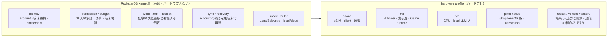

# 02 RockstarOS — 一つの OS がどのハードでも動く、とはコード上何か（2026-11-02）

## 1. 決定

| 問い | 決定 |
| --- | --- |
| OS はいくつか | **一つ。** mii 用・スマホ用・Pro 用・ロケット用の「別OS」は作らない。ハードごとの差は **hardware profile** に閉じ込める |
| 正本は端末か人か | **人（account）。** 端末は account の「今いる場所」。機種変更・mii の追加・Pro の購入・ロケット搭載でも、同じ account の続きから動く（iCloud と同じ役割をうちが持つ） |
| 「OSが入る」とは | スマホの場合: eSIM で account と回線が束なり、RockstarOS client（Android: carrier app として自動導入 / iOS: PWA or App Store）が開く。実体は cloud runtime ＋ 端末 client（03-esim.md）。mii・Pro・Pixel の場合: native RockstarOS（Buildroot / GrapheneOS 系）がそのまま載る |
| ユーザーに見せる名前 | 端末名として **RockstarOS** を見せてよい。中の Eve / Noa / AMC / Jev / Spider / Sky のうち、ユーザーが話す相手は **Eve だけ** |

## 2. 一つの OS の中身（全ハード共通）

- **kernel層** = 既存の lib/rockstar-*.ts（entitlement, service-setup, device-link, adapters）、lib/workflow.ts, lib/work-*.ts, lib/receipt-signature.ts, lib/agent-control-plane.ts、systems/rock-star-os/os（Buildroot native: rockd, platform service, Wallet simulator, A/B stage0, 署名ストア）。
- **hardware profile** = systems/rock-star-os/targets/<profile>/（今は avocado-mini のみ → mii に改名、phone / pro / pixel-native を追加）。profile に書けるのは: 入出力デバイス、電源・熱、通信（eSIM / Wi-Fi / 衛星）、ローカル演算の上限、表示層。**仕事の意味・権限・課金は profile に書かない。**

## 3. account の続き（continuity）の契約

| 何が続くか | 実装場所 | 状態 |
| --- | --- | --- |
| 本人の identity と端末束縛（EID/ICCID、Android key attestation、Pro の TPM） | lib/rockstar-entitlement-*.ts, lib/esim-attested-device-activation.ts | 実装あり。eSIM の EID を束縛キーに追加（task 11） |
| 進行中の Work / Job / Receipt | lib/work-*.ts, D1 | 実装あり。別端末から同じ Job を再開する API を明文化（task 30） |
| Eve との会話の文脈・Memory | lib/eve-*.ts, ai-memory-architecture.md | 端末跨ぎの同期規約が未定（task 30） |
| Wallet 残高・天引き契約 | lib/wallet*.ts, lib/settlement.ts, services/sky-billing | 実装あり |
| 権限・予算 | lib/agent-control-plane.ts, lib/a2a-broker-*.ts | 実装あり |
| mii の空間キャリブレーション | なし | profile 固有。account には紐づけない（部屋に紐づく） |

ルール: **account に紐づくものは cloud が正本、端末は cache。** mii のオフライン動作（Hub の local LLM）は cache で動き、復帰時に Receipt を同期する。

## 4. 今の実装との差分（何を足すか）

1. `systems/rock-star-os/targets/` に `phone/`, `pro/`, `pixel-native/` を作り、各 profile の README に「このハードだけの差」を列挙（task 31）。avocado-mini → mii。
2. `lib/rockstar-service-setup.ts` の初期設定フローを「account ログイン → 端末束縛 → profile 選択 → 続きを復元」の4段に揃える（今は eSIM/Mini/Pro で入口が別）。
3. Android の native 系（android/, os/）と Buildroot 系（systems/rock-star-os/os）は**どちらも残す**。native-os-integration.md の「Pixel/GrapheneOS ベース」と Buildroot の関係を 1 枚の表にする（task 31）。
4. 「どの端末でも同じ Job を続けられる」テストを tests/ に1本（task 30）。

## 5. 既存の判断との整合

- 2026-09「共通のコアOSと用途別OS」→ 今回「用途別OS」は作らず **hardware profile** に置き換える。用途（ヨガ・工場）は Work と Agent の側。
- 2026-10-15「account が正本」→ 維持。
- 「Codex 専用設計」「CIが一人の足を止めている」→ 対象外（Private Pixel の話）。
