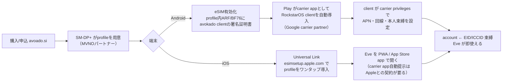

# 03 eSIM — 「eSIMを入れる手間だけでRockstarOSが入る」の設計

更新: 2026-11-02（Noelleの指示で再定義。2026-10-15の「通信＋si利用権bundle」を上書き）。

## 1. eSIMは何で、何ではないか

| | 決定 |
| --- | --- |
| 何のためか | **すでに持っているスマホに RockstarOS（＝Eve・Sky・本人の仕事）を入れる最短の手段。** OSをダウンロードして設定する手間を、「eSIMを入れる」一回に置き換える |
| 売るもの | **RockstarOS の回線付き利用権**。月額。データ残量（GB）は売らない。通信は RockstarOS のcloudに届くための最小限で、GBで数えない |
| 売らないもの | 旅行用データeSIM、通話番号、他社回線の再販 |
| プロバイダと契約する理由 | 技術的に不可避だから（eSIM profileはMNO/MVNOのSM-DP+からしか出せない）。特にiOSは、Appleの規約上、アプリから直接eSIMを書くには通信事業者としての契約が要る |
| 契約の強さ | 回線契約と同じ重さ（カード/口座引落し、未払い時は回線停止）。**これを売り文句にはしない**。ユーザーには「使い続けたくなる価値」を見せる（2026-10-10 YouTube Premium型の結論を維持） |
| OS本体をeSIMに入れるか | **入れない。** eSIM profile は数十KBで、鍵・回線設定・アクセス規則しか入らない。OSの実体はcloud（RockstarOS runtime）とスマホ側のclient。eSIMは「鍵と回線」 |

一言で：**eSIM = RockstarOSの鍵付き回線。入れた瞬間にスマホがEveの端末になる。**

## 2. 技術的に何が起きるか（Android / iOS）

- **Android**: eSIM profile のアクセス規則（ARF / BF76）に avokado client の署名証明書を入れると、client は *carrier privileges* を得る（APN・回線設定・`EuiccManager` 操作）。Google の carrier partner になると、SIM検出時に Play がその carrier app を自動導入する。これが「入れるだけでOSが入る」の実体。Pixel向け native RockstarOS（GrapheneOSベース）は別系統で、eSIMはそちらにも同じ鍵を渡す。
- **iOS**: アプリ内でeSIMを書く `CTCellularPlanProvisioning` は Apple の entitlement（通信事業者契約が前提）が要る。無くても iOS 17.4+ の universal link（`esimsetup.apple.com/esim_qrcode_provisioning?carddata=LPA:1$...`）でワンタップ導入できる。導入後の「OS」は Eve の PWA または App Store app。iOSは client を深く入れられないので、**eSIMが本人と回線を束ね、Eveはcloud側で動く**。
- **共通**: account が正本（2026-10-15決定を維持）。eSIMは account に EID/ICCID を束ねる「鍵」。機種変更・mii・Pro・将来のロケットでも、同じ account の続きから動く（Apple の iCloud と同じ役割）。

## 3. これが成り立つ条件（Codexに調べさせる・決めさせない）

| 条件 | 現状 | 誰が決める |
| --- | --- | --- |
| profile metadata に自社証明書（ARF/BF76）を入れられる MVNE/MVNO | 未確認。esim-go のような再販APIでは普通できない。候補: 日本 IIJ（自社SM-DP+）, SORACOM, 海外 1GLOBAL/Truphone, Telna, Kigen, Thales | Codex task 10 で候補比較表 → 本人が選ぶ |
| Google carrier partner（Playの自動導入） | 未申請 | 本人 |
| Apple carrier entitlement（任意。無くても universal link で可） | 未申請 | 本人 |
| 電気通信事業の届出（日本: 届出電気通信事業者。米国: MVNOのFCC登録/CPNI/USF） | 未着手 | 本人（法務） |
| 私設APN / 通信をRockstarOS cloudに限定する設計（GBを売らない根拠） | 設計なし | Codex task 10 |
| 月額の請求と未払い停止（Stripe or carrier billing） | services/sky-billing に月次・後払いの骨格あり | Codex task 11 |

## 4. 現行コードとの対応

| 役割 | 現行 | 扱い |
| --- | --- | --- |
| カタログ/注文/発行/QR/導入証明/端末利用権/照合/webhook | app/api/esim/**, lib/esim-*.ts, lib/esimgo-*.ts（esim-go前提） | 骨格は再利用。**esim-go は「profileを出せる相手」としては暫定**。provider adapter 境界（lib/esimgo-provider.ts）を `lib/esim/providers/<name>.ts` に切り直し、ARF対応providerに差し替えられる形にする |
| 端末束縛・利用権 | lib/rockstar-entitlement-*.ts, lib/esim-device-entitlement*.ts, lib/esim-attested-device-activation.ts（Android key attestation） | 維持。eSIMの EID/ICCID を entitlement の束縛キーに追加 |
| 利用開始UI | app/connect, components/esim-purchase-setup.tsx, components/rockstar-service-setup.tsx | 文言を本定義に合わせる（「データ」「GB」を出さない） |
| 旧定義の文書 | docs/service-design/08-*, docs/native-os-integration.md の「通信＋si利用権bundle」節 | 本ファイルを正本にし、旧節は「2026-10-15版」と明記して残す |

## 5. 料金（最新の有効な結論 → 05-business.md と同じ）

- eSIM回線付き RockstarOS: **月額固定（日本 ¥800前後、米国 $8.88 を候補）**。2026-10-10「月額は確実に取る」を維持。8.88は「毎月の少額」の意味で残し、天引き（下記）とは別。
- 仕事で稼いだ分からの天引き（Sky経由の収益の一定率）は Wallet/settlement に実装済みの earnings 契約を使う。eSIM契約者はこの天引きが回線料と同じ明細に載る。
- データ残量の販売はしない。通信は RockstarOS cloud 向けに最適化し、一般ブラウジング用の容量は売らない（必要なら将来 option）。

## 6. 今日から稼働させるための順番

1. **今すぐできる（provider契約なし）**: avoado.si の `/connect` で、既存の esim-go sandbox を使って「QR/universal link でeSIMを入れる → Eve が開く → account束縛」まで通す。これで体験は検証できる（自社証明書なし版）。
2. **並行**: MVNE候補への RFQ（Codex task 10 が質問票を作る。本人が送る）。質問は「ARF/BF76 に当社証明書を入れられるか」「私設APN」「日本/米国の両方で発行できるか」「最小ロットと月額」「Apple/Google partner 実績」。
3. **契約後**: provider adapter を差し替え、Android の Play 自動導入を有効化。iOS は universal link のまま。
4. **請求**: Stripe 月額 → 未払い時に entitlement を一時停止（回線停止は provider API）。

## 7. 法務・規約の注意（売り文句にしない理由）

- 「解約しにくい」を売りにすると、日本の特定商取引法・電気通信事業法の説明義務、米国の州消費者保護法（自動更新・解約容易性）に抵触しやすい。設計上は普通の回線契約と同じ重さで良いが、**UIと広告では「いつでも解約できる」を明記**する。
- 回線を提供する時点で、日本では届出電気通信事業者（届出のみ、免許不要）。本人確認は音声回線でなければ軽い。米国はMVNOとしてFCC登録・CPNI義務。これらは provider との契約形態（再販か、自社MVNOか）で変わる。
