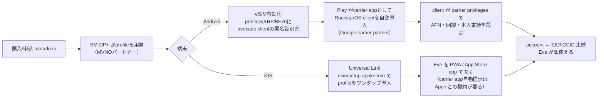

# 03 eSIM — 「eSIMを入れる手間だけでRockstarOSが入る」の設計

現行位置づけ（2026-11-20本人確認）: SIM/eSIMはOS導入時に使う仕組み。主商品はmii、最小構成はNoah。以下は導入方式の設計であり、実回線発行・自動導入・全OS受入の実績ではない。料金・provider条件は既存の個別gateで確認する。

## 1. eSIMは何で、何ではないか

| | 決定 |
| --- | --- |
| 何のためか | **すでに持っているスマホに RockstarOS（＝Eve・Sky・本人の仕事）を入れる最短の手段。** OSをダウンロードして設定する手間を、「eSIMを入れる」一回に置き換える |
| 売るもの | **RockstarOS の回線付き利用権**。月額。データ残量（GB）は売らない。通信は RockstarOS のcloudに届くための最小限で、GBで数えない |
| 売らないもの | 旅行用データeSIM、通話番号、他社回線の再販 |
| プロバイダと契約する理由 | 技術的に不可避だから（eSIM profileはMNO/MVNOのSM-DP+からしか出せない）。特にiOSは、Appleの規約上、アプリから直接eSIMを書くには通信事業者としての契約が要る |
| 契約の強さ | 回線契約と同じ重さ（カード/口座引落し、未払い時は回線停止）。**これを売り文句にはしない**。ユーザーには「使い続けたくなる価値」を見せる（2026-10-10 YouTube Premium型の結論を維持） |
| OS本体をeSIMに入れるか | **入れない。** eSIM profile は数十KBで、鍵・回線設定・アクセス規則しか入らない。OSの実体はcloud（RockstarOS runtime）とスマホ側のclient。eSIMは「鍵と回線」 |

導入の目標は、**eSIMをRockstarOSの鍵付き回線として使い、適合確認後にEveへ進めること**。自動導入は下記のprovider・端末・配布条件が整った場合に限る。

## 2. 条件付きの導入設計（Android / iOS）

- **Android**: eSIM profile のアクセス規則（ARF / BF76）に avokado client の署名証明書を入れると、client は *carrier privileges* を得る（APN・回線設定・`EuiccManager` 操作）。Google の carrier partner になると、SIM検出時に Play がその carrier app を自動導入する。これが「入れるだけでOSが入る」の実体。Pixel向け native RockstarOS（GrapheneOSベース）は別系統で、eSIMはそちらにも同じ鍵を渡す。
- **iOS**: アプリ内でeSIMを書く `CTCellularPlanProvisioning` は Apple の entitlement（通信事業者契約が前提）が要る。無くても iOS 17.4+ の universal link（`esimsetup.apple.com/esim_qrcode_provisioning?carddata=LPA:1$...`）でワンタップ導入できる。導入後の「OS」は Eve の PWA または App Store app。iOSは client を深く入れられないので、**eSIMが本人と回線を束ね、Eveはcloud側で動く**。
- **共通**: account が正本（2026-10-15決定を維持）。eSIMは account に EID/ICCID を束ねる「鍵」。機種変更・mii・Pro・将来のロケットでも、同じ account の続きから動く（Apple の iCloud と同じ役割）。

## 3. これが成り立つ条件（Codexに調べさせる・決めさせない）

| 条件 | 現状 | 誰が決める |
| --- | --- | --- |
| profile metadata に自社証明書（ARF/BF76）を入れられる MVNE/MVNO | 未確認。esim-go のような再販APIでは普通できない。候補: 日本 IIJ（自社SM-DP+）, SORACOM, 海外 1GLOBAL/Truphone, Telna, Kigen, Thales | Codex task 10 で候補比較表 → 本人が選ぶ |
| Google carrier partner（Playの自動導入） | 未申請 | 本人 |
| Apple carrier entitlement（任意。無くても universal link で可） | 未申請 | 本人 |
| 電気通信事業の届出（日本: 届出電気通信事業者。米国: MVNOのFCC登録/CPNI/USF） | 未着手 | 本人（法務） |
| 私設APN / 通信をRockstarOS cloudに限定する設計（GBを売らない根拠） | 設計なし | Codex task 10 |
| 月額の請求と未払い停止（Stripe or carrier billing） | services/sky-billing に月次・後払いの骨格あり | Codex task 11 |

## 4. 現行コードとの対応

| 役割 | 現行 | 扱い |
| --- | --- | --- |
| カタログ/注文/発行/QR/導入証明/端末利用権/照合/webhook | app/api/esim/**, lib/esim-*.ts, lib/esimgo-*.ts（esim-go前提） | 骨格は再利用。**esim-go は「profileを出せる相手」としては暫定**。provider adapter 境界（lib/esimgo-provider.ts）を `lib/esim/providers/<name>.ts` に切り直し、ARF対応providerに差し替えられる形にする |
| 端末束縛・利用権 | lib/rockstar-entitlement-*.ts, lib/esim-device-entitlement*.ts, lib/esim-attested-device-activation.ts（Android key attestation） | 維持。eSIMの EID/ICCID を entitlement の束縛キーに追加 |
| 利用開始UI | app/connect, components/esim-purchase-setup.tsx, components/rockstar-service-setup.tsx | 文言を本定義に合わせる（「データ」「GB」を出さない） |
| 旧定義の文書 | docs/service-design/08-*, docs/native-os-integration.md の「通信＋si利用権bundle」節 | 本ファイルを正本にし、旧節は「2026-10-15版」と明記して残す |

## 5. 料金

候補額・月額・仕事の収益からの天引きは[05-business.md](05-business.md)を正本とする。ここで別の料金を定義しない。既存Wallet/settlement契約を使い、商品料金・通信・si使用料・外部実費を分ける。データ残量の販売を主商品にしない。

## 6. OS導入系統の検証順

製品全体の最初の受入は[00 全体像](00-overview.md#1-一言で)の本人Mac上のNoah。以下はその前提条件にはしない。

1. 準備済みsandboxで、発行・導入案内・Eveへの導線・account束縛を個別に確認。実回線発行や端末自動導入の合格へ読み替えない。
2. task10でproviderへの質問票と適合条件を整理。契約・申込・問い合わせの送信は本人の明示許可が必要。
3. provider・配布条件が確定してから対応adapterとAndroid/iOSの導入経路を検証する。
4. 請求・利用権・回線停止は既存課金契約とproviderの個別受入を通す。

## 7. 法務・規約の注意（売り文句にしない理由）

- 「解約しにくい」を売りにすると、日本の特定商取引法・電気通信事業法の説明義務、米国の州消費者保護法（自動更新・解約容易性）に抵触しやすい。設計上は普通の回線契約と同じ重さで良いが、**UIと広告では「いつでも解約できる」を明記**する。
- 回線を提供する時点で、日本では届出電気通信事業者（届出のみ、免許不要）。本人確認は音声回線でなければ軽い。米国はMVNOとしてFCC登録・CPNI義務。これらは provider との契約形態（再販か、自社MVNOか）で変わる。

## Noah の実行先と画面を閉じた後の動作

回線と本人の利用権を確認したNoahクラウドが仕事を受け付ける。外部Agentは、対応する提供元の専用環境を優先できる。利用者が選んだ登録済み接続先を依頼に固定し、次の依頼では切り替えられる。受付後はサーバーが結果を照会する。スマホを閉じても継続し、同じ依頼IDで復帰する。利用者の停止・利用権の失効・費用条件の変化を確認し、再送で外部の仕事を増やさない。
