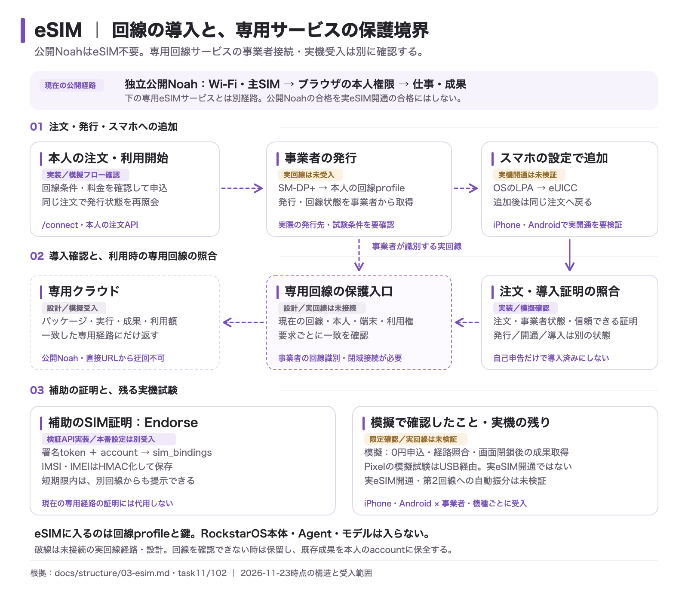
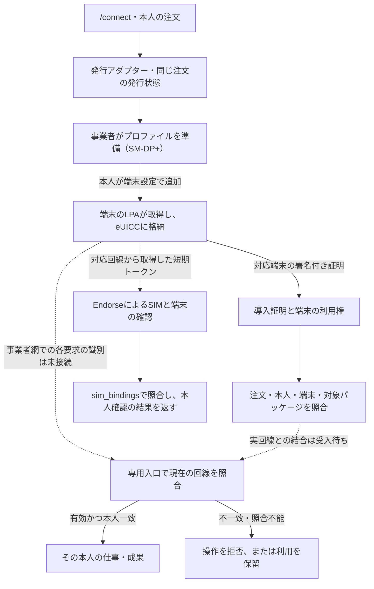

# 03 eSIM — 手持ちのスマホでRockstarOSを使い始める

スマホ向けに提供するのは、本人が選んだパッケージのAgentを動かすクラウド。配布するeSIMは、手持ちのiPhone・Androidからそのクラウドへ接続するための専用回線。利用者は仕事を任せ、成果や使用額をスマホで確認する。これらの操作は本人に発行した有効な専用eSIMを通る通信に限る。主商品はmii、最小構成はNoah。以下は設計で、専用回線での接続制御と実機での利用は検証前。

2026-11-26の検討案では、月額800円のeSIMにAgentの接続枠を組み合わせる。標準5件・Pro 18件の位置づけと未決項目は[パッケージとeSIMの料金案](05-business.md#パッケージとesimの料金案)を参照する。

## eSIMから最初の仕事まで

本人がWi-Fiや主SIMで利用開始を開き、対応機種・提供地域・回線の料金条件を確認して申し込む。事業者が発行した本人のプロファイルをスマホの設定で追加し、同じ注文を開き直す。RockstarOSは注文、事業者側の状態、信頼できる端末の導入証明を照合する。発行結果が不明なら同じ注文で照会する。利用権が有効になったらNoahでAgentを選び、使うデータ・実行先・上限を確認して開始する。[クラウド実行と成果の構成図](../services/noah-own-device.md#クラウドで依頼して受け取るまで)

模擬回線では0円申込、専用経路の照合、端末を閉じた後の成果取得を確認済み。Pixelの試験ではUSB経由で模擬回線に接続した。実回線の開通には、スマホに追加できる事業者発行のプロファイルと試験条件の確認が必要。iPhone・Androidでの実eSIM開通は未検証。[試験結果](https://github.com/k999ln/rock/pull/387)

### 専用回線での利用条件

| 場面 | 利用できる範囲 |
| --- | --- |
| Wi-Fi・普段のSIMで初めて開く／専用eSIMを紛失した | 公開側は申込・回線設定・接続案内と、本人確認付きの契約管理（紛失停止・解約など）を扱う。パッケージや成果は返さない |
| 本人が専用eSIMで接続する | サービス側で現在の回線、ログインした本人、登録端末、有効な利用権を照合する。一致した場合にパッケージの選択・実行・停止、成果・利用額の閲覧を許可する |
| RockstarOS宛ての通信が専用回線を外れる／専用回線が圏外になる | 以降の操作と新しい成果の取得を止める。専用回線で再接続できたら再照合する。他のアプリがWi-Fiや主SIMを使っていても、RockstarOSの経路を検証できれば利用できる。クラウドでは利用権・予算内の承認済みの仕事だけが続く |

実装案では、事業者の閉域接続（私設APNなど）にサービス用の入口を置く。入口で事業者が識別した回線と本人の契約を各要求で照合する。インターネットの公開入口、独立版Noah、直接のAPIやダウンロードURLからも、このサービスのパッケージや成果には到達できない構成にする。アプリが送る回線名、自己申告の識別子、ログイン済みCookieだけを根拠に許可しない。事業者の回線識別と閉域接続を確認できない場合は利用を保留する。

### 発行・端末への導入・専用回線の構造と受入（2026-11-23）

公開版NoahはWi-Fi・主SIMから使え、ブラウザの利用者ごとに仕事と成果を保存する。ここで専用eSIMを求めるのは、RockstarOSの専用パッケージとその成果を扱う入口。型Sはスマホに追加する2本目の回線で、注文・利用権の正本をサーバーに置く。旧版の通信・請求設計からの変更点は本書0章に従う。[公開Noahのセッション](../../lib/noah-browser-session.ts)・[専用パッケージの入口](../../app/api/noah/cloud-work/[[...action]]/route.ts)・[旧版の設計](../service-design/08-mini-connectivity-and-billing.md)

| 操作 | 入力と判定 | 応答・保存・復旧 |
| --- | --- | --- |
| 申し込み・発行 | `/connect`で対象と条件を確認し、本人の注文IDで状態を取得する。既存のeSIM Goアダプターの発行条件は支払済み注文、承認済みパッケージ、事業者発行の明示的な有効化。0円試行は模擬発行を使う。 | 発行結果が途切れたら同じ注文を照会する。既知の事業者注文は読み取りで突き合わせ、照合が済むまで発行取引を再送しない。発行情報は本人・注文に結び付けて暗号化し、同じ配達キーで受領をやり直せる。[発行・再照合](../../lib/esimgo-provider.ts)・[導入情報と受領確認](../../lib/esim-install-material.ts) |
| 設定・導入証明 | OSの回線追加で、端末のLPA（プロファイル取得機能）が事業者から取得し、eUICC（SIMプロファイルを保存する部品）に入れる。端末利用権には、本人・注文・プロファイル・端末・今回のチャレンジに対応する信頼済み署名の導入証明を照合する。 | 導入証明には発行元・端末参照・証明のダイジェスト等を保存する。iPhoneの追加リンク／QRからの自己申告と事業者イベントで得るEve用状態は別記録。Androidでは導入証明を提出できる対応端末が必要。iPhone・Androidとも、普段のデータ回線を維持したまま専用通信を分ける条件は次節で試す。[導入証明](../../lib/esim-install-proof.ts)・[記録](../../lib/esim-device-install-store.ts)・[iPhoneの導入試験](../../tests/esim-ios-install.test.mjs)・[Appleの設定手順](https://support.apple.com/en-us/118669) |
| SIMと本人を結ぶ | `POST /api/devices/sim-proof`で、本人セッションとEndorseの署名・発行者・宛先・有効期限を照合する。SIMと端末の識別子（IMSI・IMEI）は別々にHMAC化する。 | `sim_bindings`に本人、二つのダイジェスト、紐付け・解除時刻を保存する。同一の組の再送は同一行。別の本人による二重登録は拒否する。`verify`は一致で`sim_verified`、不一致で`passkey_required`。支払い・権限変更の資格は発行しない。トークンは有効期間内に別回線からも提示できる。[検証と解除](../../lib/sim-proof-http.ts)・[保存処理](../../lib/sim-proof-store.ts)・[task 102](../../codex/tasks/102-sim-proof-endorse.md) |
| 専用サービスを使う | 利用権の検証は注文・導入証明・登録端末・対象パッケージの現在の審査と操作範囲を参照する。専用仕事の入口は別途、本人、HTTPメソッド、URL、本文ダイジェストと回線証拠を要求ごとに照合器 `LINE` へ渡す。 | 有効な同一アカウントへの許可時だけ、返された本人の保存先で仕事・成果を扱う。回線証拠の欠落・不一致は403、照合器の未設定・障害は503。実在する事業者網とこの照合器の接続は未受入。公開Noahの保存先と専用の保存先は独立する。[注文から利用権を求める実装](../../lib/esim-cloud-grant.ts)・[操作範囲](../../lib/noah-esim-access.ts)・[専用Worker](../../services/noah-test-runtime/src/cloud-entry.mjs) |
| 紛失・機種変更・復帰 | 本人が契約管理に戻り、紛失したSIMの紐付けを解除する。注文に発行したクラウド鍵は別に失効できる。機種変更は解除後の新しいSIM証明で束ね直し、新端末の導入証明・利用権を再確認する。 | 解除行は履歴に残し、解除前に発行された証明は再利用できない。クラウド鍵の失効、アカウント上の紐付け解除、通信事業者による回線停止は各々の結果を記録する。回線復帰後は同じ仕事IDで成果を取り直す。[SIMの再登録・競合試験](../../tests/esim-sim-proof.test.mjs)・[鍵の失効と復旧試験](../../tests/esim-cloud-recovery.test.mjs)・[模擬回線の復帰試験](../../tests/esim-noah-free-trial.test.mjs) |

**再現と合格条件**

- **ローカルの証明と専用入口**　`node --experimental-strip-types --test tests/esim-install-proof.test.mjs tests/esim-device-entitlement.test.mjs tests/esim-device-entitlement-store.test.mjs tests/esim-sim-proof.test.mjs tests/noah-cloud-work.test.mjs`。試験鍵の正しい注文・端末で導入証明を受理し、同一チャレンジによる利用権の作成1件、同じSIMの二重登録0件、期限切れ・別所有者による有効化0件、合成回線の許可で本人だけが成果を取得し、回線を止めた後の取得成功0件を確認する。[証明試験](../../tests/esim-device-entitlement.test.mjs)・[合成回線を使うWorker試験](../../tests/noah-cloud-work.test.mjs)
- **実回線での受入待ち**　試験用プロファイルの発行条件を確定後、iPhoneとAndroidを各1台用意する。各機種で通常通信をWi-Fi、次に主SIMにして、事業者側で専用要求の回線を照合する。本人の仕事を1件開始し、画面を閉じてから同じ仕事の成果を1件取得する。専用eSIMを無効化・他人の回線に変更・利用権を失効させた各条件で、保護API・成果URLの成功0件、通常アプリの通信継続を記録する。復帰時に同じ依頼を重複実行した件数が0件で合格。PixelのUSB模擬試験と公開NoahのWi-Fi実績はそれぞれの試験条件で記録済み。実回線の発行、端末別経路、事業者との照合は未確認。[task 11](../../codex/tasks/11-esim-first-live.md)・[事業者への確認事項](../esim/noah-pilot-rfq.md)

### 普段の回線を変えずに使う条件

利用者がするのは初回の追加とパッケージ選択まで。目標はWi-Fi接続中も、外出して主SIMで通信中も、RockstarOS宛てだけが専用eSIMを通ること。個人所有の一般端末にeSIMを追加するだけで、SafariやChromeの特定サイトを第2回線へ割り当てる共通手順は確認できていない。手動でデータ回線を変えた試験は専用回線の疎通確認に使う。

| 端末 | 実現できる範囲と検証候補 |
| --- | --- |
| iPhone | 通常のデュアルSIMで同時に使えるモバイルデータ回線は1本。ネイティブアプリは接続に携帯回線を要求できるが、普段のSIMをデータ用にしたまま第2のeSIMを指定する機能は公開仕様で確認できない。管理下のアプリを事業者の5G専用経路（スライス）へ割り当てる方法はあるが、別契約の第2回線を並行利用できる根拠にはならない。[AppleのデュアルSIM](https://support.apple.com/ja-jp/109317)・[接続に使う回線の種類](https://developer.apple.com/documentation/network/nwparameters/requiredinterfacetype)・[Appleの5Gネットワークスライシング](https://support.apple.com/guide/deployment/support-for-5g-network-slicing-dep0f666c6f9/web) |
| Android | Android 11以降のネイティブアプリでは、対象SIMの契約IDを指定して携帯ネットワークを要求できる。端末が応じた場合にだけ、RockstarOSの接続をそのネットワークへ結び付ける。標準実装にはデータ通信用に選ばれていないSIMへの通常のインターネット要求を受け付けない条件がある。対象機種と事業者で実証する。業務用プロファイルと事業者の5G専用経路も候補だが、経由したSIMは別途確認する。[回線の指定](https://developer.android.com/reference/android/net/TelephonyNetworkSpecifier.Builder)・[接続の固定](https://developer.android.com/reference/android/net/Network#openConnection(java.net.URL))・[Androidの回線選択の実装](https://android.googlesource.com/platform/frameworks/opt/telephony/+/3536b944c16a483232280cf0a0045a7a60f94a86/src/java/com/android/internal/telephony/data/PhoneSwitcher.java)・[Androidの5Gネットワークスライシング](https://source.android.com/docs/core/connect/5g-slicing) |

実機試験はWi-Fiを有効にした場合と、Wi-Fiを切って普段のSIMをデータ用にした場合の両方で行う。通常アプリの通信経路を保ったまま、RockstarOSの要求だけを本人の専用回線として事業者側で照合できることを確かめる。専用eSIMを無効にしたら保護対象の操作・取得は0件、通常アプリの通信は継続とする。追加アプリ・端末管理・対応プランの要否も記録する。

### 機種変更・利用停止・請求

- **機種変更・紛失**。同じアカウントで再認証し、事業者の移行・再発行手順に従って新端末の導入を照合する。紛失した端末のアクセスは先に失効させる。確認済みの新端末に権限を発行し、既存の予定・仕事・成果・明細をアカウントから読み戻す。
- **回線の解約・利用権の失効**。一時圏外と契約上の利用停止を区別する。失効した利用権に依存する新規実行と次回予約の起動を保留し、処理中の仕事・未確定の利用額は同じWorkで照合する。既存成果は本人のアカウントに保全する。
- **1,000人で試す費用**。回線側の原価は「発行件数 × 発行単価 ＋ 契約回線数 × 月の回線原価 ＋ 再発行などの実費」。事業者の見積で基本料や最低利用額も確認する。Noah側は実際の仕事数と使用量から算出する。[1,000人のクラウド試算](../services/noah-own-device.md#費用の式雲)に回線原価を加えて運営予算を出す。利用者の明細では回線月額とAgentの従量を分ける。

### 設定を閉じた後の案内と請求

| 利用者が知りたいこと | 案内する画面と動作 |
| --- | --- |
| 追加の後、どこを開く？ | Apple・Androidの設定へ移る前に「追加したらこの購入履歴に戻って状態を更新」と表示する。タブを閉じたら同じRockstar IDの「登録情報 → 購入履歴・eSIM設定」へ。初回は注文の「状態を確認」、同じ画面では「状態を更新」。設定からの自動起動、SMSの受信、購入メールの到着を前提にしない |
| 何が使えるようになった？ | 試作は有効になった注文から「Noahで最初のAgentを選ぶ」へ進む。専用回線方式では、同じ注文から回線と利用権を確認して「使いたいパッケージを選ぶ」を開く。専用経路を確保できない場合は対応状況を表示する。発行中・導入確認待ち・失効の場合はその状態と次の操作を示す |
| 請求は誰のどこへ？ | 直販のeSIM注文は購入した本人の購入履歴に金額と取得できた領収書を表示。専用クラウドの月次契約は契約者のRockstar IDに対応する決済顧客へ請求し、登録した支払い方法で精算する。既存の月次契約は米ドル建て。通信会社との合算請求・請求メール配信は提供済みの経路に数えない。回線の販売元・更新条件は正式プランごとに申込前に示す |
| 仕事ごとにいくら使った？ | 「登録情報 → Agentの利用記録」（`/noah/usage`）で直近7・30・90日、Agent・仕事・通貨別に、取得済みの記録と確認できた費用を見る。未計測は未確定として扱う。ここで表示する期間や費用の合計は請求書と異なり得る |
| 今月いくら払う？ | 「登録情報 → クラウドの使用額・請求明細」（`/noah/linux#monthly-statement`）で、本人の専用クラウド契約について、基本月額・確定計算使用料・確定Agent料・予約中・月間上限を見る。予約は実行に備えて確保した額。発行済み明細では月別の確定額・入金状態と、対象の請求書を確認できる。月次請求の試験画面（`/noah/billing`）は利用者の請求先にしない |

最初の実機受入では、初めての利用者が①設定から戻る、②閉じたタブから同じ注文を探す、③パッケージを1件選んで開始する、④画面を閉じたまま予定を1回実行し、再度開いて成果・使用額を確認する、⑤停止して次回の実行が0件になる、までをiPhone・Android各1台で試す。支払い先と確定額・予約額の表示、受付中、確認待ち、失効、支払い失敗も別に確認する。回線の申込・更新料と一般クラウドAgentの使用料を一つの本番請求に集約する部分は未受入。

**2026-11-21 の決め（0章）が、この文書の1〜7章より優先する。** 1〜7章は消さずに残し、0章と食い違う所には「→ 0章」と印を付けた。

## 0. 載せる先と回線の型（2026-11-21）

### 0.1 一言で（2026-11-21 22:31 の本人の回答で更新）

**eSIM は、人のスマホと、自社の端末（mii の Hub・専用端末・車）の両方に出す。** 同じ「回線の profile」でも、入る場所が違うので、できることが違う（0.3）。

- 自社の端末では、自社クラウドへ届く唯一の回線であり、鍵でもある。
- スマホでは、今の回線の横に入る 2 本目の回線になる。主な役目は契約と入口。型は S（0.3.2）。
- OS 本体と Agent は、どちらの SIM にも入らない（0.2）。

同日 17:55 版の「スマホに売らない」は、本人の「1 は取り下げない」（22:31）で取り消した。

**2026-11-22 の本人方針が、この章の 11-21 の決めより優先する**（[07](07-decisions-from-minutes.md) の 2026-11-22）。手持ちの iPhone・Android には、クラウドへの鍵となる eSIM を配る。最初は eSIM を必須にせず、Noah 単体で出す。会員登録は廃止した。利用者から月額は取らない。この章で、これと違う所には「11-22 で更新」と書いた。

### 0.2 何が SIM に入り、何が入らないか

| 物 | 大きさ | eSIM に入るか |
| --- | --- | --- |
| eUICC（eSIM のチップ）全体の記憶域 | 約 400KB〜1MB（製品の公開値: ST33j 420KB、ST33j1m 1MB、Soracom industrial 最大 400kB） | — |
| 回線の profile（IMSI・ICCID・鍵・網の設定・小さな SIM アプリ） | 数十 KB | 入る |
| 端末アプリの署名の hash（Android の carrier privileges。ARA-M／ARF の規則 1 件は 20〜32 バイトの hash ＋ 8 バイトの権限） | 数十バイト | 入る |
| RockstarOS 本体・client・Agent・モデル | MB〜GB | **入らない** |
| 「plugin」 | — | 入るのは**利用権と鍵**だけ。Agent 本体は Hub・クラウドで動く |

### 0.3 スマホの eSIM と、自社の端末の eSIM の違い

| 項目 | スマホの eSIM | 自社の端末（Hub・専用端末・車）の eSIM |
| --- | --- | --- |
| 規格 | SGP.22（消費者向け）。スマホの中の LPA が、利用者の操作（QR・コード・iPhone の URL）で profile を入れる | SGP.32（IoT 向け）。サーバー側の eIM と端末の IPA が、人の操作なしで入れる・切り替える。工場で入れておく形もある |
| チップ | スマホのメーカーが選んだ物。こちらは profile を 1 枚入れるだけ | こちらが選ぶ（MFF2 のチップ型）。SIM の中のアプリ（applet）と鍵を、チップの供給元と決められる |
| profile の中身 | 回線の鍵（IMSI・ICCID・Ki/OPc）、網の設定、表示される回線名、Android 用の署名の hash（ARA-M の規則） | 同じ物 ＋ 端末の鍵を SIM の中に持たせる applet（GSMA IoT SAFE。SIM を信頼の起点にして、クラウドと相互 TLS）。無効化・削除を禁止するルール（PPR1・PPR2。企業が管理する端末で使われる物）も付けられる |
| OS から読めるか | iPhone: アプリからも Web からも、ICCID・EID・IMSI は読めない。Android: SIM に署名の hash を入れた自社アプリだけが読める（carrier privileges） | 自社の OS なので全部読める。account へ EID・ICCID で束ねる |
| データ通信 | **ふつうのスマホは、データ通信に同時に使える回線が 1 本だけ**（Apple 公式「one cellular data network at a time」。Android も多くの機種が同じ。実機で確かめる）。2 本目として入れた eSIM は、利用者がデータ回線に選ばない限り通信に使われない | 唯一の回線。自社クラウド行きの通信は全部ここを通る |
| 鍵としての働き | iPhone: 普段は通信に使われないので、SIM で本人を確かめられない（11-22 で更新: 会員登録は廃止。本人の続きは、このブラウザ専用の保存権限で持つ）。Android: 自社アプリが ICCID を account に束ねられる。どちらも、データ回線にした間は、網の側で SIM を確かめられる（SORACOM Endorse の署名付きトークン。取った後は Wi-Fi でも使える） | 網の側で常に SIM を確かめられる（Endorse・Beam）＋ SIM の中の鍵で相互 TLS（IoT SAFE） |
| 入れる人 | 利用者 | 工場か、自社の OS |
| 回線の種類 | 消費者向けのデータ回線。SMS を付けると、2026-05 の法改正で本人確認の対象になりうる（0.5） | IoT 向け。SMS なし。本人確認の対象外の方向（0.5） |
| 消す・やめる | 利用者が設定から profile を消せる。消しても契約は残り、請求は契約の解約で止まる | 端末の部品なので、利用者は消さない。やめるのは機器のサービスの解約 |

#### 0.3.1 ここから分かること

- 11-22 で更新: スマホの eSIM は「クラウドへの鍵」として配る。鍵として働くのは、RockstarOS の通信がその回線を通っている間だけ。どの機種で、普段の回線を変えずにそれができるかは、この文書の「普段の回線を変えずに使う条件」の実機試験で決める。
- 自社の端末の eSIM は、唯一の回線なので、**回線・鍵・入口の全部**を持つ。

#### 0.3.2 スマホの型（決定: S。2026-11-21 22:54「規定で進めて」）

11-22 の「鍵として配る」は型 S のままで成り立つ。ただし鍵として使う間は、RockstarOS の通信がこの回線を通る必要がある（0.3.1）。

| 型 | 中身 | できること | 引き換え |
| --- | --- | --- | --- |
| **S 2 本目（既定）** | 今の回線の横に入る 2 本目。SMS なし。通信は少量 | 契約と請求の形、iPhone の URL 1 つで入る入口、Android の自社アプリでの本人の束ね | 普段は通信に使われない。原価は基本料（例: SORACOM planX1 は月 $1.8 ≒ 282 円 ＋ 1MiB $0.02。eSIM profile は承認制） |
| M 主のデータ回線 | 利用者がデータ回線に選ぶ。全部の通信が通る | 網の側で常に SIM を確かめられる。回線として毎日使われる | GB を売ることになり、§1「GB を売らない」と衝突する。通信の質・サポート・値段で格安 SIM と比べられる。届出が要る |

#### 0.3.3 離脱率（本人の仮説として残し、測る。2026-11-21 22:31）

本人の言葉は「データでも eSIM は、アプリに比べて離脱率が低いはず」。17:55 版の取り下げは取り消した。

公開の数字:

- 米国の主回線（音声つきの後払い）の解約率は月 0.86〜0.92%（2026 年 4〜6 月期。Verizon 0.92%、AT&T 0.86%、T-Mobile は推計 0.9%）。
- サブスクのアプリの解約率は、中央値で月 7.5%（動画配信は 5.2%）。主回線との差は 8 倍ほど。
- データだけの 2 本目の回線の解約率は、公開の数字が見つかっていない。

データでも残る効き目:

- 毎日目に入るアイコンが無い。
- 「通信費」の枠で見られる。
- やめる操作が契約の手続きになる。

データでは弱まる効き目:

- 番号の持ち運び・端末の分割払い・家族割が無い。
- カードで請求すると、明細の見え方はアプリと同じ。口座振替やキャリア決済にすると強まる。

決まり:

- 解約を難しくする仕組みは作らない（§7）。PPR で消せなくする物を、スマホには付けない。
- **測り方（11-22 で更新）**: 月額を取らなくなったので、解約率の代わりに「使い続けた割合」で比べる。機能は同じにして、eSIM を入れた人と入れていない人の、月ごとに使い続けた割合と 3 か月の継続を比べる。
  - eSIM を入れた人だけの機能は作らない。機能が違うと、eSIM そのものの効き目と混ざる。
  - 1 か月のうちに 1 回でも使ったことを、1 回の「続けた」と数える。集計は `lib/churn-cohort.ts`（[task 103](../../codex/tasks/103-esim-churn-measure.md)）。
  - 11-21 版の「同じ値段」「どちらもカードで請求」は、月額の廃止で外した。

### 0.4 Hub の回線の型

| 項目 | 決め | 理由 |
| --- | --- | --- |
| 回線 | 国内 LTE、IoT 向けデータ専用、SMS なし。試作はカード、量産はチップ型で SGP.32 対応 | 10-10 の決めのまま |
| 通信先 | **自社クラウド（RockstarOS の制御・Agent・音声）だけ**に絞る（私設 APN か、端末側の宛先制限）。OS・モデルの更新、映像は Wi-Fi | 500MB に収まる。下の届出と本人確認で「他人の通信を媒介しない」側に寄せられる |
| 原価の目安 | 500MB を含んで月 385 円（SORACOM plan-K2 K2-500MB の定価・税込、使用中）。準備完了・休止中は月 192.5 円。初期費用はチップ型 1,111 円 | 2026-11-21 取得。卸値は見積りで変わる |
| 請求 | 回線料は機器のサービス料に含め、別の明細にしない（10-10 のまま）。決済は Stripe のカード | キャリア決済は通信会社と組む時だけ |
| 付ける順 | Wi-Fi が無い所（引渡し前の建築、車、工場、屋外、施設）から | 家庭は Wi-Fi があり、回線の価値が小さい |

### 0.5 制度（確かめていない。専門家と総合通信局に確認する）

- **電気通信事業の届出。** 総務省の参入マニュアル（追補版）は、回線の料金や条件を自分で決めて提供すると届出・登録が要り、変えずに機器と一緒に提供するだけなら要らない、通信を媒介しない IoT サービス（位置管理など）は要らない、と整理している。Hub の通信先を自社クラウドに絞り、回線料を機器のサービス料に含める形がどちらに当たるかは、総合通信局に聞く。
- **スマホの型 S は SMS を付けない**（下の本人確認の対象から外れる側に寄せる）。
- **本人確認（改正携帯電話不正利用防止法）。** 2026-05-22 成立・05-29 公布、公布から 1 年以内に施行。データ専用 SIM が対象に入る。総務省の制度整備の方向性（2026-07）は、SMS つきを対象にし、IoT 向けは対象外とする方向で検討中（範囲は未定）。**SMS なし・自社クラウド行きだけ**の Hub 回線は外れる側に寄せる。政令・省令が出たら確かめ直す。1〜7 章の「音声回線でなければ軽い」（§7）はこの改正で古くなる。

### 0.6 iPhone の人の入口（22:31 の回答で更新）

1. **eSIM の追加は URL 1 つ。** `esimsetup.apple.com` の universal link で、iOS 17.4 以降。
2. 追加の後に、Noah・Eve の PWA を開く。
3. eSIM を入れない人には、PWA の URL 1 つだけを見せる。

App Store のアプリは作らない（10-16「携帯はリモコン感覚。アプリは作らなくてよい」のまま。22:54 に決定）。iPhone の Web の通知は、ホーム画面に追加した時だけ届く。だから初回に「ホーム画面に追加」を 1 回だけ案内する（task 90 の通知と同じ扱い）。

### 0.6.1 回線の仕入れ先（決定 14。22:54）

- **第一候補は SORACOM。** Hub（IoT SIM のチップ型）と、スマホの型 S（eSIM profile。承認制）を同じ事業者でそろえる。SIM の証明（Endorse・Beam）と閉域（VPG）も同じ所で使える。
- 比べる候補は IIJ と 1GLOBAL（[provider-contract-readiness](../provider-contract-readiness-20260930.md) の比較のまま）。
- 問い合わせ・見積りの依頼は、本人の許可の後に送る（AGENTS.md §6）。質問票は [task 10](../../codex/tasks/10-esim-provider-research.md)。

### 0.7 既存コードの扱い

消費者向け eSIM のコード（`app/api/esim/**`、`lib/esim-*.ts`、`lib/esimgo-*.ts`、`toolkits/esim-bootstrap/`）は消さない。発行の gate（`providerDebitEnabled`）は既定で閉じたまま。Hub の回線は、端末の接続状態（[avocado-mini-cellular.md](../avocado-mini-cellular.md) の状態）と、account への端末束縛（`lib/rockstar-entitlement-*.ts`）で扱う。ICCID・EID を束縛キーに足す計画（02 §3）はそのまま。

### 0.8 この決めが変わる条件

- 0.3.3 の測り方で、eSIM つきの解約率がカードだけより低くなかった時。スマホの eSIM を続けるか考え直す。
- スマホの型を M にする時。§1 の「GB を売らない」を本人が変える。
- 政令で、SMS なし・IoT 向けも本人確認の対象になった時。Hub の回線にも本人確認の流れが要る。
- 総合通信局の答えが「届出が要る」だった時。届出をしてから出す（届出は登録より軽い）。

## 1. eSIMは何で、何ではないか

| | 決定 |
| --- | --- |
| 何のためか | **対応スマホに回線を追加し、本人のRockstarOSを利用開始する。** 利用権を確認した端末でEve・Noahと本人の仕事を開く（→ 0 章。スマホの eSIM と自社の端末の eSIM の違い） |
| 提供するサービス | **専用eSIMから使うAgentのクラウド**。利用者はNoahでパッケージを選び、許可した仕事の実行と成果の保存を任せる。明細では回線の月額とクラウドで使った分を区別する |
| 売らないもの | 旅行用データeSIM、通話番号、他社回線の再販 |
| プロバイダと契約する理由 | 技術的に不可避だから（eSIM profileはMNO/MVNOのSM-DP+からしか出せない）。特にiOSは、Appleの規約上、アプリから直接eSIMを書くには通信事業者としての契約が要る |
| 契約の強さ | （→ 0.3.3。本人の仮説として残し、測る）回線契約と同じ重さ（カード/口座引落し、未払い時は回線停止）。**これを売り文句にはしない**。ユーザーには「使い続けたくなる価値」を見せる（2026-10-10 YouTube Premium型の結論を維持） |
| OS本体をeSIMに入れるか | **入れない。** eSIM profile は数十KBで、鍵・回線設定・アクセス規則しか入らない。OSの実体はcloud（RockstarOS runtime）とスマホ側のclient。eSIMは「鍵と回線」 |

導入の目標は、**eSIMをRockstarOSの鍵付き回線として使い、適合確認後に同じアカウントでEveとNoahを開けること**。自動導入は下記のprovider・端末・配布条件が整った場合に限る。

## 2. 端末ごとの導入

最初に配る案内は、設定後にも開き直せる利用開始ページのURL。利用者が既存回線やWi-Fiでサインインすると、その人の注文に対応するeSIMの追加手段だけを表示する。通信事業者の発行コードや個人別のQRは公開リンクに含めない。設定へ移る前に「追加したら、このページに戻ってください」と表示する。

| 端末 | 本人が初回にする操作 |
| --- | --- |
| iPhone | iOS 17.4以降で事業者が対応する場合は、利用開始ページの「eSIMを追加」から事業者リンクを開き、システム画面で追加を確定する。標準ブラウザ・メールで受け取ったQRを長押しする方法や、別の画面に出した事業者QRをカメラで読む方法もある。完了後は本人が元のページに戻る。[Appleの導入手順](https://support.apple.com/ja-jp/118669) |
| Android | 対応するPixelの例は「設定 → ネットワークとインターネット → SIM → SIMを追加 → eSIMを設定」。事業者の案内に沿って追加する。同じスマホだけなら機種・事業者で確認済みのリンクまたは手入力コードを提示する。別の画面が使える場合はそこに事業者QRを出す。完了後は元のページに戻る。Androidはメーカー・機種・事業者の組み合わせ単位で案内を用意する。[Pixelの導入手順](https://support.google.com/pixelphone/answer/9449293?hl=ja)・[AndroidのeSIM実装](https://source.android.com/docs/core/connect/esim-overview) |

**追加を確認する方法。** 利用開始ページはサインイン済みの本人の注文を読み戻す。発行済み・回線開通・この端末での導入確認を別々に記録する。ブラウザの自己申告や回線開通の通知だけでは端末への導入を証明できない。アプリ不要の候補は、事業者が注文に対応する回線と端末を照合し、今回の確認要求に結び付く検証可能な結果をNoah側へ返す方式。必要な証明を取得できない組み合わせは「導入確認待ち」とする。導入確認後も、パッケージを開く際に専用回線の経由を確かめる。[RockstarOSの端末・アカウント設計](02-rockstaros.md)

**普段の使い方。** パッケージを有効にすると、承認済みの予定はクラウドに保存され、スマホをロックしてもNoahが実行する。本人が専用eSIMで開くと、次回予定・直近の結果・使用額・停止を確認できる。任意の端末通知は「更新があります」までとし、成果本文と承認操作は専用回線の画面でのみ提供する。

## 3. これが成り立つ条件（Codexに調べさせる・決めさせない）

| 条件 | 現状 | 誰が決める |
| --- | --- | --- |
| profile metadata に自社証明書（ARF/BF76）を入れられる MVNE/MVNO | 未確認。esim-go のような再販APIでは普通できない。候補: 日本 IIJ（自社SM-DP+）, SORACOM, 海外 1GLOBAL/Truphone, Telna, Kigen, Thales | Codex task 10 で候補比較表 → 本人が選ぶ |
| Google carrier partner（Playの自動導入） | 未申請 | 本人 |
| Apple carrier entitlement（任意。無くても universal link で可） | 未申請 | 本人 |
| 電気通信事業の届出（日本: 届出電気通信事業者。米国: MVNOのFCC登録/CPNI/USF） | 未着手 | 本人（法務） |
| 専用eSIMからサービスへの閉域接続・回線識別 | 上記の方式を設計。対象スマホ向けに提供できる事業者・端末別の通信経路・回線の照合は未検証 | task 10で条件を確認し、task 11で受入 |
| 月額の請求と未払い停止（Stripe or carrier billing） | services/sky-billing に月次・後払いの骨格あり | Codex task 11 |

## 4. 現行コードとの対応

| 役割 | 現行 | 扱い |
| --- | --- | --- |
| カタログ/注文/発行/QR/導入証明/端末利用権/照合/webhook | app/api/esim/**, lib/esim-*.ts, lib/esimgo-*.ts（esim-go前提） | 骨格は再利用。**esim-go は「profileを出せる相手」としては暫定**。provider adapter 境界（lib/esimgo-provider.ts）を `lib/esim/providers/<name>.ts` に切り直し、ARF対応providerに差し替えられる形にする |
| 端末束縛・利用権 | lib/rockstar-entitlement-*.ts, lib/esim-device-entitlement*.ts, lib/esim-attested-device-activation.ts（Android key attestation） | 維持。eSIMの EID/ICCID を entitlement の束縛キーに追加 |
| 利用開始UI | app/connect, components/esim-purchase-setup.tsx, components/rockstar-service-setup.tsx | 文言を本定義に合わせる（「データ」「GB」を出さない） |
| 旧定義の文書 | docs/service-design/08-*, docs/native-os-integration.md の「通信＋si利用権bundle」節 | 本ファイルを正本にし、旧節は「2026-10-15版」と明記して残す |

## 5. 料金

候補額・月額・仕事の収益からの天引きは[05-business.md](05-business.md)を正本とする。ここで別の料金を定義しない。既存Wallet/settlement契約を使い、商品料金・通信・si使用料・外部実費を分ける。データ残量の販売を主商品にしない。

## 6. OS導入系統の検証順

製品全体の最初の受入は[00 全体像](00-overview.md#1-一言で)の本人Mac上のNoah。以下はその前提条件にはしない。

1. 準備済みsandboxで、発行・導入案内・Eveへの導線・account束縛を個別に確認。実回線発行や端末自動導入の合格へ読み替えない。
2. task10でproviderへの質問票と適合条件を整理。契約・申込・問い合わせの送信は本人の明示許可が必要。
3. provider・配布条件が確定してから対応adapterとAndroid/iOSの導入経路を検証する。
4. 請求・利用権・回線停止は既存課金契約とproviderの個別受入を通す。
5. 同一注文への再試行で発行1回、他人の注文で有効化0件、証明未確認の端末が回線付き利用権で有料実行した件数0を確認する。続いて対応するiPhone・Androidの実機で回線追加と導入証明を検証し、Noahで予算を承認した仕事1件から本人の成果1件・利用明細1件まで照合する。一時圏外、権限失効、機種変更を別々に試す。[eSIMの実装タスク](../../codex/tasks/11-esim-first-live.md)・[クラウド実行の受入](../services/noah-own-device.md#実装公開前に確かめること)

## 7. 法務・規約の注意（売り文句にしない理由）

- 「解約しにくい」を売りにすると、日本の特定商取引法・電気通信事業法の説明義務、米国の州消費者保護法（自動更新・解約容易性）に抵触しやすい。設計上は普通の回線契約と同じ重さで良いが、**UIと広告では「いつでも解約できる」を明記**する。
- 回線を提供する時点で、日本では届出電気通信事業者（届出のみ、免許不要）。本人確認は音声回線でなければ軽い（→ 0.5。2026-05 の法改正でデータ SIM も対象に入る。この文は古い）。米国はMVNOとしてFCC登録・CPNI義務。これらは provider との契約形態（再販か、自社MVNOか）で変わる。

## Noah の実行先と画面を閉じた後の動作

回線と本人の利用権を確認したNoahクラウドが仕事を受け付ける。外部Agentは、対応する提供元の専用環境を優先できる。利用者が選んだ登録済み接続先を依頼に固定し、次の依頼では切り替えられる。受付後はサーバーが結果を照会する。スマホを閉じても継続し、同じ依頼IDで復帰する。利用者の停止・利用権の失効・費用条件の変化を確認し、再送で外部の仕事を増やさない。
