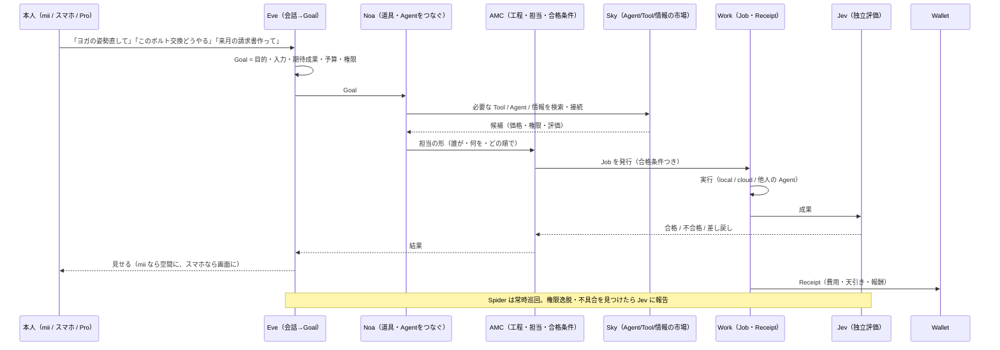

# 04 Eve → Noa → AMC → Jev、Sky、そしてサービス挙動の書き方（2026-11-02）

2026-11-21 棚とパッケージ: Noah の入口に「稼ぐ・仕事を省く」「教育」「暮らし」の棚を置き、カード 1 枚を「1 つの仕事を最後までやる組合せ」にする（本人の決定 11-19〜21）。棚に載せるのは、運営が動かして確かめた、今動かせる物だけ。並びは、運営の順から始め、数えた実績（成果が返って、また使われるか）で直す。学習したモデルは使わない。カードの工程は、今の工程の計画（lib/sky-recipe-planner.ts）の能力として、そのまま Noa へ渡る。Eve → Noa → AMC → Jev の構造と、Broker・Wallet の gate は変えない。[仕様書 110](../noah/spec-110-shelf.md)、[書式](../services/noah-shelf.md)、[300 人への出し方](../noah/trial-300.md)。

## 現在の入口と実装範囲

製品の優先順位は[00 全体像](00-overview.md#1-一言で)、公開名と内部名は[06 名前](06-naming.md)を正本とする。公開Noahと内部Noaは別の役割。

| 入口・機能 | 現在の契約と参照先 |
| --- | --- |
| Noah | `/noah`が唯一の統合タイムライン。個人の感想・発見・評価の本文と作者を主役に、通常投稿とAgent紹介を既定で全件表示し、Agentボタンで絞り込んだ時だけ戻るボタンを出す。フォロー投稿と通常投稿を紹介より先に並べる。ニュース・コミュニティーは表示しない。Xのような3カラム（左ナビ・中央フィード・右検索/Agent欄）、avokado正式花形ロゴ・白地とチャコールの文字・紫のアクセントのNoah専用メニューからAgent・仕事・成果へ進む。スマホ下部は現在地付きの「メニュー」1ボタンへ統合し、4画面をアイコン・用途説明で選ぶ。機能一覧は設けず、旧`/noah/features`はタイムラインへ戻す。公開Agentには利用人数・王冠評価・公開コメント/返信を設ける（[評価とフィードバック](../services/noah-agent-feedback.md)）。開発者には[継続改善パッケージ](../services/noah-developer-maintenance.md)を案内し、smash@avoado.siへのメールで相談を受け付ける。最初の本人MacでのAgent選択・接続・実行・成果受領・停止は[Noah単体ローンチ](../services/noah-standalone-launch.md)に集約する。Eveを開くことを実行条件にしない。接続画面はAgent選択→Mac接続→仕事依頼の順に進み、未接続時の次の操作を示し、接続案内やサインインから選択Agentへ戻す。「実行中」タブ（`/noah/activity`）に依頼入力・接続・実際の仕事状態・成果・停止を集約し、旧`/noah/launch`はAgent指定を保持して転送する。画面の説明を減らし、必要な詳細は項目別に展開、Mac接続は3ステップとコピー操作で案内する |
| Eve | 本人の依頼、仕事、成果と使用量の窓口。選んだTool・記事・担当を受け取る。Noahの主要画面ではEveへの切り替えを必須にしない。既存の認証・実行中の遷移制限を保持 |
| 互換入口 | `/sky`と`/os/sky`はqueryを保持して対応するNoah画面へ移動。保存済み担当は`/noah/saved`、調査カタログは`/noah/agents`。APIと保存識別子は変更しない |
| ローカル実験 | 公開画面は`/noah/local-tools`へ案内。Macのlocalhost制限・私有データを保持。公開Webからの実行は、別の認証済みRunner経路を使用 |
| 公開配信 | 共通ヘッダーと固定hashのasset配信を使用。公開カタログ、本人の登録、審査済み公開版、実行許可を区別。配備の履歴は[task69](../../codex/tasks/69-noah-public-timeline.md)・[task70](../../codex/tasks/70-noah-route-unification.md)、通し受入は[task71](../../codex/tasks/71-noah-standalone-launch.md)で確認 |
| 次の設計（未実装・本人確認待ち） | 本人指示（2026-11-20）により、行き先を「みんなが Agent を自分の専用の端末につないで使う。PC の前に座らない」に置く設計。他人が作った Agent は、画面と入力装置の無い専用の端末か提供者のサーバーでだけ動かす。外の Agent は 1 件ずつ実行器を書かず、つなぎ方（口）ごとに取り込む。正本は[Noah の設計書](../noah-design.md)と[作業単位ごとの実装仕様書](../noah/README.md)。出すまでに作る範囲（スマホだけで、相手のサーバーで動く Agent を、選ぶ・接続・入力欄から頼む・受け取る・切る）は[ローンチの最小限](../noah/mvp-launch.md)。現在の契約・実装・公開は変えていない |

2026-11-20の本人指示による追加範囲: [登録なしの利用と外部Agentの登録支援](../services/noah-registration-agent.md)。必要項目の入力・送信先確認から登録Agentを実行し、本人確認待ちと完了報告を管理する。

2026-11-20の本人指示による追加範囲: [成果データの保存と提供](../services/noah-result-data.md)。本人用のWorkを検索・出力し、本人が選択・同意した成果だけを運営が閲覧する。本文を含めない利用統計の契約は維持する。

以下のEve→Noa→AMC→Jevは責任分担と後続の体験を示す設計であり、すべての依頼が自動完了するという受入記録ではない。最初のNoahでは既存Work/Broker/Walletを通して本人が実行と停止を指定する。

## 1. 一周の流れ（公開入口は Eve と Noah）



| 役割 | 一言 | 持ってよいもの | 持ってはいけないもの |
| --- | --- | --- | --- |
| **Eve** | 本人と話し、Goal を作る | 会話文脈、Memory、本人の好み | 実行権限、お金 |
| **Noa** | Goal に対して道具・Agent・実行先をつないで「担当」を形にする（ノアの方舟＝全部を乗せて渡す） | Sky の検索、接続の提案 | 本人の承認なしの実行 |
| **AMC** | 工程に分解、担当・順序・合格条件を決め、進行を見る（Jennifer を吸収） | Job の発行、進捗、差し戻し | 評価の最終判断（Jev の仕事） |
| **Jev** | 成果を独立に評価。権限は持たない | 合格条件、過去の評価 | 実行、変更 |
| **Spider** | コード・接続先を巡回し、不具合と権限逸脱を探す | 読み取り | 書き込み |
| **Sky** | Agent・Tool・情報を見つけ、つなぐ場所。MCP / A2A / SDK | カタログ、価格、評価、手数料 | 本人の予算の決定 |
| **Broker** | 本人の承認・予算・端末権限を実行に渡す門番 | 承認、予算枠 | — |
| **Wallet** | 残高・予約・台帳・精算・天引き | お金 | 仕事の判断 |

**内部構造として AMC / Eve / Noa を一つに潰さない**（本人の指示）。公開UIでは Eve と Noah を表示し、NoahからEveへ選択したTool・記事・担当を渡す。ウェイクワードは「ヘイ、エヴァ」（議事録 10-27）。

注: 議事録 10-07 の「ジェニファーが最上位（データ許可）、下にプロジェクト管理・データ管理・データ探索の3人」は、この表では Jennifer＝AMC、3人＝AMC 内の役割（.codex/agents の amc / amc-worker / amc-reviewer）として読む。現行の責任分担はAMCへ統合する。互換API・保存識別子に残る`jennifer`は別製品を意味しない。

2026-11-04の本人指示により、ローカルAMCに[Goalから逆算する有限実行](../amc-goal-orchestrator.md#goalから逆算するローカル実行と再計画)を追加する。営業18役・開発21役は工程の担当候補で、32部隊の正本や本人権限を置き換えない。既存Goal reducerで前提・成果提出・実行者と異なる検収・最終OWNER受入を保持し、検収された安全な局所修正だけを元の条件と上限内で再計画する。Codex workerと別processのread-only検収はローカルadapterであり、本番Jev/Brokerの権限・課金・Web実行の受入とは分ける。

## 2. コードの対応（どこを直すか）

| 役割 | lib | app / api | 備考 |
| --- | --- | --- | --- |
| Eve | lib/eve-*.ts, lib/zema-chat-session.ts | app/chat, app/zema, app/api/eve | zema-chat-session は Eve 配下へ（task 04） |
| Noa | lib/eve-agent-proposal.ts, eve-agent-creation.ts, eve-agent-origin.ts, components/eve-object-agent-creator.tsx | app/api/llm/local-agent | コード内の `smith` → `noa`（task 04） |
| AMC | lib/amc-*.ts, lib/jennifer-amc-*.ts, lib/jennifer-*.ts | app/amc, app/api/amc, app/api/jennifer | 内部名と互換入口の整理はtask40。移動だけを機能統合の完了としない |
| Jev | lib/jev-evaluation.ts, jev-transport.ts, android/jev-provider | app/api/jev-evaluation | — |
| Spider | lib/spider-*.ts, toolkits/spider-guard | — | .github/workflows/spider-codeql.yml |
| Sky | lib/sky-*.ts | app/sky, app/api/sky, services/sky-* | 接続契約を保持。フォルダ整理はtask08 |
| Work | lib/work-*.ts, lib/workflow.ts | app/work, app/api/work-jobs, app/api/jobs | — |
| Broker | lib/a2a-broker-*.ts, lib/agent-control-plane.ts | app/api/agent-control-plane | — |
| Wallet | lib/wallet*.ts, lib/settlement.ts | app/wallet, app/api/wallet, app/api/earnings, services/sky-billing | — |

## 3. サービス挙動の書き方（これが「書式」）

新しいサービス（ヨガ矯正、工場保守、請求書作成、遠隔ツイスター…）を足すときは、**コードより先に** `docs/services/<name>.md` を1枚書く。項目は固定:

```markdown
# <サービス名>
- 本人が言う一言: 「…」
- Goal（Eveが作る）: 目的 / 入力 / 期待成果 / 予算上限 / 要る権限
- Noaがつなぐもの: Tool / Agent / 情報（Skyの何を使うか。無ければ「新規Agent: …」）
- AMCの工程: 1. … 2. … 3. …（各工程に担当と合格条件）
- Jevの合格条件: 数値で書けるものは数値（例: 姿勢誤差 < 5°、請求額の検算一致）
- 出力先: mii（空間のどこに） / スマホ（画面） / ファイル
- Wallet: 費用（誰に）/ 天引き率 / 無料か
- hardware profile 依存: mii のみ / phone でも可 / 全部
- 失敗時: 差し戻し先と本人への見せ方
- 記録: Receipt に残すもの（誰が・いつ・何を）
```

ルール:
1. 1サービス = 1枚。100行以内。
2. mii 専用にしない。「phone でも可」を必ず検討する（画面で代替できるなら可）。
3. 課金は Wallet の既存契約（earnings 天引き / 月額 / 都度）から選ぶ。新しい課金型を作らない。
4. 合格条件が書けないサービスは作らない（Jev が評価できない）。
5. 書式を満たしたら Codex task 1件 = 実装。

## 4. Sky の位置

- Sky は「市場」であり、Noa の検索先。手数料は 05-business.md（当面 0〜低率、まず流通量）。
- 他人の Agent を使うときの権限は Broker が本人に確認。Sky は価格と評価だけ出す。
- MCP / A2A / SDK は Sky の接続口。toolkits/, services/sky-agent-runtime, systems/rock-star-os/docs/TOOL-SDK.md が実体。

## 5. 後続の組合せ計画と会社受注（2026-11-15の設計）

Noahの最初の受入後に接続する応用系統。利用者像はかいや。ここでの受入条件は「めんどくさい、と言った後に、誰かが裏でツールを選び・指示を訳し・進捗を追わなくても成果が出る」。全体は [sky-work-loop.md](../sky-work-loop.md)。

| 何を決めるか | 誰が | コード | 決め方 |
| --- | --- | --- | --- |
| どの工程で作るか | Noa | lib/sky-recipe-planner.ts | 手元の素材から成果までの工程を列挙し、「検収に通る成果1つあたりの期待総額」が最小のものを選ぶ。実績は Jev の検収結果 |
| 自動化を作るか | Noa | 同上 | 初回準備を、その仕事が起きる回数で割って比べる。1回きりなら手でやる工程が選ばれる |
| 本人に何を残すか | Eve | RecipeGoal.keepForSelf | 本人が「自分でやりたい」と言った成果の型だけ。そこは自動処理に置き換えない |
| どこで実行してよいか | AMC | lib/sky-company-order.ts | si利用不可・未確認は受けない。個人情報・秘密、持ち出しの承諾なしは会社の管理下だけ |
| どの募集に応募するか | AMC | lib/sky-gig-desk.ts、lib/sky-gig-offers.ts | lane runner が読んだ募集を、売れる型・予算・納期・si利用可否・採用率で決め、lane へ決定を返す。送信は自動が初期値 |
| どの計算機で動かすか | Noa | lib/sky-device-tiers.ts | 依頼者の秘密は会社側だけ。それ以外は、こなせる中で最も安い所。参加者の端末は複数台の一致で検証 |
| 人の確認を誰に頼むか | AMC | 同上 | 30秒・2〜4択の問いにして、引き受けの少ない人から配る。同じ問いを同じ人に二度渡さない |
| お金をどう分けるか | Wallet | 同上 | 作業料（単価×検収量）と配当（入金済み余剰の一部を等分）。計算だけで、記帳・送金はしない |

- planner と分配の計算は順位と金額を出すだけ。実行・課金・送金の許可は Broker / Wallet / 本人のまま。
- lib/sky-routing.ts（正規表現で 13 役へ振り分け）は、planner が候補を出せない依頼の受け皿として残す（task 33）。
- サービスの書式は [services/company-order.md](../services/company-order.md) と [services/gig-desk.md](../services/gig-desk.md)。

## Eve News のローカル下書き補助

`toolkits/eve-news/` は出典packetからローカルOllamaの下書きを作る既存公開系統の補助CLI。`draft.mjs` は入力・出力schemaと実行前後のモデルdigestを検証し、不一致は失敗にする。`news-core.mjs` はWebと同じ根拠制約を共有する。モデルの文章を事実・公開承認・仕事の成功へ昇格させず、出典と未検証箇所を保持してEveへ渡す。実行には本人端末のモデル設定が必要で、今回のmain統合は新規ダウンロードや外部送信を実行しない。検証は `tests/eve-news-core.test.mjs` と関連 `tests/eve-news-*.test.mjs`。

## Noahの本人用リセール

[toolkits/noah-resale-agent/](../../toolkits/noah-resale-agent/)は本人用CLI。Webはlocalhost限定。既存WorkのCASと予算予約を使い、初期予算0・外部接続未受入を保持する。[実行契約](../services/noah-select-resale.md)。

[外部Agentの利用報告SDK](../../toolkits/noah-agent-client/) は、提供者が自分の登録済みAgentの利用実績を送るために使う。[記録する項目と権限](../services/noah-agent-usage.md)

Noah移行の互換ToolKit: `toolkits/noah-agent-operations/` は既存の実行テンプレート集合、`toolkits/noah-vscode/` は保存時整理の補助。単体ローンチの実行器は `scripts/noah-mac-runner.mjs`、導入は `scripts/noah-mac-install.mjs`、配布生成は `scripts/package-noah-mac.mjs`。

## 2026-11-22 相談と紹介案件の運営

本人指示により[相談・運営Agent](../services/noah-affiliate-agents.md)をNoahの既存source/MCP契約へ接続する配布物として追加。相談の適合順位に非公開報酬を使わず、媒体許可・期限・提携・正式リンクを検査する。本人用運営口は別の認証境界とし、既存のWork/Broker/Walletを飛ばさない。

実装・入力例・パッケージ生成・MCP配備準備は [toolkits/noah-affiliate-agents/](../../toolkits/noah-affiliate-agents/README.md)。

2026-11-22 本人指示: [法人si導入準備Agent](../services/noah-business-si-agent.md)を、会員登録不要の公開相談と本人用運営として追加する。既存のaccount正本とBroker/Walletを置き換えず、相談本文を保存しない公開入力と、匿名の成果・入金照合台帳を分ける。実成果・入金・媒体承認は外部の証拠で判定する。
