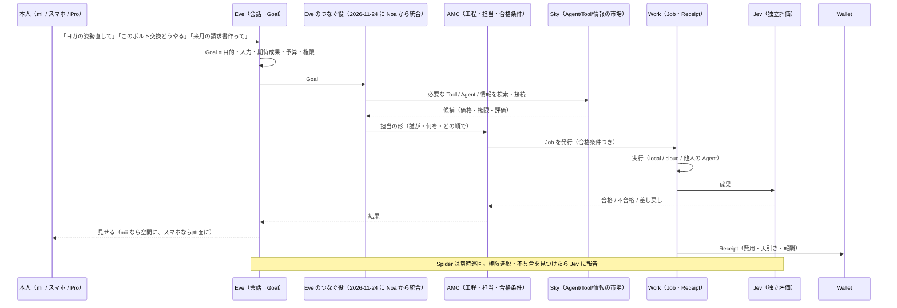

# 04 Eve → AMC → Jev（2026-11-24 に Noa を Eve へ統合）、Sky、そしてサービス挙動の書き方（2026-11-02）

2026-11-25 本人用[収益業務パック](../services/noah-revenue-pack.md)は `/noah/revenue-pack` にPC・携帯共通の画面を置く。既存NoahShellとクラウドAgentの部品を使い、接続したブラウザのメニューに入口を表示する。固定3担当の実行とWork保存は無料Cloudflareの専用alarmが担当する。

収益型Agentの成果はマイAgentの本人限定の仕事詳細で開く。成果承認額・入金額・確認できた実費を個別に表示する。作者の取り分は本人の案件の入金と最終費用がそろい、作者と運用者の関係を確認した時に算出する。

2026-11-24 本人決定。EveでAgentを作るとき、目的型は本人の目的、収益型は案件で決めた成果地点を設計の基準にする。目的型は何を誰に届ければ役立つかを決める。収益型は取り決めた申込・承認・購入などに実際に達した記録を照合する。入金と配給は別に記録する。

2026-11-24 収益型の設計と採点。Eve（eve.si）は、誰が何にいくら払っているか（需要の台帳）から逆算して、エージェントの出力を次のエージェントの入力につなぎ、最後に外部の入金の記録が出る流れ（組み合わせ）を見つけ、作り、試し、入金で採点し、悪い工程だけを作り直す。組み合わせは Eve が自動でも作り、人も Eve を道具にして作る。稼ぎ方の型への当てはめと、型に無い組み合わせの発見の両方を、見込みの利益で並べる。どれも `eve-combination/1` の 1 ファイルにし、決まった式の検査と外へ出さない試運転を通す。Eveが相談・作成と内部の接続の組み立てを担い、AMCが工程を管理し、Jevが独立して判定する。公開・送信・送金には既存の本人確認とBroker・Walletの承認を使う。[書式と合格条件](../services/eve-si.md)

2026-11-24 Agentエンジニアリングから開いたEveでは、作者が相談文と送信先を確認して依頼する。組み合わせの設計相談では、Noahの無料クラウドでモデルを1回呼び、各Agentの担当と受け渡しを相談文とともに表示する。提案したAgentの試運転は作者が後から選ぶ。相談結果は本人のWorkとして保存し、接続済みの自分の端末も選べる。

2026-11-24 Noahの作者は、ストアから「Agentエンジニアリング」を開き、自作または外部接続した本人の登録版を試し、そのAgentの掲載仕様を用意して既存の審査へ提出できる。Eveは工程に応じた相談を受け付ける。実行には既存の本人・実行先の許可を使い、掲載には既存の審査を使う。

Noahで「使える」と判定するときは、対象の登録版・操作・実行先をそろえ、依頼した本人のWorkで成果を開けることを確かめる。掲載、本人用の登録、手元や提供元での応答はそれぞれ到達した段階として記録する。[掲載Agentの実行判定と11月25日の検証結果](../services/noah-cloud-agents.md#掲載agentの実行判定)

2026-11-24 Noahの公開ナビゲーションから「シアター」タブを外す。ストアにはAgentを探す入口を置く。「法人のsi導入準備」の詳細では予告編をその場で再生できる。作者は既存の登録・掲載の表紙に自分の動画を選べる。自分のAgent、実行中の仕事、保存したものは引き続き開ける。保存した成果から仕事別の利用明細へ進める。[上映と表紙の設計](../noah/spec-115-pin-grid.md)

2026-11-24 NoahのAgent詳細。CallMCPの掲載では電話の用途、入力と返答の見本、提供元に渡る情報、無料プレビューと有料回線の条件を確認してから接続できる。公式資料に基づく使用例と、Noahで検証済みの実行状態を区別する。[Agent詳細の設計](../noah/spec-127-agent-explain.md)

2026-11-24 NoahのAgent登録と掲載では、作者が静止画・動画を指定するか、任意で4秒の表紙動画を端末上で生成して確認できる。表紙は登録した版にひもづける。本人、招待された利用者、審査済みの公開版の閲覧者は、それぞれ既存の閲覧権限でカードを開く。[ピンと登録時の表紙](../noah/spec-115-pin-grid.md)

2026-11-23 Noahのストアと実行先。公開入口は [avoado.si/noah](https://avoado.si/noah)。オレンジを基調とし、Todayの特集と、注目のAgentを2列に並べたピン表示を最初に見せる。検索、ボード、マイAgent、マーケットのAgentには共通のピンを使う。特集画像とピンの絵は画面に入ったときに短く動き、利用者の端末で動きを減らす設定が選ばれているときは静止する。特集・カテゴリ・検索からAgentを選び、詳細で利用・購入へ進める。「マイAgent」で自分のAgent、実行中の仕事、保存した成果を切り替える。作者は掲載管理から申請する。専用eSIMを使う標準経路では、本人が自社クラウドでの利用量と料金を仕事ごとに確認する。提供元のクラウドへ依頼する場合は、送信先と料金条件を実行前に提示する。画面操作を伴う仕事は対応するLinux実行器の専用ゲストに閉じ、利用者のデスクトップ・クリップボードを操作対象にしない。[eSIMと利用権](03-esim.md)・[専用画面の操作基盤](https://github.com/vercel-labs/agent-desktop)

2026-11-23 Python無料実行の拡張: Hermesの計画・情報整理、bossの面接準備、Timeの公式Python処理をprofileごとの別Worker・依頼別Durable Objectへ組み込む。isolateに異なる公式実装を同居させず、モデルと利用枠は共通実行器で管理する。配布物の固定hashと機能制限を保ち、実行・保存を本番受入してから公開する。[契約](../services/noah-cloud-agents.md#無料枠の公式python実行)

2026-11-23 無料クラウド実行: 固定した公式Memory/Filesystem/Sequential ThinkingのJavaScript本体をWorkersへ組み込み、依頼専用VFSとSQLite Durable Objectのalarmで実行する。プラン変更をせず、無料枠・日次予約・実受入済profileの制限を保持する。[境界と合格条件](../services/noah-cloud-agents.md#無料枠の公式javascript実行)

2026-11-22 CLI対応の継続: MemoryとFilesystemの公式固定版は依頼ごとの作業領域だけを使う。記憶ファイルも成果物としてWorkへ保存し、次回の自動読込や利用者端末のファイル操作は提供しない。配備先は元のCloudflare account IDへ固定する。
2026-11-22 全掲載Agentへの接続対応: 収集した配布元と公式の実行定義を照合し、提供元MCP/Spaceの入力と成果保存をNoah内で扱う。CLIは固定版を検証したprofileから拡張する。掲載、接続候補の発見、握手、実処理成功を区別し、全件の対応状況と残る条件を集計する。運営契約・提供元の本人認証・権限ゲートは省略しない。[実行方式と受入](../services/noah-cloud-agents.md)

2026-11-22 CLIのクラウド実行（最新指示）: [Noah管理クラウド](../services/noah-cloud-agents.md)で公式CLI/SDKの固定版を本人・依頼ごとの隔離環境へ自動配置する。モデル・配備鍵は運営が持ち、利用者に端末設定を求めない。提供者の公開接続先が確認できる場合は直接接続も扱う。明示依頼、本人scope、委任停止、時間/容量/同時数、結果確認前の未検証状態を保持する。

2026-11-22 全掲載Agentの利用: 提供元GitHubのserver.json、npmと公式MCP台帳、Docker公式配布記録、Hugging Faceの公開APIを照合し、Noahで入力・送信・成果保存へ進む。実行直前に定義と本人権限を再確認する。認証・支払・複雑な入力・CLIは未対応理由を返し、外部へ自動遷移しない。

2026-11-22 実機UX修正: ホームの既定は接続可能なAgent。検索条件をURLに保持し、検索結果は共通カードの一つの一覧へ統合する。提供者説明と委任設定を開閉可能にし、用途名・必要入力・送り先・実行を近接させる。書込み確認・支払確認・サーバー権限検証は維持。利用画面を開いた後の再表示は「再読み込み」で、接続失敗と表示しない。

2026-11-22 詳細の導線（最新指示）: 最初の画面でAgent名・短い説明・料金・送信先と接続ボタンを示す。接続後はその直下で用途名から操作を選び、選んだ行の直下に入力を出す。長い紹介・共有・補足は後段へまとめる。操作の表示名は既知の用途名、未知の場合は元の名前を読みやすく表示し、提供者説明を添える。実際に送る道具名・委任・確認は変えない。

2026-11-22 NoahのDaisukeのココナラAgentは、公開募集の読み取りとMacでの提案生成を独立して実行する。本人はNoahから下書きと理由を開き、次回探索・進行中の処理を停止できる。

2026-11-22 ココナラの操作は、Noahが宛先と内容を表示し、本人が1件を確認した後にMacで実行する。仕事ごとの専用Chromeがココナラの記録を再読込して結果を返す。ログインは本人が開始した専用ウィンドウで行う。[Macでの操作手順](../../toolkits/noah-coconala/README.md)

2026-11-22 接続の操作感（最新指示）: 接続ボタンから応答確定まで透過花形ロゴの待機画面を表示する。完了を確認した操作だけ短いポコ音と成功振動を1回返し、失敗や再表示では鳴らさない。音はクリック時に有効化して完了まで無音、待ち時間を人工的に延ばさない。未対応端末でも接続処理は継続し、設定で音と振動を個別に保存・解除する。

2026-11-22 最新のホーム構成: 法人向け導入準備・組合せガイドの告知枠をホームから外し、検索と共通Agent一覧から詳細・利用へ進む画面に統一する。独立した案内ページと既存データは維持する。

2026-11-22 最新の評価表示: 共通Agentカード（ホーム・検索・ボード・関連）とその詳細は、GitHub/Hugging Face等の元サイト評価に一本化する。下段のNoah内利用人数・王冠・コメントの列を撤去し、取得できない評価は補わない。既存の保存・過去評価・コメント記録は保持する。

### 2026-11-22 Noahカードと評価の統一

ホームの収集紹介と画像カードは一つの一覧にまとめ、同じカード部品を検索・ボードにも使用する。王冠・コメントは公開URLから決まる共通IDで集計し、利用人数はNoahで成功を確認した本人の重複を除く。GitHubスター・Hugging Faceいいね・Xいいね/リポストは取得済みの実数を評価元リンク付きでカードに常時表示し、未取得を0で補わず、王冠や利用人数へ加算しない。接続未確認の紹介は配布元へ進み、掲載済みAgentだけ既存の接続・ボード保存を使用する。既存の保存・評価は削除しない。

2026-11-22 会員制廃止（最新指示）: Noahは会員登録・ログイン・eSIM連携を利用の前提にしない。サーバー発行のブラウザ専用権限で保存先を分離し、初回から接続・依頼・成果へ進む。再訪時は同じ保存先を再利用する。既存アカウントのデータは保持し、新しい利用者へ自動移譲しない。外部Agentの登録に必要な情報と送信同意だけを、そのAgentの利用時に受け取る。共有端末・ブラウザデータ削除による保存先の変化は保存設定で簡潔に伝える。実装・公開・実機の受入は別途記録する。
2026-11-22 本人指示: Noahの検索入口を /noah/explore、保存関連を /noah/saved に統合する。旧検索・保存URLは条件を保持して転送し、保存データと本人確認を維持する。Noah配下のMac専用・投稿/コミュニティー/大学別ページとそこへの入口を撤去する。既存バックエンド・他製品の画面・保存データは削除しない。

2026-11-22 一周検査の修正: 登録済み状態は本人別の暗号化接続記録から読み、入力情報の有無と分離する。画像操作で画像実体もリンクも届かなければ未受取。操作ラベルは用途で翻訳し元定義を詳細に残す。ホームはピン一覧、#timeline は投稿一覧として履歴移動を反映する。

2026-11-22 Noah利用開始: eSIMの検証済み利用権に明示されたNoah権限を既存の本人IDへ解決し、Noah専用の新規会員登録を要求しない。利用開始画面は現在の接続をAPIで確かめ、接続済みなら選択中のAgent/仕事へ戻る。未設定・未接続・一時障害を区別し、既存利用者のログインは引継ぎ用の補助導線として保持する。課金・掲載管理・認証鍵管理の権限は追加しない。

2026-11-22 登録通信: native登録・登録ブラウザ呼び出し・資格情報付きMCPはWorkersのmanual redirectで転送を禁止する。旧版161/162で送信前に拒否された方式印なし/鍵なしの予約だけ復旧可能。新しい方式印を付けた応答不明は自動再登録しない。

2026-11-22 タブのロゴ: Noah配下のfaviconは元画像を保持した透過SVGを指定し、暗いブラウザタブに白背景を表示しない。

2026-11-22 成果の受け取り: JSON原文は詳細へ畳み、実際に受け取った内容に応じてアカウント情報・一覧・文章・画像を表示する。検証されていない成果を事実確認済みへ昇格しない。画像の実体は既存の所有者別Workに保存し、画像保存はユーザー操作からOSの共有/写真保存またはダウンロードへ渡す。端末への保存成功は未確認のまま断定しない。

2026-11-22 最新画面指示: 2列カードのタイムラインを採用し、モバイルはタイムライン／Agent／実行中／成果の常設4タブへ変更。詳細・依頼・登録・登録情報・任せる範囲は戻る導線を備える副画面。目的別入口と実状態による進捗、登録ボタンと同時の保存/再利用同意を使う。6言語（ja/en/zh-CN/ko/es/ar）のUI、言語設定保持、右から左の表示に対応する。以前の1メニュー指示を上書きし、権限・保存・送信前のサーバー検証は維持する。

2026-11-22 Dock入口: Noahアプリの通常起動は既定ブラウザで `https://avoado.si/noah` を開く。端末接続・ローカル実行器の導入は開始しない。互換の `noah://connect?agent=<id>` は検証済みIDのNoah詳細へ進み、不正なリンクはトップへ戻す。旧Mac実行器とその端末認証は独立した明示的な用途に保持する。

2026-11-22 登録実行基盤の訂正: Browser Use Cloudへの依存をやめ、Noah専用Workerと登録ごとの分離ブラウザを使う。設定済みの登録先・手順だけを動かし、本人確認はNoahのスマホ画面で引き継ぐ。秘密は本人別暗号化保存、完了は接続先の照会で確認する。未検証の登録先は有効化しない。

2026-11-22 外部自動登録: Agentboardの公式APIをNoahのWorkerから実行し、発行キーを本人別暗号化領域に保存する。許可した接続先・道具にだけ送信時に注入し、入力欄・Work・ログへ出さない。登録後の本人照会と通常の接続/実行ゲートを通して利用へ戻す。重複登録・無断の投稿・資格情報を返す道具の直接呼び出しはしない。

2026-11-22 新デザイン: 大小のカードで個人の感想とAgentを発見し、詳細→必要な登録→依頼→成果を連続させる。白地・会社の花形ロゴ・紫の主要操作、通常は全件/Agentのみ、モバイルは現在地付き1メニューを保持。登録情報の暗号化保存・必要項目の再利用・接続先/道具ごとの委任をバックエンドへ接続する。受取口座や書類の保存は必要時だけで、判定は接続先ごと。
2026-11-22 操作感: Noahの読み込み表示は正式花形ロゴの静かな動きに統一し、支援技術へ状態名を渡す。実際の有効なボタン/リンクの操作は短い振動と押し込み、選択は短い振動、登録/保存の成功を確認した時だけ二連。対応端末でのみ動作し、操作の設定から無効化できる。動きを減らす設定ではロゴと押し込みを静止させる。処理中の画面占有・架空の進捗・自動の継続振動はしない。

2026-11-22 掲載担当: 本人承認したアカウントに取込・掲載・取り下げを許可する。サーバー設定の所有者scopeと、認証済み本人から再計算したscopeが一致する場合だけ既存の掲載権限へ解決する。クライアントが送るscopeだけでは権限を持てない。

2026-11-21 導線の追補: 選んだAgent・棚の仕事・道具をサインイン後も保つ。外部登録の状態は同じ仕事IDで確認し、本人確認から戻ると読み直す。依頼受付後はその仕事への入口をその場に出す。画面の占有・勝手なスクロール・未確認の再実行でつながったように見せない。

2026-11-21 追加承認: NoahはOS運用より先に `avoado.si/noah` で独立して成立させる。OS既存設計との互換性を必須条件にせず、画面・端末接続・実行の依存関係を見直せる。Noah独立版154の本番DB追加・配備・一覧/依頼受付の有効化は本人承認済み。利用者の本人確認・所有者分離・保存を維持する。

2026-11-21 棚とパッケージ: Noah の入口に「稼ぐ・仕事を省く」「教育」「暮らし」の棚を置き、カード 1 枚を「1 つの仕事を最後までやる組合せ」にする（本人の決定 11-19〜21）。棚に載せるのは、運営が動かして確かめた、今動かせる物だけ。並びは、運営の順から始め、数えた実績（成果が返って、また使われるか）で直す。学習したモデルは使わない。カードの工程は、今の工程の計画（lib/sky-recipe-planner.ts）の能力として、そのまま Noa へ渡る。Eve → Noa → AMC → Jev の構造と、Broker・Wallet の gate は変えない。[仕様書 110](../noah/spec-110-shelf.md)、[書式](../services/noah-shelf.md)、[300 人への出し方](../noah/trial-300.md)。

2026-11-26 パッケージは、初回の接続と必要な許可がそろったらボタン一つで開始する。選ぶ前に成果の見本と、対象期間・人数を添えた月間の実績を表示する。[パッケージの開始と月間成果](../noah/spec-110-shelf.md#パッケージの開始と月間成果)

## 現在の入口と実装範囲

2026-11-25 本人用の[収益業務パック](../services/noah-revenue-pack.md)を追加する。実装は `toolkits/noah-revenue-pack/` と `lib/noah-revenue-pack.ts`。本人分の無料クラウド直接接続はeSIMを前提としない。一般利用者の料金・Broker/Walletを変更せず、推論実行とクラウド常駐を区別する。本人追加指示により `services/noah-revenue-runtime/` にSQLite Durable Objectのalarm実行を準備し、無料プラン確認後に本人用HTTPS入口から受け入れる。

### Noahのクラウド実行（2026-11-22 設計）

EveでAgentを組み、Noahで選んで動かし、仕事の成果を受け取る。目指すのは、収入を生む仕事と、食料・日用品の配給を含む暮らしの仕事の両方を継続して任せられること。RockstarOSは本人確認・権限・予算・成果の保存を担い、対応端末の導入にはeSIMを鍵付き回線として使う。[eSIMから最初の仕事まで](03-esim.md#esimから最初の仕事まで)

Noahのクラウドを選んだ仕事は、本人のMacが閉じていても、Noahが依頼時または予約時刻にLinux環境を起動して実行する構想。現在のMac実行、提供者のサーバーで動く公開版の設計、固定テストAgentのクラウド受入はそれぞれ別の実行経路。一般Agentのクラウド実行と従量請求の流れ・受入条件は[専用端末の設計](../services/noah-own-device.md#クラウドで依頼して受け取るまで)にまとめる。

### 既存の入口

2026-11-21 独立サービスの追補: `/noah` 配下ではコミュニティーOS runtimeを起動しない。専用ログインは `/noah/account`、ログアウト・認証後もNoah内へ戻る。主要4画面は端末導入なしのリモートAgentを本線にし、既存Macの管理は明示的な別経路に残す。

2026-11-21: Noah の公開先は **https://avoado.si/noah**。スマホ向けの接続・依頼・成果は最新 main を土台に公開する。公開状態の読み取り確認は `node --experimental-strip-types scripts/check-noah-domain.mjs`。ページ200だけでは接続APIの配備を合格としない。本番DBへの適用は本人の承認後。

製品の優先順位は[00 全体像](00-overview.md#1-一言で)、公開名と内部名は[06 名前](06-naming.md)を正本とする。公開Noahと内部Noaは別の役割。

| 入口・機能 | 現在の契約と参照先 |
| --- | --- |
| Noah | `/noah`が唯一の統合タイムライン。個人の感想・発見・評価の本文と作者を主役に、通常投稿とAgent紹介を既定で全件表示し、Agentボタンで絞り込んだ時だけ戻るボタンを出す。フォロー投稿と通常投稿を紹介より先に並べる。ニュース・コミュニティーは表示しない。Xのような3カラム（左ナビ・中央フィード・右検索/Agent欄）、avokado正式花形ロゴ・白地とチャコールの文字・紫のアクセントのNoah専用メニューからAgent・仕事・成果へ進む。スマホ下部は現在地付きの「メニュー」1ボタンへ統合し、4画面をアイコン・用途説明で選ぶ。機能一覧は設けず、旧`/noah/features`はタイムラインへ戻す。公開Agentには利用人数・王冠評価・公開コメント/返信を設ける（[評価とフィードバック](../services/noah-agent-feedback.md)）。開発者には[継続改善パッケージ](../services/noah-developer-maintenance.md)を案内し、smash@avoado.siへのメールで相談を受け付ける。最初の本人MacでのAgent選択・接続・実行・成果受領・停止は[Noah単体ローンチ](../services/noah-standalone-launch.md)に集約する。Eveを開くことを実行条件にしない。接続画面はAgent選択→Mac接続→仕事依頼の順に進み、未接続時の次の操作を示し、接続案内やサインインから選択Agentへ戻す。「実行中」タブ（`/noah/activity`）に依頼入力・接続・実際の仕事状態・成果・停止を集約し、旧`/noah/launch`はAgent指定を保持して転送する。画面の説明を減らし、必要な詳細は項目別に展開、Mac接続は3ステップとコピー操作で案内する |
| Eve | 本人の依頼、仕事、成果と使用量の窓口。選んだTool・記事・担当を受け取る。Noahの主要画面ではEveへの切り替えを必須にしない。既存の認証・実行中の遷移制限を保持 |
| 互換入口 | `/sky`と`/os/sky`はqueryを保持して対応するNoah画面へ移動。保存済み担当は`/noah/saved`、調査カタログは`/noah/agents`。APIと保存識別子は変更しない |
| ローカル実験 | 公開画面は`/noah/local-tools`へ案内。Macのlocalhost制限・私有データを保持。公開Webからの実行は、別の認証済みRunner経路を使用 |
| 公開配信 | 共通ヘッダーと固定hashのasset配信を使用。公開カタログ、本人の登録、審査済み公開版、実行許可を区別。配備の履歴は[task69](../../codex/tasks/69-noah-public-timeline.md)・[task70](../../codex/tasks/70-noah-route-unification.md)、通し受入は[task71](../../codex/tasks/71-noah-standalone-launch.md)で確認 |
| 次の設計（未実装・本人確認待ち） | 本人指示（2026-11-20）により、行き先を「みんなが Agent を自分の専用の端末につないで使う。PC の前に座らない」に置く設計。他人が作った Agent は、画面と入力装置の無い専用の端末か提供者のサーバーでだけ動かす。外の Agent は 1 件ずつ実行器を書かず、つなぎ方（口）ごとに取り込む。正本は[Noah の設計書](../noah-design.md)と[作業単位ごとの実装仕様書](../noah/README.md)。出すまでに作る範囲（スマホだけで、相手のサーバーで動く Agent を、選ぶ・接続・入力欄から頼む・受け取る・切る）は[ローンチの最小限](../noah/mvp-launch.md)。現在の契約・実装・公開は変えていない |

2026-11-20の本人指示による追加範囲: [登録なしの利用と外部Agentの登録支援](../services/noah-registration-agent.md)。必要項目の入力・送信先確認から登録Agentを実行し、本人確認待ちと完了報告を管理する。

2026-11-22: 100人への段階試用に向け、登録先の429には再開目安を示す。待機期限を本人別に暗号化保存し、再読み込み・別の受付IDでも期限前に外部登録を再送しない。期限後の再送も本人操作だけ。疑似100人試験、公開環境の読み取り検査、Pixelの実登録一周は別々の証拠として記録し、外部サービスの枠や対応先を水増ししない。

2026-11-20の本人指示による追加範囲: [成果データの保存と提供](../services/noah-result-data.md)。本人用のWorkを検索・出力し、本人が選択・同意した成果だけを運営が閲覧する。本文を含めない利用統計の契約は維持する。

以下のEve→Noa→AMC→Jevは責任分担と後続の体験を示す設計であり、すべての依頼が自動完了するという受入記録ではない。最初のNoahでは既存Work/Broker/Walletを通して本人が実行と停止を指定する。

2026-11-22 の本人指示: [Agent収集](../services/noah-agent-collection.md)で、既存の外部台帳・公開検索を継続実行する。クラウドのGitHub Actionsで候補と握手の記録を更新し、Noah R2の非公開領域へ再開状態を保存する。Macの稼働は条件にしない。出典付き候補を `/noah/agents` の紹介欄へ署名付きで掲載する。Xの紹介は投稿本文を転載せず配布先リンクを使う。

## 1. 一周の流れ（公開入口は Eve と Noah）



| 役割 | 一言 | 持ってよいもの | 持ってはいけないもの |
| --- | --- | --- | --- |
| **Eve** | 本人と話し、Goal を作る。道具・Agent・実行先をつないで「担当」と組み合わせを形にする（2026-11-24 に Noa を統合） | 会話文脈、Memory、本人の好み、Sky の検索、接続の提案、需要の台帳 | 実行権限、お金、本人の承認なしの実行、自分が作った組み合わせの合格判定 |
| ~~Noa~~ | 2026-11-24 に Eve へ統合（本人決定）。つなぐ役は Eve が持つ | — | — |
| **AMC** | 工程に分解、担当・順序・合格条件を決め、進行を見る（Jennifer を吸収） | Job の発行、進捗、差し戻し | 評価の最終判断（Jev の仕事） |
| **Jev** | 成果を独立に評価。権限は持たない | 合格条件、過去の評価 | 実行、変更 |
| **Spider** | コード・接続先を巡回し、不具合と権限逸脱を探す | 読み取り | 書き込み |
| **Sky** | Agent・Tool・情報を見つけ、つなぐ場所。MCP / A2A / SDK | カタログ、価格、評価、手数料 | 本人の予算の決定 |
| **Broker** | 本人の承認・予算・端末権限を実行に渡す門番 | 承認、予算枠 | — |
| **Wallet** | 残高・予約・台帳・精算・天引き | お金 | 仕事の判断 |

**内部構造として AMC / Eve を一つに潰さない**（本人の指示）。2026-11-24 の本人決定で Noa は Eve にまとめた。AMC と Jev は分けたまま（作った者が合格を出さないため）。公開UIでは Eve と Noah を表示し、NoahからEveへ選択したTool・記事・担当を渡す。ウェイクワードは「ヘイ、エヴァ」（議事録 10-27）。

注: 議事録 10-07 の「ジェニファーが最上位（データ許可）、下にプロジェクト管理・データ管理・データ探索の3人」は、この表では Jennifer＝AMC、3人＝AMC 内の役割（.codex/agents の amc / amc-worker / amc-reviewer）として読む。現行の責任分担はAMCへ統合する。互換API・保存識別子に残る`jennifer`は別製品を意味しない。

2026-11-04の本人指示により、ローカルAMCに[Goalから逆算する有限実行](../amc-goal-orchestrator.md#goalから逆算するローカル実行と再計画)を追加する。営業18役・開発21役は工程の担当候補で、32部隊の正本や本人権限を置き換えない。既存Goal reducerで前提・成果提出・実行者と異なる検収・最終OWNER受入を保持し、検収された安全な局所修正だけを元の条件と上限内で再計画する。Codex workerと別processのread-only検収はローカルadapterであり、本番Jev/Brokerの権限・課金・Web実行の受入とは分ける。

2026-11-25本人確定: 専用クラウドの犯罪予防への協力は[03 §9〜10](03-esim.md#9-プライバシー保護と犯罪予防への協力2026-11-25本人確定)に従う。Spiderは適法性を確認した安全確認範囲の読み取り・報告のみ、Jevは独立評価のみとする。具体的な兆候を人が確認し、案件ごとの法的根拠・相手機関の真正性と管轄・必要最小限の範囲を確認した上で、権限を分離した手続きで本人情報と関連記録を提供する。siによる自動犯罪認定・自動通報・包括的な情報提供は行わない。Broker／Walletの既存gateは維持する。提携先・国・運用条件は未確定で、監視・情報提供の実装済み表記はしない。

## 2. コードの対応（どこを直すか）

| 役割 | lib | app / api | 備考 |
| --- | --- | --- | --- |
| Eve | lib/eve-*.ts, lib/zema-chat-session.ts | app/chat, app/zema, app/api/eve | zema-chat-session は Eve 配下へ（task 04） |
| Eve のつなぐ役（旧 Noa） | lib/eve-agent-proposal.ts, eve-agent-creation.ts, eve-agent-origin.ts, components/eve-object-agent-creator.tsx | app/api/llm/local-agent | 2026-11-24 に Eve へ統合。ファイル名は既に eve-。コード内の `smith`・`noa` の識別子と API は変えない |
| AMC | lib/amc-*.ts, lib/jennifer-amc-*.ts, lib/jennifer-*.ts | app/amc, app/api/amc, app/api/jennifer | 内部名と互換入口の整理はtask40。移動だけを機能統合の完了としない |
| Jev | lib/jev-evaluation.ts, jev-transport.ts, android/jev-provider | app/api/jev-evaluation | — |
| Spider | lib/spider-*.ts, toolkits/spider-guard | — | .github/workflows/spider-codeql.yml |
| Sky | lib/sky-*.ts | app/sky, app/api/sky, services/sky-* | 接続契約を保持。フォルダ整理はtask08 |
| Work | lib/work-*.ts, lib/workflow.ts | app/work, app/api/work-jobs, app/api/jobs | — |
| Broker | lib/a2a-broker-*.ts, lib/agent-control-plane.ts | app/api/agent-control-plane | — |
| Wallet | lib/wallet*.ts, lib/settlement.ts | app/wallet, app/api/wallet, app/api/earnings, services/sky-billing | — |

## 3. サービス挙動の書き方（これが「書式」）

新しいサービス（ヨガ矯正、工場保守、請求書作成、遠隔ツイスター…）を足すときは、**コードより先に** `docs/services/<name>.md` を1枚書く。項目は固定:

```markdown
# <サービス名>
- 本人が言う一言: 「…」
- Goal（Eveが作る）: 目的 / 入力 / 期待成果 / 予算上限 / 要る権限
- Eveがつなぐもの: Tool / Agent / 情報（Skyの何を使うか。無ければ「新規Agent: …」）
- AMCの工程: 1. … 2. … 3. …（各工程に担当と合格条件）
- Jevの合格条件: 数値で書けるものは数値（例: 姿勢誤差 < 5°、請求額の検算一致）
- 出力先: mii（空間のどこに） / スマホ（画面） / ファイル
- Wallet: 費用（誰に）/ 天引き率 / 無料か
- hardware profile 依存: mii のみ / phone でも可 / 全部
- 失敗時: 差し戻し先と本人への見せ方
- 記録: Receipt に残すもの（誰が・いつ・何を）
```

ルール:
1. 1サービス = 1枚。100行以内。
2. mii 専用にしない。「phone でも可」を必ず検討する（画面で代替できるなら可）。
3. 課金は Wallet の既存契約（earnings 天引き / 月額 / 都度）から選ぶ。新しい課金型を作らない。
4. 合格条件が書けないサービスは作らない（Jev が評価できない）。
5. 書式を満たしたら Codex task 1件 = 実装。

## 4. Sky の位置

- Sky は「市場」であり、Noa の検索先。手数料は 05-business.md（当面 0〜低率、まず流通量）。
- 他人の Agent を使うときの権限は Broker が本人に確認。Sky は価格と評価だけ出す。
- MCP / A2A / SDK は Sky の接続口。toolkits/, services/sky-agent-runtime, systems/rock-star-os/docs/TOOL-SDK.md が実体。

## 5. 後続の組合せ計画と会社受注（2026-11-15の設計）

Noahの最初の受入後に接続する応用系統。利用者像はかいや。ここでの受入条件は「めんどくさい、と言った後に、誰かが裏でツールを選び・指示を訳し・進捗を追わなくても成果が出る」。全体は [sky-work-loop.md](../sky-work-loop.md)。

| 何を決めるか | 誰が | コード | 決め方 |
| --- | --- | --- | --- |
| どの工程で作るか | Noa | lib/sky-recipe-planner.ts | 手元の素材から成果までの工程を列挙し、「検収に通る成果1つあたりの期待総額」が最小のものを選ぶ。実績は Jev の検収結果 |
| 自動化を作るか | Noa | 同上 | 初回準備を、その仕事が起きる回数で割って比べる。1回きりなら手でやる工程が選ばれる |
| 本人に何を残すか | Eve | RecipeGoal.keepForSelf | 本人が「自分でやりたい」と言った成果の型だけ。そこは自動処理に置き換えない |
| どこで実行してよいか | AMC | lib/sky-company-order.ts | si利用不可・未確認は受けない。個人情報・秘密、持ち出しの承諾なしは会社の管理下だけ |
| どの募集に応募するか | AMC | lib/sky-gig-desk.ts、lib/sky-gig-offers.ts | lane runner が読んだ募集を、売れる型・予算・納期・si利用可否・採用率で決め、lane へ決定を返す。送信は自動が初期値 |
| どの計算機で動かすか | Noa | lib/sky-device-tiers.ts | 依頼者の秘密は会社側だけ。それ以外は、こなせる中で最も安い所。参加者の端末は複数台の一致で検証 |
| 人の確認を誰に頼むか | AMC | 同上 | 30秒・2〜4択の問いにして、引き受けの少ない人から配る。同じ問いを同じ人に二度渡さない |
| お金をどう分けるか | Wallet | 同上 | 作業料（単価×検収量）と配当（入金済み余剰の一部を等分）。計算だけで、記帳・送金はしない |

- planner と分配の計算は順位と金額を出すだけ。実行・課金・送金の許可は Broker / Wallet / 本人のまま。
- lib/sky-routing.ts（正規表現で 13 役へ振り分け）は、planner が候補を出せない依頼の受け皿として残す（task 33）。
- サービスの書式は [services/company-order.md](../services/company-order.md) と [services/gig-desk.md](../services/gig-desk.md)。

## Eve News のローカル下書き補助

`toolkits/eve-news/` は出典packetからローカルOllamaの下書きを作る既存公開系統の補助CLI。`draft.mjs` は入力・出力schemaと実行前後のモデルdigestを検証し、不一致は失敗にする。`news-core.mjs` はWebと同じ根拠制約を共有する。モデルの文章を事実・公開承認・仕事の成功へ昇格させず、出典と未検証箇所を保持してEveへ渡す。実行には本人端末のモデル設定が必要で、今回のmain統合は新規ダウンロードや外部送信を実行しない。検証は `tests/eve-news-core.test.mjs` と関連 `tests/eve-news-*.test.mjs`。

## Noahの読み込み表示

2026-11-22 の追加指示: Agent一覧はカード配置に沿うスケルトン、他画面は小さな正式花形ロゴと細い進行中表示を使う。大きな回転・揺れ・光彩背景は使わず、端末の動きを減らす設定と読み上げの状態通知を保つ。表示は通信待ちを示すもので、進捗率や完了の根拠にはしない。

## Noahの本人用リセール

[toolkits/noah-resale-agent/](../../toolkits/noah-resale-agent/)は本人用CLI。Webはlocalhost限定。既存WorkのCASと予算予約を使い、初期予算0・外部接続未受入を保持する。[実行契約](../services/noah-select-resale.md)。

[外部Agentの利用報告SDK](../../toolkits/noah-agent-client/) は、提供者が自分の登録済みAgentの利用実績を送るために使う。[記録する項目と権限](../services/noah-agent-usage.md)

Noah移行の互換ToolKit: `toolkits/noah-agent-operations/` は既存の実行テンプレート集合、`toolkits/noah-vscode/` は保存時整理の補助。単体ローンチの実行器は `scripts/noah-mac-runner.mjs`、導入は `scripts/noah-mac-install.mjs`、配布生成は `scripts/package-noah-mac.mjs`。

## Noahの配給

本人は最初に専用回線で配送先（宛名・郵便番号・都道府県・市区町村・町名番地・任意の建物名）を登録する。通常のAgent利用には住所を要求しない。運営は予算と仕入先を管理し、Dockで入荷済みロットから受取人・数量・案内を指定する。指定時点の配送先を保存し、運営がその指定の「配送先を確認」を開いた時だけ表示する。登録内容の変更は次の指定から反映する。

Noahの配給Agentが指定番号ごとに本人用のお知らせを作る。通常回線には更新の有無だけを返し、本人の有効な専用回線で品目・数量・案内を開ける。「受け取りました」は本人の受取申告で、最初の時刻を保存する。運営の仕入額・送料と利用者の0円を別に記録する。入荷数は在庫、受取待ち、受取済みの合計と一致する。定期配給は運営が計画を開始し、毎回その時点の在庫、配送先、回線資格を照合する。[模擬試験の手順](../../toolkits/esim-bootstrap/README.md#noah-free-trial)。

### 配給のお金の決まり（2026-11-22 本人回答）

- 画面での呼び名は「定期便」。文書の中では「配給」のままにする。
- 渡す物は、Agent の利益のうちの本人の分。ゆくゆく全部を物（定期便）で渡す。農家などの仕入先とつながるまでは、現金で渡す。
- 何割を本人の分にするかは未定（「20万のうち15万」は例）。残りは、Agent を作った人の収益と、運営の取り分。お金が欲しい人は、Agent を作る側で稼ぐ。
- 受け取るのは、Noah の利用者全員と、寄与した人（携帯の計算資源を出した量など）。全員への等分は物（今は現金）。寄与の分は、作業料として現金で上乗せする（07 の 2026-11-15 の 2 層の案と同じ形。原資を実際に入った現金だけにする事と、毎月の約束の上限は、まだ本人確認待ち）。
- 箱の中身は運営が決める（おまかせ。本人は選ばない）。上の指定の仕組み（運営が Dock で品物・数量・受取人を指定する）のまま。
- 2026-11-25 の会話: 中身は食材を第一に、電球などの生活必需品（パナソニックなどと継続の契約）、伝統工芸品も候補。「一人当たりにさ、ちゃんと予算があるわけ…その中で買い物できる」。上の「おまかせ」と合わない所は [spec-124](../noah/spec-124-teikibin-ledger.md) の 13 章（本人の回答待ち）。
- 1人が何人分も受け取らない確かめは、ゆくゆく eSIM 1回線＝1人。ただし最初は eSIM を必須にしない（Noah 単体で今日売り出せる形にする）。eSIM を必須にしない間の確かめ方は、渡し始める前に決める。
- 渡し始める前に、税理士・弁護士に確かめる。物で受け取っても値段分が収入になりうる事（[国税庁 No.2200](https://www.nta.go.jp/taxes/shiraberu/taxanswer/shotoku/2200.htm)）、生活保護の収入認定（贈与・配当も収入に数える: [江戸川区の案内](https://www.city.edogawa.tokyo.jp/e091/kenko/fukushikaigo/sekatsuhogo/shunyunintei.html)）、家族の扶養（年130万円: [首相官邸](https://www.kantei.go.jp/jp/headline/nennsyuunokabe/index.html)）、月額の「おまけ」にする場合の景品の上限（取引額1,000円未満は200円、以上は2割: [消費者庁](https://www.caa.go.jp/policies/policy/representation/fair_labeling/premium_regulation/)）。
- 額の目安: 1人暮らしの1か月の消費支出は平均17.3万円、うち食料4.9万円（[家計調査 2025年](https://www.stat.go.jp/data/kakei/sokuhou/tsuki/pdf/fies_gaikyo2025.pdf)）。本人の分を全部物にするなら、食べ物の他に日用品なども要る。

- 法人のsi導入準備は会員登録不要の公開Web/MCPとし、所有者用の成果・銀行照合台帳を分離する。[設計](../services/noah-business-si-agent.md)。

### 2026-11-22 NoahのURL共有
公開入口 `/` と `/noah` はNoahのタイトル・説明・共有画像を初期HTMLへ出す。Open GraphとXの `summary_large_image` に対応し、画像は公開PNGとする。サービス紹介を使い、個人の収益実績をサイト全体の実績として表示しない。

Agent詳細 `/noah/ready/agent?id=...` に共有・URLコピーを設ける。個別カードは公開一覧の掲載判定と同じ条件で返す。取り下げ・非公開・不正IDは汎用説明とnoindexとし、個別画像を返さない。共有からの閲覧は接続・依頼を自動実行しない。

## 収集Agentの内部接続（2026-11-22）

収集カードと評価バッジは `/noah/discover/agent?id=project-…` を開く。出典URLは詳細で文字として保持し、カード操作で配布元へ遷移しない。接続済み系列との同一性はディレクトリの固定project IDと掲載中の系列で照合し、既存の接続計画・本人scope・握手・Workのゲートを通る。公開Hugging Face Spaceは公式APIで同じrepo・公開状態・実行hostを確認後、本人のボタン操作で隔離iframeをNoah内に表示する。外部入力先を明記し、親画面遷移と新規ウィンドウを許可しない。iframeの読み込みをTool実行成功へ昇格しない。確認できない実行先は未接続としてNoah内の取込・設定へ案内する。出典別の評価と確認日時を保持する。

取込・設定の本人識別はNoahの署名付きブラウザセッションを利用できる。非公開Agentと下書きの対象API・UUID・methodのみを許可し、変更時のOrigin/owner scope、既存の容量制限、別所有者拒否を維持する。公開・審査・実行器・課金のAPIは対象外。

2026-11-22: Noahの操作反応は実際のタップ/キーボード操作に短い音・振動・押し込みを返す。接続成功の音は成功応答後だけとし、通常タップと区別する。Web Audioを低遅延設定で使い回し、非表示や待機時は停止/休止する。端末が非対応の振動を保証せず、画面で試せる入口を置く。外部の数値評価は維持し、数値のない掲載元のバッジは一覧に出さず詳細で確認できる。
2026-11-22 提供元APIの実行受け皿: 公開Gradio Spaceの公式メタデータと公開APIを照合し、本人の入力・送信先確認から既存Workへ依頼を保存する。実行番号・入力定義hash・本人scopeを保持し、結果通信を維持し、再読込では保存済み成果を表示する。成果は既存の実行中・保存・仕事詳細へ統合。送信後の結果不明を再送しない。公開コードそのものの任意実行、提供元のGPU制限回避、認証や支払の代行は含めない。契約は [提供元API実行](../services/noah-provider-runtime.md)。

## 2026-11-22 相談と紹介案件の運営

本人指示により[相談・運営Agent](../services/noah-affiliate-agents.md)をNoahの既存source/MCP契約へ接続する配布物として追加。相談の適合順位に非公開報酬を使わず、媒体許可・期限・提携・正式リンクを検査する。本人用運営口は別の認証境界とし、既存のWork/Broker/Walletを飛ばさない。

実装・入力例・パッケージ生成・MCP配備準備は [toolkits/noah-affiliate-agents/](../../toolkits/noah-affiliate-agents/README.md)。

2026-11-22 本人指示: [法人si導入準備Agent](../services/noah-business-si-agent.md)を、会員登録不要の公開相談と本人用運営として追加する。既存のaccount正本とBroker/Walletを置き換えず、相談本文を保存しない公開入力と、匿名の成果・入金照合台帳を分ける。実成果・入金・媒体承認は外部の証拠で判定する。
2026-11-22 実取得の境界: 認証済みChromeから端末内で必要列へ変換し、Noahの本人用台帳へ取得元・日時・範囲・0件を含む受領票を保存する。Cookieは移送しない。単発の取得・ASP支払予定・受取口座登録を、継続接続・銀行着金へ昇格させない。公開記事はサイトマップに載せ、運営画面は検索対象外とする。

2026-11-22: [Noahの成果報酬組み合わせ](../services/noah-revenue-combinations.md)を追加。サービスと広告条件の証拠を照合し、公開相談と本人用成果台帳を分離する。金融口座の発注権限は取得しない。

2026-11-22 既存媒体経由の紹介: 法人相談は登録済み記事へ接続できる。掲載媒体の証拠と記事URLを別に検証し、Noah自体の媒体承認とは区別する。広告タグの改変と相談別成果の推測を行わない。

2026-11-22 収集と紹介の統合: 公開一覧の完全な取得世代と提携済み案件の非公開索引を照合する。候補と実行/掲載の証拠を分け、適格な組み合わせだけを公開する。仕様は [成果報酬組み合わせ](../services/noah-revenue-combinations.md)。

### 公開サイト診断と登録媒体への紹介（2026-11-22）
Noahの固定アダプターで公開サイト診断を実行し、結果と相談準備票を共通Workへ保存する。外部へのURL送信・公開レポートの扱いを実行前に明示し、用途と希望が合う場合だけ登録済み記事へ進める。提携索引、実行証拠、条件期限、記事内原文タグの全てを公開・紹介の直前に照合する。詳細と真偽の合格条件は [サービス定義](../services/noah-site-diagnostics.md)。

2026-11-22 集客改善: 既存WordPress/EC記事の冒頭から対象Noah Agentへ直接つなぎ、自社Xから記事へ案内する。固定2件の入口は公開条件を再確認し、経路/UTC日付別のブラウザ遷移要求だけを30日分保存する。人・注文・承認への確定帰属は行わず、ASP実記録と別に改善する。

2026-11-23: [786系列の接続と稼働表示](../noah/spec-127-live-agent-families.md)。既存の公開Agent一覧へ本体台帳を名寄せして追加し、本番の準備・成果受領を記録する。表示は10秒ごとに更新し、確認期限を過ぎたものを利用可能と断定しない。

本人用収益パックの配布・端末用CLIは `toolkits/noah-revenue-pack/`、Macに依存しないクラウド実行は `services/noah-revenue-runtime/`、共通Noahの入口は `/noah/revenue-pack`。[挙動と合格条件](../services/noah-revenue-pack.md)。

2026-11-24 登録UX: [登録Agent](../services/noah-registration-agent.md)は保存済み項目・必須の不足・任意項目を分け、元のAgentの画面内で準備する。保存の選択、外部送信先、料金条件を操作直前に示す。保存だけで有料実行は開始せず、提供元の未取得料金を無料と表示しない。

2026-11-26 登録情報の再入力抑止: 保存済み情報の読込が済むまで新規入力を求めず、読込失敗は再試行へ戻す。Safari/Chromeの標準自動入力を共通プロフィールとAgent登録の入力欄で使えるようにし、保存した項目は次のAgentへ再利用する。OAuthによるアカウント連携とは区別する。
