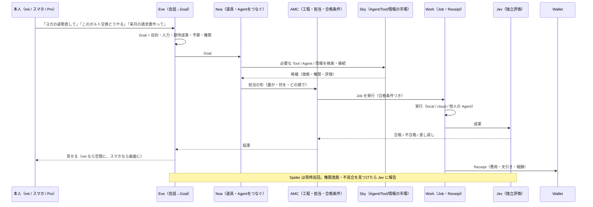

# 04 Eve → Noa → AMC → Jev、Sky、そしてサービス挙動の書き方（2026-11-02）

2026-11-20 専用の端末と画面: 本人指示により、Noah の行き先を「みんなが Agent を自分の専用の端末につないで使う。PC の前に座らない」に置く。主商品は mii、Noah はその最小構成で、最初は本人の Mac（裏で動く）、次に mii の Hub へ同じ契約を移す。他人が作った Agent は、画面と入力装置の無い専用の端末（家・手元。端末を持たない人には雲）か提供者のサーバーでだけ動かし、本人が使っている端末の画面・入力・ブラウザを使わせない。mii では、Agent に空間の表示・カメラ・マイクを直接渡さない。本人の端末そのものを操作する Agent は受けない。置き場所は機種の名前で書かず、ハードの差は hardware profile に置く。外の Agent は 1 件ずつ実行器を書かず、つなぎ方（口）ごとに取り込む。[全体の設計](../noah-design.md)、[詳細](../noah-agent-market-design.md)、[画面を取らない](../services/noah-screenless.md)、[専用の端末](../services/noah-own-device.md)、[取り込み](../services/noah-agent-intake.md)。設計まで。実装・契約・公開は変えていない。

2026-11-19 Noah単体ローンチ: 公開版の登録/公開/ライブラリをaccountへ統合し、本人が認証したMac runnerが外向きHTTPSで依頼を取得する。Webからlocalhostの公開bindを要求しない。対応済み固定adapterと審査済みNode/Python配布版を扱い、仕事は既存Work、審査は既存Package reviewを再利用する。停止は実行器の終了報告まで待ち、通信不明は停止済みにしない。[受入仕様](../services/noah-standalone-launch.md)。

2026-11-18 ヘッダー統一: NoahとEveは共通の上段アプリ切替（Noah / Eve）を使い、現在地のみ選択表示を変える。コミュニティーはNoah内の機能。Eveの仕事・接続・設定はアプリ内ナビゲーションとして保持し、本人確認や実行中の遷移制限を変えない。

2026-11-18 画面統合: `/noah`を唯一のタイムラインとし、既存のTool利用・購入・掲載/販売・担当設定・接続/端末・成果・クラウド設定を`/noah/features`から同じシェルで開く。旧`/sky`と`/os/sky`は対応するNoah画面へqueryを保持して移動する。API・認証・保存先・課金条件は変更しない。旧Agent設定は`/noah/saved`、外部Agentカタログは`/noah/agents`、Mac実行は既存の案内。ローカル実験は公開側で`/noah/local-tools`へ案内し、実験本体のhost制限を保持する。

2026-11-18 公開配信の修正: Sitesの静的ファイル優先配信に依存せず、正規asset URLはWorkerを通して共通ヘッダーを付ける。ビルド時に正規URLと内容hash付き保管URLの対応を固定し、HTML/SVGとservice workerはWorkerで返す。保管先は公開asset専用であり秘密の保管場所ではない。権限付きAPIやcookieを保管先へのリクエストへ転送しない。

2026-11-18 公開指示の更新: 統合タイムラインを既存avoado.siへ公開する。ドメイン直下はNoahへの入口にし、既存fragment/queryの共有導線を保持する。公開カタログと認証付き投稿の権限を区別し、管理/接続/実行/停止はMac版への案内を維持する。GitHubは作業branch/PRへ保存する。

2026-11-18 Noahの統一: ニュース、フォロー、投稿・共有、コミュニティーとAgent検索・分類・紹介を共通のOS画面にまとめる。Macでは本人のAgent登録・管理・対応Agentの接続・実行・停止へ進み、公開画面はMacへの案内を挟む。`/noah/public`は公開モードの確認用とし別製品にしない。既存の認証・投稿権限・公開範囲とWork/Broker/Walletを保持し、ニュースの閲覧やカタログ掲載を実行許可へ昇格させない。

2026-11-18 公開範囲の確定: 本人指示によりavoado.si向けNoahは準備まで。公開Site・ドメイン・main・本番DBを変更せず、ローカルで確認できる成果物として保持する。

2026-11-18 本人指定の `avoado.si/noah` に公開カタログ・検索・詳細を追加する。既存認証/DB/公開範囲を保ち、本人のAgent・Work・SSDデータを含めない。Macへの移動と未実装の認証付き遠隔実行を区別する。

## 1. 一周の流れ（公開入口は Eve と Noah）



| 役割 | 一言 | 持ってよいもの | 持ってはいけないもの |
| --- | --- | --- | --- |
| **Eve** | 本人と話し、Goal を作る | 会話文脈、Memory、本人の好み | 実行権限、お金 |
| **Noa** | Goal に対して道具・Agent・実行先をつないで「担当」を形にする（ノアの方舟＝全部を乗せて渡す） | Sky の検索、接続の提案 | 本人の承認なしの実行 |
| **AMC** | 工程に分解、担当・順序・合格条件を決め、進行を見る（Jennifer を吸収） | Job の発行、進捗、差し戻し | 評価の最終判断（Jev の仕事） |
| **Jev** | 成果を独立に評価。権限は持たない | 合格条件、過去の評価 | 実行、変更 |
| **Spider** | コード・接続先を巡回し、不具合と権限逸脱を探す | 読み取り | 書き込み |
| **Sky** | Agent・Tool・情報を見つけ、つなぐ場所。MCP / A2A / SDK | カタログ、価格、評価、手数料 | 本人の予算の決定 |
| **Broker** | 本人の承認・予算・端末権限を実行に渡す門番 | 承認、予算枠 | — |
| **Wallet** | 残高・予約・台帳・精算・天引き | お金 | 仕事の判断 |

**内部構造として AMC / Eve / Noa を一つに潰さない**（本人の指示）。公開UIでは Eve と Noah を表示し、NoahからEveへ選択したTool・記事・担当を渡す。ウェイクワードは「ヘイ、エヴァ」（議事録 10-27）。

注: 議事録 10-07 の「ジェニファーが最上位（データ許可）、下にプロジェクト管理・データ管理・データ探索の3人」は、この表では Jennifer＝AMC、3人＝AMC 内の役割（.codex/agents の amc / amc-worker / amc-reviewer）として読む。Jennifer を AMC に吸収するのは 2026-11-02 の整理での判断で、本人の確認待ち。

2026-11-04の本人指示により、ローカルAMCに[Goalから逆算する有限実行](../amc-goal-orchestrator.md#goalから逆算するローカル実行と再計画)を追加する。営業18役・開発21役は工程の担当候補で、32部隊の正本や本人権限を置き換えない。既存Goal reducerで前提・成果提出・実行者と異なる検収・最終OWNER受入を保持し、検収された安全な局所修正だけを元の条件と上限内で再計画する。Codex workerと別processのread-only検収はローカルadapterであり、本番Jev/Brokerの権限・課金・Web実行の受入とは分ける。

## 2. コードの対応（どこを直すか）

| 役割 | lib | app / api | 備考 |
| --- | --- | --- | --- |
| Eve | lib/eve-*.ts（11）, lib/zema-chat-session.ts | app/chat, app/zema, app/api/eve | zema-chat-session は Eve 配下へ（task 04） |
| Noa | lib/eve-agent-proposal.ts, eve-agent-creation.ts, eve-agent-origin.ts, components/eve-object-agent-creator.tsx | app/api/llm/local-agent | コード内の `smith` → `noa`（task 04） |
| AMC | lib/amc-*.ts, lib/jennifer-amc-*.ts, lib/jennifer-*.ts（7） | app/amc, app/api/amc, app/api/jennifer | jennifer-* を lib/amc/ に統合（task 23） |
| Jev | lib/jev-evaluation.ts, jev-transport.ts, android/jev-provider | app/api/jev-evaluation | — |
| Spider | lib/spider-*.ts, toolkits/spider-guard | — | .github/workflows/spider-codeql.yml |
| Sky | lib/sky-*.ts（104本） | app/sky, app/api/sky, services/sky-* | 104本は多い。lib/sky/ に機能別サブフォルダ化（task 26） |
| Work | lib/work-*.ts, lib/workflow.ts | app/work, app/api/work-jobs, app/api/jobs | — |
| Broker | lib/a2a-broker-*.ts, lib/agent-control-plane.ts | app/api/agent-control-plane | — |
| Wallet | lib/wallet*.ts, lib/settlement.ts | app/wallet, app/api/wallet, app/api/earnings, services/sky-billing | — |

## 3. サービス挙動の書き方（これが「書式」）

新しいサービス（ヨガ矯正、工場保守、請求書作成、遠隔ツイスター…）を足すときは、**コードより先に** `docs/services/<name>.md` を1枚書く。項目は固定:

```markdown
# <サービス名>
- 本人が言う一言: 「…」
- Goal（Eveが作る）: 目的 / 入力 / 期待成果 / 予算上限 / 要る権限
- Noaがつなぐもの: Tool / Agent / 情報（Skyの何を使うか。無ければ「新規Agent: …」）
- AMCの工程: 1. … 2. … 3. …（各工程に担当と合格条件）
- Jevの合格条件: 数値で書けるものは数値（例: 姿勢誤差 < 5°、請求額の検算一致）
- 出力先: mii（空間のどこに） / スマホ（画面） / ファイル
- Wallet: 費用（誰に）/ 天引き率 / 無料か
- hardware profile 依存: mii のみ / phone でも可 / 全部
- 失敗時: 差し戻し先と本人への見せ方
- 記録: Receipt に残すもの（誰が・いつ・何を）
```

ルール:
1. 1サービス = 1枚。100行以内。
2. mii 専用にしない。「phone でも可」を必ず検討する（画面で代替できるなら可）。
3. 課金は Wallet の既存契約（earnings 天引き / 月額 / 都度）から選ぶ。新しい課金型を作らない。
4. 合格条件が書けないサービスは作らない（Jev が評価できない）。
5. 書式を満たしたら Codex task 1件 = 実装。

## 4. Sky の位置

- Sky は「市場」であり、Noa の検索先。手数料は 05-business.md（当面 0〜低率、まず流通量）。
- 他人の Agent を使うときの権限は Broker が本人に確認。Sky は価格と評価だけ出す。
- MCP / A2A / SDK は Sky の接続口。toolkits/, services/sky-agent-runtime, systems/rock-star-os/docs/TOOL-SDK.md が実体。

## 5. 組合せの決め方と会社受注（2026-11-15）

利用者像はかいや。受入条件は「めんどくさい、と言った後に、誰かが裏でツールを選び・指示を訳し・進捗を追わなくても成果が出る」。全体は [sky-work-loop.md](../sky-work-loop.md)。

| 何を決めるか | 誰が | コード | 決め方 |
| --- | --- | --- | --- |
| どの工程で作るか | Noa | lib/sky-recipe-planner.ts | 手元の素材から成果までの工程を列挙し、「検収に通る成果1つあたりの期待総額」が最小のものを選ぶ。実績は Jev の検収結果 |
| 自動化を作るか | Noa | 同上 | 初回準備を、その仕事が起きる回数で割って比べる。1回きりなら手でやる工程が選ばれる |
| 本人に何を残すか | Eve | RecipeGoal.keepForSelf | 本人が「自分でやりたい」と言った成果の型だけ。そこは自動処理に置き換えない |
| どこで実行してよいか | AMC | lib/sky-company-order.ts | AI不可・未確認は受けない。個人情報・秘密、持ち出しの承諾なしは会社の管理下だけ |
| どの募集に応募するか | AMC | lib/sky-gig-desk.ts、lib/sky-gig-offers.ts | lane runner が読んだ募集を、売れる型・予算・納期・AI可否・採用率で決め、lane へ決定を返す。送信は自動が初期値 |
| どの計算機で動かすか | Noa | lib/sky-device-tiers.ts | 依頼者の秘密は会社側だけ。それ以外は、こなせる中で最も安い所。参加者の端末は複数台の一致で検証 |
| 人の確認を誰に頼むか | AMC | 同上 | 30秒・2〜4択の問いにして、引き受けの少ない人から配る。同じ問いを同じ人に二度渡さない |
| お金をどう分けるか | Wallet | 同上 | 作業料（単価×検収量）と配当（入金済み余剰の一部を等分）。計算だけで、記帳・送金はしない |

- planner と分配の計算は順位と金額を出すだけ。実行・課金・送金の許可は Broker / Wallet / 本人のまま。
- lib/sky-routing.ts（正規表現で 13 役へ振り分け）は、planner が候補を出せない依頼の受け皿として残す（task 33）。
- サービスの書式は [services/company-order.md](../services/company-order.md) と [services/gig-desk.md](../services/gig-desk.md)。

## Eve News のローカル下書き補助

`toolkits/eve-news/` は出典packetからローカルOllamaの下書きを作る既存公開系統の補助CLI。`draft.mjs` は入力・出力schemaと実行前後のモデルdigestを検証し、不一致は失敗にする。`news-core.mjs` はWebと同じ根拠制約を共有する。モデルの文章を事実・公開承認・仕事の成功へ昇格させず、出典と未検証箇所を保持してEveへ渡す。実行には本人端末のモデル設定が必要で、今回のmain統合は新規ダウンロードや外部送信を実行しない。検証は `tests/eve-news-core.test.mjs` と関連 `tests/eve-news-*.test.mjs`。

## Noahの本人用リセール

[toolkits/noah-resale-agent/](../../toolkits/noah-resale-agent/)は本人用CLI。Webはlocalhost限定。既存WorkのCASと予算予約を使い、初期予算0・外部接続未受入を保持する。[実行契約](../services/noah-select-resale.md)。

Noah移行の互換ToolKit: `toolkits/noah-agent-operations/` は既存の実行テンプレート集合、`toolkits/noah-vscode/` は保存時整理の補助。単体ローンチの実行器は `scripts/noah-mac-runner.mjs`、導入は `scripts/noah-mac-install.mjs`、配布生成は `scripts/package-noah-mac.mjs`。
