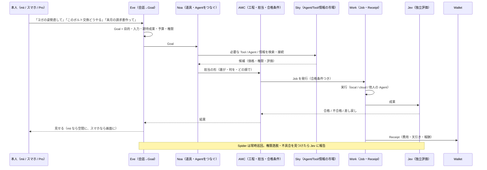

# 04 Eve → Noa → AMC → Jev、Sky、そしてサービス挙動の書き方（2026-11-02）

## 1. 一周の流れ（ユーザーには Eve しか見えない）



| 役割 | 一言 | 持ってよいもの | 持ってはいけないもの |
| --- | --- | --- | --- |
| **Eve** | 本人と話し、Goal を作る | 会話文脈、Memory、本人の好み | 実行権限、お金 |
| **Noa** | Goal に対して道具・Agent・実行先をつないで「担当」を形にする（ノアの方舟＝全部を乗せて渡す） | Sky の検索、接続の提案 | 本人の承認なしの実行 |
| **AMC** | 工程に分解、担当・順序・合格条件を決め、進行を見る（Jennifer を吸収） | Job の発行、進捗、差し戻し | 評価の最終判断（Jev の仕事） |
| **Jev** | 成果を独立に評価。権限は持たない | 合格条件、過去の評価 | 実行、変更 |
| **Spider** | コード・接続先を巡回し、不具合と権限逸脱を探す | 読み取り | 書き込み |
| **Sky** | Agent・Tool・情報を見つけ、つなぐ場所。MCP / A2A / SDK | カタログ、価格、評価、手数料 | 本人の予算の決定 |
| **Broker** | 本人の承認・予算・端末権限を実行に渡す門番 | 承認、予算枠 | — |
| **Wallet** | 残高・予約・台帳・精算・天引き | お金 | 仕事の判断 |

**内部構造として AMC / Eve / Noa を一つに潰さない**（本人の指示）。ユーザーに見せる名前だけ Eve に揃える。ウェイクワードは「ヘイ、エヴァ」（議事録 10-27）。

注: 議事録 10-07 の「ジェニファーが最上位（データ許可）、下にプロジェクト管理・データ管理・データ探索の3人」は、この表では Jennifer＝AMC、3人＝AMC 内の役割（.codex/agents の amc / amc-worker / amc-reviewer）として読む。Jennifer を AMC に吸収するのは 2026-11-02 の整理での判断で、本人の確認待ち。

## 2. コードの対応（どこを直すか）

| 役割 | lib | app / api | 備考 |
| --- | --- | --- | --- |
| Eve | lib/eve-*.ts（11）, lib/zema-chat-session.ts | app/chat, app/zema, app/api/eve | zema-chat-session は Eve 配下へ（task 04） |
| Noa | lib/eve-agent-proposal.ts, eve-agent-creation.ts, eve-agent-origin.ts, components/eve-object-agent-creator.tsx | app/api/llm/local-agent | コード内の `smith` → `noa`（task 04） |
| AMC | lib/amc-*.ts, lib/jennifer-amc-*.ts, lib/jennifer-*.ts（7） | app/amc, app/api/amc, app/api/jennifer | jennifer-* を lib/amc/ に統合（task 23） |
| Jev | lib/jev-evaluation.ts, jev-transport.ts, android/jev-provider | app/api/jev-evaluation | — |
| Spider | lib/spider-*.ts, toolkits/spider-guard | — | .github/workflows/spider-codeql.yml |
| Sky | lib/sky-*.ts（104本） | app/sky, app/api/sky, services/sky-* | 104本は多い。lib/sky/ に機能別サブフォルダ化（task 26） |
| Work | lib/work-*.ts, lib/workflow.ts | app/work, app/api/work-jobs, app/api/jobs | — |
| Broker | lib/a2a-broker-*.ts, lib/agent-control-plane.ts | app/api/agent-control-plane | — |
| Wallet | lib/wallet*.ts, lib/settlement.ts | app/wallet, app/api/wallet, app/api/earnings, services/sky-billing | — |

## 3. サービス挙動の書き方（これが「書式」）

新しいサービス（ヨガ矯正、工場保守、請求書作成、遠隔ツイスター…）を足すときは、**コードより先に** `docs/services/<name>.md` を1枚書く。項目は固定:

```markdown
# <サービス名>
- 本人が言う一言: 「…」
- Goal（Eveが作る）: 目的 / 入力 / 期待成果 / 予算上限 / 要る権限
- Noaがつなぐもの: Tool / Agent / 情報（Skyの何を使うか。無ければ「新規Agent: …」）
- AMCの工程: 1. … 2. … 3. …（各工程に担当と合格条件）
- Jevの合格条件: 数値で書けるものは数値（例: 姿勢誤差 < 5°、請求額の検算一致）
- 出力先: mii（空間のどこに） / スマホ（画面） / ファイル
- Wallet: 費用（誰に）/ 天引き率 / 無料か
- hardware profile 依存: mii のみ / phone でも可 / 全部
- 失敗時: 差し戻し先と本人への見せ方
- 記録: Receipt に残すもの（誰が・いつ・何を）
```

ルール:
1. 1サービス = 1枚。100行以内。
2. mii 専用にしない。「phone でも可」を必ず検討する（画面で代替できるなら可）。
3. 課金は Wallet の既存契約（earnings 天引き / 月額 / 都度）から選ぶ。新しい課金型を作らない。
4. 合格条件が書けないサービスは作らない（Jev が評価できない）。
5. 書式を満たしたら Codex task 1件 = 実装。

## 4. Sky の位置

- Sky は「市場」であり、Noa の検索先。手数料は 05-business.md（当面 0〜低率、まず流通量）。
- 他人の Agent を使うときの権限は Broker が本人に確認。Sky は価格と評価だけ出す。
- MCP / A2A / SDK は Sky の接続口。toolkits/, services/sky-agent-runtime, systems/rock-star-os/docs/TOOL-SDK.md が実体。
