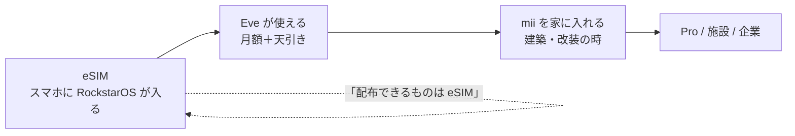

# 05 収益と計画 — 何で稼ぎ、1ヶ月・1年で何をするか（2026-11-02）

議事録の最新結論を優先。古い結論（例: 9月の「GB付きeSIM」「三万人無料配布を主軸」）は 07-decisions-from-minutes.md に残し、ここでは採らない。

## 1. 収益の柱（優先順）

| # | 柱 | 何を売るか | 価格の候補 | 実装 | 状態 |
| --- | --- | --- | --- | --- | --- |
| 1 | **eSIM 月額** | RockstarOS の回線付き利用権。GB は売らない | 日本 ¥800 前後の月額固定（10-10）。米国はドル建て候補。旧 $8.88 は 09-22 に廃止。カード・口座引落し | services/sky-billing, lib/rockstar-service-setup-billing.ts, Stripe | 骨格あり。provider 契約が要る（03-esim.md） |
| 2 | **仕事からの天引き** | Eve/Sky 経由で本人が稼いだ分の一定率 | 率は Wallet の earnings 契約（既存）。回線料と同じ明細 | lib/wallet*.ts, lib/settlement.ts, app/api/earnings | 実装あり |
| 3 | **mii ハード** | 建築に埋め込む端末（Column / Puck / Slot ＋ Hub） | 議事録最新は mii ¥160,000 / Pro ¥800,000（10-16）。設計書・3Dチャットの ¥410,000 は旧値→ **未決**（07 参照）。原価は後で | docs/avocado-mini-r5, 01-mii.md | 設計中。原価は task 20 |
| 4 | **Sky** | 利用者の月額（10-16: ¥600 候補）。開発者からは手数料を取らない（10-07/10-10） | ¥600 月額候補。手数料 0 | lib/sky-*.ts, services/sky-billing | 実装あり |
| 5 | **企業・施設向け** | 工場研修、医学部教材、建築への標準装備（PDF の路線） | 施設単位のライセンス | Wallet のライセンス型 | 未着手 |
| — | データ販売 | **しない**（今は）。将来の option | — | — | — |

「解約しにくい」は内部の見通しであり、売り文句にしない。UI と広告は「いつでも解約できる」を明記（03-esim.md §7）。

## 2. 顧客の入口（配布できるもの）

- **入口は eSIM 一本。** 3万人無料配布（10-10）は「ソフトは無料で配る、ハードは配らない」の意味で維持。配る実体は eSIM。
- 足りない分はデータのマネタイズで回収（10-10）とあるが、本人の最新指示（11-02）で「データ販売は今はしない」。07 の未決に残す。
- mii は「eSIM で Eve を使っている人が、家を建てる・改装するとき」に入る。PDF Issue01 の建築雑誌路線はこれ。

## 3. 1ヶ月計画（2026-11）

| 週 | やること | 完了条件 | 担当 |
| --- | --- | --- | --- |
| 1 | この構造整理の PR を main に入れる。Codex task 01/02（archive・verify 短縮） | `npm run verify` が typecheck+lint+product tests で 5分以内 | Noelle + Codex |
| 1–2 | eSIM: esim-go sandbox で「QR/universal link → Eve が開く → account 束縛」を通す（task 11） | 自分のスマホで一周できる | Codex |
| 2 | eSIM provider RFQ 質問票（task 10）を本人が 3〜5社へ送る | 返答が 1 社以上 | Noelle |
| 2–3 | 名前の統一 task 03（表示）→ 04（識別子） | rg で旧名ゼロ | Codex |
| 3 | mii Gen1 試作の構成確定: 1 プロジェクター＋1 壁＋頭追跡（task 21） | 部品リストと購入 | Kaiya + Codex |
| 3–4 | Stripe 月額 → 未払い停止の流れ（task 11 後半） | テスト決済で entitlement が止まる | Codex |
| 4 | サービス書式（04 §3）で最初の 3 サービスを書く: ヨガ矯正 / 工場保守ガイド / 請求書作成 | docs/services/ に 3 枚 | Noelle |

## 4. 1年計画（2026-11 → 2027-10）

| 四半期 | 製品 | 事業 |
| --- | --- | --- |
| Q1（11–1月） | eSIM 稼働（esim-go 暫定）。Eve のスマホ体験を 1 本に。mii Gen1 試作（運動視差） | provider 契約。月額課金開始。最初の有料ユーザー（自分たち＋知人） |
| Q2（2–4月） | ARF 対応 provider へ切替、Android 自動導入。mii Gen1 の 4 Tower キャリブレーション | 電気通信事業届出。Sky に最初の外部 Agent |
| Q3（5–7月） | mii Gen1 を 1 軒の建築に埋め込む（PDF の実例を 1 つ作る）。hardware profile phone/pro | 建築家・ビルダー 1 社と組む。企業研修の PoC 1 件 |
| Q4（8–10月） | mii Gen2（Hybrid AIRR）の設計開始。Pro との基板共通化 | mii の受注（ロット単価は task 20 の結果で） |

## 5. 数字の置き方（Codex が勝手に変えない）

- 月額 ¥800、Sky ¥600、mii ¥160,000（旧 ¥410,000）は**候補**。変えるときは本人が 07 の決定表に日付を足す。
- 原価・工場・ロット単価は「後」。task 20 は**調べて表にするだけ**で、価格を決めない。
