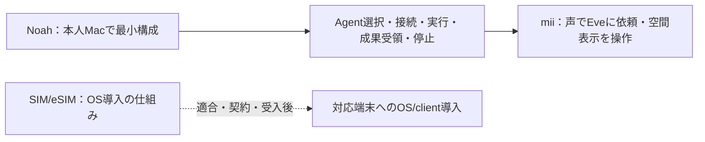

# 05 収益候補と検証の順序

現在の製品優先順位は[00 全体像](00-overview.md#1-一言で)を正本とする。主商品miiへ進む最小構成として、本人MacのNoahを先に受け入れる。以下の金額・収益は候補であり、新たな価格決定・課金開始・収益の証明ではない。

## 1. 収益の候補（列順は優先順位ではない）

| # | 柱 | 何を売るか | 価格の候補 | 実装 | 状態 |
| --- | --- | --- | --- | --- | --- |
| 1 | **eSIM 月額** | RockstarOS の回線付き利用権。GB は売らない | 日本 ¥800 前後、米国 $8.88 を含む月額候補。採用・変更は本人が決める。カード・口座引落し | services/sky-billing, lib/rockstar-service-setup-billing.ts, Stripe | 骨格あり。provider 契約が要る（03-esim.md） |（2026-11-21: スマホ（今の回線の横に入る 2 本目）と、mii の Hub・専用端末・車の回線の両方。端末の回線は機器のサービス料に含める。03 の 0 章）（2026-11-25 の会話「別に1円もお金取らんと」と食い違う。07 の未決）
| 2 | **仕事からの天引き** | Eve/Sky 経由で本人が稼いだ分の一定率 | 率は Wallet の earnings 契約（既存）。回線料と同じ明細 | lib/wallet*.ts, lib/settlement.ts, app/api/earnings | 実装あり |
| 3 | **mii ハード** | 建築に埋め込む端末（Column / Puck / Slot ＋ Hub） | 議事録最新は mii ¥160,000 / Pro ¥800,000（10-16）。設計書・3Dチャットの ¥410,000 は旧値→ **未決**（07 参照）。原価は後で | docs/avocado-mini-r5, 01-mii.md | 設計中。原価は task 20 |
| 4 | **Sky** | 利用者の月額（10-16: ¥600 候補）。開発者からは手数料を取らない（10-07/10-10） | ¥600 月額候補。手数料 0 | lib/sky-*.ts, services/sky-billing | 実装あり |
| 5 | **企業・施設向け** | 工場研修、医学部教材、建築への標準装備（PDF の路線） | 施設単位のライセンス | Wallet のライセンス型 | 未着手 |
| 6 | **安全の早期発見**（2026-11-25 の会話。候補） | 国・警察・学校へ、危険な物を作ろうとする依頼に事件の前に気づく仕組みと、人の確認の運用。データそのものは売らない | 未定（先方の予算。「どのぐらいまで出せそうですか」と先に聞く） | [services/noah-safety-early-warning.md](../services/noah-safety-early-warning.md)（下書き） | 未着手。通信の秘密・個人情報の決まりの中で作る |
| — | データ販売 | **しない**（今は）。将来の option。2026-11-25 の会話で「データはキープしたまま売る」（会社を売る時も手元に残す）と、6 の案が出た（07 の未決） | — | — | — |

「解約しにくい」は内部の見通しであり、売り文句にしない。UI と広告は「いつでも解約できる」を明記（03-esim.md §7）。

計算の原価と、サーバーを持つ時機は [compute-placement.md](../compute-placement.md)（2026-11-21）。1 人月 45〜60 円で、月額の 1 割以下に保つ。

## 2. 現在の入口と検証順

- 最初の合格条件と残件は[Noah単体ローンチ](../services/noah-standalone-launch.md)へ集約する。Noahの利用開始にSIM購入やmii購入を要求しない。
- その後、miiの音声・表示・操作を同じ仕事へつなぐ。発売日・販売条件・有料顧客像は未確定。
- SIM/eSIMは[03](03-esim.md)の導入系統。provider契約・回線・課金の実受入は個別に行う。
- データ販売を今回の収益源へ追加しない。

以下の月次・年次表は**2026-11-02時点の検討履歴**。今の作業順・約束した納期・実施許可として使わない。現在の着手順は上記と[task一覧](../../codex/tasks/00-index.md)で確認する。

## 3. 以前の1ヶ月案（2026-11-02時点・履歴）

| 週 | やること | 完了条件 | 担当 |
| --- | --- | --- | --- |
| 1 | この構造整理の PR を main に入れる。Codex task 01/02（archive・verify 短縮） | `npm run verify` が typecheck+lint+product tests で 5分以内 | Noelle + Codex |
| 1–2 | eSIM: esim-go sandbox で「QR/universal link → Eve が開く → account 束縛」を通す（task 11） | 自分のスマホで一周できる | Codex |
| 2 | eSIM provider RFQ 質問票（task 10）を本人が 3〜5社へ送る | 返答が 1 社以上 | Noelle |
| 2–3 | 名前の統一 task 03（表示）→ 04（識別子） | rg で旧名ゼロ | Codex |
| 3 | mii Gen1 試作の構成確定: 1 プロジェクター＋1 壁＋頭追跡（task 21） | 部品リストと購入 | Kaiya + Codex |
| 3–4 | Stripe 月額 → 未払い停止の流れ（task 11 後半） | テスト決済で entitlement が止まる | Codex |
| 4 | サービス書式（04 §3）で最初の 3 サービスを書く: ヨガ矯正 / 工場保守ガイド / 請求書作成 | docs/services/ に 3 枚 | Noelle |

## 4. 以前の1年案（2026-11-02時点・履歴）

| 四半期 | 製品 | 事業 |
| --- | --- | --- |
| Q1（11–1月） | eSIM 稼働（esim-go 暫定）。Eve のスマホ体験を 1 本に。mii Gen1 試作（運動視差） | provider 契約。月額課金開始。最初の有料ユーザー（自分たち＋知人） |
| Q2（2–4月） | ARF 対応 provider へ切替、Android 自動導入。mii Gen1 の 4 Tower キャリブレーション | 電気通信事業届出。Sky に最初の外部 Agent |
| Q3（5–7月） | mii Gen1 を 1 軒の建築に埋め込む（PDF の実例を 1 つ作る）。hardware profile phone/pro | 建築家・ビルダー 1 社と組む。企業研修の PoC 1 件 |
| Q4（8–10月） | mii Gen2（Hybrid AIRR）の設計開始。Pro との基板共通化 | mii の受注（ロット単価は task 20 の結果で） |

## 5. 数字の置き方（Codex が勝手に変えない）

- 月額 ¥800、Sky ¥600、mii ¥160,000（旧 ¥410,000）は**候補**。変えるときは本人が 07 の決定表に日付を足す。
- 原価・工場・ロット単価は「後」。task 20 は**調べて表にするだけ**で、価格を決めない。

## 6. 出口・組織・時間（2026-11-25 の会話。決定ではない）

ノエルとかいやの会話（本人が貼った書き起こし）から。数字は目標として話した物で、計画の数字ではない。5 章のとおり、Codex はこの数字を価格や計画に使わない。

| 事 | 会話の言葉 |
| --- | --- |
| 売値の決まり方 | 「売却するときに、値段が上がりやすいのってさ、やっぱストック収入があるかどうか」。その利益が「どれだけ硬いか」 |
| 目標の数字 | 「1年後にちゃんと8億っていう利益を見込めるか」（月 8 億。年約 100 億）。AI なら利益の 10 倍。「1、2年で1000億で売れたら」。国に事業を渡して 3000 億を上の 5 人で分ける構想 |
| データ | 「データはキープしたまま売る」。「データは日本のもの。日本が大事ってのは変わらん」 |
| 売り先 | 基本は海外（アメリカ）で考える。「別に国に対してもセールスかけれるぐらいの感じで」事業設計を組む |
| 組織 | 日本で会社にするかは「考え中」。上は 5 人。少人数とほとんど AI で動く会社の例になりたい気持ちと、国と仕事する大企業になりたい気持ちの両方。外国人を日本に呼んで雇いたい（日本の食材・昼の寿司の例）。社員を沢山抱えたい気持ちは無い |
| 時間 | 「希望は3年」（話し手の学部生のうちに） |

**配る率との関係。** 定期便は、会社が回す Agent の売上から費用を引いた残り（余剰）の 75% を利用者へ回す（07 の 2026-11-24）。会社に残るのは 25% なので、ストック収入（会社の利益）は余剰の 4 分の 1 になる。

| 会社の利益（月） | 要る余剰（月） | 利用者へ回る額（月） |
| --- | --- | --- |
| 8 億円 | 32 億円 | 24 億円 |
| 1 億円 | 4 億円 | 3 億円 |

今の実例の売上は月 39,500 円（[trial-300-profit](../noah/trial-300-profit.md)）。配る率を決める時は、売値と一緒に決める（07 の未決「配る率と売値」）。

## 7. 先の事業の構想（2026-11-25 の会話。決定ではない）

今の作業順（[00](00-overview.md) の 1 章と 2 章の検証順）は変えない。残しておく構想として書く。

- **没入する映像（mii の先）。** 生成した動画の世界観に、リアルタイムで入り込む。そのための動画を集めるゲーム。[01 の 8 章](01-mii.md#8-先の構想2026-11-25-の会話決定ではない)。
- **エネルギー事業。** 次にやりたい事。量子コンピューターも手に入れたい。売った後のお金を 2 人で合わせて投じる案。目安は 4 年後で、「今から種まいときたい」。原子力は国の許可が要る事業で、ロシアとの取引は今は制裁で多くが止まっている（どちらも確かめていない。始める前に調べる）。
- **ファッション。** 「ファッションのこととかもしたい」。

## パッケージとeSIMの料金案

2026年11月26日。検討する組み合わせは「月額800円のeSIMで標準5件のAgentを接続」「Proは18件を接続」。Proの料金と共用Agentの枠の数え方は未定。既存のNoahのカード枠や、月の余剰からの条件付き差し引きと、eSIMの契約料金は別に管理する。パッケージを選ぶときは、同じ版を利用した人の確定手取り、または運営が収益を管理できる場合の定期便の内容・配達回数を月単位で示す。対象期間・人数・0件の月・未確定分も表示する。[集計方法と料金案の比較](../noah/spec-110-shelf.md#パッケージの開始と月間成果)

## Agentの開発資金と農家への継続発注（2026-11-26 構想）

Eveで作るAgentの組み合わせごとに、実際に受注できる仕事、稼働できる量、入金と費用をもとに見込みを計算する。比較用の試算を先に作る。運営主体、資金の保管、契約、損失負担が決まった段階で、個人・法人からの出資を扱う案を検討する。開発者への制作費・作者分、出資者の分配請求権、Noahの全員向け定期便にはそれぞれ別の原資と受取条件を記録する。農家への支払いと地域への配給は継続事業に位置づける。上のeSIM料金案とAgent接続件数から運用利回りを計算することはできない。[現在の実装、資金の流れ、段階別の受入条件](../services/eve-noah-agent-fund.md)
